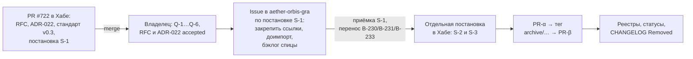

# Независимая экспертиза диалога о приёмке PR #722

## Роль эксперта и ограничение независимости

**Роль:** ревьюер управления изменениями и выпуском в docs-as-code и выноса
репозитория. Это проверяющий, который сверяет каждое утверждение с деревом,
историей git и решениями обоих репозиториев. Курс он по существу не оценивает.

Роль выбрана, потому что вопрос диалога — не качество промптов курса, а
**что меняет PR, в каком репозитории и в каком порядке**. Методист курса здесь
не нужен: PR #722 не содержит ни одного файла курса (C-1).

**Ограничение независимости.** Экспертизу выполнил ИИ-агент того же семейства,
что и автор PR. Поэтому выводы опираются не на мнение, а на повторяемые
проверки: [`dialog-review-checks.sh`](../../research/hub/exp/gra-extraction-cleanup-721/dialog-review-checks.sh)
и его [журнал](../../research/hub/exp/gra-extraction-cleanup-721/dialog-review-checks.log).
Каждый вердикт ниже ссылается на номер проверки C-1…C-8. Владелец может
перезапустить сценарий и получить те же числа.

## Короткий ответ

1. **Первый вердикт ИИ («PR #722 выполнен корректно…», вопросы А, Б, В) —
   опровергнут.** Он описывает не этот PR. Файлов `day1-framer.md` и
   `day2-scout.md` нет ни в Хабе, ни в его истории, ни в репозиториях владельца
   (C-2, C-3). PR #710 — карта компаний, а не «предыдущая версия» (C-4).
2. **Правило владельца «запрещено изменение документов к курсу или к технологии»
   — подтверждено как правило.** PR #722 его **не нарушает**: в домене курса
   0 изменённых файлов из 28 (C-1).
3. **Последовательность владельца — подтверждена.** Сначала постановка на
   копирование в спицу со ссылкой на Хаб, потом план архивации, и только потом
   отдельная постановка на очистку Хаба. RFC уже строит порядок так. Экспертиза
   нашла два пробела и закрыла их в версии RFC 0.2 (раздел «Что изменено в PR»).
4. **Поправка ИИ ко второй реплике владельца — в основном опровергнута.** Верно
   только то, что нельзя смешивать работу в спице и удаление в Хабе в одном PR.
   Остальное противоречит решениям спицы и фактам: Хаб не SSOT курса, архив
   папкой `_archive/` ломает ссылки, «все изменения в Хабе запрещены» — это
   больше, чем нужно.
5. **Рекомендация: мержить** PR #722 после этой правки. Обоснование — в
   последнем разделе.

## Проверки

| ID | Что проверяется | Результат | Источник |
| --- | --- | --- | --- |
| C-1 | Файлы PR против `origin/main` | 28 файлов (с этой экспертизой), из них в `research/reputation-technologies/` — 0 | `git diff --name-only` |
| C-2 | `day1-framer` / `day2-scout` в Хабе | дерево: 0; вся история: 0 | `git ls-files`, `git log --all --name-only` |
| C-3 | Те же имена в коде владельца на GitHub | `day1-framer`: 0, `day2-scout`: 0 | `gh search code --owner G-Ivan-A` |
| C-4 | Что такое PR #710 и PR #722 | #710 (merged 2026-10-30): «каркас карты компаний и проверяемый экспорт графа»; #722: RFC выноса GRA, ADR-022, стандарт v0.3 | `gh pr view` |
| C-5 | Офлайн-режим и контакты в действующем материале дня 1 | 4 совпадения: строки 14, 69, 87, 193 файла `2026-10-30-day1-osint-pipeline-design.md` | `grep` |
| C-6 | Спица: HEAD, снимок импорта, решения ADR-001 | HEAD `1669943`; `last_sync.hub_commit` = `32b5fa5`; ADR-001, п. 1, п. 2 и последствие «Изменения материалов курса и модели теперь вносятся только здесь» | клон спицы, `python3 -I` |
| C-7 | Коммиты в домене после снимков | после `c06075d` (база RFC): 0; после `32b5fa5` (снимок спицы): 5, все — #711 (документ цитат) | `git log` |
| C-8 | Повтор инвентаря на ветке PR | диспозиции 81 строки совпадают с `gra-inventory.tsv`; у 3 строк изменились только счётчики входящих ссылок: новые документы #721 упоминают эти единицы | `gra-inventory.py` |

## Разбор утверждений диалога

### Первая реплика ИИ: вердикт по PR #722

| # | Утверждение | Вердикт | Доказательство |
| --- | --- | --- | --- |
| D-1 | «PR #722 выполнен корректно и соответствует методологии GRA», проверены «файлы промптов» | **Опровергнуто** | PR #722 состоит из RFC, ADR, стандарта, двух анализов, бэклога, реестров и evidence (C-1). Промптов в нём нет |
| D-2 | «Конард исправил критические ошибки предыдущей версии (#710)» | **Опровергнуто** | #710 — карта компаний (C-4), к GRA-промптам отношения не имеет |
| D-3 | «Файлы `day1-framer.md` и `day2-scout.md` теперь полностью независимы», JSON удалён, введены сноски | **Опровергнуто** | Файлов нет нигде (C-2, C-3). Ассистент описывает материал, которого не видел. Это галлюцинация проверки, а не ошибка PR |
| D-4 | Вопрос А: добавить в день 1 запрет выдумывать URL без веба | **Опровергнуто для PR, по существу уже сделано** | Действующий материал дня 1 уже содержит: «без него — запросы для ручного списка, никаких названий из памяти» (стр. 14), «несуществующий домен не конструируется» (стр. 87), «запрет выдуманных URL» (стр. 193) (C-5) |
| D-5 | Вопрос Б: запретить генерацию личных email | **Опровергнуто для PR, по существу уже сделано** | «ФИО и email не выводятся из шаблонов» (стр. 69, C-5) |
| D-6 | Вопрос В: Промпт-фильтр дня 3 — в отдельном PR? | **Вне предмета PR** | Промпт-фильтр уже существует (приложение А сценария дня 3) и уже скопирован в спицу: `education/technograd-reputation-engineering/day-03/lecturer-script.md`, стр. 26. Новые изменения курса — только в спице (ADR-001 спицы, C-6) |
| D-7 | «Approve with minor comments; внести правки А и Б в течение часа; потом мержить» | **Опровергнуто** | Правки А и Б в Хабе означали бы изменение документа курса — ровно то, что владелец запретил и что ADR-001 спицы переносит в спицу. Внесение их в PR #722 было бы ошибкой |

Вывод по первой реплике: принимать её за ревью нельзя. Она не проверяла
репозиторий, хотя утверждает обратное. Владелец справедливо её остановил.

### Вторая реплика владельца: правило и порядок

| # | Утверждение владельца | Вердикт | Доказательство и уточнение |
| --- | --- | --- | --- |
| O-1 | «Критическая ошибка исполнения: запрещено изменение документов к курсу или к технологии» | **Подтверждено как правило; к PR #722 не относится** | Правило записано в трёх местах: ADR-001 спицы («изменения материалов курса и модели теперь вносятся только здесь»), Non-goals RFC («Перемещения и удаления файлов домена нет», «Спица не изменяется», «Курс не перерабатывается») и ADR-010, Принцип 2, п. 4. В PR 0 файлов курса (C-1). Изменённый `standards/artifact-deprecation-standard.md` — норма управления Хабом, которую просит issue («стандарт + ADR»), а не документ курса или технологии GRA. Он остаётся `draft` до принятия ADR-022 |
| O-2 | Цель — вывести проект из Хаба в `aether-orbis-gra` | **Подтверждено** | Постановка #721; ADR-001 спицы, п. 1 |
| O-3 | Сейчас нужен RFC на финализацию копирования в спицу | **Подтверждено; RFC есть в этом PR** | Шаг 2 RFC — предусловия в спице; сверка полноты (F-2) называет остаток: документ цитат (после снимка `32b5fa5`, C-7), провенанс `exp/quotes-711/`, источники #650 при ответе Q-3 «перенести», три задачи Спринта 29 |
| O-4 | Задача на копирование выставляется в `aether-orbis-gra` со ссылкой на постановку, заданную в Хабе | **Подтверждено** | Так устроен черновик S-1 (репозиторий `aether-orbis-gra`, родитель #721). Пробел: в версии 0.1 у S-1 была только строка таблицы, а не текст, который можно вставить в issue. Закрыто в RFC 0.2 — раздел «Постановка S-1 для `aether-orbis-gra`» |
| O-5 | Потом предусмотреть все действия по архивации и очистке: явная архивация вне действующих каталогов, со статусами | **Подтверждено; предусмотрено** | Шаги 4–6 RFC и ADR-022: архив — защищённый тег `archive/reputation-technologies-2026-11`, в дереве остаётся только README-надгробие с манифестом и статусом; записи `path_migrations`; запись `Removed` в CHANGELOG |
| O-6 | «И только тогда ОТДЕЛЬНАЯ постановка задачи на выполнение оптимизации Хаба» | **Подтверждено; уточнено в RFC 0.2** | В версии 0.1 шаг 5 уже зависел от шага 2, но Ш1.3 создавал S-1…S-4 одновременно. Теперь S-2 и S-3 (очистка Хаба) выставляются отдельной постановкой только после приёмки S-1 и переноса задач (B-286), а шаг 4 зависит от шага 2 |

**Ответ на «Если не прав, исправьте меня»:** владелец прав в обоих пунктах.
Нужны две оговорки, обе не меняют его порядок:

- запрет действует на **документы курса и модели GRA**, а не на нормы
  Хаба. Стандарт выбытия, ADR-022, RFC и бэклог — это и есть «постановка,
  оформленная в Хабе», на которую сошлётся задача в спице. Без них ссылаться
  не на что;
- замораживается **домен** `research/reputation-technologies/`, а не весь Хаб.
  Полная заморозка Хаба невозможна, это сказано в issue. Параллельная работа
  (PR #718, #720) продолжается и домен не затрагивает (C-7: 0 коммитов в
  домене после базы RFC).

### Третья реплика ИИ: «поправка» к владельцу

| # | Утверждение | Вердикт | Доказательство |
| --- | --- | --- | --- |
| A-1 | «Хаб — SSOT методологии GRA и курса; AetherOrbis-GRA — потребитель, реализующий пайплайн сбора данных» | **Опровергнуто** | ADR-001 спицы, п. 1: «Репозиторий `aether-orbis-gra` — источник истины для описания GRA (L1–L4), исследовательской модели и курса»; п. 2: «Хаб остаётся источником практик и глобальных исследований» (C-6). Профиль спицы — архетип D (учебный пакет), а не движок сбора данных |
| A-2 | Изменение Хаба до синхронизации «нарушает целостность референсов в других проектах (MANGO, OPS)» | **Опровергнуто по фактам, верно по принципу** | Сверка полноты, F-4: из других репозиториев экосистемы на домен ведут 0 ссылок. Ломаются только 167 плавающих ссылок самой спицы, поэтому шаг 2 их закрепляет до шага 5 |
| A-3 | RFC на «спин-офф» должен лежать в `aether-orbis-gra` | **Опровергнуто** | RFC затрагивает два репозитория и удаление в Хабе (`rfc-scope: multi`). Решение об удалении в Хабе принимается в Хабе (Deletion Rules, условие 5). Владелец сформулировал это правильно: задача — в спице, постановка — в Хабе |
| A-4 | Копировать «промпты day1, day2, day3-filter» и адаптировать их в «JSON Schema / Research Specification» | **Опровергнуто** | Таких файлов нет (C-2, C-3). 34 файла курса уже перенесены инструментом импорта спицы (F-3), остаток — 1 документ цитат и, по Q-3, #650 (сверка полноты, F-2). Формата «Research Specification» в спице нет. Адаптация формата — решение спицы, а не условие выноса |
| A-5 | Архив — «архивная ветка или папка `_archive/`» | **Опровергнуто** | Папка снова даёт 404 на старые `blob/main`-ссылки и остаётся в действующем дереве — именно то, что владелец назвал помехой. Ветку можно переписать. ADR-022 и IPA-1 выбирают защищённый тег |
| A-6 | «До этого момента все изменения в Хабе запрещены» | **Опровергнуто как избыточное** | Запрет нужен только на домен (H5 RFC, Ш1.2 — снятие A-4 RFC #715). Иначе остановились бы PR #718 и #720, не связанные с GRA |
| A-7 | Не смешивать работу в спице и удаление в Хабе в одном PR | **Подтверждено** | PR #722 не делает ни того, ни другого (C-1). Шаг 5 RFC разделён на PR-α, тег и PR-β, а спица работает своими PR по S-1 |
| A-8 | «Прогон pipeline на скопированных данных» как критерий | **Частично** | Нужен измеримый критерий, а не «прогон». Он есть: пустой `grep` плавающих ссылок, 200 на `PIN_SHA`, совпадение якорей цитат, 6 из 19 шагов CI курса уже проходят на копиях спицы (F-3) |

## Последовательность, которую подтверждает экспертиза

1. Слить PR #722. Это постановка в Хабе, на которую ссылается задача в спице.
   Слияние не принимает RFC: его статус остаётся `proposed`.
2. Владелец отвечает на Q-1…Q-6 и переводит RFC и ADR-022 в `accepted`.
3. Владелец выставляет issue в `aether-orbis-gra` текстом из раздела RFC
   «Постановка S-1 для `aether-orbis-gra`». В Хабе в это время домен заморожен,
   документы курса не меняются.
4. После приёмки S-1 и переноса задач Спринта 29 — **отдельная** постановка в
   Хабе на очистку: S-2 (валидатор) и S-3 (надгробие, тег, удаление).
5. Реестры и статусы, запись `Removed`, перенос урока в правила (S-4 можно
   выставить в любой момент: он не касается домена).

## Что изменено в PR по итогам экспертизы

| Пробел | Правка | Где |
| --- | --- | --- |
| У задачи для спицы не было текста постановки, на который она сошлётся | Добавлен готовый текст issue S-1 в каркасе стандарта постановки | RFC 0.2, «Постановка S-1 для `aether-orbis-gra`» |
| Ш1.3 создавал S-1…S-4 одновременно, а владелец требует отдельной постановки очистки после копирования | Ш1.3 создаёт S-1 и S-4; S-2 и S-3 выставляются отдельно после приёмки S-1 | RFC 0.2, Ш1.3, таблица и схема; бэклог B-270, новая B-286 |
| Шаг 4 (валидатор очистки) зависел только от шага 1 | Шаг 4 зависит от шагов 1 и 2 | RFC 0.2, дорожная карта; бэклог B-276 |

## Рекомендация

**Мержить.**

- PR выполняет постановку #721 целиком: проверка полноты выноса, план удаления
  и архива, стандарт и ADR, WBS с граничными случаями, карта экосистемы,
  сверка остатка для спицы, RFC с дорожной картой и спринт бэклога, анализ
  протокола, IPA-1…IPA-5.
- PR не меняет ни одного документа курса или технологии (C-1) и не трогает
  спицу. Слияние обратимо одним revert.
- Слияние не означает принятия решений. RFC и ADR-022 остаются `proposed`,
  стандарт v0.3 — `draft`. Удаление ждёт ответа на Q-2 и отдельной
  постановки S-3.
- Правки А и Б из первой реплики ИИ вносить **не нужно**: они уже есть в
  материалах дня 1 (C-5), а новые правки курса делаются только в спице.
