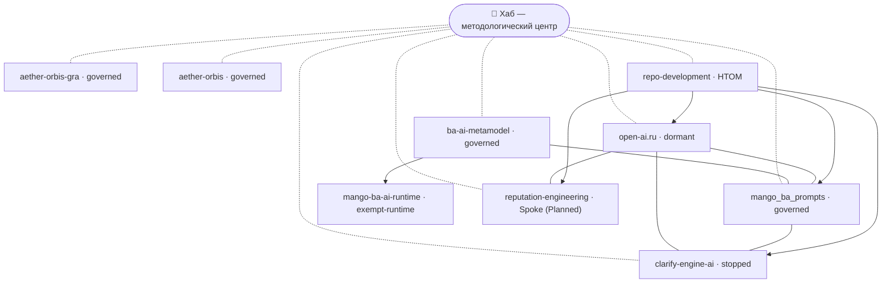

# Экосистемная карта Хаба

> 📚 **Контекст:** этот документ дополняет [Product Vision](vision.md) и
> [Product Concept](product-concept.md). Vision отвечает на вопрос «зачем»,
> Concept — «что и для кого», а карта экосистемы — «как Хаб связан с другими
> проектами и как эта связь поддерживается в актуальном виде».

> 📌 **Статус:** Draft — черновик для согласования фаундером единым пакетом
> вместе с [Product Vision](vision.md) и [Product Concept](product-concept.md).

## Содержание

- [Введение](#введение)
- [Матрица проектов](#матрица-проектов)
- [Граф связей](#граф-связей)
- [Обмен практиками](#обмен-практиками)
- [Принцип «Need-to-Know»](#принцип-need-to-know)
- [Принцип разделения онбординга и передачи контекста](#принцип-разделения-онбординга-и-передачи-контекста)
- [Добавление нового проекта](#добавление-нового-проекта)
- [Roadmap экосистемы](#roadmap-экосистемы)
- [Связанные документы](#связанные-документы)

---

## Введение

Хаб `hybrid-Intelligence-lab` — методологический центр и связующий слой
растущей экосистемы проектов. Экосистема устроена по модели **hub-and-spoke**:
Хаб хранит общие правила, стандарты, шаблоны и практики, а проекты вокруг него
создают продукты, импортируют применимые практики и возвращают улучшения через
обратную связь. Карта фиксирует, какие проекты входят в экосистему, как они
связаны между собой и как эта связь поддерживается в актуальном виде.

Карта строится на принципе **«Need-to-Know»**: Хаб видит все проекты экосистемы
и хранит полный граф, а каждый проект видит только те проекты, с которыми связан
по функционалу. Это держит контекст проекта компактным и снижает шум: проект
получает ровно те связи, которые ему нужны для работы, и не тащит за собой всю
карту экосистемы. Подробности — в разделе [«Need-to-Know»](#принцип-need-to-know).

Карта — живой документ. Она обновляется, когда в экосистеме появляется новый
проект, меняются связи или статус существующего проекта. Человекочитаемый
процесс синхронизации описан в гайде
[Синхронизация с проектами](../guides/sync-with-projects.md).

---

## Матрица проектов

Матрица — единый реестр репозиториев экосистемы (элемент I-1
[RFC #715](rfc/2026-11-02-rfc-hub-governance-optimization-roadmap.md#шаг-2-контракт-детерминированного-наследования--7-задач);
решение владельца Q-4 в issue
[#717](https://github.com/G-Ivan-A/hybrid-Intelligence-lab/issues/717)).
Другие документы Хаба не ведут собственных таблиц статусов, а ссылаются сюда.

| Репозиторий | Класс | Тип | Связь с Хабом | Краткое описание |
| --- | --- | --- | --- | --- |
| [hybrid-Intelligence-lab](https://github.com/G-Ivan-A/hybrid-Intelligence-lab) (Хаб) | `hub` | Методологический центр | Источник генома и норм | Нормы, стандарты, шаблоны, исследования и решения экосистемы. |
| [mango_ba_prompts](https://github.com/G-Ivan-A/mango_ba_prompts) | `governed` | HTOM-команда | Референсная реализация | Действующий репозиторий: референсная реализация универсальной модели БА (39 классов). Статус `legacy/archived` по issue #583 отменён решением Q-3. |
| [ba-ai-metamodel](https://github.com/G-Ivan-A/ba-ai-metamodel) — репозиторий проекта метамодели БА | `governed` | Spoke-репозиторий (архетип B) | Вынос из Хаба по [контракту выноса](../ops/hub-project-extraction-contract.md) | Ядро метамодели БА, компиляторы пакетов, тесты и eval; до выноса живёт в `projects/ba-ai-process/`. Создан 2026-11-04 с одним `README.md`; вынос отложен до окна заморозки источников ([бэклог](../ops/backlog.md), B-243). |
| [mango-ba-ai-runtime](https://github.com/G-Ivan-A/mango-ba-ai-runtime) | `exempt-runtime` | Spoke-репозиторий | Закреплённая компиляция | Автономная среда исполнения MVP; правило `EP-C1` запрещает зависимость инструкций от документов Хаба, поэтому геном не наследует. |
| [aether-orbis-gra](https://github.com/G-Ivan-A/aether-orbis-gra) | `governed` | HTOM-команда (архетип D) | Геном и практики | GRA — исследовательский фреймворк репутационной архитектуры. |
| [aether-orbis](https://github.com/G-Ivan-A/aether-orbis) | `governed` | Spoke-репозиторий | Геном | Спица вне контура MVP; бутстрап `AGENTS.md` и профиля — задача Ш4.3. |
| [open-ai.ru](https://github.com/G-Ivan-A/open-ai.ru) | `dormant` | Spoke-репозиторий | Будущий единый интерфейс | Законсервирован до появления готовых решений; затем становится единым интерфейсом проектов экосистемы (Q-5). Задач согласования нет. |
| [clarify-engine-ai](https://github.com/G-Ivan-A/clarify-engine-ai) | `stopped` | HTOM-команда | Источник механизмов | Проект остановлен; изменения не планируются. |

Внутренние рабочие области и планы, которые не являются отдельными
репозиториями:

| Проект | Статус | Тип | Связь с Хабом | Краткое описание |
| --- | --- | --- | --- | --- |
| reputation-engineering | Planned | Spoke-репозиторий | Репутационный инжиниринг | Методология и кейсы репутационного инжиниринга. |
| [repo-development](../projects/repo-development/README.md) | Active | HTOM-команда | Развитие репо | Инструменты и процессы развития самого репозитория. |

**Обозначения.**

- **Класс** (I-1) определяет, применяется ли к репозиторию согласованное чтение:
  - `governed` — наследует геном Хаба; к нему применяются синк и проверки
    согласованного чтения;
  - `exempt-runtime` — автономная среда исполнения, исключённая из наследования
    генома правилом `EP-C1`;
  - `legacy-evidence` — используется только как свидетельство по
    [ADR-014](adr/2026-09-adr-014-legacy-evidence-not-baseline.md); сейчас таких
    репозиториев нет;
  - `dormant` — законсервирован с явной целью возобновления; задач согласования
    нет;
  - `stopped` — остановлен; задач нет.
- **Статус** рабочих областей — `Active` (работает) или `Planned` (запланирована,
  ещё не запущена).
- **Тип** — `HTOM-команда` (гибридная человек + AI рабочая единица, наследует
  governance-геном `templates/htom/`) или `Spoke-репозиторий` (production-продукт
  с собственным жизненным циклом, шаблон `templates/spoke/`). Различие закреплено
  в RFC [htom-vs-spoke-clarification-2026-06.md](rfc/htom-vs-spoke-clarification-2026-06.md).
- **Связь с Хабом** — короткая роль проекта по отношению к методологическому
  центру.

Класс меняется только решением владельца. Изменение записывается здесь в том же
PR, что и решение.

---

## Граф связей

Граф различает два уровня связей:

- **Методологическая связь (hub-and-spoke)** — каждый проект связан с Хабом как с
  источником общих правил и шаблонов. На диаграмме показана пунктиром.
- **Функциональная связь** — прямая связь между проектами по функционалу
  (например, портал использует библиотеку промптов). На диаграмме показана
  сплошной линией. Именно функциональные связи определяют, что проект «видит» по
  принципу Need-to-Know.



Если диаграмма не отображается, тот же граф в текстовом виде — функциональные
связи каждого проекта (то, что проект видит по принципу Need-to-Know):

- **open-ai.ru** → `mango_ba_prompts`, `clarify-engine-ai`,
  `reputation-engineering`.
- **mango_ba_prompts** → `open-ai.ru`, `clarify-engine-ai`, репозиторий
  метамодели БА (crosswalk 39 классов с метамоделью).
- **ba-ai-metamodel** (репозиторий метамодели БА) → `mango_ba_prompts`, `mango-ba-ai-runtime`
  (runtime компилируется с закреплённого коммита метамодели).
- **mango-ba-ai-runtime** — методологической связи нет (`exempt-runtime`);
  входящая функциональная связь от репозитория метамодели БА.
- **clarify-engine-ai** → `open-ai.ru`, `mango_ba_prompts`.
- **reputation-engineering** → `open-ai.ru`.
- **repo-development** → все проекты экосистемы.

Методологическая связь с Хабом есть у каждого проекта, кроме
`mango-ba-ai-runtime` (`exempt-runtime`): Хаб хранит полный граф,
а проект — только перечисленные выше функциональные связи.

---

## Обмен практиками

Обмен практиками — второй поток экосистемы рядом с картой проектов. Карта
показывает, кто с кем связан; каталог практик показывает, какие проверенные
подходы можно импортировать в конкретный проект.
Короткое имя потока: обмен практиками.

```text
Внешние источники и проектный опыт
        │
        ▼
research/ фиксирует анализ и источники
        │
        ▼
practices/ фиксирует атомарные практики
        │
        ▼
templates/ и sync prompt помогают импортировать применимое
        │
        ▼
Проект адаптирует практику и возвращает обратную связь в Хаб
```

Цикл обмена практиками соответствует жизненному циклу знаний:
Observation и Research фиксируют сигнал, Hypothesis и RFC делают предложение
reviewable, Pattern и Standard закрепляют повторяемость, Template и Framework
дают готовые формы и методологические пакеты, Deprecation/Archive закрывает
устаревшее. Подробный стандарт — в
[Knowledge Lifecycle proposal](rfc/knowledge-lifecycle-proposal.md).

Ключевые артефакты:

| Артефакт | Роль |
| --- | --- |
| [practices/README.md](https://github.com/G-Ivan-A/hybrid-Intelligence-lab/blob/main/practices/README.md) | Каталог фиксированных практик, отдельный от research и product docs. |
| [2026-06-12-external-practice-intake.md](../research/hub/2026-06-12-external-practice-intake.md) | Анализ внешних agent-work практик и Mango docs pattern. |
| [2026-06-12-international-ai-governance-practices.md](../research/hub/2026-06-12-international-ai-governance-practices.md) | Анализ NIST, EU AI Act, ISO/IEC 42001, OpenAI, Anthropic и Google SAIF. |
| [templates/sync-project-with-hub-prompt.md](https://github.com/G-Ivan-A/hybrid-Intelligence-lab/blob/main/templates/sync-project-with-hub-prompt.md) | Исполнимый prompt для сравнения проекта с Хабом и предложения импортов. |
| [docs/rfc/resolve-artifact-location-proposal.md](rfc/resolve-artifact-location-proposal.md) | Исполнимый prompt для выбора правильного места нового артефакта в жизненном цикле. |

Правило импорта: Хаб предлагает практику, но проект принимает решение с учётом
локального контекста. Creative mode может обоснованно обойти рекомендацию, если
альтернатива лучше решает цель проекта.

## Связь L1-L4

Карта экосистемы завершает Framework-слой **L1-L2**: Vision объясняет зачем,
Product Concept описывает что, а карта показывает как проекты связаны вокруг
Хаба. Methodology-слой **L3-L4** находится в
[governance/](../ops/artifact-map.md),
[standards/](../standards/README.md), [practices/](../practices/README.md) и
[Resolve Artifact Location proposal](rfc/resolve-artifact-location-proposal.md). Проект берёт
из L3-L4 только то, что подходит его контексту, и возвращает обратную связь
через issue или PR.

---

## Принцип «Need-to-Know»

Принцип «Need-to-Know» разделяет, кто какой объём карты хранит и видит.

| Где хранится | Что хранит | Кто видит | Формат |
| --- | --- | --- | --- |
| **Хаб** | Полный граф экосистемы (эта карта). | Все проекты и связи. | `docs/ecosystem-map.md` (человекочитаемо). |
| **Проект** | Частичный граф — только связанные по функционалу проекты. | Свои функциональные связи. | `.hub-ecosystem.json` (машиночитаемо) и `docs/ecosystem-context.md` (человекочитаемо). |

**Зачем так.** Полная карта в каждом проекте быстро устаревает и создаёт шум:
проекту незачем знать о связях, которые его не касаются. Частичный граф держит
контекст компактным и релевантным, а единый источник истины (карта Хаба) не
размывается копиями.

**Как синхронизируется.** Обновление частичного графа — полуавтоматическое:

```text
Хаб обновляет полный граф (ecosystem-map.md)
        │
        ▼
Скрипт Smart Sync читает полный граф и профиль проекта
        │
        ▼
Скрипт ПРЕДЛАГАЕТ изменения частичного графа проекта
        │
        ▼
Человек просматривает и ПОДТВЕРЖДАЕТ изменения
        │
        ▼
Обновляются .hub-ecosystem.json и docs/ecosystem-context.md проекта
```

Ключевое правило — **human-in-control**: скрипт только предлагает изменения,
а решение принимает человек. Частичный граф проекта никогда не обновляется
молча. Машиночитаемый файл `.hub-ecosystem.json` нужен инструментам, а
человекочитаемый `docs/ecosystem-context.md` объясняет связи людям проекта.

Пошаговый человекочитаемый процесс для команды проекта описан в гайде
[Синхронизация с проектами](../guides/sync-with-projects.md).

---

## Принцип разделения онбординга и передачи контекста

В экосистеме Хаба есть два разных способа передать контекст агенту. Их нельзя
смешивать, потому что ошибка приводит к неверному применению правил проекта:
например, HTOM-команду можно ошибочно принять за production-spoke и запретить
или потребовать не те артефакты.

| Тип | Для кого | Источник контекста | Что проверяется |
| --- | --- | --- | --- |
| **Runtime-онбординг** | Агент с доступом к репозиторию, issue, PR или файлам. | Репозиторий как внешний источник контекста. | Governance-файлы, issue/comments, README, тип проекта, Readback и стоп до апрува. |
| **Передача контекста между чатами** | Новый чат без памяти предыдущего диалога или без прямого доступа к репозиторию. | Краткий summary от пользователя, ссылки, вставленные фрагменты и решения. | Что уже обсуждено, какие решения приняты, какие вопросы открыты и каких файлов не хватает. |

Практическое правило: `AI_SESSION_HANDOVER_PROMPT.md` должен сначала определить
тип проекта (`HTOM-команда` или `Spoke-репозиторий`), затем выбрать канал
контекста. Если доступ к репозиторию есть — запускается Runtime-онбординг по
[ai-rules/agent-onboarding-protocol.md](../ai-rules/agent-onboarding-protocol.md).
Если доступа нет — агент просит недостающие файлы или summary и не достраивает
контекст догадками.

Минимальные требования к структуре такого prompt-артефакта описаны в
[standards/session-handover-standard.md](../standards/session-handover-standard.md).

---

## Добавление нового проекта

Когда в экосистеме появляется новый проект, его добавляют в карту по единому
сценарию. Ниже — краткий маршрут; подробная инструкция для людей — в гайде
[Синхронизация с проектами](../guides/sync-with-projects.md).

1. **Создать репозиторий проекта** (или рабочую область) по подходящему шаблону:
   `templates/htom/` для HTOM-команды, `templates/spoke/` для production-спока.
2. **Инициализировать профиль проекта** `.hub-profile.json` (тип, стек, фаза) —
   он нужен Smart Sync для фильтрации релевантных шаблонов и связей.
3. **Добавить проект в эту карту** — новую строку в [матрицу](#матрица-проектов)
   и узел в [граф связей](#граф-связей) через PR в Хаб.
4. **Настроить связи** — запустить Smart Sync, чтобы он предложил частичный граф
   нового проекта, и подтвердить `.hub-ecosystem.json` и
   `docs/ecosystem-context.md` на стороне проекта.

Новый проект добавляется по принципу Anti-Inflation: запись в карте появляется
тогда, когда проект реально существует или запланирован, а не «про запас».

---

## Roadmap экосистемы

Дорожная карта описывает развитие экосистемы по ценности. Последовательность и
сроки уточняются фаундером.

### Этап 1. Ядро экосистемы

**Фокус:** зафиксировать методологический центр и первые связи.

- Хаб как источник общих правил и шаблонов.
- Репозитории по классам — в [матрице проектов](#матрица-проектов);
  `governed`: `mango_ba_prompts`, `aether-orbis-gra`, `aether-orbis` и
  репозиторий метамодели БА после выноса.
- Полный граф экосистемы в этой карте.

### Этап 2. Need-to-Know на практике

**Фокус:** раскатать частичный граф по проектам.

- В каждом `governed`-репозитории появляются `.hub-ecosystem.json` и
  `docs/ecosystem-context.md`.
- Smart Sync расширяется: предлагает обновления не только шаблонов, но и связей.
- Человек подтверждает изменения частичного графа осознанно.

### Этап 3. Рост экосистемы

**Фокус:** подключать новые проекты по единому сценарию.

- Запуск запланированных проектов (`reputation-engineering`).
- Добавление новых проектов по процессу из раздела
  [«Добавление нового проекта»](#добавление-нового-проекта).
- Карта остаётся единым источником истины, а проекты — компактными по принципу
  Need-to-Know.

---

## Связанные документы

| Документ | Роль |
| --- | --- |
| [Product Vision](vision.md) | Уровень L1: зачем существует Хаб. |
| [Product Concept](product-concept.md) | Уровень L2: что делает Хаб, для кого и как. |
| [Каталог практик](https://github.com/G-Ivan-A/hybrid-Intelligence-lab/blob/main/practices/README.md) | Фиксированные практики для обмена между Хабом и проектами. |
| [Sync Project With Hub Prompt](https://github.com/G-Ivan-A/hybrid-Intelligence-lab/blob/main/templates/sync-project-with-hub-prompt.md) | Prompt для проектной синхронизации с практиками и шаблонами Хаба. |
| [Knowledge Lifecycle proposal](rfc/knowledge-lifecycle-proposal.md) | Стандарт движения знания от observation до deprecation/archive. |
| [Resolve Artifact Location proposal](rfc/resolve-artifact-location-proposal.md) | Resolver для выбора места нового артефакта и фиксации нарушений lifecycle. |
| [Синхронизация с проектами](../guides/sync-with-projects.md) | Человекочитаемый процесс синхронизации карты. |
| [htom-vs-spoke-clarification-2026-06.md](rfc/htom-vs-spoke-clarification-2026-06.md) | Различие HTOM-команда vs Spoke-репозиторий. |
| [session-handover-standard.md](../standards/session-handover-standard.md) | Draft-стандарт структуры `AI_SESSION_HANDOVER_PROMPT.md` и разделения онбординга/передачи контекста. |
| [projects/README.md](../projects/README.md) | Навигация по проектным рабочим областям. |
| [RFC #715](rfc/2026-11-02-rfc-hub-governance-optimization-roadmap.md) | Классы реестра (I-1) и решения владельца Q-3…Q-5 по классам спиц. |
| [hub-project-extraction-contract.md](../ops/hub-project-extraction-contract.md) | Контракт выноса проекта Хаба в новый репозиторий. |

---

> 🗺️ Это документ-карта уровня экосистемы (Draft). Он показывает, как Хаб связан
> с другими проектами; ответ на вопрос «зачем» даёт [Vision](vision.md), а «что и
> как» — [Concept](product-concept.md).
