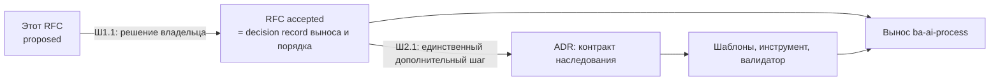

# RFC: Дорожная карта оптимизации Хаба и детерминированного управления спицами

## RFC Metadata

| Field | Value |
| --- | --- |
| Owner | G-Ivan-A |
| RFC status | `accepted`: решение владельца в issue [#717](https://github.com/G-Ivan-A/hybrid-Intelligence-lab/issues/717) (2026-11-03), ответы на Q-1…Q-5 — раздел «Решения владельца» |
| Source issue | [#715](https://github.com/G-Ivan-A/hybrid-Intelligence-lab/issues/715) |
| Impacted artifacts | `projects/ba-ai-process/`, `research/mango/`, `templates/htom/`, `templates/spoke/`, `tools/sync-from-hub.sh`, `tools/validate-repository-structure.sh`, `.github/workflows/validate.yml`, `ops/backlog.md`, `docs/ecosystem-map.md`, `docs/rfc/` (legacy RFC без даты), профили `.hub-profile.json` спиц; подробности в разделе «Impacted Artifacts» |
| Decision record | По выносу и порядку шагов decision record — этот принятый RFC. ADR «Контракт наследования экосистемы» — задача Ш2.1, not yet |
| Implementation link | Шаг 1 — PR [#718](https://github.com/G-Ivan-A/hybrid-Intelligence-lab/pull/718): [анализ шага 1](../analysis/2026-11-03-ba-meta-model-extraction-step1.md), [контракт выноса](../../ops/hub-project-extraction-contract.md), спринт 30 [бэклога](../../ops/backlog.md), [реестр экосистемы](../ecosystem-map.md). Доказательная база RFC: [evidence-контейнер `hub-governance-roadmap-715`](../../research/hub/exp/hub-governance-roadmap-715/README.md) и анализы issue #713 ([mango_ba_prompts](../analysis/2026-11-02-mango-ba-prompts-hub-practice-transfer-check.md), [aether-orbis-gra](../analysis/2026-11-02-aether-orbis-gra-hub-practice-transfer-check.md)) |
| Archetype scope | multi: A (Хаб) и спицы B/C/D, которыми Хаб управляет |

## Summary

Предлагается упорядоченная дорожная карта из семи шагов: **46 задач к
исполнению** и **11 задач, отложенных по триггеру**. Шаги расставлены так,
чтобы каждый следующий опирался на результат предыдущего. Сначала решение о
выносе. Затем контракт детерминированного наследования (один ADR). Только после
этого вынос `projects/ba-ai-process/`: новый репозиторий должен родиться уже по
контракту. Далее согласование спиц, инвентаризация устаревшего, чистка Хаба и
закрытие оставшегося техдолга.

Главный вывод о выносе. Мнение владельца о выносе мета-модели БА в отдельный
методологический репозиторий подтверждается измерением, но с поправкой на
гранулярность. Выносить нужно **весь Source-проект `projects/ba-ai-process/`**,
то есть мета-модель вместе с компилятором, дистрибутивами, тестами и
решениями. Если вынести только мета-модель, цепочка Source → Distribution из
ADR-017 разорвётся между двумя репозиториями. Отказ от `mango_ba_prompts` и
`mango-ba-ai-runtime` как от целевых домов подтверждается.

Главный вывод о детерминизме. Расхождения спиц производит отсутствие
закреплённого контракта, а не исполнители. Синк читает плавающий `main`. Три
инструмента синка пишут `last_sync` в трёх несовместимых формах. Реестров
экосистемы два, и ни один не полон. Геном сам поставляет противоречия.

## Motivation

### Нормализованная постановка (по стандарту постановки задач)

| Элемент | Содержание |
| --- | --- |
| Цель | Хаб управляет экосистемой предсказуемо. Спицы наследуют практики Хаба детерминированно, то есть из закреплённого источника с проверяемым дрейфом. Пользователь читает любой репозиторий экосистемы одинаково. Сам Хаб содержит только то, что относится к его роли (нормы, исследования, решения), и не несёт чужого жизненного цикла. |
| Задачи | (1) Проанализировать структуру Хаба и предложить, что выносить. (2) Определить, что обеспечивает корректное и детерминированное наследование, и провести изменения через один дополнительный шаг (ADR). (3) Вынести обоснованное. (4) Согласовать спицы с практиками Хаба, кроме обоснованных или явно заданных пользователем отклонений. (5) Описать устаревшее, что можно безболезненно архивировать или удалить. (6) Изменить Хаб: архивация, валидаторы, бэклог. (7) Закрыть техдолг бэклога. |
| Границы | Входит: оптимизация Хаба и изменения в спицах, которые инициирует Хаб в рамках своей политики. Не входит: изменения, которые проекты инициируют внутри себя. Обратный сбор практик из спиц — только по инициативе пользователя. Исключено по указанию владельца: A-4 «два SSOT курса» (см. ниже). |
| SSOT | Это RFC — для порядка шагов и решения о выносе. Будущий ADR Ш2.1 — для контракта наследования. Задачи исполнения — в [`ops/backlog.md`](../../ops/backlog.md) после принятия (Ш1.2). Измерения — в evidence-контейнере. |
| Уровни приёмки | **L1:** RFC содержит упорядоченные шаги, число задач на шаге и обоснование каждого шага. **L2:** каждое утверждение о состоянии подкреплено воспроизводимым измерением или ссылкой на анализ. **L3:** граф решений проверен на соответствие Boundary RFC/ADR. **L4:** гипотезы предъявлены к опровержению. |
| Режим | Creative: внешнее исследование, фальсификация гипотез, синтез кейсов, измерение. |

### Почему нужно решение уровня RFC

Проблема не локальна. Она затрагивает геном, инструменты синка, CI, бэклог и
шесть внешних репозиториев, то есть имеет кросс-репозиторные последствия.
Boundary RFC/ADR в таком случае требует «RFC first». Измерения
([evidence](../../research/hub/exp/hub-governance-roadmap-715/README.md),
снимок `main` @ `3d25a38`) показывают четыре класса боли.

1. **Хаб несёт чужой жизненный цикл.** BA-направление занимает 100 из 150
   строк бэклога (спринты 14–21, 24–28) и 25 из 69 шагов CI. В CI
   устанавливаются `opencode-ai` и `pywinpty`. В `projects/ba-ai-process/` 303
   файла со своими `build/`, `dist/`, `tests/`, `decisions/` и `docs/rfc/`. По
   собственным критериям Хаба ([projects/README.md](../../projects/README.md#когда-выносить-в-отдельный-spoke-репозиторий),
   [ops/repo-model.md](../../ops/repo-model.md)) production-код получает
   отдельный жизненный цикл и выносится в спицу.
2. **Наследование не детерминировано.** `tools/sync-from-hub.sh` берёт шаблоны
   с плавающего `raw.githubusercontent.com/.../main`. Есть три инструмента
   синка и три формы `last_sync`: версии по шаблонам (инструмент Хаба),
   `hub_sha` (`mango_ba_prompts`) и `hub_commit` (`aether-orbis-gra`). В шаблоне
   профиля генома поля закрепления нет вовсе. Собственный валидатор
   `mango_ba_prompts` проходит, хотя валидаторы генома Хаба на той же копии
   дают 6 FAIL ([анализ #713](../analysis/2026-11-02-mango-ba-prompts-hub-practice-transfer-check.md)).
3. **Чтение экосистемы несогласовано.** Из семи репозиториев `AGENTS.md` есть
   у трёх, профиль `.hub-profile.json` тоже у трёх, `ops/backlog.md` только у
   Хаба. Реестров экосистемы два: таблица статусов в `ops/backlog.md` знает 5
   репозиториев, [`docs/ecosystem-map.md`](../ecosystem-map.md) (draft от
   2026-06-12) — 3. Полного нет.
4. **Хаб копит обслуживающую нагрузку.** Валидатор структуры занимает 3397
   строк, из них около 800 — явные пути файлов, поэтому почти каждый новый
   документ требует правки валидатора. В CI 22 одноразовые самопроверки
   конкретных issue курса. В бэклоге статус записан двумя написаниями (`TODO`
   37 и `todo` 60), четыре ID повторяются, у спринтов 23–29 нет приоритета.
   207 документов в открытом статусе не обновлялись с 2026-09-01. Это верхняя
   граница кандидатов на триаж, а не список на удаление.

### Исключение A-4 (решение владельца)

Находка A-4 «Два SSOT курса после выноса» из
[анализа aether-orbis-gra](../analysis/2026-11-02-aether-orbis-gra-hub-practice-transfer-check.md)
в этом RFC **не рассматривается**. Владелец объявил её временным отклонением:
пока пользователь не убедился в спицах полностью, он продолжает выставлять часть
задач в Хабе. Дорожная карта не создаёт задач на перенос, заморозку или
ре-импорт материалов `research/reputation-technologies/`. Свёртка CI-шагов курса
(Ш6.2) меняет только форму запуска самопроверок, но не дом материалов.

## Goals and Non-goals

**Goals:**

- Задать порядок шагов 1–7, число задач на каждом шаге и обоснование порядка.
- Дать независимое мнение о составе выноса из Хаба и о целевом доме мета-модели БА.
- Определить состав контракта детерминированного наследования и путь его решения
  (этот RFC → один ADR) и проверить, допускает ли стандарт такой граф.
- Задать классы репозиториев экосистемы, чтобы согласование применялось только
  там, где Хаб управляет.

**Non-goals:**

- Не принимаются решения внутри проектов (например, модернизация
  `mango_ba_prompts` по её собственному RFC — это инициатива спицы).
- Не меняются `standards/`, `docs/adr/`, `templates/` и инструменты в рамках
  этого PR. Изменения — задачи шагов 2–6 после принятия.
- Не решается судьба курса (A-4, временное отклонение).
- Не детализируются задачи сверх короткого описания: по постановке важны порядок
  и причина.
- Нет автоматической отправки данных из спиц в Хаб.

## Proposal

### Дорожная карта

| Шаг | Название | Задач | Зависит от | Почему на этом месте |
| --- | --- | --- | --- | --- |
| 1 | Анализ структуры и решение о выносе | 2 | — | Анализ выполнен этим RFC; осталось решение владельца и постановка задач в бэклог. Без решения нельзя проектировать контракт под новый репозиторий. |
| 2 | Контракт детерминированного наследования (один ADR) | 7 | 1 | Новый репозиторий должен родиться по контракту. Иначе вынос добавит четвёртый вариант синка: `aether-orbis-gra`, созданная 2026-11-01 без контракта, уже ввела третью форму `last_sync`. |
| 3 | Вынос `ba-ai-process` | 7 | 2 | Даёт наибольшее сокращение нагрузки Хаба: 2/3 бэклога и 36% CI. Уменьшает объём шагов 5–7. |
| 4 | Согласованное чтение спиц | 4 | 2, 3 | Согласовывать имеет смысл по уже закреплённому контракту и полному реестру, в который вошёл новый репозиторий. |
| 5 | Мониторинг устаревшего: инвентаризация | 3 | 3 | После выноса инвентаризация не тратится на 303 + 13 уходящих файла. Может идти параллельно с шагом 4. |
| 6 | Изменение Хаба: чистка, валидаторы, бэклог | 5 | 5 | Удаление и архивация требуют инвентаризации и мандата (Artifact Deprecation Standard). |
| 7 | Закрытие техдолга бэклога | 18 (+11 по триггеру) | 6 | Исполняется нормализованный и уменьшенный бэклог; ничего не делается дважды. |
| | **Итого** | **46 (+11)** | | |

Нумерация задач — `Ш<шаг>.<номер>`. Каждая задача после принятия RFC становится
строкой бэклога (Ш1.2), а сложные — issue по стандарту постановки задач.

### Решения владельца (issue #717, 2026-11-03)

RFC принят. Ответы на открытые вопросы и комментарии владельца к шагу 1
(строки «Имя» и «Отложенный вынос» — [комментарий владельца к PR #718](https://github.com/G-Ivan-A/hybrid-Intelligence-lab/pull/718#issuecomment-6625672558),
2026-11-04):

| ID | Решение владельца | Следствие для дорожной карты |
| --- | --- | --- |
| Q-1 | Выносится весь Source-проект метамодели БА. Имя согласуется отдельно | Шаг 3 сохраняется. Имя — по [анализу шага 1](../analysis/2026-11-03-ba-meta-model-extraction-step1.md) (рекомендация `ba-ai-metamodel`) и согласованию в PR #718. Ниже «новый репозиторий» — репозиторий проекта метамодели БА |
| Q-2 | Архетип B; компиляторы и тесты — `project_specific_directories`, если нет критического противоречия | Противоречий не найдено (анализ шага 1, раздел «Q-2»); задекларированы 8 каталогов |
| Q-3 | `mango_ba_prompts` — `governed`: действующий репозиторий, референсная реализация универсальной модели, не legacy | Ш4.1 выполняется; статус `legacy/archived` по #583 отменён |
| Q-4 | Единый реестр — [`docs/ecosystem-map.md`](../ecosystem-map.md) | Ш2.2 выполнена в части реестра: таблица статусов бэклога заменена ссылкой |
| Q-5 | `open-ai.ru` — `dormant`: законсервирован в ожидании готовых решений, чтобы стать единым интерфейсом проектов экосистемы | Запись в реестре без задач согласования; на Ш5.1 `research/open-ai-ru/` не архивируется как «остановленный» |
| Процесс | Вынос — три шага: новый репозиторий → задача в нём на копирование по контракту Хаба → удаление или архивирование в Хабе отдельной задачей | Подтверждён с поправками: заморозка и `HUB_SHA`, исполнимый контракт [`ops/hub-project-extraction-contract.md`](../../ops/hub-project-extraction-contract.md), этапы E1–E6, удаление только после E6 (Ш3.5 → Ш3.6 → Ш3.7) |
| Порядок | Правила копирования — временное исключение до контракта наследования | Шаг 3 для проекта метамодели может начаться до завершения шага 2: контракт выноса локально применяет I-2 (`last_sync` по схеме), I-3 (закреплённый SHA) и I-4 (инструмент Хаба). Для остальных спиц порядок 2 → 3 сохраняется |
| Имя | Репозиторий [`ba-ai-metamodel`](https://github.com/G-Ivan-A/ba-ai-metamodel) создан 2026-11-04 с одним `README.md` | Q-1 закрыт полностью; «новый репозиторий» ниже — `ba-ai-metamodel` |
| Отложенный вынос | Вынос откладывается: заморозить проекты экосистемы невозможно, работа над `mango_ba_prompts` и связанными репозиториями идёт | Шаг 3 — `deferred (triggered)`, триггер и сверка дрейфа — B-243; пока он ждёт, исключение «Порядок» не используется и шаг 2 идёт первым. Обоснование, риски и возможности — [анализ шага 1, «Отложенный вынос»](../analysis/2026-11-03-ba-meta-model-extraction-step1.md) |
| Состав | «Ядро, компиляторы, 39 классов, eval» — только база для масштабирования | Подтверждено с поправками: 39 классов остаются в `mango_ba_prompts`, общий фреймворк оценки — пробел, нужен версионированный crosswalk (анализ шага 1) |

### Шаг 1. Анализ структуры и решение о выносе — 2 задачи

Анализ выполнен ниже; обе задачи выполнены в issue #717:

- **Ш1.1** ✅ Решение владельца по Q-1…Q-5 и перевод RFC в `accepted`. *Причина:*
  без human gate вынос невозможен; ADR-017 уже требует нового human decision
  gate даже для публикации отдельного `ba-ai-playbook`, а перенос всего Source
  меняет больше.
- **Ш1.2** ✅ Внести шаги 2–7 в [`ops/backlog.md`](../../ops/backlog.md) отдельным
  спринтом со ссылкой на RFC. *Причина:* задачи исполняются из бэклога, а не из
  RFC. Выполнено: спринт 30 бэклога.

**Кандидаты на вынос.** Полный анализ размеров — в evidence. Ниже только
решение по каждому кандидату.

| Кандидат | Объём | Решение | Обоснование |
| --- | --- | --- | --- |
| `projects/ba-ai-process/` | 303 файла, 25 шагов CI, 100 строк бэклога | **Вынести целиком** | Производственный код и свой релизный цикл (компиляторы, три дистрибутива, тесты, зависимости CI). Свой журнал решений (`decisions/`, `docs/rfc/`). Содержимое `scope: mango-only`, а Хаб — дом переносимых норм. |
| `research/mango/` | 13 файлов, последнее изменение 2026-09-26 | **Вынести вместе с `ba-ai-process`** | Доменное исследование одного клиента, вход Source по ADR-017. В Хабе стало бы осиротевшим. |
| `projects/education-ba-prompt/` | 3 файла | Решить на Ш5.1 | Уходит с BA, если зависит от мета-модели; иначе остаётся. |
| `research/ba-requirements/` | 129 файлов | **Оставить в Хабе** | Переносимое исследование БА, не привязанное к клиенту: survey #703, нормализация, стандарты. На него ссылаются 18 файлов Хаба. |
| `research/ai-education/` | 68 файлов | Оставить | Общеэкосистемное исследование. Нужен триаж статусов (Ш5.1): 61 draft без обновления. |
| `research/reputation-technologies/` | 173 файла | Вне рассмотрения | A-4, временное отклонение владельца. |
| `research/open-ai-ru/`, `docs/project-summaries/` | 2 и 4 файла | Не выносить; триаж на Ш5.1 | Сводки по остановленным и спящим спицам — кандидаты в архив, а не в новый репозиторий. |
| `projects-sink/`, `projects/repo-development/` | 9 и 4 файла | Оставить | Роль Хаба по ADR-007: приём материалов и развитие самого Хаба. |

**Независимое мнение о мета-модели БА.** Направление владельца верное. Мнение
отличается в двух поправках.

1. **Гранулярность — весь Source-проект, а не только мета-модель.** Компиляторы
   `build/compile-*-package.py --check` читают мета-модель и сверяют
   дистрибутивы в CI. Если вынести только мета-модель, цепочка
   Source → Distribution из ADR-017 окажется в двух репозиториях. Тогда
   понадобится второй канал закрепления внутри одного конвейера, а это та самая
   недетерминированность, которую устраняет шаг 2.
2. **Это методологическая спица с конвейером поставки, а не чистая методология,
   как `aether-orbis-gra`.** Рекомендуемый архетип — B (знание и промпты с
   оценкой); окончательное решение — Q-2. Runtime остаётся отдельным и
   автономным: `mango-ba-ai-runtime` закрепляет коммит источника в
   `compilation-manifest.yaml`. После выноса закрепляется коммит нового
   репозитория, и EP-C1 не нарушается.

Проверка отвергнутых владельцем домов подтверждает оба отказа:

- `mango_ba_prompts` — `governed` (Q-3), референсная реализация модели на
  данных клиента. Её прогоны и 39 проектных стандартов смешались бы с
  переносимым Source, а версия модели — с версией практик.
- `mango-ba-ai-runtime` — копия, которую сотрудники берут для клиентских
  прогонов. ADR-017 отклонил вариант «дать runtime прямой доступ к Source»:
  runtime потерял бы автономность, а исследовательское обоснование стало бы
  операционной зависимостью.

### Шаг 2. Контракт детерминированного наследования — 7 задач

Что обеспечивает корректное и детерминированное наследование. Это элементы
I-1…I-8 будущего ADR. Внешние аналоги проверены: Copier хранит
`_commit` шаблона в `.copier-answers.yml` и обновляет до явного `--vcs-ref`;
cruft хранит commit в `.cruft.json`, а `cruft check` завершается с кодом 1 при
отставании; Backstage держит владельца и lifecycle каждого компонента в
дескрипторе `catalog-info.yaml`.

| Элемент | Правило | Почему без него недетерминированно |
| --- | --- | --- |
| I-1 Реестр экосистемы | Один SSOT-реестр всех репозиториев. У каждого — класс: `governed` (наследует геном), `exempt-runtime` (EP-C1, автономный runtime), `legacy-evidence`, `dormant`, `stopped`. | Сейчас два неполных реестра (5 и 3 репозитория из 7); Хаб не знал о выносе `aether-orbis-gra` (A-3). |
| I-2 Схема профиля | `last_sync` = `{hub_sha, date, scope, tool}` в шаблонах профиля генома и в валидаторе. | Три несовместимые формы `last_sync`; шаблон профиля генома не содержит поля закрепления. |
| I-3 Закреплённый источник | Синк только с конкретного SHA или тега Хаба, никогда с `main`. | `sync-from-hub.sh` читает плавающий `main`: два одинаковых запуска в разные дни дают разный результат. |
| I-4 Один канонический инструмент | Инструмент синка принадлежит Хабу; локальные скрипты спиц — только обёртки над ним. | Сейчас три реализации (`sync-from-hub.sh`, `sync_from_hub.py`, `import_from_hub.py`) с разной семантикой. |
| I-5 Проверка дрейфа в CI спицы | Спица запускает валидаторы генома на закреплённом SHA. Отставание от текущего Хаба — предупреждение, не блокировка. | Локальный валидатор `mango_ba_prompts` проходит при 6 FAIL генома (M-раздел #713). |
| I-6 Декларация отклонений | `deviations[]` в профиле: `{path или section, reason, declared_by: owner или project, issue}`. Обобщает `project_specific_directories` на секции и правила. | Обоснованное отклонение и нарушение сейчас неразличимы для машины. |
| I-7 Непротиворечивый геном | Исправить H-1 (`ops/` в тексте шаблонов, но не в каноническом наборе) и H-3 (геном поставляет корневые `AI_*.md`). | Геном сам производит расхождения: A-1, A-2 и M-1 наследованы из шаблонов. |
| I-8 Обратный поток по инициативе пользователя | Сбор практик из спиц — только по запуску пользователя: шаблон issue «сбор практики» с конкретным SHA спицы. Автоотправки нет. | Согласуется с ADR-017: автосбор требует отдельного opt-in. Фиксирует постановку #715. |

Минимальный набор домов для согласованного чтения `governed`-репозитория:
`AGENTS.md`, `.hub-profile.json`, бэклог в `ops/backlog.md` (или задекларированное
отклонение), `docs/vision.md` и `docs/concept.md`, `docs/adr/`, шаблоны задач
`task` и `task-creative`, CI `validate`. Матрица
[`spoke-consistency-matrix.py`](../../research/hub/exp/hub-governance-roadmap-715/spoke-consistency-matrix.py)
измеряет именно этот набор.

Задачи:

- **Ш2.1** ADR «Контракт наследования экосистемы» (I-1…I-8). *Причина:* решение
  меняет геном, профиль и инструменты, а значит требует краткого принятого
  decision record (Boundary: RFC → ADR).
- **Ш2.2** Единый реестр (I-1). Рекомендуется обновить `docs/ecosystem-map.md` и
  убрать дублирующую таблицу из бэклога (Q-4). *Причина:* вход для шагов 3–4.
- **Ш2.3** Схема профиля и её валидатор, шаблоны `templates/*/.hub-profile.json`
  (I-2, I-6). *Причина:* без поля закрепления нечего проверять.
- **Ш2.4** Канонический инструмент синка с закреплением (I-3, I-4); поглощает
  строку бэклога B-111 вместе с Ш2.6. *Причина:* устраняет источник
  недетерминизма.
- **Ш2.5** Исправить геном (I-7: H-1, H-3/B-111). *Причина:* иначе каждый новый
  синк заново производит A-1, A-2 и M-1.
- **Ш2.6** Шаблон CI-проверки дрейфа для спиц (I-5). *Причина:* дрейф должна
  ловить машина, а не разовый анализ.
- **Ш2.7** Шаблон issue обратного сбора практик (I-8). *Причина:* обратный поток
  становится воспроизводимым, но остаётся в руках пользователя.

**Проверка графа решений.** Владелец предложил провести изменения через
отдельный ADR или RFC, допуская только один дополнительный шаг. Граф
«этот RFC → один ADR» **допустим** по Boundary RFC/ADR
[стандарта RFC](../../standards/rfc-structure-standard.md#boundary-rfcadr).
Строка «Accepted proposal needs a concise accepted decision record before
becoming standard/template/tool/practice» описывает ровно этот случай:
результат — шаблоны, инструменты и практика. Решение о выносе и порядке шагов не
порождает отдельного стандарта, поэтому для него применима строка «Accepted RFC
itself is the decision record». Граф «этот RFC → отдельный RFC о детерминизме →
ADR» дал бы два дополнительных шага. Он отклонён: альтернативы контракта уже
сужены этим RFC (таблица I-1…I-8), и стандарт не требует второго RFC. Первый
ADR внутри нового репозитория, который фиксирует импорт (как ADR-001
`aether-orbis-gra`), — внутренняя запись проекта, а не шаг Хаба.

### Шаг 3. Вынос `ba-ai-process` — 7 задач

Задачи Ш3.1–Ш3.4 исполняет агент нового репозитория по
[контракту выноса](../../ops/hub-project-extraction-contract.md) (этапы
E1–E6); Ш3.5–Ш3.7 — задачи Хаба после E6. Шаг отложен решением владельца
2026-11-04 до окна заморозки источников (бэклог B-243); при возобновлении
параметры выноса сверяются с базовым снимком дрейфа при `c06075d`.

- **Ш3.1** Создать репозиторий из генома каноническим инструментом на
  закреплённом SHA: профиль, `AGENTS.md` и `project_specific_directories` для
  `ba-meta-model`, `build`, `decisions`, `dist`, `experiments`,
  `meta-model-guides`, `research`, `tests`. *Причина:*
  спица рождается согласованной, а шаг 4 для неё не нужен.
- **Ш3.2** Перенос с сохранением истории: `projects/ba-ai-process/`,
  `research/mango/`, `docs/ba-meta-model-overview.md`, при решении Ш5.1 — `projects/education-ba-prompt/`; ADR
  импорта в новом репозитории. *Причина:* сохраняются provenance и `git blame`
  решений ADR-017.
- **Ш3.3** Перенести 25 BA-шагов CI и тесты Хаба `test-execution-package.sh`,
  `test-cline-package.sh`, `test-opencode-package.sh`,
  `test-bcreq-working-release-pipeline.sh`, `test-ba-meta-model-overview.sh`.
  *Причина:* CI Хаба перестаёт ставить runtime-зависимости.
- **Ш3.4** Перенести BA-спринты 14–21 и 24–28 (100 строк, 95 открытых) в бэклог
  нового репозитория по карте ID. *Причина:* бэклог Хаба на 2/3 состоит из
  жизненного цикла другого продукта.
- **Ш3.5** Перевести закрепление `mango-ba-ai-runtime` (`compilation-manifest.yaml`)
  с коммита Хаба на коммит нового репозитория. *Причина:* сохраняется EP-C1 и
  воспроизводимая компиляция.
- **Ш3.6** Надгробие в Хабе: `path_migrations`, строки в `projects/README.md`,
  `ops/artifact-map.md` и реестре; переписать 45 входящих ссылок из Хаба;
  убрать пути из валидатора. Шесть представлений идентичности — по
  [Artifact Deprecation Standard](../../standards/artifact-deprecation-standard.md).
  *Причина:* без этого появятся битые ссылки и «limbo»-пути.
- **Ш3.7** Проверка: CI Хаба зелёный без BA, CI нового репозитория зелёный,
  пакет runtime компилируется с закреплённого коммита побайтно так же.
  *Причина:* вынос считается выполненным по измерению, а не по слиянию PR.

### Шаг 4. Согласованное чтение спиц — 4 задачи

Согласование применяется только к классу `governed`. Остальные классы получают
запись в реестре вместо задач.

| Репозиторий | Класс (рекомендация) | Задачи |
| --- | --- | --- |
| `mango_ba_prompts` | `governed` (Q-3 решён) | Ш4.1 |
| `aether-orbis-gra` | `governed` | Ш4.2 |
| `aether-orbis` | `governed` | Ш4.3 |
| новый репозиторий проекта метамодели БА | `governed` | 0: согласован при рождении (Ш3.1) |
| `mango-ba-ai-runtime` | `exempt-runtime` (EP-C1) | 0: исключение записывается в реестр |
| `open-ai.ru` (последний коммит 2026-06-09) | `dormant` (Q-5 решён) | 0 |
| `clarify-engine-ai` (остановлен) | `stopped` | 0 |

- **Ш4.1** `mango_ba_prompts`: находки M-1…M-8 из
  [анализа #713](../analysis/2026-11-02-mango-ba-prompts-hub-practice-transfer-check.md)
  через ре-синк на закреплённом SHA. *Причина:* наибольшее расхождение (6 FAIL
  генома).
- **Ш4.2** `aether-orbis-gra`: A-1, A-2, A-3, A-5 (A-4 исключена) и
  нормализация `last_sync` в схему I-2. *Причина:* корневые `AI_*.md` уходят
  после исправления генома (Ш2.5) одним ре-синком.
- **Ш4.3** `aether-orbis`: бутстрап `AGENTS.md` и профиля (задача B-113 бэклога
  Хаба переходит сюда). *Причина:* активная спица без входной точки агента.
- **Ш4.4** Прогон матрицы согласованного чтения по реестру и запись результата
  в реестр. Запуск — по инициативе пользователя. *Причина:* закрывает шаг
  измерением.

Обоснованные отклонения (декларированные `project_specific_directories`, слой
`<project_specific_rules>`, архетип D у `aether-orbis-gra`, BL-префикс бэклога
mango по разрешению владельца) сохраняются и переносятся в `deviations[]` (I-6).

### Шаг 5. Мониторинг устаревшего — 3 задачи

Результат шага — один Analysis со списком «архивировать / обновить / удалить с
мандатом / оставить» по критериям
[Artifact Deprecation Standard](../../standards/artifact-deprecation-standard.md).

- **Ш5.1** Содержание: пул из 207 документов в открытом статусе без обновления с
  2026-09-01, за вычетом вынесенных; `docs/project-summaries/`,
  `research/open-ai-ru/`, `projects/education-ba-prompt/`. *Причина:* статус
  `draft` у исследования — норма, поэтому нужен критерий (есть ли входящие
  ссылки, актуальность предмета, есть ли замена), а не отсечка по дате.
- **Ш5.2** Нормы: 17 legacy RFC без даты в `docs/rfc/`, 7 ADR в `proposed`,
  10 стандартов в `draft`, 11 руководств `guides/` в `draft`. *Причина:*
  незакрытая норма — конкурирующий источник для агента.
- **Ш5.3** Инструменты и связи. Тесты одноразовых контрактов:
  `test-mango-kb-migration-contract.sh` (миграция ADR-009 завершена),
  `test-sprint-5-agent-model.sh`. `test-ba-requirements-forensics.sh` не
  подключён к CI. Сюда же список путей валидатора, ссылки на ветки
  `issue-*` (9 файлов; ветки пока существуют, но их удаление сломает ссылки) и
  ссылки на переименованный `mango-ba-ai-runtime-cli`. *Причина:* мёртвая
  проверка стоит времени CI и маскирует реальные.

### Шаг 6. Изменение Хаба — 5 задач

- **Ш6.1** Архивация и депрекация по Ш5.1–Ш5.2: статус, навигация, входящие
  ссылки, CHANGELOG. Физическое удаление — только с мандатом (кандидат без
  входящих ссылок: `docs/superpowers/plans/`). *Причина:* шесть представлений
  идентичности меняются согласованно.
- **Ш6.2** Валидаторы. Заменить около 800 явных путей в
  `validate-repository-structure.sh` правилами дома (каталог + шаблон имени).
  Удалить устаревшие тесты по Ш5.3. Свернуть 22 шага самопроверок курса в один
  цикл (дом курса не меняется — A-4). *Причина:* сейчас каждый новый документ
  требует правки валидатора; это налог на каждую задачу.
- **Ш6.3** Гигиена бэклога: единое написание `TODO`; разрешить повторяющиеся ID
  B-121, B-122, B-123, B-223 с картой старых ID в новые; убрать DONE-строки
  спринтов 4 и 10 по правилу архивации после приёмки итогов. *Причина:* машинная
  маршрутизация и счёт задач требуют однозначного словаря и ID.
- **Ш6.4** Обновить бэклог с обоснованием: приоритеты оставшихся спринтов
  Хаба, приоритеты вместо `null` у спринтов 23 и 29, связь с
  [RFC закрытия спринтов](2026-09-28-rfc-backlog-sprint-closure.md).
  *Причина:* шаг 7 исполняет только приоритизированное.
- **Ш6.5** Индексы и навигация: `docs/rfc/README.md`, `docs/adr/README.md`,
  `ops/artifact-map.md`, `CHANGELOG.md` по итогам Ш6.1–Ш6.4. *Причина:* реестры
  должны совпадать с деревом.

### Шаг 7. Закрытие техдолга — 18 задач (+11 по триггеру)

После шагов 3 и 6 в бэклоге Хаба остаются 31 открытая строка Хаба (спринты 4,
9, 10, 13, 22, 23 и отложенные с триггером). Из них к исполнению готовы 20; две
из них уже поглощены ранними шагами и в счёт шага 7 не входят: B-111 (доставка
`AGENTS.md` в спицы с upstream SHA) закрывается задачами Ш2.4 и Ш2.6, B-113
(геном в `aether-orbis`) — задачей Ш4.3. Остаётся 18. Ещё 11 остаются `deferred` до наступления своего триггера: 10 строк раздела
«Отложенные задачи с триггером» и Спринт 22. Строки Спринта 29 (курс, 6 штук)
— часть задач, которые владелец сознательно ведёт в Хабе (A-4); в счёт
техдолга они не входят. BA-строки после Ш3.4 принадлежат новому репозиторию и
его исполнению; по границе постановки это уже проектная, а не хабовая
инициатива. Число 18 — верхняя граница: Ш6.4 может закрыть часть строк как
`CANCELLED` с обоснованием.

*Причина последнего места:* исполнять бэклог до нормализации (Ш6.3) и
переприоритизации (Ш6.4) значит работать по дублирующимся ID и устаревшему
порядку.

### Фальсифицируемые гипотезы и адверсариальная проверка

**H1.** Расхождения спиц производит отсутствие закреплённого контракта
наследования, а не дисциплина исполнителей. *Опровергается, если* спицы,
синкнутые одним инструментом с одного SHA, всё равно расходятся в домах, которые
нормирует геном.

**H2.** Вынос `ba-ai-process` сокращает обслуживающую нагрузку Хаба сильнее
любой чистки внутри Хаба. *Опровергается, если* связность BA с остальным Хабом
так велика, что после выноса число межрепозиторных правок превысит
освобождённые строки бэклога и шаги CI.

| # | Проверка | Результат | Вердикт |
| --- | --- | --- | --- |
| 1 | Есть ли в экосистеме две спицы с одним инструментом синка и одним SHA? | Нет: три инструмента, три формы `last_sync`, общего SHA нет. Прямой опыт для опровержения H1 отсутствует. | ⚠️ H1 не опровергнута, но и не доказана экспериментом |
| 2 | Производит ли расхождения сам геном? | Да: A-1, A-2 (handover ссылается на несуществующие `ops/*`), корневые `AI_*.md` (H-3/K-3), H-1. Геном противоречив до любого исполнителя. | ✅ держит H1 |
| 3 | Ловит ли текущий CI спицы дрейф от Хаба? | Нет: локальный валидатор mango проходит при 6 FAIL генома. | ✅ держит H1 |
| 4 | Есть ли расхождения, которые контракт не устранит? | Да: M-7 (два дома `docs/ba-process*`) и M-6 (`docs/contracts/`) — локальные решения спицы. Контракт их только обнаружит (I-5), но не предотвратит. | ⚠️ H1 верна не для всех находок; I-5 обязателен |
| 5 | Доля BA в нагрузке Хаба | 100/150 строк бэклога (67%), 25/69 шагов CI (36%), 303/1071 файлов (28%) | ✅ держит H2 |
| 6 | Связность BA с Хабом | 45 файлов Хаба вне проекта ссылаются на `projects/ba-ai-process`, из них 18 — `research/ba-requirements`; 94 файла проекта ссылаются на Хаб. Это разовая цена Ш3.6, а нагрузка бэклога и CI возникает постоянно. | ⚠️ H2 держится, но Ш3.6 — самая дорогая задача шага 3 |
| 7 | Не дешевле ли оставить BA и просто чистить? | Чистка (Ш6.2–Ш6.3) не убирает установку runtime-зависимостей из CI Хаба и 95 открытых BA-строк. | ✅ держит H2 |
| 8 | Есть ли прецедент выноса без контракта и чем он кончился? | `aether-orbis-gra` (2026-11-01): Хаб о выносе не знал (A-3), появилась третья форма `last_sync`, геном перенёс корневые `AI_*.md`. | ✅ держит порядок «шаг 2 до шага 3» |

Итог: ✅ 5, ⚠️ 3, ❌ 0. Порядок шагов устойчив. Проверка 4 добавляет I-5 в
обязательный состав контракта, а не в «желательный».

### Апелляция (hybrid_work)

Статус `mango_ba_prompts` в бэклоге Хаба — `legacy/archived` по #583. Владелец
при этом инициировал модернизацию спицы (#413/#420 спицы, позднее #583); этот
вывод уже записан в анализе #713. От решения зависит, будет ли Ш4.1. Рекомендация
— класс `governed` с пометкой «legacy-evidence для прогонов до 2026-09»: ADR-014
сохраняется для старых прогонов, а новая работа идёт по контракту. Решение —
Q-3: **`governed`** (issue #717), репозиторий — референсная реализация
универсальной модели.

## Alternatives

| Альтернатива | Почему отклонена |
| --- | --- |
| Оставить `ba-ai-process` в Хабе и только чистить | Не убирает 2/3 бэклога и зависимостей runtime из CI Хаба (проверка 7). Противоречит критериям выноса `projects/README.md`. |
| Вынести только мета-модель | Разрывает Source → Distribution ADR-017 между репозиториями; нужен второй канал закрепления внутри одного конвейера. |
| Мета-модель в `mango_ba_prompts` | Репозиторий — референсная реализация на данных клиента (Q-3): прогоны и проектные стандарты смешались бы с Source, версия модели — с версией практик. |
| Мета-модель в `mango-ba-ai-runtime` | Нарушает EP-C1 и отклонённую в ADR-017 альтернативу «прямой доступ runtime к Source». |
| Сначала вынос, потом контракт (порядок шагов 2 и 3 наоборот) | Повторяет кейс `aether-orbis-gra`: новая спица рождается с собственной формой синка, и шаг 4 удваивается. Для проекта метамодели риск снят решением владельца по #717: контракт выноса применяет I-2…I-4 до ADR Ш2.1. |
| Отдельный RFC о детерминизме перед ADR | Два дополнительных шага вместо одного; альтернативы уже сужены здесь. |
| Автоматическая отправка практик из спиц в Хаб | Противоречит постановке (сбор — по инициативе пользователя) и ADR-017 (автосбор только opt-in). |
| Обязательная блокировка CI спицы при любом отставании от Хаба | Делает Хаб операционной зависимостью спиц. Отставание — предупреждение (I-5), блокирует только нарушение генома на закреплённом SHA. |
| Отдельный новый файл реестра в `ops/` | Anti-Inflation: дом-кандидат уже есть (`docs/ecosystem-map.md`); новый файл нужен, только если владелец решит иначе (Q-4). |

## Trade-offs

- **Цена выноса.** Разовая переработка около 45 входящих ссылок и 94 исходящих
  (Ш3.6). Межрепозиторная ссылка требует permalink с SHA вместо относительного
  пути. Смягчение: инструмент синка (Ш2.4) и правило ссылок ADR Ш2.1.
- **Две точки правды на переходе.** Пока Ш3.2–Ш3.6 не завершены, BA-материалы
  существуют в двух местах. Смягчение: один PR переноса и одно надгробие, а не
  постепенная миграция.
- **Закрепление ⇒ отставание.** Спицы перестают получать изменения Хаба
  автоматически. Это намеренно: детерминизм важнее свежести, а отставание видно
  в CI (I-5).
- **Правила дома вместо явного списка путей.** Валидатор станет менее строгим к
  отдельным файлам, но строгим к каталогам и именам. Отдельные контракты-«замки»
  на ключевые файлы сохраняются тестами.
- **Нагрузка на владельца.** Решения нужны на Ш1.1 (пять вопросов), на мандате
  удаления (Ш6.1) и по классам спиц. Остальное делегируется.
- **Совместимость.** `path_migrations` и `sync_history` спиц не переписываются:
  журнал фиксирует пути на момент синка.

## Impacted Artifacts

| Артефакт | Влияние | Шаг |
| --- | --- | --- |
| `projects/ba-ai-process/`, `research/mango/` | Переезд в новый репозиторий, надгробие в Хабе | 3 |
| `docs/adr/` | Новый ADR «Контракт наследования экосистемы» | 2 |
| `templates/htom/`, `templates/spoke/` | Профиль с закреплением, исправление H-1/H-3, шаблон CI дрейфа, шаблон issue обратного сбора | 2 |
| `tools/sync-from-hub.sh`, `templates/manifest.json` | Закреплённый источник, канонический инструмент | 2 |
| `tools/validate-repository-structure.sh`, `tools/test-*.sh` | Правила дома вместо списка путей; удаление и перенос тестов | 3, 6 |
| `.github/workflows/validate.yml` | Перенос 25 BA-шагов, свёртка 22 шагов курса | 3, 6 |
| `ops/backlog.md`, `ops/artifact-map.md`, `CHANGELOG.md` | Спринт дорожной карты, перенос BA-спринтов, нормализация | 1, 3, 6 |
| `docs/ecosystem-map.md` | Единый реестр экосистемы | 2 |
| `docs/rfc/` (legacy без даты), `guides/`, `standards/` в draft | Триаж статусов | 5, 6 |
| `.hub-profile.json` Хаба и спиц | `last_sync` по схеме I-2, `deviations[]`, `path_migrations` выноса | 2–4 |
| `mango-ba-ai-runtime/compilation-manifest.yaml` | Закрепление на коммит нового репозитория | 3 |
| `mango_ba_prompts`, `aether-orbis-gra`, `aether-orbis` | Согласование по контракту | 4 |

PR #716 менял только: данный RFC, индекс [`docs/rfc/README.md`](README.md),
evidence-контейнер и регистрационные записи (CHANGELOG, artifact-map, список
путей валидатора структуры).

## Implementation and Validation

Текущее состояние: предложение, ничего из шагов 2–7 не применено.

Доказательная база воспроизводима:

```bash
python3 research/hub/exp/hub-governance-roadmap-715/backlog-census.py
python3 research/hub/exp/hub-governance-roadmap-715/hub-status-census.py 2026-09-01
python3 -I research/hub/exp/hub-governance-roadmap-715/spoke-consistency-matrix.py . /tmp/spokes/<repo> ...
```

Критерии приёмки шагов после принятия:

| Шаг | Проверка готовности |
| --- | --- |
| 2 | Профили всех `governed`-спиц проходят валидатор схемы; повторный синк с тем же SHA даёт пустой diff. |
| 3 | CI Хаба без BA-шагов зелёный; `git grep projects/ba-ai-process` в Хабе находит только надгробие и журналы; компиляция runtime воспроизводима. |
| 4 | Матрица согласованного чтения: каждая ячейка `governed` — ✅ или задекларированное отклонение. |
| 5 | Analysis с решением по каждому кандидату пула. |
| 6 | Валидатор структуры без явных путей отдельных документов; бэклог без повторяющихся ID и с одним словарём статусов. |
| 7 | В бэклоге Хаба нет открытых строк, кроме `deferred` с непрошедшим триггером и задач курса. |

Локальная проверка этого PR: `./tools/validate-frontmatter.sh .`,
`./tools/validate-file-naming.sh`, `./tools/validate-repository-structure.sh`,
`./tools/validate-rrp-links.sh`, `python3 tools/generate-manifest.py --check`,
`tools/test-*.sh`.

## Lifecycle and Decision Path



- Сейчас: `accepted` (issue #717, 2026-11-03). Ответы на Q-1…Q-5 — раздел
  «Решения владельца». Шаг 3 отложен по триггеру (2026-11-04, B-243).
- После принятия: Ш2.1 оформляет ADR; задачи шагов 2–7 становятся строками
  бэклога (Ш1.2) и исполняются отдельными issue/PR. В метаданных RFC
  заполняются Decision record и Implementation link.
- Если владелец отклонит вынос (Q-1), шаг 3 исключается, шаги 2 и 4–7
  сохраняются. BA-нагрузка остаётся в шаге 7 (+95 строк).

## Open Questions

Блокирующих вопросов нет. Q-1…Q-5 решены владельцем в issue #717 (раздел
«Решения владельца»); имя нового репозитория — `ba-ai-metamodel`
(2026-11-04). Открытых вопросов нет; срок шага 3 задаёт триггер B-243. Ниже —
исходные формулировки и рекомендации RFC v0.1 для истории решения.

1. **Q-1. Вынос `ba-ai-process` целиком** вместе с `research/mango/`, а не одной
   мета-модели? Рекомендация: да, весь Source-проект. **Решение: да.** Имя
   репозитория RFC v0.1 рекомендовал сохранить — `ba-ai-process`, чтобы не
   менять идентичность ADR-017 и `path_migrations`. Бренд в имени не нужен:
   архитектура поставки универсальна, `mango-only` — это область содержимого.
   Анализ шага 1 добавил критерий различимости и рекомендует
   `ba-ai-metamodel`.
2. **Q-2. Архетип нового репозитория.** Рекомендация: B (знание и промпты с
   оценкой); компилятор и дистрибутивы — задекларированные
   `project_specific_directories`. **Решение: B.**
3. **Q-3. Апелляция по `mango_ba_prompts`:** `governed` или `legacy-evidence`?
   Рекомендация: `governed`, ADR-014 сохраняется для прогонов до модернизации.
   **Решение: `governed`.**
4. **Q-4. Дом реестра экосистемы.** Рекомендация: `docs/ecosystem-map.md` с
   таблицей классов; таблица статусов в бэклоге заменяется ссылкой. **Решение: да.**
5. **Q-5. Класс `open-ai.ru`** (без коммитов с 2026-06-09): `dormant` или
   `stopped`? Рекомендация: `dormant` — запись в реестре без задач согласования.
   **Решение: `dormant`.**

## Related Artifacts

- Источник: issue [#715](https://github.com/G-Ivan-A/hybrid-Intelligence-lab/issues/715).
- Принятие и шаг 1: issue [#717](https://github.com/G-Ivan-A/hybrid-Intelligence-lab/issues/717),
  [анализ шага 1](../analysis/2026-11-03-ba-meta-model-extraction-step1.md),
  [контракт выноса](../../ops/hub-project-extraction-contract.md).
- Доказательства: [evidence-контейнер #715](../../research/hub/exp/hub-governance-roadmap-715/README.md);
  анализы #713 — [mango_ba_prompts](../analysis/2026-11-02-mango-ba-prompts-hub-practice-transfer-check.md),
  [aether-orbis-gra](../analysis/2026-11-02-aether-orbis-gra-hub-practice-transfer-check.md).
- Решения: [ADR-017](../../projects/ba-ai-process/decisions/2026-09-adr-017-ba-ai-process-source-distribution.md),
  [ADR-014](../adr/2026-09-adr-014-legacy-evidence-not-baseline.md),
  [RFC закрытия спринтов](2026-09-28-rfc-backlog-sprint-closure.md),
  [RFC структуры генома HTOM и CI](2026-08-21-rfc-htom-genome-structure-and-ci.md),
  [RFC htom-vs-spoke](htom-vs-spoke-clarification-2026-06.md).
- Нормы: [стандарт RFC](../../standards/rfc-structure-standard.md),
  [Artifact Deprecation Standard](../../standards/artifact-deprecation-standard.md),
  [AGENTS.md bootstrap standard](../../standards/agents-md-bootstrap-standard.md),
  [правила бэклога](../../ops/backlog-instruction.md),
  [projects/README.md](../../projects/README.md), [ops/repo-model.md](../../ops/repo-model.md).
- Внешние аналоги: [Copier — обновление проекта и `_commit`](https://python-package-copier.readthedocs.io/en/latest/pages/how-to/update-template/),
  [cruft — `cruft check` и `.cruft.json`](https://github.com/cruft/cruft),
  [Backstage — дескриптор `catalog-info.yaml`](https://backstage.io/docs/features/software-catalog/descriptor-format/).
