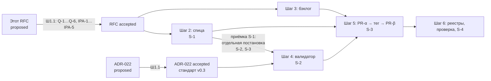

# RFC: Завершение выноса GRA из Хаба и очистка домена `research/reputation-technologies/`

## RFC Metadata

| Field | Value |
| --- | --- |
| Owner | G-Ivan-A |
| RFC status | `proposed`: ждёт решения владельца по вопросам Q-1…Q-6 и предупреждениям IPA-1…IPA-5 |
| Source issue | [#721](https://github.com/G-Ivan-A/hybrid-Intelligence-lab/issues/721) |
| Impacted artifacts | `research/reputation-technologies/` (173 файла), `.github/workflows/validate.yml` (19 шагов курса), `tools/validate-repository-structure.sh`, `tools/validate-frontmatter.sh`, `tools/test-frontmatter-validator.sh`, `.hub-profile.json`, `standards/artifact-deprecation-standard.md`, `ops/backlog.md`, `ops/artifact-map.md`, `CHANGELOG.md`, 11 живых файлов Хаба со ссылками на домен; в спице `aether-orbis-gra` — ссылки на Хаб, `education/`, будущий `ops/backlog.md`. Подробности — в разделе «Impacted Artifacts» |
| Decision record | [ADR-022](../adr/2026-11-adr-022-hub-archive-and-extraction-redirect.md) (`proposed`) — для формы архива и префиксного перенаправления. По составу и порядку шагов decision record — это RFC после принятия |
| Implementation link | not yet. Доказательная база: [evidence-контейнер `gra-extraction-cleanup-721`](../../research/hub/exp/gra-extraction-cleanup-721/README.md), [сверка полноты выноса](../analysis/2026-11-04-gra-extraction-completeness-check.md), [анализ протокола исполнения](../analysis/2026-11-04-issue-721-execution-protocol-analysis.md), [экспертиза диалога о приёмке](../analysis/2026-11-04-issue-721-dialog-expert-review.md) |
| Archetype scope | multi: A (Хаб) и спица D `aether-orbis-gra`, которая принимает остаток домена |

## Summary

Предлагается дорожная карта из шести шагов и **18 задач**. Она доводит вынос
направления «Репутационные технологии (GRA)» до конца и убирает домен из дерева
Хаба, не ломая ни одной ссылки, у которой есть хозяин.

Короткий ответ на вопрос issue «что удалить, что архивировать»:

1. **73 файла (19 единиц)** — рабочие версии и одноразовые самопроверки задач.
   Это кандидаты на удаление по мандату владельца (Q-2).
2. **61 файл (22 единицы)** — записи решений и уроков, в том числе отклонённых.
   Они уходят в архив.
3. **34 файла** уже лежат в спице без расхождений. Их заменяет указатель.
4. **1 файл** создан после снимка спицы и доимпортируется.
5. **1 файл с персональными данными** не архивируется.
6. **2 файла** ждут решения: глобальное это исследование или проектное (Q-3).

Измерение, разбивка по правилам и граничные случаи — в
[сверке, F-1](../analysis/2026-11-04-gra-extraction-completeness-check.md#f-1-состав-домена-и-предварительная-диспозиция).

Две поправки к постановке, обе по индустриальной практике:

- **Архив — не каталог в дереве, а аннотированный тег с манифестом** (IPA-1).
  Каталог `archive/` не сохраняет ни одной ссылки `blob/main`: путь всё равно
  меняется. При этом он оставляет 33,5 % байтов Хаба в каждом поиске агента и
  требует исключения в каждом валидаторе.
- **Записи решений не удаляются, даже если решение отменено** (IPA-2). Хабу не
  нужна вторая «книга эволюции». Она уже есть в спице как `docs/history.md`, и
  ей нужен устойчивый адрес свидетельств. Его даёт тег.

Порядок жёсткий, потому что каждый шаг снимает блокер следующего:

1. решение владельца;
2. спица закрепляет 167 плавающих ссылок на SHA;
3. остаток бэклога переезжает;
4. норма и валидатор принимают манифест;
5. домен выходит из дерева;
6. реестры обновляются.

Полная заморозка Хаба не нужна. Замораживается только домен и только на время
шага 5.

### План работ (WBS) задачи #721

Протокол issue требует, чтобы план работ шёл первым. Стандарт RFC фиксирует
порядок разделов, поэтому WBS стоит первым подразделом Summary (рекомендация R-2
[анализа протокола](../analysis/2026-11-04-issue-721-execution-protocol-analysis.md)).
Риск контекста: **Н** — шаг читается целиком; **С** — нужен выбор фрагментов;
**В** — объём не помещается в окно, поэтому шаг исполнен скриптом
evidence-контейнера, и в контекст попадает только результат. Отчёты «Шаг N
выполнен» — в теле PR #722.

| № | Пункт | Почему нужен | ССОТ | Риск | Статус |
| --- | --- | --- | --- | --- | --- |
| W-1 | Нормализация постановки и анализ протокола исполнения | Протокол — обязательный отдельный документ issue; без разбора его противоречий (ожидание подтверждения, «полные права») шаги нельзя исполнить по правилам Хаба | Текст issue #721; [`ai-rules/agent-work-rules.md`](../../ai-rules/agent-work-rules.md); `AGENTS.md` `<hybrid_work>`; [ADR-010](../adr/2026-08-adr-010-agent-autonomy-principles.md), Принцип 2 | Н | ✅ [анализ протокола](../analysis/2026-11-04-issue-721-execution-protocol-analysis.md) |
| W-2 | Инвентарь домена и предварительная диспозиция | «Что удалить, что архивировать» нельзя решить чтением 173 файлов | Дерево `research/reputation-technologies/` @ `c06075d`; поля `source:` спицы @ `1669943`; [инвентарь миграции спицы](https://github.com/G-Ivan-A/aether-orbis-gra/blob/1669943e6f0193e78b245bb9d26b3281a1c5a438/docs/analysis/2026-11-01-migration-inventory.md) | В → `gra-inventory.py` | ✅ F-1 |
| W-3 | Сверка со спицей: что ещё перенести | Issue: «были изменения после создания репозитория» | `.hub-profile.json` спицы, `last_sync.hub_commit` = `32b5fa5`; [`ops/backlog.md`](../../ops/backlog.md), Спринт 29 | С | ✅ F-2 |
| W-4 | Переносятся ли самопроверки курса | 19 шагов CI либо переезжают, либо удаляются вместе с файлами | [`.github/workflows/validate.yml`](../../.github/workflows/validate.yml); прогон CI 41427101826 | В → `ci-course-steps.py`, `spoke-guard-replay.py` | ✅ F-3 |
| W-5 | Перепись ссылок на домен | Любое движение файла ломает ссылки; нужно знать, чьи | Деревья Хаба и спицы; `tools/validate-repository-structure.sh`, `resolve_declared_path_migration` | В → `gra-inventory.py` | ✅ F-4 |
| W-6 | Норма выбытия против постановки и практики | Постановка просит удалять «НЕ ЦЕННОЕ», а стандарт запрещает удалять пути со ссылками из истории | [Artifact Deprecation Standard](../../standards/artifact-deprecation-standard.md), Deletion Rules и Compatibility Mechanisms; внешние источники F-5/F-6 | С | ✅ F-5, F-6, F-7 |
| W-7 | Экосистема и параллельная работа | Issue: «полная остановка хаба невозможна» | Снимок `gh api` 2026-11-04 08:38 UTC (`ecosystem-snapshot.log`); [`docs/ecosystem-map.md`](../ecosystem-map.md) | С | ✅ F-8 |
| W-8 | RFC с дорожной картой и обоснованием каждой задачи | Прямое требование issue | Этот RFC; [стандарт RFC](../../standards/rfc-structure-standard.md) | С | ✅ этот документ |
| W-9 | Норма архива и перенаправления: ADR-022 и стандарт v0.3 | Issue: «возможно, потребует стандарта и ADR». Стандарт сам требует decision record для смены правил удаления | [Artifact Deprecation Standard](../../standards/artifact-deprecation-standard.md#lifecycle), последний абзац Lifecycle; [ADR Structure Standard](../../standards/adr-structure-standard.md) | С | ✅ `proposed` / `draft` |
| W-10 | Спринт 31 в бэклоге | Прямое требование issue | [`ops/backlog-instruction.md`](../../ops/backlog-instruction.md); нумерация Спринта 30 в PR #718 (B-234…B-267) | Н | ✅ B-268…B-286; Ш1.3 исполняется двумя строками: B-270 (S-1, S-4) и B-286 (S-2, S-3 после приёмки S-1) |
| W-11 | Регистрация и локальная проверка | Иначе новые документы — сироты, а CI красный | `CHANGELOG.md`, `ops/artifact-map.md`, индексы `docs/rfc/`, `docs/adr/`; валидаторы `tools/` | Н | ✅ |
| W-12 | Исполнение выноса из дерева: удаление, архив, надгробие | Цель issue | Deletion Rules, условие 5 (мандат); ADR-010, Принцип 2, п. 4 | В → суб-issue S-3 | ⛔ заблокировано: нет мандата владельца на список удаления (Q-2), 167 ссылок спицы плавающие (Ш2.1) |
| W-13 | Действия в спице: закрепление ссылок, доимпорт, бэклог | Без них W-12 ломает спицу | Деревья спицы @ `1669943`; [анализ #713](../analysis/2026-11-02-aether-orbis-gra-hub-practice-transfer-check.md), A-1 | С → суб-issue S-1 | ⛔ заблокировано: другой репозиторий, вне PR #722 |

Лимит эффективного контекста не достигнут ни на одном пункте: объёмы читали
скрипты, а не модель.

## Motivation

### Нормализованная постановка (по стандарту постановки задач)

| Элемент | Содержание |
| --- | --- |
| Цель | Направление GRA живёт только в спице `aether-orbis-gra`. В Хабе нет его рабочих файлов, проверок и задач. Все свидетельства, на которые ссылаются решения, доступны по устойчивому адресу. Хаб в `research/` хранит только независимые глобальные исследования. |
| Задачи | (1) Полный план с граничными случаями. (2) Карта экосистемы и параллельной работы без полной заморозки. (3) Сверка со спицей: что ещё скопировать. (4) RFC с дорожной картой, обоснованием шагов и задач и спринтом в бэклоге. (5) Анализ протокола исполнения отдельным документом. (6) При необходимости — стандарт и ADR архивирования и удаления. |
| Границы | Входит: Хаб и изменения в спице, которые инициирует Хаб в рамках выноса (закрепление ссылок, доимпорт, перенос задач). Не входит: развитие курса в спице и решения, которые спица принимает сама (например, какие самопроверки ей нужны). |
| SSOT | Для состава и порядка — этот RFC. Для формы архива и перенаправления — ADR-022 и стандарт v0.3. Задачи — Спринт 31 [`ops/backlog.md`](../../ops/backlog.md). Измерения — evidence-контейнер. |
| Уровни приёмки | **L1:** каждый шаг и каждая задача имеют причину. **L2:** каждое утверждение о состоянии подкреплено измерением или цитатой со ссылкой. **L3:** граф решений не нарушает Boundary RFC/ADR и Deletion Rules. **L4:** гипотезы предъявлены к опровержению. |
| Режим | Creative: внешние источники, опровергающие пробы, измерение. |

### Почему нужно решение уровня RFC

Решение кросс-репозиторное: оно меняет Хаб и спицу. Оно меняет CI и
валидаторы. Оно меняет норму удаления, а стандарт выбытия требует для этого
нового decision record: «Изменение состава состояний, набора легитимных
переходов или правил удаления требует нового либо superseding human decision
record» ([Lifecycle](../../standards/artifact-deprecation-standard.md#lifecycle)).
Boundary RFC/ADR в таком случае требует сначала RFC.

Четыре блокера найдены измерением
([сверка](../analysis/2026-11-04-gra-extraction-completeness-check.md)):

1. **167 плавающих ссылок спицы** вида `blob/main` на домен Хаба (F-4). Любое
   движение файла их ломает.
2. **72 из 80 единиц** упомянуты в исторических записях, и все 19 единиц из
   списка DELETE есть в CHANGELOG (F-5). Действующее условие 2 раздела Deletion
   Rules такое удаление запрещает.
3. **GitHub не перенаправляет удалённый путь**, даже объявленный в
   `path_migrations`: проба `pr-ops/` даёт 404 (F-6). Значит, ни каталог-архив,
   ни удаление не сохраняют ссылок `blob/main`. Их сохраняет только SHA.
4. **Персональные данные** (F-7) нельзя архивировать.

### Снятие исключения A-4 RFC #715

[RFC #715](2026-11-02-rfc-hub-governance-optimization-roadmap.md) исключил домен
из своей дорожной карты. Решение владельца там записано так: «пока пользователь
не убедился в спицах полностью, он продолжает выставлять часть задач в Хабе.
Дорожная карта не создаёт задач на перенос, заморозку или ре-импорт материалов
`research/reputation-technologies/`». Issue #721 — новая постановка того же
владельца с целью «завершить перенос». Поэтому этот RFC **предлагает** снять
A-4 для домена (Ш1.2), но не снимает его сам. Пока владелец не ответил на Q-1,
A-4 действует, и шаги 2–6 не начинаются. Текст RFC #715 этот PR не меняет:
PR #718 слит 2026-11-04, RFC #715 принят в issue #717, раздел «Исключение
A-4» в нём не изменился; снять A-4 может только Ш1.2 после ответа на Q-1.

## Goals and Non-goals

**Goals:**

- Определить, что удалить, что архивировать, что перенести и что оставить, с
  правилом и доказательством для каждой единицы.
- Задать порядок шагов, при котором ни один шаг не ломает спицу или CI.
- Задать форму архива и перенаправления, которую можно повторить для следующих
  выносов. Ближайший — `projects/ba-ai-process/`, задача Ш3.6 RFC #715.
- Сопоставить постановку владельца с индустриальной практикой и показать каждое
  расхождение в форме Industry Practice Alert.

**Non-goals:**

- В этом PR файлы домена не перемещаются и не удаляются (W-12: нет мандата).
- Спица не изменяется: её задачи даны готовой постановкой S-1 (раздел
  «Постановка S-1 для `aether-orbis-gra`»).
- Документы курса и модели GRA в Хабе не изменяются: с ADR-001 спицы их
  меняют только в спице. Это правило владельца; к нормам Хаба (стандарт, ADR,
  RFC, бэклог) оно не относится.
- Курс не перепроектируется. Какие инварианты курса проверять в спице, решает
  спица.
- Git-история Хаба не переписывается. Это возможно только по отдельному решению
  владельца (Q-4).

## Proposal

### Дорожная карта

| Шаг | Название | Задач | Зависит от | Почему на этом месте |
| --- | --- | --- | --- | --- |
| 1 | Решение и постановка | 3 | — | Без мандата нельзя удалять (Deletion Rules, условие 5), а пока действует A-4, нельзя трогать домен |
| 2 | Предусловия в спице | 3 | 1 | Спица — единственный потребитель плавающих ссылок на домен. Сначала её ссылки получают устойчивый адрес, и только потом адрес в Хабе исчезает |
| 3 | Перенос и закрытие задач Спринта 29 | 2 | 2 | Задачам нужен бэклог спицы (Ш2.3). Закрытие строк до выноса не оставляет в Хабе задач без дома |
| 4 | Норма и валидатор перенаправления | 2 | 1, 2 | После удаления файлов ссылки из истории и из архивных копий должны разрешаться правилом, а не правкой исторического текста. Валидатор — часть очистки Хаба, а её постановка выставляется только после приёмки копирования в спице |
| 5 | Вынос из дерева | 5 | 2, 3, 4 | Единственный шаг, который меняет домен. Всё, что могло сломаться, к этому моменту уже переадресовано |
| 6 | Реестры, проверка, перенос практики | 3 | 5 | Реестры должны совпадать с деревом. Урок протокола закрепляется в правилах, чтобы следующий вынос не повторял разбор |
| | **Итого** | **18** | | |

Норма для шага 4 подготовлена этим PR в виде черновика: ADR-022 (`proposed`) и
стандарт v0.3 (`draft`). Шаг 4 остаётся в карте, потому что валидатор и тест
пока не изменены.

### Шаг 1. Решение и постановка — 3 задачи

- **Ш1.1** Владелец отвечает на Q-1…Q-6 и на IPA-1…IPA-5 и переводит этот RFC
  и ADR-022 в `accepted`. *Причина:* удаление и перезапись человеческой работы
  — абсолютная граница (ADR-010, Принцип 2, п. 4). Мандат на конкретный список
  (Q-2) — условие 5 раздела Deletion Rules.
- **Ш1.2** Снять исключение A-4 RFC #715 для домена GRA. Это одна строка в
  разделе «Исключение A-4» RFC #715 со ссылкой на этот RFC; выполнить после
  ответа владельца на Q-1 (PR #718 слит 2026-11-04, A-4 в RFC #715 не
  изменился). *Причина:* иначе два RFC противоречат друг другу о доме
  материалов курса. Кроме того, владелец перестаёт ставить в Хаб новые задачи
  курса, и домен можно заморозить.
- **Ш1.3** Выставить issue S-1 в `aether-orbis-gra` текстом раздела
  «Постановка S-1 для `aether-orbis-gra`» со ссылкой на #721 и этот RFC.
  S-4 можно выставить сразу: он не касается домена. S-2 и S-3 — это отдельная
  постановка на очистку Хаба. Её выставляют только после приёмки S-1 и
  переноса задач Спринта 29 (B-286). *Причина:* шаги 2 и 5 не помещаются в
  один PR и затрагивают два репозитория. Протокол issue требует отдельных
  подзадач для больших шагов (П2). Порядок «сначала копирование в спицу по
  постановке из Хаба, потом отдельная постановка очистки» задал владелец в
  PR #722 ([экспертиза](../analysis/2026-11-04-issue-721-dialog-expert-review.md), O-4, O-6).

### Шаг 2. Предусловия в спице — 3 задачи (суб-issue S-1, в `aether-orbis-gra`)

- **Ш2.1** Закрепить 167 плавающих ссылок `blob/main` на домен Хаба на один SHA
  Хаба `PIN_SHA`. Это `main` Хаба на момент закрепления; по нему домен
  заморожен до шага 5. *Причина:* GitHub отдаёт 404 на удалённый путь `blob/main`,
  но 200 на путь по SHA (F-6). Один SHA вместо разных даёт одну проверку: на этом
  коммите существует каждый путь.
- **Ш2.2** Доимпортировать `2026-11-01-course-quotes-days-1-4-alce.md` в
  `education/` спицы и пересчитать якоря строк `#Lnnn` по копиям колод спицы. При
  ответе Q-3 «перенести» то же сделать для источников #650. Сборщик
  `exp/quotes-711/` переносится как провенанс. *Причина:* документ создан после
  снимка `32b5fa5` (R3). Якоря Хаба указывают не на те строки копий спицы: случай
  #711, эпиграф на строке 581, а не 591 (F-3).
- **Ш2.3** Создать `ops/backlog.md` спицы. *Причина:* `AGENTS.md` спицы требует
  «Check the project backlog before starting», а бэклога нет (анализ #713, A-1).
  Без бэклога задачам Спринта 29 некуда переехать.

### Шаг 3. Перенос и закрытие задач Спринта 29 — 2 задачи

- **Ш3.1** Перенести B-230, B-231, B-233 в бэклог спицы с полем «Источник» —
  строкой Хаба. В Хабе отметить строки «перенесено» со ссылкой на строку спицы.
  *Причина:* это открытые задачи курса (F-2). C4 в `docs/roadmap.md` спицы — о
  международном сотрудничестве, а не о юридической проверке кейсов, так что
  дублирования нет.
- **Ш3.2** Закрыть B-228 (PR #661 принят), B-229 (материалы дня 2 есть и
  перенесены) и B-232 (каталога `gra-research-program/` в спице нет; структура
  L1–L4 задана её ADR-002). Закрыть Спринт 29 по его критерию. *Причина:*
  статусы устарели (F-9), а закрытие без ссылок нарушает правило закрытия
  спринтов.

### Шаг 4. Норма и валидатор перенаправления — 2 задачи (суб-issue S-2)

- **Ш4.1** Расширить `resolve_declared_path_migration` в
  `tools/validate-repository-structure.sh` и чтение `path_migrations` в
  `tools/validate-historical-immutable.sh`. Запись с внешним `to`
  (URL репозитория-приёмника) и полем `manifest` принимает битую относительную
  ссылку, если путь под префиксом `from` перечислен в манифесте. *Причина:*
  сейчас правило принимает ссылку, только если `to + suffix` существует
  локально. Для внешнего приёмника это всегда ложь. Переписывать исторические
  ссылки запрещено (Historical link policy).
- **Ш4.2** Проверка манифеста и регрессионный тест `tools/test-*.sh`. Каждый
  удалённый путь домена есть в манифесте ровно один раз. У каждой строки есть
  адрес: SHA-ссылка на спицу, ссылка на тег или отметка «удалён; последняя
  версия — `<SHA>`». Тест падает на пропущенном пути. *Причина:* манифест
  заменяет redirect для 173 путей. Без машинной проверки он разойдётся с деревом
  так же, как сегодня расходятся реестры.

### Шаг 5. Вынос из дерева — 5 задач (суб-issue S-3)

Шаг исполняется двумя PR и тегом между ними. Делить нужно ради содержимого
тега: в архив не должно попасть то, что удалено по мандату.

- **Ш5.1** Сигнал выбытия и заморозка домена. В `README.md` домена вписываются
  блок перехода (`deprecated`, замена — спица) и манифест по 80 единицам. С этого
  момента новые правки домена запрещены, кроме задач этого RFC. *Причина:*
  прямой переход `active → deleted` запрещён (Lifecycle): потребитель должен
  получить сигнал до исчезновения адреса.
- **Ш5.2** Переписать 11 живых файлов Хаба со ссылками на домен: на спицу (по
  SHA) или на манифест. Это `research/README.md` (7 относительных ссылок), три
  файла `research/ba-requirements/normalization/`, `external-sources-registry.md`,
  4 файла external-insights от 2026-10-30, `ops/artifact-map.md` и
  `ops/backlog.md`. *Причина:* это обслуживаемые указатели, а не история.
  Historical link policy их не защищает, а валидатор внутренних ссылок упадёт на
  восьми относительных ссылках (F-4).
- **Ш5.3** PR-α: удалить по мандату Q-2 единицы R9 (73 файла) и по Q-4 файл PII
  в том же PR, что Ш5.1–Ш5.2. В манифесте они отмечены «удалён; последняя
  версия — `<SHA>`». *Причина:* удалённое по мандату не должно попасть в тег.
  Иначе «удаление» сводится к переименованию. Если мандата нет, правило
  неопределённости переводит единицы R9 в архив (стандарт, Deletion Rules).
- **Ш5.4** Аннотированный тег `archive/reputation-technologies-2026-11` на
  merge-коммите PR-α. В сообщении тега — ссылка на этот RFC и на манифест.
  Ruleset запрещает обновлять и удалять теги `archive/*`; включает его владелец
  (Q-6). *Причина:* тег — неизменяемый снимок, все относительные ссылки внутри
  которого продолжают работать. Защиту тегов GitHub перенёс в rulesets (F-6).
- **Ш5.5** PR-β: убрать из дерева остальные файлы домена, кроме `README.md`
  (надгробия). В том же PR:
  - убрать 19 шагов курса из `validate.yml`;
  - убрать 174 упоминания домена из `validate-repository-structure.sh`;
  - убрать правило `presentation-rfc/*.md` из `validate-frontmatter.sh:96` и его
    тест `test-frontmatter-validator.sh:84`;
  - добавить запись `path_migrations` с внешним `to`, полями `manifest` и
    `archive`.

  *Причина:* проверки без файлов падают, а файлы без проверок незаметно
  дрейфуют. Поэтому их убирают атомарно (R-8 сверки). Самопроверки охраняют
  только копии Хаба: в копиях спицы падают 13 из 19 (F-3).

### Шаг 6. Реестры, проверка, перенос практики — 3 задачи

- **Ш6.1** Записать выбытие в `CHANGELOG.md` (раздел `Removed`) со ссылкой на
  тег и манифест. Обновить `ops/artifact-map.md`, а строку домена в
  `research/README.md` заменить указателем на спицу. *Причина:* это условие 6
  раздела Deletion Rules. Прежние записи CHANGELOG не переписываются (IPA-4).
- **Ш6.2** Проверка приёмки. `git grep research/reputation-technologies` находит
  только надгробие, `path_migrations` и исторические записи. Повторный прогон
  `gra-inventory.py` показывает 0 единиц в дереве, кроме `README.md`. Задание
  `validate` в CI зелёное и короче примерно на 38 с. Все 167 ссылок спицы на
  `PIN_SHA` отвечают 200. *Причина:* результат подтверждается тем же
  инструментом, которым измерялся вход.
- **Ш6.3** Закрепить форму Industry Practice Alert в
  `ai-rules/agent-collaboration-rules.md` с правкой R-5 анализа протокола. По
  умолчанию предлагается вариант практики, ответы адресуются по номеру IPA, а
  необратимое действие выполняется только после ответа. *Причина:* владелец
  просит учить его практикам через комментарии PR. Без нормы каждый агент
  оформит предупреждение по-своему, и ответы нельзя будет сопоставить.

### Граничные случаи

| Случай | Решение | Шаг |
| --- | --- | --- |
| Во время шагов 2–5 владелец ставит в Хаб задачу курса | После Ш1.2 задачи курса идут в спицу. До Ш1.2 действует A-4, и шаги 2–6 не начаты, так что конфликта нет | 1 |
| Файл домена изменился после `PIN_SHA` | Ш5.1 замораживает домен. Если правка всё же влита, Ш2.1 повторяется на новом SHA до Ш5.3 | 2, 5 |
| Единица частично перенесена (`exp/day1-osint-709/`) | Архив, а не указатель: на 5 путей ссылается спица | 5 |
| Отклонённое решение (`presentation-rfc/`, `status: rejected`) | Архив: отклонённое решение — свидетельство | 5 |
| Владелец не дал мандат на удаление | Единицы R9 уходят в тег вместе с архивом (правило неопределённости) | 5 |
| PR #718 сливается раньше (наступил 2026-11-04) | Спринт 31 перебазирован после Спринта 30 (B-234…B-267), конфликты слияния решены с сохранением обеих сторон. Общие файлы — `ops/backlog.md`, `CHANGELOG.md`, `ops/artifact-map.md`, `docs/rfc/README.md`, `validate.yml` | все |
| Ссылки CHANGELOG — абсолютные URL `blob/main/...` | Не переписываются. Читатель получает 404 на GitHub, но адрес разрешается через манифест надгробия. Валидатор абсолютные URL не проверяет | 6 |
| Тег случайно удалён | Ruleset запрещает удаление. Коммит остаётся достижим из `main` и по SHA, так что тег можно восстановить | 5 |
| Другой репозиторий экосистемы ссылается на путь домена | Сейчас таких ссылок 0. `aether-orbis` использует только идентификатор направления (F-8). Перед Ш5.3 перепись повторяется | 5 |
| Тот же механизм нужен для выноса `projects/ba-ai-process/` | ADR-022 сформулирован для любого выноса; этот RFC — первое применение | — |

### Фальсифицируемые гипотезы и адверсариальная проверка

- **H1. Вынос текущих документов полон.** *Опровергается, если* хотя бы один
  из 34 перенесённых файлов изменён в Хабе после коммита в его `source:`.
- **H2. Самопроверки курса можно перенести в спицу как есть.** *Опровергается,
  если* хотя бы один шаг падает на копиях спицы.
- **H3 (из постановки). Каталог-архив сохраняет ссылки на перемещённые
  файлы.** *Опровергается, если* GitHub не перенаправляет путь из
  `path_migrations`.
- **H4 (из постановки). Малоценное можно удалить по действующей норме.**
  *Опровергается, если* у единиц DELETE есть ссылки из исторических записей.
- **H5. Очистка требует заморозки Хаба.** *Опровергается, если* параллельная
  работа не пишет в домен и ни один другой репозиторий не ссылается на его пути.

| # | Проверка | Результат | Вердикт |
| --- | --- | --- | --- |
| H1 | Blob на `source:`-коммите против blob на `HEAD`, 34 файла (`gra-inventory.log`) | 34 из 34 совпадают | ✅ держится |
| H2 | 19 шагов CI на копиях спицы (`spoke-guard-replay.log`) | 6 проходят, 13 падают | ❌ опровергнута |
| H3 | `blob/main/pr-ops/README.md` после `path_migrations` `pr-ops/` → `ops/` (`permalink-probe.log`) | 404 без перенаправления | ❌ опровергнута |
| H4 | Ссылки CHANGELOG на 19 единиц DELETE (`gra-inventory.tsv`, колонка ссылок) | 19 из 19 упомянуты | ❌ опровергнута: нужен манифест |
| H5 | Открытые PR экосистемы и входящие ссылки (`ecosystem-snapshot.log`) | Общий файл с PR #718 — только `ops/backlog.md` и реестры; ссылок других репозиториев — 0 | ❌ опровергнута: достаточно заморозки домена |

Итог: держится 1 из 5. Опровержения H2–H5 меняют план: самопроверки удаляются,
а не переносятся; архив — тег; удаление требует манифеста; замораживается
только домен.

### Предупреждения об индустриальной практике (IPA)

Шаблон взят из протокола issue с правкой R-5
[анализа протокола](../analysis/2026-11-04-issue-721-execution-protocol-analysis.md#recommendations).
Issue отдаёт приоритет лучшей практике, поэтому изменения подготовлены по
практике, а вариант владельца описан как альтернатива. Ответ — комментарием к PR:
«Применить индустриальную практику (IPA-n)» или «Подтверждаю с учётом риска
(IPA-n)». Необратимые действия (удаление, тег, переписывание истории) ждут
ответа. Обратимые подготовлены сразу.

> ⚠️ **IPA-1. Форма архива**
> **Запрос Владельца:** «вынести в отдельный архивный каталог (общий для подобных
> архивов), исключить из валидаторов».
> **Индустриальная практика:** неизменяемый снимок — аннотированный тег под
> защитой ruleset. Устойчивая ссылка — permalink на коммит
> ([GitHub Docs](https://docs.github.com/en/repositories/working-with-files/using-files/getting-permanent-links-to-files)).
> Рабочее дерево содержит только то, что используется
> ([Google docguide: «Delete Dead Documentation»](https://google.github.io/styleguide/docguide/best_practices.html#delete-dead-documentation)).
> **Обоснование практики:** каталог меняет путь так же, как удаление: проба
> `pr-ops/` даёт 404. При этом в контексте агента остаются 8,66 МБ, то есть
> 33,5 % байтов Хаба. Anthropic рекомендует давать модели «smallest possible set
> of high-signal tokens» ([источник](https://www.anthropic.com/engineering/effective-context-engineering-for-ai-agents)).
> **Риск выполнения запроса:** исключение в каждом валидаторе и в `validate.yml`.
> Нужен отдельный запрет правок архива. `grep -r` агента продолжает читать
> каталог. Ссылки `blob/main` всё равно ломаются.
> **Действие ИИ:** ADR-022 и Ш5.4 подготовлены по практике (тег). Вариант
> владельца описан в ADR-022 как запасной, с тремя обязательными мерами.

> ⚠️ **IPA-2. Документы с обоснованием старых решений**
> **Запрос Владельца:** «если проект кардинально изменился, зачем сохранять все
> документы с обоснованиями старых решений»; «как ССОТ историчности оставлять
> только то, что соответствует актуальным видению».
> **Индустриальная практика:** запись решения не удаляется, а получает статус
> `superseded` со ссылкой на новое решение
> ([Nygard, «keep the old one around, but mark it as superseded»](https://cognitect.com/blog/2011/11/15/documenting-architecture-decisions)).
> Рабочие черновики при этом удаляются (Google docguide).
> **Обоснование практики:** отклонённое решение отвечает на вопрос «почему не
> так» и предотвращает повторный круг. В Хабе это уже норма: ADR-014 делает
> наследие свидетельством, а не базисом. Наследие не удаляется.
> **Риск выполнения запроса:** «книга эволюции» спицы (`docs/history.md`) теряет
> адреса доказательств. Следующий исполнитель повторяет отклонённый вариант
> курса (#610).
> **Действие ИИ:** 22 единицы записей решений (R7, R7a, R8) идут в тег, а не в
> удаление. Удаляются только 19 единиц R9. «Книга» не дублируется в Хабе: она
> уже есть в спице.

> ⚠️ **IPA-3. Персональные данные в архиве**
> **Запрос Владельца:** «файлы, которые влияют на данные и не могут быть удалены,
> — архивировать». `2026-10-14-day1-lecturer-gra-research.md` подпадает под это
> правило: на него ведут 10 ссылок спицы.
> **Индустриальная практика:** минимизация и ограничение срока хранения
> персональных данных ([GDPR, ст. 5(1)(c) и 5(1)(e)](https://eur-lex.europa.eu/eli/reg/2016/679/oj);
> в РФ — [152-ФЗ, ст. 5, ч. 7](https://www.consultant.ru/document/cons_doc_LAW_61801/)).
> **Обоснование практики:** архив по определению хранит и тиражирует
> содержимое, а цель обработки (подготовка лекции) достигнута.
> **Риск выполнения запроса:** персональные данные закрепляются в защищённом от
> удаления теге. Убрать их потом можно только переписыванием истории.
> **Действие ИИ:** в Ш5.3 файл удаляется из дерева до тега и в архив не
> попадает. Переписывание истории не предлагается по умолчанию, это Q-4.

> ⚠️ **IPA-4. Ссылки исторических записей**
> **Запрос Владельца:** «чистота репозитория — отсутствие мусора, избыточных,
> устаревших и неактуальных данных». После выноса 84 ссылки CHANGELOG и 49
> ссылок аудита указывают на отсутствующие пути, и их хочется «почистить».
> **Индустриальная практика:** запись журнала изменений неизменяема. Выбытие
> фиксируется новой записью `Removed`
> ([Keep a Changelog 1.1.0](https://keepachangelog.com/en/1.1.0/)).
> **Обоснование практики:** запись — снимок момента решения. Её правка
> выдаёт новое знание за старое. В Хабе то же требует Historical link policy
> стандарта выбытия.
> **Риск выполнения запроса:** ретроактивное переписывание 15 исторических
> файлов. Пропадает соответствие «запись ↔ PR».
> **Действие ИИ:** исторические записи не меняются. Их ссылки разрешает манифест
> надгробия (ADR-022), а выбытие записывается новой строкой `Removed` (Ш6.1).

> ⚠️ **IPA-5. Ожидание подтверждения внутри задачи**
> **Запрос Владельца:** протокол, П3г и П5: «запросить у Владельца подтверждение»
> и только потом продолжать.
> **Индустриальная практика:** асинхронное решение через review запроса на
> слияние. Вопросы и варианты фиксируются в описании PR, а утверждением служит
> review или merge
> ([GitHub Docs: about pull request reviews](https://docs.github.com/en/pull-requests/collaborating-with-pull-requests/reviewing-changes-in-pull-requests/about-pull-request-reviews)).
> **Обоснование практики:** агент не видит ответа после окончания сессии.
> Правила Хаба называют ожидание подтверждения недопустимым состоянием
> завершения.
> **Риск выполнения запроса:** сессия заканчивается без результата, и
> накопленный контекст теряется.
> **Действие ИИ:** невыполненное вынесено в блок «Не выполнено и вопросы» тела PR
> и в Спринт 31. PR переводится в ready for review, и merge служит утверждением.

### Черновики суб-issue

| ID | Репозиторий | Заголовок | Родитель | ССОТ и накопленный контекст | Приёмка |
| --- | --- | --- | --- | --- | --- |
| S-1 | `aether-orbis-gra` | Подготовка к удалению домена GRA из Хаба: закрепить ссылки, доимпортировать цитаты, создать бэклог | #721 | Этот RFC, шаг 2; список 167 ссылок — `gra-inventory.tsv`, колонка плавающих ссылок; правило 3 инвентаря миграции спицы; анализ #713, A-1 | `grep -r 'hybrid-Intelligence-lab/blob/main/research/reputation-technologies'` в спице пуст; все ссылки на `PIN_SHA` отвечают 200; документ цитат лежит в `education/`, якоря совпадают с копиями спицы; `ops/backlog.md` спицы существует |
| S-2 | Хаб | Валидатор: внешний `to` и манифест в `path_migrations` | #721 | Ш4; `resolve_declared_path_migration`; ADR-022 | Тест падает на пути вне манифеста и проходит на пути из манифеста; `validate-historical-immutable.sh` читает ту же запись |
| S-3 | Хаб | Вынос домена `research/reputation-technologies/` из дерева: надгробие, тег, удаление | #721 | Ш5–Ш6; манифест по `gra-inventory.tsv`; ответы Q-2…Q-6 | Критерии Ш6.2 |
| S-4 | Хаб | Форма Industry Practice Alert в правилах сотрудничества | #721 | Ш6.3; R-5 анализа протокола | Форма есть в `ai-rules/agent-collaboration-rules.md`, на неё ссылается `agent-work-rules.md` (апелляция) |

Сами issue не созданы. Создание issue — внешнее действие, и до принятия RFC его
утверждает владелец (Ш1.3). Очерёдность выставления: S-1 и S-4 — после
принятия RFC; S-2 и S-3 — одной отдельной постановкой после приёмки S-1.

### Постановка S-1 для `aether-orbis-gra`

Текст ниже вставляется в issue спицы без правок. Он ссылается на постановку в
Хабе и не дублирует её: решения и доказательства остаются здесь.

```markdown
## Контекст
Хаб `hybrid-Intelligence-lab` завершает вынос GRA в этот репозиторий:
постановка — issue G-Ivan-A/hybrid-Intelligence-lab#721, решение — RFC
«Завершение выноса GRA из Хаба» (шаг 2) и ADR-022 Хаба. По ADR-001 этого
репозитория он — источник истины курса и модели, поэтому остаток домена
переносится сюда, а не правится в Хабе. После приёмки этой задачи Хаб
отдельной постановкой убирает `research/reputation-technologies/` из дерева и
оставляет архив защищённым тегом. Тогда все ссылки `blob/main` на этот путь
начнут отдавать 404.
Не входит в задачу: переработка курса, изменения в Хабе, перенос проверок Хаба
как есть.

## Цель
Спица не зависит от путей `blob/main` домена Хаба. Документ цитат курса и его
провенанс лежат в спице. У спицы есть бэклог, готовый принять задачи курса из
Хаба.

## SSOT (1–3 якоря)
- RFC Хаба #721, шаг 2 и раздел «Постановка S-1»: docs/rfc/2026-11-04-rfc-gra-extraction-completion-and-hub-cleanup.md
  (permalink на `PIN_SHA`).
- Перечень 167 плавающих ссылок и диспозиции: research/hub/exp/gra-extraction-cleanup-721/gra-inventory.tsv Хаба на `PIN_SHA`.
- ADR-001 этого репозитория и правило 3 инвентаря миграции.

## Контракты задачи
- `PIN_SHA` — один SHA `main` Хаба, который владелец называет в комментарии к
  этой issue. Домен Хаба заморожен с базы RFC (`c06075d`), поэтому подходит
  любой SHA после слияния PR #722 в Хабе.
- Доимпорт — инструментом импорта спицы с `--commit PIN_SHA` или вручную, с
  записью провенанса. Якоря строк `#Lnnn` пересчитываются по копиям колод
  спицы, а не берутся из Хаба (случай #711: строка 581, а не 591).
- Источники #650 переносятся, только если владелец ответил на Q-3 RFC
  «перенести».
- Какие инварианты курса проверять в CI спицы, решает спица. Кандидаты —
  6 проверок Хаба, которые проходят на копиях спицы (анализ сверки полноты
  Хаба, F-3).
- Код Хаба в спице не исполняется. Хаб — только источник данных.

## Готово, когда
- `grep -r 'hybrid-Intelligence-lab/blob/main/research/reputation-technologies'`
  в спице пуст. Все ссылки на `PIN_SHA` отвечают 200.
- Документ `2026-11-01-course-quotes-days-1-4-alce.md` лежит в `education/`,
  его якоря указывают на те же строки копий спицы. Сборщик `exp/quotes-711/`
  перенесён как провенанс.
- `ops/backlog.md` спицы существует и содержит B-230, B-231, B-233 Хаба с
  полем «Источник».
- `last_sync` в `.hub-profile.json` указывает `PIN_SHA` и область доимпорта.
- В issue #721 Хаба оставлен комментарий со ссылкой на PR спицы. Это сигнал
  для отдельной постановки очистки Хаба (S-2, S-3).

Operating Mode: Structured.
```

### Апелляция (hybrid_work)

Постановка требует «полных прав» исполнителя, но удаление и перезапись
человеческой работы входят в закрытый список ADR-010 (Принцип 2, п. 4), который
режим не отменяет. Поэтому в этом PR нет ни одного перемещения или удаления
файла домена. Подготовлено всё, что для них нужно: список с правилом для
каждой единицы, порядок, норма, валидатор (в задаче) и вопросы. Это апелляция по
форме контракта, а не остановка.

## Alternatives

| Альтернатива | Почему отклонена |
| --- | --- |
| A. Каталог `archive/` в дереве (вариант постановки) | Не сохраняет ни одной ссылки `blob/main`. Оставляет треть байтов в поиске агента и требует исключений во всех валидаторах (IPA-1). Остаётся запасным вариантом ADR-022 |
| B. Оставить домен как есть до «полной уверенности» (A-4 бессрочно) | Два SSOT курса. 19 шагов CI (28 % `validate`) охраняют копии, которые уже не ведутся. Постановка #721 прямо требует завершить вынос |
| C. Удалить весь домен одним PR без тега | Нарушает Deletion Rules (условия 2, 4, 5). Ломает 167 ссылок спицы. Теряет 22 единицы записей решений |
| D. Переместить файлы в спицу с историей (`git filter-repo`) | Спица уже импортировала текущие документы без истории и адаптировала их (правило 3 инвентаря). Повторный импорт создал бы второй вариант тех же файлов. Свидетельства нужны по адресу, а не в виде копий |
| E. Переписать ссылки CHANGELOG и исторических записей на спицу | Ретроактивное переписывание (IPA-4, Historical link policy) |
| F. Переписать историю git, чтобы убрать всё, а не только PII | Меняет все SHA и ломает 51 закреплённую ссылку спицы и все ссылки на коммиты в PR. Цель «чистого дерева» достигается без этого |

## Trade-offs

- **Обнаружимость архива ниже, чем у каталога.** Человек видит архив через
  манифест надгробия и список тегов, а не в дереве. Компромисс: манифест лежит
  ровно по старому пути домена.
- **Двухэтапный шаг 5.** Два PR и тег между ними сложнее одного PR. Зато тег не
  содержит удалённого по мандату, и удаление не превращается в переименование.
- **Ссылки CHANGELOG на GitHub дают 404.** Их разрешает манифест, а не
  веб-перенаправление: у GitHub нет перенаправления для удалённых путей.
- **Заморозка домена.** Между Ш2.1 и Ш5.5 домен нельзя править. Это недели, а не
  месяцы, и курс в это время ведётся в спице.
- **Нагрузка на владельца.** Решения нужны на Ш1.1 (Q-1…Q-6, IPA-1…IPA-5) и на
  включении ruleset (Ш5.4). Остальное исполняется агентами.
- **Совместимость.** `sync_history` спицы и прежние `path_migrations` не
  переписываются: журнал фиксирует пути на момент синка.

## Impacted Artifacts

| Артефакт | Влияние | Шаг |
| --- | --- | --- |
| `research/reputation-technologies/` | Сигнал выбытия, манифест, удаление R9 и PII, вынос из дерева; остаётся `README.md` — надгробие | 5 |
| Тег `archive/reputation-technologies-2026-11` и ruleset `archive/*` | Новый неизменяемый снимок | 5 |
| `.github/workflows/validate.yml` | Минус 19 шагов курса | 5 |
| `tools/validate-repository-structure.sh`, `tools/validate-historical-immutable.sh` | Внешний `to` и манифест в `path_migrations`; минус 174 упоминания домена | 4, 5 |
| `tools/validate-frontmatter.sh`, `tools/test-frontmatter-validator.sh` | Минус правило `presentation-rfc/*.md` | 5 |
| `.hub-profile.json` | Запись `path_migrations` с полями `manifest` и `archive` | 5 |
| `standards/artifact-deprecation-standard.md` | v0.3: манифестное перенаправление и архив тегом | этот PR (draft) |
| `docs/adr/` | ADR-022 | этот PR (proposed) |
| 11 живых файлов Хаба | Ссылки на спицу или манифест | 5 |
| `ops/backlog.md` | Спринт 31; перенос и закрытие Спринта 29 | этот PR, 3 |
| `CHANGELOG.md`, `ops/artifact-map.md`, `research/README.md` | `Removed`, карта, указатель на спицу | 6 |
| `ai-rules/agent-collaboration-rules.md` | Форма IPA | 6 |
| `aether-orbis-gra` | Ссылки на SHA, доимпорт, бэклог | 2, 3 |
| [RFC #715](2026-11-02-rfc-hub-governance-optimization-roadmap.md) | Снятие A-4 для домена | 1 |

Этот PR меняет только: данный RFC; ADR-022; стандарт выбытия v0.3; два анализа;
evidence-контейнер; Спринт 31 в `ops/backlog.md`; регистрационные записи
(CHANGELOG, artifact-map, индексы RFC и ADR, список путей валидатора структуры).

## Implementation and Validation

Текущее состояние: предложение. Шаги 1–6 не начаты; норма шага 4 есть в виде
черновика.

Доказательная база воспроизводима (клоны спиц — недоверенные данные: только
чтение и `python3 -I`):

```bash
D=research/hub/exp/gra-extraction-cleanup-721
python3 -I $D/gra-inventory.py . /tmp/spokes/aether-orbis-gra --tsv $D/gra-inventory.tsv > $D/gra-inventory.log
python3 -I $D/ci-course-steps.py .github/workflows/validate.yml $D/ci-run-41427101826-jobs.jsonl
python3 -I $D/spoke-guard-replay.py . /tmp/spokes/aether-orbis-gra $D/gra-inventory.tsv
```

Критерии приёмки шагов после принятия:

| Шаг | Проверка готовности |
| --- | --- |
| 1 | RFC и ADR-022 в `accepted`; ответы на Q-1…Q-6 записаны в PR; S-1 и S-4 созданы; S-2 и S-3 созданы после приёмки S-1 |
| 2 | В спице нет ссылок `blob/main` на домен Хаба; все ссылки на `PIN_SHA` отвечают 200; документ цитат в `education/` |
| 3 | В Хабе нет открытых строк Спринта 29; у каждой строки есть ссылка «перенесено» или причина закрытия |
| 4 | Тест S-2 зелёный в CI; без манифеста ссылка на удалённый путь падает |
| 5 | Тег существует и защищён; в дереве домена только `README.md`; CI зелёный |
| 6 | Критерии Ш6.2; запись `Removed` в CHANGELOG; карта артефактов совпадает с деревом |

Локальная проверка этого PR: `./tools/validate-frontmatter.sh .`,
`./tools/validate-file-naming.sh`, `./tools/validate-repository-structure.sh`,
`./tools/validate-rrp-links.sh`, `python3 tools/generate-manifest.py --check`,
`tools/test-*.sh`.

## Lifecycle and Decision Path



- Сейчас: `proposed`. Все обязательные секции заполнены, локальная проверка
  проходит.
- Human gate: владелец отвечает на Q-1…Q-6 и IPA-1…IPA-5 и переводит RFC и
  ADR-022 в `accepted`.
- После принятия задачи Спринта 31 исполняются отдельными issue и PR. В
  метаданных RFC заполняется Implementation link.
- Если владелец оставляет A-4 (Q-1 — «нет»), исполняются только Ш3.2 и Ш6.3, а
  RFC переходит в `deferred` до новой постановки.

## Open Questions

1. **Q-1. Снять исключение A-4 RFC #715 для домена GRA и с этого момента ставить
   задачи курса только в спицу?** Рекомендация: да. Постановка #721 — «завершить
   перенос», а без заморозки домена шаг 5 не исполним.
2. **Q-2. Мандат на удаление 19 единиц R9 (73 файла)** по списку
   `gra-inventory.tsv` (`disposition = DELETE`)? Рекомендация: да. Это рабочие
   варианты дня 4 и одноразовые самопроверки задач, их содержание поглощено
   принятыми версиями, а записи решений на них не ссылаются.
3. **Q-3. Стратегия партнёров (#292) и источники курса (#650): глобальные или
   проектные?** Рекомендация: #292 оставить в Хабе как глобальное исследование;
   #650 перенести в спицу, потому что на него ведут 116 ссылок курса.
4. **Q-4. Персональные данные: удалить только из дерева или переписать историю
   git?** Рекомендация: только из дерева, без попадания в тег. Спица заменяет
   свои 10 ссылок на этот файл текстом без персональных данных. Переписывать
   историю — только при юридическом требовании: это ломает все SHA, включая 51
   закреплённую ссылку спицы.
5. **Q-5. Форма архива: тег (B) или каталог `archive/` (A)?** Рекомендация: B
   (IPA-1). A — только с тремя мерами ADR-022.
6. **Q-6. Включить ruleset, запрещающий обновлять и удалять теги `archive/*`?**
   Рекомендация: да; это действие администратора репозитория.

## Related Artifacts

- Источник: issue [#721](https://github.com/G-Ivan-A/hybrid-Intelligence-lab/issues/721).
- Доказательства: [evidence-контейнер #721](../../research/hub/exp/gra-extraction-cleanup-721/README.md);
  [сверка полноты выноса](../analysis/2026-11-04-gra-extraction-completeness-check.md);
  [анализ протокола исполнения](../analysis/2026-11-04-issue-721-execution-protocol-analysis.md);
  [экспертиза диалога о приёмке PR #722](../analysis/2026-11-04-issue-721-dialog-expert-review.md);
  [анализ #713 — aether-orbis-gra](../analysis/2026-11-02-aether-orbis-gra-hub-practice-transfer-check.md).
- Решения: [ADR-022](../adr/2026-11-adr-022-hub-archive-and-extraction-redirect.md),
  [ADR-010](../adr/2026-08-adr-010-agent-autonomy-principles.md),
  [ADR-014](../adr/2026-09-adr-014-legacy-evidence-not-baseline.md),
  [ADR-007](../adr/2026-07-adr-007-hub-root-structure.md),
  [RFC #715](2026-11-02-rfc-hub-governance-optimization-roadmap.md) (A-4, Ш3.6).
- Нормы: [Artifact Deprecation Standard](../../standards/artifact-deprecation-standard.md),
  [стандарт RFC](../../standards/rfc-structure-standard.md),
  [правила бэклога](../../ops/backlog-instruction.md),
  [правила работы агента](../../ai-rules/agent-work-rules.md).
- Спица: [ADR-001](https://github.com/G-Ivan-A/aether-orbis-gra/blob/1669943e6f0193e78b245bb9d26b3281a1c5a438/docs/adr/2026-11-adr-001-separate-repository-and-ssot.md),
  [инвентарь миграции](https://github.com/G-Ivan-A/aether-orbis-gra/blob/1669943e6f0193e78b245bb9d26b3281a1c5a438/docs/analysis/2026-11-01-migration-inventory.md),
  [`docs/history.md`](https://github.com/G-Ivan-A/aether-orbis-gra/blob/1669943e6f0193e78b245bb9d26b3281a1c5a438/docs/history.md).
- Внешние: [GitHub — permanent links](https://docs.github.com/en/repositories/working-with-files/using-files/getting-permanent-links-to-files),
  [GitHub — tag protections → rulesets](https://github.blog/changelog/2024-05-29-sunset-notice-tag-protections),
  [Google docguide](https://google.github.io/styleguide/docguide/best_practices.html),
  [Nygard — Documenting Architecture Decisions](https://cognitect.com/blog/2011/11/15/documenting-architecture-decisions),
  [Keep a Changelog](https://keepachangelog.com/en/1.1.0/),
  [Anthropic — effective context engineering](https://www.anthropic.com/engineering/effective-context-engineering-for-ai-agents).
