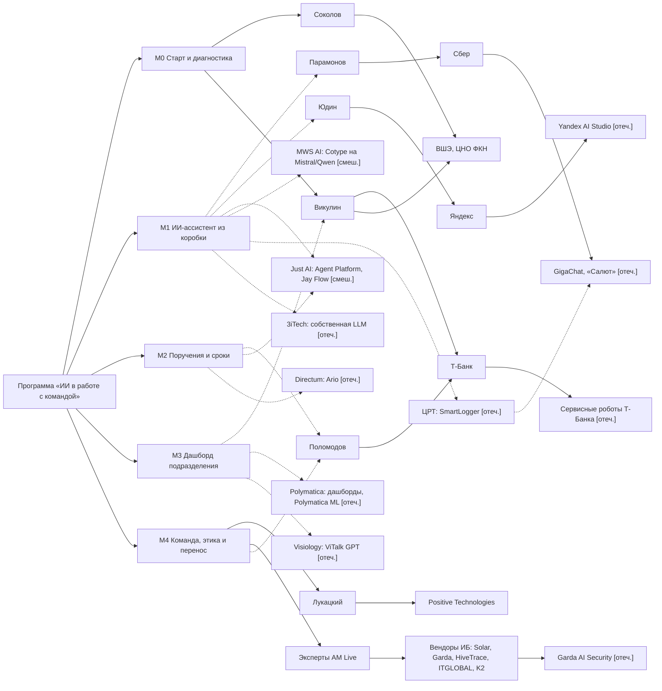

# Пул кандидатов команды реализации с разметкой GRA (Москва)

> **Внутренний артефакт академии, заказчику не передаётся.** Документ нужен
> руководителю отдела цифровых программ, чтобы собрать экспертную команду
> (US-3 [постановки](../task-contract.md)) и видеть силу доказательств за
> каждым кандидатом. В паспорт для заказчика попадают только роли и
> требования к ним ([team.md](../passport/team.md)), но не имена из этого
> пула.

> **Приватность.** Здесь собраны только публичные профессиональные сведения
> из открытых источников: должность, работодатель, публичные выступления и
> программы, в которых человек назван преподавателем. Контакты, оценки
> личности и непубличные сведения не собирались (ограничение 6 постановки).
> Включение в пул **не означает согласия** кандидата участвовать: ни с кем из
> перечисленных людей и ни с одной компанией контакт не устанавливался, RFI не
> отправлялся.

Пул закрывает пункт 4 постановки и задачу З-9
[task-contract.md](../task-contract.md). Факты, источники и перепроверка
исполнителем (G5) лежат в отчёте
[2026-11-10-candidate-pool-facts.md](../../../../research/ai-team-management-program/2026-11-10-candidate-pool-facts.md);
номера в квадратных скобках ниже — номера источников этого отчёта (§5).
Модули и роли взяты из [architecture.md](../passport/architecture.md) и
[team.md](../passport/team.md). Бренды вузов и бизнес-школ появляются здесь
как места работы кандидатов: это внутренний документ, а не тело программы
(ограничение 5 постановки).

> **Версия 0.2 (итерация 2, задача #732).** Пул расширен блоком D —
> стартапы и компании МСБ в робототехнике, ИИ-агентах и автоматизации
> бизнес-процессов (§14). Рейтинг теперь складывается из соответствия роли и
> доступности публичного профессионального канала связи (шкала К0–К3, §14.1).
> Для блоков A и B доступность контакта проверена аудитом
> [2026-11-11-candidate-public-channels-audit.md](../../../../research/ai-team-management-program/2026-11-11-candidate-public-channels-audit.md);
> устаревшие факты исправлены на месте с пометкой «итерация 2». Разделы 1–13
> описывают пул итерации 1 и сохранены как база сравнения.

## 1. Состав пула и фильтры

Пул покрывает роли, которые академия набирает **извне**: ведущего эксперта по
ИИ-трансформации (8 очных дней), гостевых экспертов (по полдня в каждом
очном модуле), методического партнёра из вуза и компании-партнёры,
которые дают инструмент и учебный кейс для практикума. Куратор и ИИ-инженер
практикума в пул **не входят**: это штатные роли академии, их требования
описаны в [team.md](../passport/team.md).

Кандидаты разделены на три блока так, как просил диалог заказчика:

- **A — корпоративные эксперты**: люди, которые работают в компаниях и
  публично говорят об ИИ;
- **B — независимые преподаватели вузов и бизнес-школ**;
- **C — компании типа B**: поставщики ИИ-решений и интеграторы, которые
  могут дать продукт для практикума, учебный кейс или спикера.

Граница между A и B условна. Почти все найденные люди совмещают работу в
корпорации и преподавание в ВШЭ или МФТИ, поэтому у них стоит пометка
«A/B», а блок B без совмещения почти пуст (см. §5).

Фильтры отбора:

1. **Москва.** У человека — подтверждённое преподавание или работа в
   Москве; у компании — офис или головная компания в Москве. Где офис не
   подтверждён, стоит «нет данных», и кандидат не отбрасывается: это
   проверяется по ЕГРЮЛ (§11).
2. **Не менее 5 лет на рынке.** Для компании это регистрация не позднее 2021
   года. Content AI и Raft зарегистрированы как юрлица в 2022 году и фильтр
   **не проходят**. Они остаются в таблице блока C с пометкой, потому что у
   Content AI заявлена более долгая продуктовая история и нужна проверка
   правопреемства. Для человека фильтр означает не менее 5 лет в профессии;
   подтверждён он только у Лукацкого (в ИБ с 1992 года [15]), у остальных
   стаж по открытым источникам не установлен.
3. **Публичная активность — маркер, а не блокер.** Отсутствие Telegram-канала,
   выступлений или публикаций снижает оценку репутационной массы (M4), но
   не исключает кандидата. Так, у Викулина публичной активности вне ВШЭ не
   найдено, но он остаётся в ядре пула: преподавание на программе для
   руководителей подтверждено первоисточником. *Итерация 2: опровергнуто —
   у Викулина есть личный Telegram-канал и сайт с публикациями до ноября
   2026 года (аудит [3, 4]).*

## 2. Как читать разметку GRA

### 2.1. Источники определений

Разметка опирается на исследовательскую модель GRA:
[methodology/research-program](https://github.com/G-Ivan-A/aether-orbis-gra/tree/main/methodology/research-program),
файл `20-taxonomy.md` (массы, дистанции, полярность, модели H0–H6) и файл
`30-decision-framework.md` (гейт G1–G6). Определения ниже **взяты оттуда**, а
не придуманы заново. Согласованность этих определений внутри Хаба
проверена аудитом
[2026-10-10-reputation-technologies-consistency-audit.md](../../../../docs/audit/2026-10-10-reputation-technologies-consistency-audit.md).
Там же исправлено старое прочтение «дистанция обратна доверию».

Вторая опора — скоринговая модель партнёров
[§3.7 стратегии привлечения партнёров](../../../../research/education/2026-06-29-partner-attraction-strategy.ru.md#37-скоринговая-модель).
Она не определяет M, D и P, а даёт критерии отбора российских партнёров
со шкалой 0–100: доступность для российской аудитории (вес 20), учебная
применимость кейса (14), скорость согласования (12), этическая и юридическая
простота (10), стратегическое соответствие GRA (8) и другие. Отсюда же
рейтинг форматов привлечения (§3.7.3): учебный кейс-партнёр — 88,
отраслевой круглый стол — 82, корпоративный преподаватель — 76,
партнёрская лекция с вузом — 71. В пуле эти форматы использованы как
подсказка, в какой роли звать кандидата. Числовой балл 0–100 кандидатам
**не присваивается**: модель §3.7 построена для курса по
репутационным технологиям, и её веса на эту программу не калибровались. Перенос
формата — интерпретация (◐).

### 2.2. Статусы утверждений

Каждое ключевое утверждение о кандидате помечено:

- **●** — факт, который подтверждён открытым первоисточником (страница
  вуза, профиль на Habr, текст эфира);
- **◐** — интерпретация: факт есть, но вывод из него (например, «может вести
  М3») сделан исполнителем, или источник — самоописание компании;
- **○** — гипотеза: только сводка поиска («С» в отчёте), заголовок без
  текста или отсутствие данных.

### 2.3. Масса M1–M4 в этом пуле

По `20-taxonomy.md` масса — наблюдаемые характеристики узла, которые, по
гипотезе, усиливают его взаимодействия. Влияние на конкретное решение —
**не** масса, а проявление массы в контексте (бывший M5 фиксируется
отдельно). Для человека в пуле компоненты читаются так:

- **M1 — ресурсная**: ресурсы организации, которая стоит за кандидатом
  (банк, вендор, вуз). Это не личное состояние: оно не собирается.
- **M2 — институциональная (позиционная)**: формальные полномочия —
  должность, роль автора или руководителя программы. От неё зависит, может ли
  человек сам согласовать участие.
- **M3 — сетевая**: число и качество связей, посредничество между группами.
  Например, мост «вуз ↔ корпорация» или модерация отраслевого эфира.
- **M4 — репутационная**: публичная видимость в профессиональной среде —
  выступления, публикации, премии. Отсутствие данных даёт «?», а не «низко».

Для компании M1 — масштаб и принадлежность к холдингу, M2 — формальный
статус (реестр ПО, статус базовой платформы), M3 — отраслевые связи
(конференции, совместные предприятия, кейсы у крупных заказчиков), M4 —
репутация. Выручку и численность пул не проверял, поэтому M1 у большинства
компаний — «?».

### 2.4. Дистанция D1–D5 в этом пуле

Дистанция — открытый многомерный конструкт: мера разделённости двух узлов,
которая, по гипотезе, ослабляет их взаимодействие. Это **не** «обратное
доверие», и оси не сводятся в одно число. Дистанция измеряется от кандидата
до программы, то есть до академии и банка-заказчика:

- **D1 — физическая/пространственно-временная**: подтверждено ли
  присутствие в Москве и доступность для очных дней.
- **D2 — информационно-коммуникационная**: есть ли канал от академии к
  кандидату. Прямого канала нет ни у кого: RFI не отправлялся, контактов нет.
  Поэтому «средне» означает, что есть публичная площадка (программа вуза,
  эфир, профиль компании), через которую можно выйти на кандидата, а
  «далеко» — что такой площадки не найдено.
- **D3 — социальная / доверие**: история выполненных обязательств перед
  академией. Её нет ни у одного кандидата, поэтому у всех стоит «?» по правилу
  Дня 1 GRA: «?» вместо 0 при отсутствии данных.
- **D4 — ценностная/культурная**: насколько повестка кандидата совпадает с
  программой. Программа — про управленческую рутину и команду, а не про
  разработку моделей. Вендорская позиция «продать стек» повышает D4.
- **D5 — институциональная**: формальные барьеры. Сюда входят конкуренция с
  банком-заказчиком (NDA, согласие работодателя), закупочные процедуры, реестр
  ПО и требования ИБ банка, провал фильтра «≥5 лет».

### 2.5. Полярность P1–P4 в этом пуле

Полярность — характеристика связи: в какую сторону связь действует на
интересы узла и, по гипотезе, куда направлен поток по ней.

- **P1 — знак** связи кандидата с программой: +1, 0, −1 или «?». Знак ставится
  отдельно по содержанию и по конфликту интересов. Если они расходятся,
  итог — «?», а не среднее.
- **P2 — направленность**: что течёт от кандидата к программе (экспертиза,
  инструмент, кейс) и что от программы к кандидату (доступ к 20–25
  руководителям банка как к потенциальным клиентам). Обратный поток — источник
  коммерческого интереса вендора.
- **P3 — поток среды** (метафора, ○): идёт ли кандидат «по потоку»
  требований банка к отечественному стеку и реестру ПО, «против» или
  «поперёк».
- **P4 — время**: знак и направление меняются. У каждой разметки есть
  дата фиксации (10.11.2026), и смена места работы кандидата требует
  пересмотра.

### 2.6. Порядковый режим H6 и обозначения

Разметка сделана в **порядковом режиме H6** (`20-taxonomy.md`, §5): чисел нет,
кандидаты ранжируются по массе и дистанции внутри пула, у связи ставится знак
+/−/?. Сила связи F по формуле H1 не считается. В аудитории её тоже никто не
считает, а количественные оценки по открытым данным ненадёжны.

| Ось | Обозначения |
| --- | --- |
| M1–M4 | ↑ — выше среднего по пулу; → — средне; ↓ — ниже; ? — нет данных |
| D1–D5 | Б — близко; С — средне; Д — далеко; ? — нет данных |
| P1 | +1, 0, −1, ? |

Выводы пула проходят гейт G1–G6 (`30-decision-framework.md`) лишь частично:
статус по каждому шагу гейта — в §12.

## 3. Перенумерация модулей

Отчёт о фактах писался до того, как устоялась архитектура, поэтому в нём
модули пронумерованы иначе: М1 — обзор кейсов, М2 — встречи, протоколы и
поручения, М3 — дашборд, М4 — ИБ и 152-ФЗ, М5 — изменения и команда. В пуле
везде используется **итоговая нумерация паспорта**
([architecture.md](../passport/architecture.md)). Соответствие такое:

| Модуль отчёта о фактах | Модуль паспорта | Комментарий |
| --- | --- | --- |
| М1 «Обзор кейсов» | М0 «Старт и диагностика» (онлайн) и вводная часть М1 | Обзор кейсов и отбор задач — материал онбординга, отдельного очного модуля нет |
| М2 «Встречи / протоколы / поручения» | **разделён**: встречи и протоколы → М1 «ИИ-ассистент из коробки»; поручения и сроки → М2 «Поручения и сроки» (артефакт B) | Речевые технологии идут в М1, СЭД и агентная связка «протокол → реестр» — в М2 |
| М3 «Дашборд» | М3 «Дашборд подразделения» (артефакт A) | Без изменений |
| М4 «ИБ / 152-ФЗ / маскирование» | **разделён**: маскирование ПДн → М1 (практика); ИБ-политика и этика → М4 | Чек-лист маскирования нужен уже в первом очном модуле |
| М5 «Изменения / команда» | М4 «Команда, этика и перенос» (+ демо-день) | Отдельного пятого модуля в паспорте нет |

Дальше ссылки на модули в таблицах пула — только в нумерации паспорта.

## 4. Блок A — корпоративные эксперты

### 4.1. Ключевые утверждения

| Кандидат | Ключевое утверждение | Статус | Источник |
| --- | --- | --- | --- |
| A/B-1 Всеволод Викулин | Руководитель команды сервисных роботов в Т-Банке; автор и преподаватель интенсива ЦНО ФКН ВШЭ «Генеративный ИИ для руководителей» (очно 6–7.06.2026, онлайн 18–21.08.2026): отбор GenAI-кейсов, ROI, структура пилота | ● (G5: V-3) | [5], [6] |
| | Публичной активности вне материалов ВШЭ не найдено | ○ → **опровергнуто в итерации 2**: личный Telegram-канал и сайт vikulin.ai; на сайте — «Т-Банк: руковожу внедрением AI-агентов» и собственный консалтинг для руководителей | аудит [3], [4] |
| A/B-3 Сергей Юдин | Технический директор направления профессиональных ИИ-сервисов «Яндекса»; соавтор и эксперт «ИИ-лидеров» ВШЭ | ● (G5: V-2) | [3] |
| | Связан с платформой агентов Yandex AI Studio | ◐ (по контексту роли; новости вендора — С) | [9], [10] |
| A/B-4 Александр Поломодов | Технический директор Т-Банка; публичный спикер; эксперт «ИИ-лидеров» | ● (G5: V-2) | [3] |
| | Итерация 2: в собственном канале и на сайте — «технический лидер, ex-CTO и Technical Fellow», работодатель не назван; работа в Т-Банке на 2026-11-11 **требует проверки** | ◐ | аудит [6]–[8] |
| | Доклад на AI Boost о переходе команд от ИИ-помощников к агентам | ○ (С) | [13] |
| A/B-5 Евгений Парамонов | По ВШЭ — «технический директор сервисов GigaChat и ассистента «Салют» (Сбербанк)» | ● как цитата ВШЭ (G5: V-4) | [3] |
| | Должность расходится с другими источниками: управляющий директор SberDevices (vc.ru); технический директор GigaChat — другой человек (developers.sber.ru) | ◐, требует проверки | [21], [22] |
| A/B-7 Алексей Лукацкий | Бизнес-консультант по ИБ Positive Technologies, в кибербезопасности с 1992 года; в программе ВШЭ — Chief Evangelist Officer | ● | [15], [3] |
| | Публично говорит о рисках ИИ в ИБ (дипфейки, фишинг, снижение порога атак) | ○ (С) | [16] |
| | Темы 152-ФЗ и ПДн в найденных материалах нет | нет данных | — |
| A/B-9 Илья Самофеев | Исполнительный директор red_mad_robot; модератор эфира AM Live «Безопасность ИИ» 14.10.2026 | ● | [7] |
| A/B-10 Эксперты AM Live | Николай Куликов (Solar Group), Денис Каракай (Garda AI Security), Никита Беляевский (HiveTrace), Вячеслав Валькович (ITGLOBAL.COM; в итерации 1 — «Вальковиц», исправлено по [7] и аудиту [21]), Максим Князев (K2 Cybersecurity) — участники эфира 14.10.2026 | ● | [7] |
| | Тезисы эфира: тотальная блокировка ИИ не работает — нужна корпоративная альтернатива и DLP; заказчики хотят маскировать собственные определения конфиденциального; ИИ-фаервол на уровне MVP; 43% слушателей «почти не контролируют» ИИ | ● как мнения участников, ◐ как основание для модуля | [7] |

### 4.2. Разметка GRA

| Кандидат | M1 / M2 / M3 / M4 | D1 / D2 / D3 / D4 / D5 | P1 | P2, P3, P4 | Стек | Модули паспорта | Формат по §3.7.3 |
| --- | --- | --- | --- | --- | --- | --- | --- |
| Викулин | ↑ / → / → / ↓ | Б / С / ? / Б / Д | содержание +1, конфликт −1 → **?** | P2: к программе — ROI и структура пилота; от программы — доступ к руководителям банка-конкурента. P4: пересмотр при смене работодателя | отечественный, внутренняя разработка Т-Банка (◐) | М0 и вводная часть М1 (отбор задач, кейсы), М3 (экономика решения), М4 (пилот → дорожная карта) — ◐ | Корпоративный преподаватель (76) |
| Юдин | ↑ / ↑ / → / → | Б / С / ? / С / С | содержание +1, вендор стека −1 → **?** | P2: агентные сценарии ↔ продвижение Yandex AI Studio. P3: по потоку (отечественный стек) | отечественный (Яндекс) | М1, М2 — ◐ | Корпоративный преподаватель (76) |
| Поломодов | ↑ / ↑ / → / → | Б / С / ? / С / Д | содержание +1, конфликт −1 → **?** | P2: опыт команд с ИИ-агентами; от программы — то же, что у Викулина | отечественный, внутренняя разработка Т-Банка (◐) | М4 (команда с ИИ-агентами), М2 — ◐ | Корпоративный преподаватель (76) |
| Парамонов | ↑ / ? / → / → | Б / С / ? / С / Д | **?** до проверки должности | P2: ассистенты GigaChat и «Салют» ↔ продвижение экосистемы Сбера. P4: должность расходится уже сейчас | отечественный (GigaChat) | М1 — ◐ | Корпоративный преподаватель (76) |
| Лукацкий | ↑ / → / ↑ / ↑ | Б (◐) / С / ? / Б / С | **+1** (◐) по М4; риск продуктовой рекламы | P2: ИБ-рамка ↔ узнаваемость вендора ИБ. P3: по потоку (банк строго относится к ИБ) | отечественный (вендор ИБ) | М4 (ИБ-риски ИИ); М1 (маскирование) — нет данных | Корпоративный преподаватель (76) |
| Самофеев | → / ↑ / → / ? | Б (◐) / С / ? / С / С | **?** | P2: модерация ↔ продвижение интегратора | смешанный (○) | М4 — модерация круглого стола (○) | Отраслевой круглый стол (82) |
| Эксперты AM Live (5 человек) | → / → / → / → | ? / С / ? / Б / С | **+1** (◐) по содержанию М4 | P2: тезисы о теневом ИИ и DLP ↔ продвижение продуктов ИБ. P4: места работы актуальны на 14.10.2026 | отечественный (вендоры ИБ, ◐) | М4; М1 (маскирование — тезис Князева) | Отраслевой круглый стол (82) |

У всех кандидатов блока A высокая ресурсная масса M1: за ними стоят Т-Банк,
Яндекс, Сбер и Positive Technologies. Поэтому их ранжирует не масса, а
институциональная дистанция D5. Её дают три разных механизма конфликта
интересов (§8): работа на банк-конкурент, роль вендора стека и роль вендора
ИБ. Из-за этого почти у всех итоговая полярность P1 — «?», а не «+1».
Содержательно кандидаты подходят, а институционально каждого нужно
согласовать с ИБ и закупкой банка-заказчика. Лукацкий — единственный, у
кого содержание и конфликт не тянут в разные стороны на уровне модуля. Вендор ИБ
рассказывает о рисках ИИ, а не продаёт ИИ-ассистент. Поэтому его P1 «+1»,
хотя риск рекламы продуктов остаётся.

## 5. Блок B — независимые преподаватели вузов и бизнес-школ

### 5.1. Ключевые утверждения

| Кандидат | Ключевое утверждение | Статус | Источник |
| --- | --- | --- | --- |
| A/B-2 Евгений Соколов | Руководитель департамента больших данных и информационного поиска ФКН ВШЭ, доцент, научный руководитель ЦНО ФКН; автор и руководитель программы «ИИ-лидеры» (6 модулей по 3 дня, 6 месяцев) | ● (G5: V-1, V-2) | [3], [4] |
| | Связь с коммерческими компаниями в источниках не указана | нет данных (это не доказательство отсутствия) | — |
| A/B-6 Радослав Нейчев | Руководитель группы ML-разработки лаборатории ИИ «Яндекса»; заместитель заведующего кафедрой ФПМИ МФТИ; к. ф.-м. н. | ● (G5: V-2) | [3] |
| | Лауреат номинации «Преподаватели» Yandex ML Prize | ○ (С) | [14] |
| Бизнес-школы: СКОЛКОВО, MBS, МИРБИС, РАНХиГС, ВШБ ВШЭ | Программы по ИИ для руководителей найдены, но **ни одного** преподавателя с именем и подтверждённым ведением модуля нет | нет данных | [18], [23]–[26] |
| ИМИСП, Университет Иннополис | Найдены программы, но вне Москвы | ◐ | [27], [29] |

**Каналы, а не кандидаты.** Дарья Козлова («Яндекс Образование») названа
организатором программы «Сколково + Яндекс + ИТМО» для ИТ-руководителей [18].
Названные в рекламном материале руководители «ГигаАкадемии» Сбера [19] —
организаторы, а не преподаватели. Курс «Нейросети для руководителей»
Яндекс Практикума [28] открыть не удалось. Эти площадки — выход на
преподавателей, а не кандидаты в команду. Их полярность определяется тем же
вендорским интересом, что у Яндекса и Сбера в блоке A.

### 5.2. Разметка GRA

| Кандидат | M1 / M2 / M3 / M4 | D1 / D2 / D3 / D4 / D5 | P1 | P2, P3, P4 | Стек | Модули паспорта | Формат по §3.7.3 |
| --- | --- | --- | --- | --- | --- | --- | --- |
| Соколов | → / ↑ / ↑ / ? | Б / С / ? / Б / С | **+1** (◐): связь с вендорами не найдена | P2: методика программы для руководителей ↔ интерес вуза к корпоративному клиенту. P3: поперёк (академическая повестка) | вендорно-нейтральный (нет данных) | М0 (диагностика, методика), методическая экспертиза всех модулей — ◐ | Партнёрская лекция с вузом (71) |
| Нейчев | ↑ / → / → / → (○) | Б (◐) / С / ? / С / С | **?**: сильная ML-экспертиза, но не по темам модулей; вендор | P2: техническая база ↔ интерес Яндекса | отечественный (Яндекс) | прямых нет; техническая вводная М0 — ○ | Партнёрская лекция с вузом (71) |

Блок B — самое слабое место пула. «Независимых» преподавателей в строгом
смысле (без работы у вендора или банка) нашёлся один — Соколов. И его
сетевая масса M3 высока именно потому, что он — узел, через который в
программу ВШЭ пришли все остальные эксперты кластера. Бизнес-школы публикуют
программы, но не составы преподавателей. Поэтому закрыть блок B можно
только адресным запросом в школы, а не поиском (§11).

## 6. Блок C — компании типа B

### 6.1. Фильтр, Москва, реестр, стек, модули

Все компании описаны по самоописаниям в профилях Habr и сводкам поиска.
Перепроверку первоисточником (G5) прошло только ядро блоков A и B, поэтому
каждая компания здесь — **кандидат на RFI, а не подтверждённый партнёр**.

| № | Компания | Фильтр ≥5 лет (≤2021) | Офис в Москве | Реестр российского ПО | Стек | Модули паспорта | RFI | Источник |
| --- | --- | --- | --- | --- | --- | --- | --- | --- |
| C-1 | Just AI | проходит: 2011 ● | да (С) | Agent Platform — запись от 17.02.2026 (С) | смешанный (◐): платформа отечественная, набор моделей в Jay Flow не проверен | М1 (Jay Flow — ассистент), М2 (Agent Platform — связка «протокол → реестр») — ◐ | RFI не отправлялся | [30]–[32] |
| C-2 | Naumen | проходит: 13.11.2001 ● | нет данных (головная компания в Екатеринбурге, С) | нет данных | отечественный (◐) | М1 (Speech AI — расшифровка встреч) — ◐ | RFI не отправлялся | [33], [34] |
| C-3 | Directum | проходит: 15.08.1988 ● (возможно, год кооператива-предшественника) | нет данных | нет данных | отечественный (◐) | М2 (СЭД Directum RX, ИИ-сервисы Ario — контроль поручений) — ◐ | RFI не отправлялся | [35], [36] |
| C-4 | Visiology | проходит: 2015 ● | нет данных | заявка в 2017 году (С), подтверждения нет | отечественный (◐) | М3 (BI-дашборды; ViTalk GPT) — ◐ | RFI не отправлялся | [37], [38] |
| C-5 | Polymatica | проходит: 2010/2011 (источники расходятся, С) | да, головной офис (С) | в реестре ● (Habr) | отечественный (●: реестр) | М3 (интерактивные дашборды, работа в закрытом контуре) — ● по продукту, ◐ по применимости | RFI не отправлялся | [39], [40] |
| C-6 | Content AI | **не проходит**: юрлицо с 01.04.2022 (С); правопреемство не проверено | центры разработки в Москве (С) | ContentReader Server № 20814 от 26.12.2023 (С) | отечественный (◐) | М1 (документы, а не протоколы встреч) — ○ | RFI не отправлялся | [41] |
| C-7 | Smart Engines | проходит: 2010 ● | нет данных | нет данных | отечественный (◐) | М1 (обработка на устройстве без передачи ПДн как паттерн маскирования), М4 — ◐ | RFI не отправлялся | [42] |
| C-8 | red_mad_robot | проходит: 16.11.2008 ● | кейсы в Москве (С) | нет данных | смешанный (○): интегратор, модели не проверены | М4 (кейсы внедрения агентов, перенос), М2 — ○ | RFI не отправлялся | [43], [44], [54] |
| C-9 | MWS AI (бывш. MTS AI) | проходит: 26.09.2017 ● | нет данных | нет данных | **смешанный** (◐): Cotype 1 — на базе Mistral (западная), Cotype Pro 2 — на базе Qwen 2.5 (китайская) | М1 (распознавание и синтез речи, ассистент), М2 — ◐ | RFI не отправлялся | [45], [46] |
| C-10 | Cloud.ru | проходит: 2019 ● | нет данных | нет данных | отечественный (◐, облако) | М0 (инфраструктура учебной песочницы), М2 (Evolution AI Agents не подтверждён) — ○ | RFI не отправлялся | [47] |
| C-11 | Haulmont | проходит: 05.09.2008 ● | нет данных | нет данных (аккредитованная ИТ-компания) | отечественный (◐) | М2 (СЭД TEZIS) — ◐ | RFI не отправлялся | [48] |
| C-12 | Raft | **не проходит**: 01.04.2022 ● | нет данных | нет данных | нет данных | М4 (внедрение ИИ) — ○ | RFI не отправлялся | [49] |
| C-13 | КРОК | проходит: 1992 ● | нет данных | нет данных | смешанный (○): мультивендорный интегратор | прямых нет: интеграции вне MVP (Д-2) | RFI не отправлялся | [50] |
| C-14 | ЛАНИТ | проходит: 16.10.1989 ● | нет данных | нет данных | смешанный (○): мультивендорный интегратор | прямых нет: интеграции вне MVP (Д-2) | RFI не отправлялся | [51] |
| C-15 | Группа ЦРТ | год не подтверждён (○) | нет данных | нет данных | отечественный (◐): интеграция с SaluteSpeech | М1 (речевая аналитика SmartLogger) — ◐ | RFI не отправлялся | [52] |
| C-16 | 3iTech (бывш. 3i Technologies) | переименование в 02.2020, год основания нет данных (○) | нет данных | нет данных | отечественный по заявлению (◐): собственная LLM «3iTech AI» | М1 (речевая аналитика с LLM) — ◐ | RFI не отправлялся | [53] |

Вне таблицы: продукт JasIA не найден, его существование не подтверждено (○).
Сервис протоколирования совещаний «Аспро» [55] упомянут в выдаче, но
страница не открылась, поэтому в пул он не включён (○). ELMA, IBS, Selectel,
«Мегапьютер», «Норбит» и Dialog Systems не проверялись из-за бюджета
запросов.

### 6.2. Разметка GRA и конфликт интересов

D2 у всех компаний — «далеко» (Д): RFI не отправлялся, а профиль на Habr —
канал вещания, а не канал связи. D3 у всех — «?». D4 у всех — «С»: это
вендоры, их повестка — продажа продукта. Поэтому в таблице показаны только
различающиеся оси.

| № | Компания | M1 / M2 / M3 / M4 | D1 | D5 | P1 | P3 (○) | Конфликт интересов |
| --- | --- | --- | --- | --- | --- | --- | --- |
| C-1 | Just AI | ? / ? / ↑ / ? | Б | Б (◐, реестр С) | +1 (◐) | по потоку | вендор агентной платформы: интерес продать её после программы; организует конференцию Conversations и премию Generation AI Awards ● |
| C-2 | Naumen | ? / ? / ? / ? | С (◐) | ? | ? | по потоку | вендор речевых технологий |
| C-3 | Directum | ? / ? / ? / ? | ? | ? | +1 (◐) | по потоку | вендор СЭД: банк уже может работать на другой СЭД |
| C-4 | Visiology | ? / ? / ? / ? | ? | ? | +1 (◐) | по потоку | вендор BI; прямой конкурент Polymatica |
| C-5 | Polymatica | ? / ↑ (◐, статус базовой платформы ФНС, С) / ? / ? | Б | Б (●) | +1 (◐) | по потоку | вендор BI; прямой конкурент Visiology |
| C-6 | Content AI | ? / ? / ? / ? | Б (◐) | Д: не проходит фильтр | ? | по потоку | вендор документной обработки |
| C-7 | Smart Engines | ? / ? / ? / ? | ? | ? | +1 (◐) по М1 как паттерн | по потоку | вендор распознавания документов |
| C-8 | red_mad_robot | ? / ? / ↑ (◐, совместное предприятие с «Билайном», С) / ? | Б (◐) | ? | ? | ? | интегратор; Самофеев (блок A) — исполнительный директор |
| C-9 | MWS AI | ↑ (◐, группа МТС) / ? / ? / ? | ? | ? | ? | **поперёк**: отечественная модель на зарубежных базах | вендор моделей; в группе МТС есть банк — проверить конкуренцию с заказчиком (○) |
| C-10 | Cloud.ru | ↑ (◐, группа Сбера) / ? / ? / ? | ? | С | ? | по потоку | **вендор стека** из группы Сбера, а Сбер — ещё и банк |
| C-11 | Haulmont | ? / ? / ? / ? | ? | ? | +1 (◐) | по потоку | вендор СЭД |
| C-12 | Raft | ? / ? / ? / ? | ? | Д: не проходит фильтр | ? | ? | интегратор |
| C-13 | КРОК | ? / ? / ? / ? | ? | ? | 0 | ? | интегратор; продажа проектов интеграции вне MVP |
| C-14 | ЛАНИТ | ? / ? / ? / ? | ? | ? | 0 | ? | то же |
| C-15 | Группа ЦРТ | ? / ? / → (◐, кейсы ВТБ, МТС, Сбера, С) / ? | ? | ? | +1 (◐) | по потоку | вендор речевой аналитики; кейс ВТБ — банк, возможная чувствительность для заказчика |
| C-16 | 3iTech | ? / ? / ? / ? | ? | ? | +1 (◐) | по потоку | вендор речевой аналитики |

Блок C почти целиком состоит из «?» по массе. Это честный результат, а не
недоработка разметки. Открытые профили говорят, *что* компания делает, но не
говорят, насколько она устойчива и какая у неё репутация у банков. Различает
компании только связка «модуль → продукт → реестр». По ней выделяются
Polymatica (единственная с реестром, подтверждённым ●, и с Москвой) и Just AI
(Москва, реестр по сводке и высокая сетевая масса). Ориентир по формату
для всех компаний блока — **учебный кейс-партнёр** (§3.7.3, 88): продукт
показывается на синтетических данных учебного набора, а не внедряется у
заказчика.

## 7. Граф GRA: Программа → Модуль → Преподаватель → Компания → упоминания ИИ

Граф показывает, через какие узлы ИИ-стек конкретного вендора попадает в
модуль. На этом пути и лежит конфликт интересов. Стек отмечен в узлах
упоминаний ИИ: [отеч.] — отечественный, [смеш.] — смешанный (в паспорте и
допущении Д-3 — «комбинированный»), [зап.] — западный. Пунктирные рёбра — гипотезы (○) и связи, ожидающие RFI.

Тот же граф рёбрами. В графе западного стека в чистом виде нет: зарубежные
модели входят только как основа отечественных продуктов (MWS AI) и, возможно,
как часть набора моделей у Just AI.

| От | К | Тип связи | Статус | Источник |
| --- | --- | --- | --- | --- |
| Программа | М0–М4 | состав программы | ● | [architecture.md](../passport/architecture.md) |
| М0 | Соколов | методика и диагностика | ◐ | [3], [4] |
| М0 | Викулин | отбор задач для ИИ, экономика пилота | ◐ | [5], [6] |
| М1 | Парамонов | ИИ-ассистенты | ○ до проверки должности | [3], [21] |
| М1 | Юдин | агенты и ассистенты | ◐ | [3], [9] |
| М2 | Поломодов | агенты в командах | ○ | [13] |
| М3 | Викулин | ROI и решение по данным | ◐ | [5] |
| М4 | Лукацкий | риски ИИ в ИБ | ◐ | [3], [16] |
| М4 | Эксперты AM Live | теневой ИИ, DLP, маскирование | ● как тезисы | [7] |
| М4 | Поломодов | команда с ИИ-агентами | ○ | [13] |
| Соколов | ВШЭ, ЦНО ФКН | место работы | ● | [3] |
| Викулин | Т-Банк; ВШЭ | место работы; преподавание | ● | [5], [6] |
| Поломодов | Т-Банк | место работы | ● | [3] |
| Юдин | Яндекс | место работы | ● | [3] |
| Парамонов | Сбер | место работы, должность спорна | ◐ | [3], [21], [22] |
| Лукацкий | Positive Technologies | место работы | ● | [15] |
| Эксперты AM Live | Solar, Garda, HiveTrace, ITGLOBAL.COM, K2 | места работы на 14.10.2026 | ● | [7] |
| Т-Банк | сервисные роботы | ИИ-продукт | ● (в роли Викулина) | [5] |
| Яндекс | Yandex AI Studio | ИИ-продукт | ○ (новости вендора) | [9], [10] |
| Сбер | GigaChat, «Салют» | ИИ-продукт | ● (в роли Парамонова по ВШЭ) | [3] |
| Garda | Garda AI Security | ИИ-продукт ИБ | ● | [7] |
| М1 | Just AI, MWS AI, ЦРТ, 3iTech | речевые технологии и ассистенты, ждут RFI | ◐ | [30], [45], [52], [53] |
| М2 | Just AI, Directum | агенты и СЭД, ждут RFI | ◐ | [30], [36] |
| М3 | Polymatica, Visiology | BI-дашборды, ждут RFI | ◐ | [40], [37] |
| ЦРТ | SaluteSpeech (Сбер) | интеграция | ○ (С) | [52] |
| MWS AI | Mistral, Qwen 2.5 | базовые модели Cotype | ○ (С) | [46] |

## 8. Конфликты интересов

Конфликт интересов здесь — не основание исключить кандидата, а
институциональная дистанция D5. Её нужно снять до контракта. В пуле
четыре механизма конфликта.

**Банк-конкурент.** Заказчик — банк, а Викулин и Поломодов работают в
Т-Банке. Прямой риск — утечка практик в обе стороны: эксперт видит
рабочие сценарии руководителей банка-заказчика, а участники получают
внутренние кейсы Т-Банка, которые тот, возможно, не готов раскрывать.
Снимается двусторонним NDA, согласием работодателя эксперта, учебными
данными вместо данных заказчика и явным согласием заказчика на эксперта из
Т-Банка. Последнее — решение заказчика, а не академии. Сбер (Парамонов,
Cloud.ru) тоже банк, поэтому к нему применимо то же правило. У MWS AI риск
предположительный (○): в группе МТС есть банк, это нужно проверить.

**Вендор стека.** Яндекс (Юдин, Нейчев) и Сбер (Парамонов, Cloud.ru)
поставляют ассистенты и модели, из которых программа собирает свой стек.
Паспорт намеренно не фиксирует бренд: стек выбирается вместе с ИБ заказчика
на этапе М0 ([architecture.md](../passport/architecture.md), «Технологический
стек»). Правило для пула: эксперт вендора не участвует в выборе стека, а
продукт вендора в модуле показывается рядом хотя бы с одной альтернативой.

**Вендор ИБ.** Positive Technologies (Лукацкий) — вендор ИБ. Его роль в
М4 — рамка рисков, а не выбор средств защиты. Конфликт слабее, чем у вендора
стека, но правило то же: без продуктовых рекомендаций в модуле.

**Эксперты AM Live.** Все пятеро работают у вендоров ИБ (Solar Group, Garda,
HiveTrace, ITGLOBAL.COM, K2 Cybersecurity), и их тезисы — мнения участников
эфира, а не исследование. Для М4 это материал для дискуссии, а не
нормативная база. Лучший формат здесь — отраслевой круглый стол с
несколькими вендорами (§3.7.3, 82): так интересы одного вендора
компенсируются другими.

## 9. Покрытие модулей и пробелы

| Модуль паспорта | Подтверждённые люди | Компании (через RFI) | Покрытие | Пробел и как закрыть |
| --- | --- | --- | --- | --- |
| М0 Старт и диагностика | Соколов (методика, ●), Викулин (отбор задач, ●) | Cloud.ru — песочница (○) | хорошее | Нет |
| М1 ИИ-ассистент из коробки | Парамонов, Юдин — по ассистентам вообще (◐); маскирование — тезисы AM Live (●) | Just AI, MWS AI, ЦРТ, 3iTech, Naumen; Smart Engines — паттерн локальной обработки | **частичное** | Нет подтверждённого преподавателя по **протоколам встреч**. Закрывается демонстрацией речевого партнёра по RFI, а сценарий ведёт ведущий эксперт |
| М2 Поручения и сроки | Поломодов — агенты в командах (○) | Directum, Haulmont (СЭД), Just AI (агенты) | **слабое** | Нет подтверждённого преподавателя по **извлечению поручений**. Закрывается кейсом партнёра по СЭД или агентной платформе и учебным набором академии; содержание ведёт ведущий эксперт |
| М3 Дашборд подразделения | Викулин — ROI и решение по данным (◐) | Polymatica, Visiology | **частичное** | Нет подтверждённого преподавателя по **дашбордам задач подразделения**. Закрывается BI-партнёром по RFI как учебным кейс-партнёром |
| М4 Команда, этика и перенос | Лукацкий (ИБ, ●), эксперты AM Live (●), Поломодов (команды, ○) | red_mad_robot (кейсы внедрения, ○) | ИБ — хорошее; изменения и команда — слабое | Нет преподавателя по **управлению изменениями** из бизнес-школ (имён не найдено). Закрывается адресным запросом в бизнес-школы; до тех пор тему ведёт ведущий эксперт |

Главный пробел пула — практическое ядро программы. Ни у одного
подтверждённого преподавателя нет публичной темы «протоколы встреч» или
«дашборд задач подразделения». Кластер ВШЭ силён в стратегии, экономике
пилотов и рисках, то есть в том, что паспорт относит к М0 и М4. Поэтому М1–М3
нельзя закрыть только людьми: их закрывают **компании через RFI** (продукт
на синтетическом учебном наборе) вместе с ведущим экспертом и ИИ-инженером
практикума, который в пул не входит. Это совпадает с выводом отчёта о
фактах (§3, п. 3): практику разумнее строить на синтетических данных и одном-двух
вендорных инструментах.

## 10. Резерв на каждую роль (ГК-11)

Постановка требует резервного эксперта на каждую роль (ГК-11: «эксперт или
партнёр выбывает → срыв модуля»). Резерв выбирался так, чтобы он не
разделял конфликт основного кандидата. Если основной выбывает из-за
конфликта, резерв из той же компании не поможет.

| Роль | Основной кандидат | Резерв | Почему резерв устойчив |
| --- | --- | --- | --- |
| Ведущий эксперт по ИИ-трансформации (8 очных дней) | Викулин (◐: при согласии Т-Банка и заказчика) | Юдин, затем Поломодов | Юдин не связан с банком-конкурентом; Поломодов — только если заказчик согласен на Т-Банк |
| Методический партнёр из вуза | Соколов | Нейчев (МФТИ) | Другой вуз, тот же уровень формальной позиции |
| Гость М1: ассистент, встречи, протоколы | Речевой партнёр по RFI (Just AI / MWS AI / ЦРТ / 3iTech) | Naumen (Москва не подтверждена); эксперт — Парамонов после проверки должности | Четыре независимых вендора: выбытие одного не срывает модуль |
| Гость М1: маскирование ПДн | Князев (AM Live: тезис о маскировании собственных определений) | Smart Engines (паттерн локальной обработки), Лукацкий | Разные компании и разный уровень: инженер, вендор, консультант |
| Гость М2: поручения и сроки | Directum или Just AI Agent Platform по RFI | Haulmont (TEZIS); эксперт — Поломодов (○) | Два разных класса решений: СЭД и агентная платформа |
| Гость М3: дашборд | Polymatica по RFI | Visiology | Прямые конкуренты: если один откажется, второй заинтересован прийти |
| Гость М4: ИБ и этика | Лукацкий | Эксперты AM Live: Беляевский, Каракай, Куликов, Валькович, Князев; Беляков («Лаборатория Касперского», антифрод — найден в итерации 2) | Пять вендоров ИБ, не связанных с Positive Technologies |
| Гость М4: команда и изменения | Поломодов (○) | red_mad_robot (кейсы внедрения), Самофеев — модератор круглого стола | Резерв слабый: закрыть адресным запросом в бизнес-школы (§11) |

## 11. Следующие шаги

**RFI компаниям блока C.** В первую очередь — Polymatica, Visiology, Just AI,
MWS AI, ЦРТ, 3iTech, Directum, Haulmont. RFI отправляется без названия
банка-заказчика (формулировка «корпоративный клиент финансового сектора»).
Состав запроса:

1. Юрлицо: ОГРН, дата регистрации, адрес в Москве; для Content AI, Directum,
   MWS AI и 3iTech — история переименований и правопреемство.
2. Продукт для модуля: что именно покажет продукт в М1, М2 или М3 на
   синтетическом учебном наборе академии (протоколы, поручения, статусы
   задач).
3. Реестр российского ПО: номер записи и дата для конкретного продукта, а
   не для компании.
4. Размещение и данные: облако в РФ, on-premise или закрытый контур; где
   хранятся данные; обучается ли модель на данных клиента; соответствие
   152-ФЗ.
5. Модели: какие LLM и речевые модели используются, их происхождение
   (отечественные, западные, китайские, open-weight). Это нужно для отметки
   стека «отечественный / западный / смешанный» в пуле.
6. Учебные лицензии: 25 учебных аккаунтов на 6 месяцев, цена, ограничения.
7. Спикер: есть ли эксперт на полдня очного модуля, его тема и условия.
8. Банковские клиенты: работает ли компания с банками и есть ли
   ограничения на участие в программе для банка (без названия заказчика).
9. Готовность подписать NDA и сроки ответа.

**Проверка по ЕГРЮЛ.** Действующий статус, дата регистрации (фильтр «≥5
лет»), адрес (фильтр «Москва») и смена наименования. Обязательно для Naumen
(Москва), Directum (1988 или позже), Content AI и Raft (2022), MWS AI
(официальное название), ЦРТ и 3iTech (год основания).

**Проверка по реестру Минцифры.** Номер записи, дата, класс ПО и
правообладатель для каждого продукта, который попадёт в модуль. Сейчас
первоисточником подтверждён только реестр Polymatica; записи Just AI и
Content AI известны по сводке поиска.

**NDA.** Двусторонний NDA с каждым внешним экспертом и партнёром до
раскрытия названия заказчика. Для экспертов Т-Банка и Сбера — ещё и
письменное согласие работодателя и явное согласие заказчика. Ни в одном модуле
не используются данные заказчика, только учебный набор академии.

**Люди.** Проверить должность Парамонова по первоисточнику Сбера и даты
ближайших потоков программ ВШЭ (в публикациях они менялись). Запросить у
бизнес-школ состав преподавателей программ по ИИ для руководителей и
управлению изменениями, чтобы закрыть блок B и резерв М4.

## 12. Рекомендуемое ядро для команды

Ядро — предварительный вывод (◐). Оно прошло шаги G1–G3 и G5 только для
людей. Компании ждут RFI и проверки по реестрам, поэтому до контракта
ядро остаётся гипотезой рабочей команды, а не решением. Для каждого
пункта, как требует G4, указаны условие, которое опровергло бы
рекомендацию, и альтернатива.

| Роль | Рекомендация | Почему | Опровергается, если… | Альтернатива |
| --- | --- | --- | --- | --- |
| Пул ведущего эксперта | Кластер ЦНО ФКН ВШЭ: **Викулин** — ROI, отбор задач, структура пилота; **Соколов** — методический контакт | Единственный кластер, где преподавание ИИ руководителям в Москве подтверждено первоисточником (V-1–V-3) | заказчик не согласен на эксперта из Т-Банка, Т-Банк не даёт согласия или NDA не подписан | Юдин (с правилом «без выбора стека»), методика — Соколов |
| Гость М4 по ИБ | **Лукацкий** | ИБ-эксперт с наибольшей публичной массой (M3, M4) и 30+ годами в профессии; назван преподавателем программы ВШЭ | он не готов говорить о рисках ИИ для руководителей без продуктовой части или недоступен | Эксперты AM Live в формате круглого стола |
| BI-партнёр М3 | **Polymatica** или **Visiology** по RFI | Единственные компании пула с продуктом под дашборд; у Polymatica реестр ● и Москва | обе не дают учебных лицензий или не работают на синтетических данных | Дашборд в табличном редакторе по шаблону академии, без партнёра |
| Речевой партнёр М1–М2 | Один из **Just AI / MWS AI / ЦРТ / 3iTech** по RFI | Речевые технологии и агенты нужны для связки «встреча → протокол → реестр поручений» | ни один не проходит требования ИБ банка (размещение, 152-ФЗ, происхождение моделей) | Универсальный ассистент из стека, выбранного с ИБ на М0, без отдельного речевого партнёра |

Эта сборка покрывает стратегию, экономику и ИБ людьми, а практику М1–М3 —
продуктами партнёров. Слабое место — управление изменениями в М4: его ведёт
ведущий эксперт, пока адресный запрос в бизнес-школы не даст имени.

## 13. Гейт G1–G6: где пул стоит сейчас

| Шаг | Состояние |
| --- | --- |
| G1 Источник | У каждого утверждения есть номер источника из отчёта о фактах; утверждения из сводок поиска помечены ○ |
| G2 Дата | Даты программ, эфира и регистрации взяты из источников; разметка зафиксирована на 10.11.2026 |
| G3 Статус | Каждое ключевое утверждение помечено ●/◐/○ (§4–§6) |
| G4 Опровержение | Для рекомендаций ядра указаны опровергающее условие и альтернатива (§12) |
| G5 Независимость | Ядро блоков A и B перепроверено исполнителем по первоисточникам (V-1–V-4); блок C не перепроверен и ждёт RFI и проверки реестров |
| G6 Личные выводы | Выводов о личности, мотивах и «психотипе» кандидатов в пуле нет и не будет: разметка касается только профессиональных ролей и организаций |

## Связанные документы

- [Отчёт о фактах по кандидатам](../../../../research/ai-team-management-program/2026-11-10-candidate-pool-facts.md)
  — источники [1]–[55] и перепроверка G5.
- [Постановка задачи](../task-contract.md): З-9, ГК-11, ограничения 5 и 6.
- [Архитектура программы](../passport/architecture.md): модули М0–М4 и стек.
- [Команда реализации](../passport/team.md): роли и требования к ним.
- [Стратегия привлечения партнёров, §3.7](../../../../research/education/2026-06-29-partner-attraction-strategy.ru.md#37-скоринговая-модель)
  — критерии и форматы привлечения.
- [GRA research-program](https://github.com/G-Ivan-A/aether-orbis-gra/tree/main/methodology/research-program)
  — определения M1–M4, D1–D5, P1–P4, H0–H6 и гейта G1–G6.
- [Аудит согласованности GRA](../../../../docs/audit/2026-10-10-reputation-technologies-consistency-audit.md).
