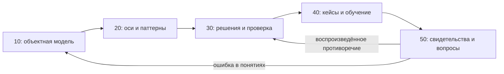

# Типы ИИ-агентов: образовательный справочник

## Главный вывод

«Copilot», «RAG», «мультиагентный» и «фоновый» отвечают на разные вопросы.
Одна система может обладать всеми четырьмя свойствами. Выбор начинается с
задачи, доступных свидетельств и допустимых действий, затем определяются
контур управления, знания, координация и среда исполнения. Название продукта
не заменяет описание этих свойств.

Это независимый **M2 Reference Research Pattern**: теория → таксономия →
выведенная из механизмов рамка решений → практика → обратная связь.
Основание формы — [Research Standard](https://github.com/G-Ivan-A/hybrid-Intelligence-lab/blob/main/standards/research-standard.md)
и [RFC RRP](https://github.com/G-Ivan-A/hybrid-Intelligence-lab/blob/main/docs/rfc/2026-07-17-rfc-reference-research-pattern.md).
Механизмы управления, поиска и координации достаточно выделены для M2;
универсального рейтинга агентов и экспериментально установленных порогов
выбора этот модуль не заявляет. Рекомендации — исследовательский синтез,
который должен пройти человеческий review; `draft` не означает стандарт Хаба.

## Для кого и зачем

**User story:** как фаундер или участник команды я хочу объяснить устройство
агента, выбрать соразмерный способ работы и проверить результат, чтобы
обучать коллег и принимать обоснованные решения без зависимости от бренда.

После изучения читатель умеет:

1. Отличить модель, агента, workflow, инструмент и артефакт.
2. Описать решение несколькими независимыми осями, включая границу автономии.
3. Составить рабочее задание, выбрать точки участия человека и критерии остановки.
4. Прочитать benchmark без переноса его результата на чужую задачу.
5. Связать паттерны с абстрактной цепочкой **Продукт → Процесс → Операция → Артефакт**.
6. Обновить знание с сохранением источника, версии и нерешённых противоречий.

Предварительно достаточно понимать вход, выход и проверку функции. API,
RAG, HITL и другие термины объяснены в [глоссарии](50-open-research.md#glossary).

## Карта чтения

| Часть | Вопрос | Результат обучения |
| --- | --- | --- |
| [10 — Теория](10-theory.md) | Что делает систему агентной? | Объектная модель и границы делегирования |
| [20 — Таксономия](20-taxonomy.md) | Какие классификации совместимы? | Оси, классические семейства и 14 практических карточек T00–T13 |
| [30 — Выбор](30-decision-framework.md) | Какой набор паттернов достаточен? | Алгоритм, компромиссы, benchmark-карта и план проверки |
| [40 — Практика](40-practice-and-cases.md) | Как применять и учить? | Маппинг БА, три разобранных кейса, упражнения и живая БЗ |
| [50 — Исследование](50-open-research.md) | Откуда выводы и как их пересматривать? | Корпус источников, насыщение, альтернативы и самоаудит |

Фаундер: введение → теория → выбор → маппинг и кейсы.
Практик: теория → карточки → выбор → упражнения.
Преподаватель: весь маршрут → задания с ответами → протокол обновления БЗ.
Исследователь: теория → метод и источники → проверка спорной рекомендации.

## Границы и связь с существующим знанием

Объект — способы построения и использования агентов в БА, репутационном
инжиниринге, сборе и классификации информации; веб-интерфейсы, программирование
и робототехника дают граничные случаи. Цепочка БА — приложение таксономии,
а не основание её определения. Здесь нет архитектуры конкретного продукта.

[Индустриальный обзор БА](https://github.com/G-Ivan-A/hybrid-Intelligence-lab/blob/main/research/ba-requirements/2026-10-28-agent-ba-industry-survey.md)
используется для различения типов решений и смысла метрик, без переноса
проектных сравнений. Его синтетические результаты не являются замерами
агентов. Из [концепции Aether Orbis](https://github.com/G-Ivan-A/aether-orbis/blob/351f0634eda5a9d6e0387a3fabcf08c94b2796f0/docs/concept.md)
берётся только принцип заменяемых компонентов и устойчивой glue logic.
Модель живой БЗ в практике — предложение этого исследования, а не описание
реализованного сервиса.

Соседние модули углубляют отдельные механизмы:
[retrieval](../retrieval/00-introduction.md),
[task processing](../task-processing/00-introduction.md),
[memory](../memory/00-introduction.md),
[tool use](../tool-use/00-introduction.md),
[evaluation](../evaluation/00-introduction.md),
[multi-agent orchestration](../multi-agent-orchestration/00-introduction.md),
[context engineering](../agent-context-engineering/00-introduction.md).
Этот модуль соединяет их в карту типов; он не заменяет их технические руководства.

## Доказательность и воспроизводимость чтения

Дата среза — **2026-10-28**. В [реестре источников](50-open-research.md#sources)
разделены первичные статьи, документация и образовательные курсы; у каждого
указаны организация/авторы, вклад и граница применимости. Документация без
даты публикации имеет только дату обращения. Числа leaderboard намеренно не
копируются: без версии набора и конфигурации они плохо переносятся.

Обозначения: **D** — документированный механизм; **R** — результат,
сообщённый авторами в пределах их исследования; **H** — наш вывод/рекомендация;
**X** — учебный синтетический пример. Карточки, маппинг и алгоритм выбора — H;
внешние основания D/R стоят рядом с механизмом. Локальные LLM-испытания не
проводились, сравнительное превосходство реализаций не установлено.

Дополнительный файл RRP не нужен: маппинг помещён в раздел 05 практики,
а БЗ — в раздел 06. Это сохраняет шестифайловую модель и позволяет менять
прикладные рекомендации независимо от понятий.
