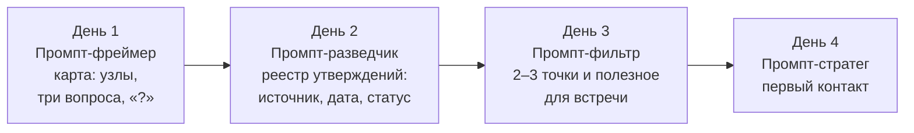

# День 2 курса «Репутационный инжиниринг»: обоснование, метод, тайминг и кейсы

**Документ 1 из 3.** Комплект Дня 2 «Собираю: проверяем основания связей» (30 октября, 18:30–20:00, онлайн, 90 минут), тема программы — «Мониторинг ресурсов, работа с данными». Остальные документы комплекта:

- [Документ 2: 24 слайда и промпты для изображений](https://github.com/G-Ivan-A/hybrid-Intelligence-lab/blob/main/research/reputation-technologies/2026-10-30-day2-presentation.md);
- [Документ 3: сценарий лектора и «Промпт-разведчик»](https://github.com/G-Ivan-A/hybrid-Intelligence-lab/blob/main/research/reputation-technologies/2026-10-30-day2-lecturer-script.md).

Версия 0.3 пересобрана по issue [#673](https://github.com/G-Ivan-A/hybrid-Intelligence-lab/issues/673). Единственный источник логики, тона и структуры — раздел Дня 2 в [RFC v0.3 «Логический каркас Дней 1–4»](https://github.com/G-Ivan-A/hybrid-Intelligence-lab/blob/main/research/reputation-technologies/2026-10-12-rfc-days-1-3-logic.md#день-2-собираю-проверяем-основания-связей). Что изменилось по сравнению с версией 0.2:

- кейс 1 — проактивное изучение сети «Х» перед встречей, по решению Дня 1. `CONFLICT` — пресс-релиз «сеть ищет местных производителей» против поста в чате «матрица закрыта до весны». Это повод для вопроса на встрече, а не тревога;
- иски за долгий срок работы читаются на простом информативном уровне: компания действует и ведёт дела. Это не форензик-анализ;
- GRA работает как guardrails для промптов: масса, дистанция и полярность — вопросы, а не расчёт;
- 24 слайда, 2 голосования в чате, 1 проба промпта; у каждого слайда есть ссылки для самостоятельного изучения;
- Промпт-разведчик обязательно ищет по ключевым словам в веб-архиве и в открытом вебе; ЕГРЮЛ — по желанию.

Документ отвечает на четыре вопроса.

1. Что такое происхождение данных (провенанс) и зачем данным статусы `PARTIAL` и `CONFLICT`?
2. Как статус меняет подготовку к первому контакту с будущим партнёром?
3. Как «Промпт-фреймер» Дня 1 превращается в «Промпт-разведчик» Дня 2 и какие guardrails он соблюдает?
4. Почему ИИ на Дне 2 делает первичную сортировку, а основания проверяет человек?

Опоры комплекта:

- [RFC v0.3](https://github.com/G-Ivan-A/hybrid-Intelligence-lab/blob/main/research/reputation-technologies/2026-10-12-rfc-days-1-3-logic.md) — слайды, гипотезы дня, условие сбора, guardrails;
- [SSOT Дня 1](https://github.com/G-Ivan-A/hybrid-Intelligence-lab/blob/main/research/reputation-technologies/2026-10-07-day1-rationale-and-method-653.md) — стиль, механики вовлечения, значки статуса;
- [рамка решений](https://github.com/G-Ivan-A/hybrid-Intelligence-lab/blob/main/research/reputation-technologies/gra-research-program/30-decision-framework.md) — запрещённые формулировки F1–F10, процедура S1–S7, гейт ИИ G1–G6;
- [исследование #650](https://github.com/G-Ivan-A/hybrid-Intelligence-lab/blob/main/research/reputation-technologies/2026-09-30-course-sources-and-presentations-650.md) — источники Д1–Д13 и Н1–Н13, промпты D2-1…D2-3.

Допущения перечислены в разделе [«Ограничения и допущения»](https://github.com/G-Ivan-A/hybrid-Intelligence-lab/blob/main/research/reputation-technologies/2026-10-30-day2-rationale-and-method.md#ограничения-и-допущения).

## Аппеляции

Требования #673 выполнены. Четыре места, где буквальное исполнение требования мешало бы цели дня, записаны в формате, который задал фаундер.

> 1. АППЕЛЯЦИЯ: Требование «Промпт-разведчик обязательно ищет по ключевым словам в Wayback Machine и в открытом вебе» создает риск выдуманных снимков: ИИ-чат без доступа к сети «найдёт» архивные страницы и даты, которых нет. Предлагаю решение: поиск запускается в инструменте с доступом к сети; без него слушатель сам открывает `web.archive.org/web/*/домен-сети` и вставляет в промпт то, что увидел. Пустой результат записывается как «снимков нет», а не как вывод о сети. Дата снимка берётся из архива, а не из ответа модели. Обоснование: guardrail 4 и гейт G1–G2 — факт есть только по ссылке, которую человек открыл. Это та же аппеляция 1 RFC v0.3, перенесённая из Промпта-фильтра Дня 3 в Промпт-разведчик Дня 2.
> 2. АППЕЛЯЦИЯ: Требование «обязательный поиск в Wayback Machine и в открытом вебе — в Промпте-разведчике Дня 2» создает риск расхождения с RFC v0.3, где этот поиск закреплён за Промптом-фильтром Дня 3: слушатель искал бы одно и то же дважды. Предлагаю решение: на Дне 2 Разведчик ищет и датирует источники — это сбор; на Дне 3 Фильтр берёт готовый реестр и ищет только по новым узлам. Обоснование: программа Технограда относит сбор данных ко Дню 2, а выбор — ко Дню 3; при следующей ревизии RFC фраза о Дне 3 уточняется так же.
> 3. АППЕЛЯЦИЯ: Требование «иски за долгий срок — признак того, что компания работает» создает риск, что одна строка об исках превратится в подсчёт исков и вывод о том, как сеть рассчитывается с поставщиками. Предлагаю решение: в реестр пишется одна строка «компания действует, иски за годы работы есть»; число, суммы, предметы и стороны не выписываются; ИИ и лектору прямо запрещено делать выводы о платёжной дисциплине; ЕГРЮЛ и картотека дел — по желанию. Обоснование: принцип фаундера 4 в RFC — «пока на очень простом информативном уровне»; углублённый анализ вне рамок курса.
> 4. АППЕЛЯЦИЯ: Требование «`CONFLICT` — повод для вопроса на встрече, а не тревога» создает риск, что слушатель отложит первое письмо до тех пор, пока противоречие не снимется само. Предлагаю решение: `CONFLICT` снимается вопросом — дистрибьютору «Д» до письма и сети в самом письме; письмо уходит, не дожидаясь «полной ясности». Обоснование: правило программы «признание "здесь данных недостаточно" вместо ложной уверенности не должно блокировать действие» и слайд 21 RFC.

## Главная мысль дня

**Идея дня (RFC).** Мирно собираем то, что можно узнать о будущем партнёре, и записываем, на чём держится каждое утверждение. Решение опирается не на объём упоминаний, а на происхождение и статус.

Мониторинг отвечает, сколько о сети говорят. День 2 добавляет к каждому утверждению три вопроса:

- кто это утверждает и откуда он это знает;
- когда это было;
- хватает ли этих данных для **нашего** шага — первого письма сети «Х», — или источники расходятся.

К 20:00 слушатель приходит от «соберём побольше и посмотрим среднее» к «для каждого утверждения я знаю источник, дату и статус. `CONFLICT` — повод спросить, `PARTIAL` закрывает публичные заявления, но не разговор». Это второй шаг цепочки курса «Вижу → Собираю → Выбираю → Действую». День 2 — это «Собираю».

**Роли.** ИИ делает первичную сортировку: раскладывает сведения по источникам, датам и статусам. Человек открывает ссылки и проверяет основания. Ни ИИ, ни лектор не выносят приговоров будущему партнёру: статус описывает состояние наших знаний, а не качество сети.

**GRA на Дне 2 — три вопроса, а не расчёт.** День 2 не вводит новых положений GRA. Масса, дистанция и полярность остаются вопросами к карте Дня 1. Они работают как guardrails: помогают откалибровать промпт и разложить гипотезы, но ничего не вычисляют. Подробнее — в разделе [«GRA как guardrails»](https://github.com/G-Ivan-A/hybrid-Intelligence-lab/blob/main/research/reputation-technologies/2026-10-30-day2-rationale-and-method.md#gra-как-guardrails-три-вопроса-вместо-расчёта).

**Артефакт к 20:00.** Реестр утверждений по кейсу 1. Для каждого утверждения записаны источник, дата, статус (`VERIFIED`, `PARTIAL` или `CONFLICT`) с причиной и то, что статус меняет в подготовке к первому контакту. Реестр — вторая запись для статистики соисследователя.

**Гипотезы дня** (из RFC):

| ID | Гипотеза ○ | Основание | Проверка |
| --- | --- | --- | --- |
| Г2-1 | 72% позитива делают нас увереннее, но не точнее | Слайд 7, Heuer `[650:Д3]` | Слайд 8: 140 упоминаний — 9 независимых источников |
| Г2-2 | ИИ быстро раскладывает сведения, но достраивает выводы там, где фактов нет | Слайд 13, ALCE `[650:Н4]` | Слайды 14–15: проба Промпта-разведчика и разбор |
| Г2-3 | Перед первым письмом сети «Х» нужно понять, что сеть ценит в поставщиках и как в неё вошли другие, а уже потом считать | — | Слайды 17–20 |

## Условие сбора: только открытые источники

Условие сбора дословно из RFC:

**Условие сбора.** Только открытые источники — гибко и одновременно аккуратно. Открыто то, что человек или компания сами опубликовали для публики или делового контакта и что доступно без обхода входа, платного доступа и без обмана. Можно: реестры, сайты, публикации, снимки веб-архива, открытые аккаунты и профили в соцсетях, фото в открытом доступе, телефоны, опубликованные для делового контакта, — в личную записную книжку для одного звонка, без базы. Нельзя: скрытые базы, «слитые» выгрузки и агрегаторы персональных данных, парсинг вопреки правилам площадки, закрытые профили, подставные аккаунты и разговоры под чужим видом. Профессиональная роль ЛПР открыта для изучения, частная жизнь — нет; вывод о человеке по фото — гипотеза низкой уверенности.

Это этическая граница всего курса. На кейсе 1 она выглядит так.

| Можно | Нельзя |
| --- | --- |
| Сайт сети «Х», пресс-релизы, страница «Поставщикам» и её снимки в веб-архиве | Скрытые базы, «слитые» выгрузки, агрегаторы персональных данных |
| Открытые аккаунты и профили категорийного менеджера и коммерческого директора — как профессионалов | Закрытые профили, просьба «добавить в друзья» ради сведений |
| Фото с выставки и с открытия магазинов в открытом доступе | Вывод о характере человека по фото как основание решения: только гипотеза низкой уверенности (G6) |
| Телефон с визитки или с сайта — в личную записную книжку для одного звонка | Парсинг контактов вопреки правилам площадки, своя «база ЛПР» |
| Разговор с дистрибьютором «Д» о его **собственном** входе в сеть | Просьба раскрыть чужие коммерческие условия; подставные аккаунты; звонок под видом покупателя |

Правовая опора — [этика и право кейса 1](https://github.com/G-Ivan-A/hybrid-Intelligence-lab/blob/main/research/reputation-technologies/gra-research-program/40-practice-and-cases.md#17-этика-и-право): ст. 152.2 ГК РФ (охрана частной жизни) и ст. 10.1 152-ФЗ (персональные данные, разрешённые для распространения) `[653:М8]`. Это граница для лектора, а не юридическая консультация. Решение об этике сбора — в [RFC](https://github.com/G-Ivan-A/hybrid-Intelligence-lab/blob/main/research/reputation-technologies/2026-10-12-rfc-days-1-3-logic.md#решения-по-кейсу-1-источникам-этике-и-структуре-кейсов-issue-671-пункты-1316).

## Почему Дню 2 нужны провенанс и статусы

Мониторинг даёт точку отсчёта, но не основание для первого письма. Ниже — пять разрывов между «нашли упоминание» и «знаем, на что опереться». Для каждого указана опора в источниках.

**1. Объём повышает уверенность, но не точность.** Когда минимум информации для обоснованного суждения уже есть, дополнительная информация, как правило, не повышает точность оценки. Зато она повышает уверенность аналитика — вплоть до чрезмерной `[650:Д3]` (Heuer, с. 52). Двадцать перепостов одной новости выглядят как двадцать подтверждений, а по происхождению это один источник.

**2. Дашборд не объясняет «почему».** AMEC в Barcelona Principles 4.0 предупреждает: автоматические дашборды и отчёты на цифрах сами по себе не объясняют «почему» за метриками. Объём публикаций и тональность не равны воздействию на стейкхолдеров — это «ошибка подмены» `[650:Д7]` (с. 18, 24). Там же: методология должна различать уровни доверия к источникам `[650:Д7]` (с. 27).

**3. Среднее стирает расхождение.** Аналитические стандарты требуют признавать существенную подтверждающую и противоречащую информацию и доводить расхождения до заказчика, а не сглаживать их `[650:Д2]`. Оценка «матрица сети частично открыта» скрывает, что пресс-релиз пишет «сеть ищет местных производителей», а пост в чате — «матрица закрыта до весны».

**4. Отсутствие данных не равно нулю.** «Отмечайте не только наличие свидетельств, но и их отсутствие» `[650:Д3]` (с. 99). Пробелы в данных выпадают из рассуждения: что не на экране, того как будто нет `[650:Д3]` (с. 119). Это прямое продолжение правила Дня 1 «"?" — не 0». Пустой веб-архив записывается как «снимков нет», а не как вывод о сети.

**5. ИИ ускоряет сбор и ускоряет ошибку.** ИИ-поисковики ошиблись более чем в 60% запросов и почти никогда не сомневались вслух `[653:М3]`. Даже лучшие модели с цитированием заметную часть утверждений не подкрепляют источниками полностью `[650:Н4]`. NIST называет конфабуляции естественным следствием устройства генеративных моделей `[650:Н6]`. Значит, ИИ нужен на этапе сбора и черновой сортировки, а каждое его утверждение проходит провенанс.

## Провенанс: происхождение данных

### Определение для курса

**Провенанс (происхождение данных)** — это ответ на вопрос, кто, когда и каким действием создал утверждение и через какие руки оно до нас дошло. W3C определяет provenance как информацию о сущностях, действиях и людях, участвовавших в создании данных. Её можно использовать для оценки качества, надёжности и того, можно ли данным доверять `[650:Д1]`. В модели качества данных Wang и Strong это свойство называется прослеживаемостью: данные задокументированы, проверяемы и легко соотносятся с источником `[650:Д6]`. Российский ГОСТ Р 71484.2-2024 прямо пишет, что доверие к набору данных можно повысить, указав их происхождение `[650:Д12]`.

### Запись провенанса: одна строка на утверждение

Каждое утверждение на карте записывается одной строкой реестра:

| Поле | Что пишем | Пример (кейс 1) |
| --- | --- | --- |
| Утверждение | Одна проверяемая фраза, без оценок | «Сеть "Х" ищет местных производителей» |
| Источник | Кто утверждает; ссылка, которую человек открыл (G1) | Пресс-релиз на сайте сети «Х» |
| Первичный или пересказ | Первичный источник создан тем, у кого был непосредственный опыт, без ретроспективы `[650:Д1]` | Первичный: сеть говорит о себе |
| Дата | Дата из источника, а не из ответа модели (G2). Для веб-архива — дата снимка | Пресс-релиз датирован мартом этого года |
| Надёжность источника | A–F: насколько мы знаем этот источник `[650:Д5]` | B: официальный сайт сети |
| Достоверность сведения | 1–6: подтверждено ли другими `[650:Д5]` | 3: возможно; 12 публикаций — перепосты того же текста |
| Тип утверждения | ● факт, ◐ интерпретация, ○ гипотеза (значки Дня 1) | ● факт публикации; ◐ «матрица открыта» — уже интерпретация намерения |
| Статус данных | `VERIFIED`, `PARTIAL` или `CONFLICT` — для **этого** шага | `CONFLICT` вместе с постом в чате (см. кейс 1) |
| Причина статуса | Для `PARTIAL` и `CONFLICT` — почему достоверность низкая: «слухи», «агрегированные данные», «отсутствие прямого первоисточника», «нет даты», «намерение, а не практика». Причина подсказывает, какой источник снимет статус | Официальное намерение с датой против слов практика без даты |
| Что меняет в подготовке | Какой шаг подготовки к первому контакту меняет эта строка | Первое письмо — о сроках входа в матрицу и пилотной партии; до письма — вопрос дистрибьютору «Д» |

**Два принципа записи.**

1. **Надёжность источника и достоверность сведения оцениваются раздельно.** Надёжный источник может передать непроверенное сведение, а малоизвестный — точное. Так устроена матрица полевого устава FM 2-22.3: надёжность A–F × достоверность 1–6 `[650:Д5]`. Российские опоры: проверять отдельно источник и содержание `[650:Д10]`; знание источника и его мотивов — отдельный параметр достоверности `[650:Д11]`.
2. **Отделять сведение от суждения.** Аналитический продукт должен чётко отличать утверждения, передающие исходную информацию, от допущений и суждений `[650:Д2]`. Поэтому в реестре «пресс-релиз опубликован» (●) и «матрица открыта» (◐) — разные строки.

### Цепочка происхождения: где теряется основание

Утверждение редко приходит из первоисточника. Обычно путь такой: событие → первичный документ → пересказ СМИ → пост → перепост → ответ ИИ. На каждом шаге теряется что-то из трёх: автор, дата, контекст. Провенанс — это восстановление цепочки назад, до звена, у которого есть автор и дата. Если восстановить её нельзя, утверждение получает `PARTIAL`, сколько бы раз его ни повторили. Это и значит «источник важнее объёма».

Веб-архив — отдельное звено цепочки. Снимок страницы «Поставщикам» показывает, как страница выглядела в день снимка, а не сегодня. Поэтому дата снимка записывается рядом с утверждением, а текущий вид страницы человек открывает сам.

## Статусы данных: PARTIAL и CONFLICT вместо усреднённых метрик

### Определения

`PARTIAL` и `CONFLICT` — **рабочие метки курса, а не термины стандарта.** Готовой классификации с такими именами в литературе нет `[650]`. Метки опираются на четыре группы источников:

- модель происхождения W3C PROV `[650:Д1]`;
- требование аналитических стандартов выражать неопределённость явно и доводить расхождения до заказчика `[650:Д2]`;
- метод конкурирующих гипотез: искать то, что опровергает, а не только подтверждает `[650:Д3]`;
- фиксированный словарь оценок, потому что словесные оценки без шкалы читаются по-разному `[650:Д4]`.

| Статус | Определение | Ближайший аналог в источниках | Чем статус не является |
| --- | --- | --- | --- |
| `VERIFIED` | Происхождение восстановлено: есть первичный источник или два независимых, противоречий нет. Данных достаточно **для этого шага** | Достоверность «1»: сведение подтверждено внешними источниками `[650:Д5]` | Не «истина навсегда»: статус пересматривается при новом источнике |
| `PARTIAL` | Данных пока недостаточно для нашего шага: один источник, нет автора, нет даты, нет первичного документа, выборка мала | Оценки F и 6: «нет оснований для оценки» `[650:Д5]`; критические информационные пробелы `[650:Д2]` | Не «ложь» и не «0». F и 6 «не обязательно означают» недоверие, только отсутствие основания `[650:Д5]` |
| `CONFLICT` | Два или больше источника с восстановленным происхождением дают несовместимые утверждения об одном объекте за один период | Оценка 5: «противоречит другой информации по предмету» `[650:Д5]`; требование признавать противоречащую информацию `[650:Д2]` | Не «среднее» и не «кто-то лжёт». Оценка 5 у FM 2-22.3 означает «маловероятно»; наш `CONFLICT` шире — обе стороны могут быть частично правы |

**Статус — не оценка партнёра, а состояние наших знаний о нём.** Это главная фраза слайда 11. `CONFLICT` по матрице сети «Х» говорит, что мы пока не знаем, когда сеть берёт новых поставщиков. Он ничего не говорит о том, хорош ли партнёр.

Три уточнения.

**Статус относителен шагу.** Одни и те же данные могут быть `VERIFIED` для шага «написать первое письмо» и `PARTIAL` для шага «подписать годовой договор на всю матрицу». Достаточность определяется ценой ошибки, а не числом источников. Это наша интерпретация ◐. Она опирается на определение качества данных как пригодности для использования `[650:Д6]`.

**Статус данных и тип утверждения — разные оси.** Значки Дня 1 (● факт, ◐ интерпретация, ○ гипотеза) говорят, *что за утверждение* перед нами. `VERIFIED/PARTIAL/CONFLICT` говорит, *хватает ли под ним данных*. Гипотеза ○ «матрица сети открыта для новых поставщиков» может иметь статус данных `CONFLICT`. Это нормальная и полезная запись, а не ошибка.

**Коммерческие условия сети из открытых источников — `PARTIAL` или `CONFLICT` с причиной.** Условия закупки, бонусы, отсрочки и договорённости сети с поставщиками обычно не публикуют. Коммерческая тайна — «режим конфиденциальности информации», который вводит сам обладатель сведений `[Д2-Р8]` (ст. 3). Поэтому в чатах, на форумах и в агрегаторах встречаются только пересказы. Правила разметки:

- такие сведения можно записать: любая разведка — результат, если она размечена;
- из чата, форума, агрегатора или косвенного упоминания они получают `PARTIAL`, а если им противоречит другой источник, — `CONFLICT`;
- рядом со статусом записывают причину низкой достоверности: «агрегированные данные», «отсутствие прямого первоисточника», «слухи»;
- `VERIFIED` возможен, только если условие прямо подтверждает первичный документ — официальная публикация самой сети или наш собственный договор, — и только для периода этого документа;
- коммерческую тайну сети не ищут, а у «С» и «Д» не просят чужих условий: они рассказывают о своём входе в сеть, а не о договорах;
- такие сведения не становятся главной темой подготовки: Дню 2 важнее, открыта ли матрица и как в неё входят.

### Почему не усреднять

Усреднение превращает два разных мира в один несуществующий. Если пресс-релиз говорит «сеть ищет местных производителей», а пост в чате — «матрица закрыта до весны», среднее «матрица частично открыта» не описывает ни одного реального состояния сети. Первое письмо на основе такого среднего не подходит ни к одному из них. `CONFLICT` сохраняет оба утверждения и их происхождение и задаёт вопрос, который нельзя задать среднему: **почему они расходятся?** Возможные ответы:

- разные периоды: пост мог относиться к прошлому сезону — полярность меняется со временем, как на Дне 1;
- разные категории: сеть ищет местных производителей овощей, а полка консервов заполнена;
- намерение и практика: пресс-релиз объявляет курс, а вход в матрицу идёт по графику ротации;
- один из источников ошибся.

Каждый ответ ведёт к своему вопросу в первом письме или к «Д».

### Метрики со статусами

Метрика со статусом — любое число дашборда с тремя приписками:

1. происхождение: из каких источников и за какой период;
2. статус: `VERIFIED`, `PARTIAL` или `CONFLICT`;
3. что скрыто: какой разброс или противоречие стоит за числом.

Пример слайда 8: «72% позитивных упоминаний сети "Х"» превращается в «72% позитива — 140 упоминаний, из них 96 — перепосты одного пресс-релиза. Независимых источников — 9. Статус `PARTIAL`, причина — агрегированные данные». На этом числе слушатели голосовали на слайде 3, поэтому проверка гипотезы Г2-1 идёт на той же цифре.

### Иски и реестры: маркер активности, а не форензик-анализ

Иски за долгий срок работы сети читаются как маркер активности: компания действует и ведёт дела. Если такие сведения попались в открытом вебе или в ЕГРЮЛ, они записываются одной строкой реестра: «компания действует, иски за годы работы есть». Это не форензик-анализ, и курс не учит его делать.

- ИИ и лектор категорически не делают из исков выводов о платёжной дисциплине сети, о её финансовом положении или о характере людей в ней.
- Число исков, суммы, доли, предметы споров и стороны на экран не выводятся и в реестр не выписываются: цифры сейчас не критичны.
- ЕГРЮЛ и картотека дел — по желанию, не обязательная и не приоритетная цель. Обязательный поиск Дня 2 — по ключевым словам в веб-архиве и в открытом вебе.
- Статус такой строки — `VERIFIED` только для утверждения «компания действует». Ничего в подготовке к первому письму она не меняет.

Основание — принцип фаундера 4 в [RFC](https://github.com/G-Ivan-A/hybrid-Intelligence-lab/blob/main/research/reputation-technologies/2026-10-12-rfc-days-1-3-logic.md#4-цифры-кейса-1-признак-того-что-компания-работает):

> «Количество исков за длительный период существования бизнеса говорит о том, что он работает. […] пока на очень простом информативном уровне».

## Как статусы меняют управленческое решение, а не только отчёт

Это центральный вопрос первого блока программы. Ответ короткий: статус задаёт **тип следующего шага** в подготовке к первому контакту.

| Статус | Что можно делать | Чего не делаем | Связь с Днём 3 |
| --- | --- | --- | --- |
| `VERIFIED` | Опираться в письме и на встрече; ссылаться на источник | Считать статус вечным: при новом источнике он пересматривается | Точка входит в фильтр как «качество данных — высокое» |
| `PARTIAL` | Спрашивать и проверять: первоисточник, дата, второй независимый источник. Делать **обратимые** шаги: вопрос в письме, звонок первичному источнику, пилотная партия | Публичные заявления и ссылки на сведение как на факт | Точка с `PARTIAL` требует проверки до публичного шага |
| `CONFLICT` | Выяснять причину расхождения. Самый короткий путь — вопрос тому, кто знает обе стороны: «Д» до письма, сеть в письме | Усреднять; выбирать удобную сторону; молчать о расхождении в реестре | Точка с `CONFLICT` может быть приоритетной: прямой разговор снимает противоречие |

**Правило программы «Страсть к данным».** Признание «здесь данных недостаточно» вместо ложной уверенности не должно блокировать действие. В таблице это видно: `PARTIAL` закрывает только публичные заявления, а вопрос, звонок и пилотную партию открывает. Уверенность в выводе снижается явно, как требуют `[650:Д3]` (с. 120) и `[650:Д2]`. Первое письмо при этом не откладывается до бесконечного сбора данных.

## GRA как guardrails: три вопроса вместо расчёта

GRA на Дне 2 — модель, которая делает результат промпта воспроизводимым. Она не считает силу связи и не ставит партнёру балл. Guardrails — ограничители, которые промпт задаёт ИИ-инструменту. Ограничитель не подсказывает модели правильный ответ. Он запрещает выдавать за ответ то, у чего нет основания, и заставляет показывать, чего мы не знаем ([RFC, «GRA как guardrails»](https://github.com/G-Ivan-A/hybrid-Intelligence-lab/blob/main/research/reputation-technologies/2026-10-12-rfc-days-1-3-logic.md#gra-как-guardrails-модель-для-промптов)).

**Три вопроса к каждой связи** (guardrail 1) на Дне 2 структурируют гипотезы, под которые Разведчик ищет данные:

| Вопрос | Что спрашиваем о сети «Х» | Какие данные ищет Разведчик |
| --- | --- | --- |
| Масса | Какой вес у узла для нашего шага — кто в сети решает о новом поставщике? | Страница «Поставщикам», вакансии категорийных менеджеров, слова представителей сети на выставке и в отраслевых СМИ |
| Дистанция | Насколько узел далёк от нас и через кого до него ближе? | Кто уже поставляет в сеть: сопоставщик «С», дистрибьютор «Д» |
| Полярность | +1, 0, −1 или «?» — как узел относится к новым поставщикам сейчас? | Пресс-релиз «сеть ищет местных производителей» и пост «матрица закрыта до весны» — с датами |

Из семи guardrails курса Промпт-разведчик соблюдает три:

- **guardrail 4 — нет вывода без открытой ссылки и даты.** Факт есть только по ссылке, которую человек открыл; дата берётся из источника или снимка архива, а не из ответа модели (G1–G2);
- **guardrail 5 — статус, опровержение и альтернатива.** У каждого утверждения — значок ●, ◐ или ○, условие, при котором оно неверно, и другое объяснение (G3–G4);
- **guardrail 7 — только открытые источники.** Модель не ищет и не принимает сведения из закрытых профилей, скрытых баз и утечек; граница — условие сбора выше.

Guardrails 2 («?» не равно 0), 3 (размер не равен массе) и 6 (личные качества — гипотеза низкой уверенности) действуют с Дня 1 и остаются в промпте как напоминание.

**Калибровка промпта.** Если ИИ нарушил ограничитель, правится промпт, а не ответ: ограничитель добавляется или уточняется, прогон повторяется. Повторный прогон той же модели — не независимая проверка (G5), основание по-прежнему проверяет человек. Каждое нарушение записывается одной строкой: какой guardrail, на каком узле, что исправили в промпте. Так курс копит статистику соисследователя, которая позже станет доказательной базой для модели GRA.

## Эволюция промпта: от «Промпта-фреймера» к «Промпту-разведчику»

Курс строит модульную цепочку промптов. Выход каждого дня — вход следующего, слушатель ведёт **один** кейс все четыре дня:

| Измерение | День 1: Промпт-фреймер | День 2: Промпт-разведчик | Почему меняется |
| --- | --- | --- | --- |
| Задача | Черновик карты: узлы-кандидаты и ответы на три вопроса, «?» там, где нет основания | Найти данные под каждый «?» карты, восстановить их происхождение, присвоить статусы | «Вижу» → «Собираю» |
| Вход | Описание ситуации своими словами | Карточка Дня 1 (или мини-бриф) и источники, которые слушатель открыл сам | Работа идёт от вопросов карты, а не от поиска «всего подряд» |
| Выход | Карточка карты: гипотезы ○ | Реестр утверждений: утверждение → источник → дата → надёжность → статус → причина статуса → что меняет в подготовке к первому контакту | Реестр — вход Промпта-фильтра Дня 3 |
| Поиск | Нет | **Обязательный** поиск по ключевым словам в веб-архиве (https://web.archive.org/) и в открытом вебе; пустой архив — «снимков нет». ЕГРЮЛ — по желанию | Сбор — задача Дня 2; дата снимка — из архива (аппеляции 1 и 2) |
| Граница сбора | Нет | Условие сбора: открытые аккаунты, сайты, реестры, снимки архива; без скрытых баз, парсинга и закрытых профилей | Guardrail 7 |
| Отношение к пробелам | «?» — не 0 | `PARTIAL` с указанием, что изменит статус; запрет заполнять пробел догадкой | Правило программы «не доверять выводам там, где фактов нет» |
| Отношение к противоречиям | Не рассматривается | `CONFLICT` с обеими сторонами и их провенансом; запрет усреднять | «`PARTIAL` и `CONFLICT` вместо усреднённых метрик» |
| Иски и реестры | Не рассматривается | Одна строка «компания действует» — маркер активности; запрет выводов о платёжной дисциплине | Принцип фаундера 4 (аппеляция 3) |
| Коммерческие условия | Не рассматривается | Сведения из чатов и форумов — только `PARTIAL` или `CONFLICT` с обязательной причиной; коммерческую тайну сети не ищем | 98-ФЗ `[Д2-Р8]` |
| Guardrails | 1–3 | 4, 5 и 7; калибровка промпта и запись нарушений | Сбор — главная зона галлюцинаций |
| Качественные данные | Нет | Сначала «почему» — как другие вошли в сеть, потом «сколько» | Блок 3 программы |

**Какой вход Разведчик ждёт.** Формат карточки задаёт [Промпт-фреймер Дня 1](https://github.com/G-Ivan-A/hybrid-Intelligence-lab/blob/main/research/reputation-technologies/gra-research-program/40-practice-and-cases.md#промпт-фреймер-дня-1): у каждого утверждения — значок ●, ◐ или ○, а «?» и ○, которые нужно проверить на Дне 2, собраны в последнем поле. Разведчик принимает карточку целиком и в первую очередь проверяет эти вопросы. Если карточки нет, промпт начинает с мини-брифа из пяти полей: цель, ближайший шаг и его срок, кейс, 3–7 узлов-кандидатов, известные факты. Логика Разведчика не зависит от точной формы карточки.

Полный текст «Промпта-разведчика», готовый к копированию, — в [Приложении А документа 3](https://github.com/G-Ivan-A/hybrid-Intelligence-lab/blob/main/research/reputation-technologies/2026-10-30-day2-lecturer-script.md#приложение-а-промпт-разведчик-для-слушателей). Он объединяет три промпта #650:

- D2-1 «Оценка источника»;
- D2-2 «Реестр утверждений со статусами»;
- D2-3 «Отзывы: сначала "почему", потом "сколько"».

## ИИ на Дне 2: первичная кластеризация и охота на галлюцинации

**Роль.** ИИ — инструмент вероятностной систематизации и проверки гипотез. Его выводы не являются истиной и не являются эмпирическим подтверждением ([30-decision-framework.md, §5](https://github.com/G-Ivan-A/hybrid-Intelligence-lab/blob/main/research/reputation-technologies/gra-research-program/30-decision-framework.md#5-гейт-для-выводов-ии-агентов)). ИИ делает первичную сортировку, человек проверяет основания. На Дне 2 ИИ делает три работы, и все три — черновые:

| Работа ИИ | Что получает слушатель | Что делает человек | Почему ИИ здесь полезен |
| --- | --- | --- | --- |
| Поиск и первичная кластеризация | Найденные по ключевым словам страницы открытого веба и снимки веб-архива; темы в упоминаниях сети с цитатами | Открывает ссылки, сверяет даты снимков, проверяет, что темы не выдуманы | Быстро даёт материал и гипотезы «почему» — вход блока 3 |
| Черновой реестр утверждений | Утверждения, разложенные по полям провенанса | Проверяет каждую ссылку (G1), дату (G2), статус (G3) | Снимает механическую работу; ошибки становятся видимыми |
| Поиск противоречий и пробелов | Кандидаты в `CONFLICT` и `PARTIAL`; «какие два источника сильнее всего изменили бы статусы» | Решает, что спросить первым, и спрашивает сам | ИИ хорошо сравнивает тексты, если не просить его угадывать |

**Тезис для эфира, в исправленной формулировке #650:** «Правильный запрос снижает частоту галлюцинаций и делает их видимыми и проверяемыми, но не отменяет их». Основания:

- документация Anthropic: разрешить модели ответ «я не знаю» и требовать цитаты — эти приёмы снижают галлюцинации, но не устраняют их полностью `[650:Н7]`;
- документация GigaChat: промпты «уменьшают вероятность» выдуманных данных `[650:Н9]`;
- обзор галлюцинаций Ji et al.: противоречие источнику и добавление непроверяемого — разные типы ошибок, и искать их нужно по-разному `[650:Н3]`;
- новичкам галлюцинацию распознать трудно, поэтому этап проверки обязателен `[650:Н12]`.

**Правило «не доверять выводам там, где фактов нет»** — программное правило блока 2. В промпте оно реализовано четырьмя запретами:

1. не заполнять пустое поле догадкой — писать «в источниках нет», для пустого архива — «снимков нет»;
2. не повышать статус из-за числа повторов одного источника;
3. не делать выводов о личности, мотивах и «психотипе» (G6, r ≈ 0,29 `[653:М7]`);
4. не делать из исков и реестров выводов о платёжной дисциплине — только маркер активности.

**Проба промпта на Дне 2 — одна, на слайде 14.** Слушатели получают в чате промпт и пакет из 8 утверждений о сети «Х» и 5 минут прогоняют его в своём ИИ-инструменте. В чат — номер утверждения, которому ИИ дал `VERIFIED` без источника. На слайде 15 лектор разбирает свой прогон и ответы чата. Четыре типичные ошибки:

1. перепост посчитан независимым источником;
2. утверждение без даты получило `VERIFIED`;
3. пост «матрица закрыта до весны» подан как факт;
4. старый снимок страницы «Поставщикам» из веб-архива подан как текущая страница, без даты снимка.

Дата берётся из источника, а не из ответа модели — guardrail 4. Пакет утверждений и ключ разбора — в [Приложении Б документа 3](https://github.com/G-Ivan-A/hybrid-Intelligence-lab/blob/main/research/reputation-technologies/2026-10-30-day2-lecturer-script.md#приложение-б-пакет-из-8-утверждений-о-сети-х-и-ключ-разбора).

**ИИ-компонент: 16,5 минуты из 90** — блок 2, слайды 13–15:

- 3,5 мин — правило и гипотеза Г2-2 (слайд 13);
- 9 мин — проба Промпта-разведчика на кейсе, ответы в чат (слайд 14);
- 4 мин — разбор пробы (слайд 15).

Остальной день ИИ присутствует как черновик, который человек проверяет.

## Качественные и количественные данные: что оцифровывать первым

Третий блок программы задаёт порядок работы с данными. Сначала понять «почему», потом считать «сколько».

| Шаг | Данные | Что даёт | Вопрос шага |
| --- | --- | --- | --- |
| 1. Качественные | Разговоры, открытые комментарии, отзывы, выступления | Гипотезы о причинах | «Почему так происходит?» |
| 2. Гипотезы | Формулировки «если…, то…» с опровергающим условием (S2) | Что именно проверять | «Что опровергло бы это объяснение?» |
| 3. Количественные | Метрики, реестры, счёт по темам, объёмы и сроки | Масштаб: насколько это распространено | «Сколько и у кого?» |

Это разведочный последовательный дизайн смешанных методов: сначала собирают и анализируют качественные данные, и их результаты определяют последующий количественный сбор `[650:Д8]`. Русскоязычный обзор смешанных стратегий — `[650:Д9]`.

**Ошибка преждевременной оцифровки** (наш термин) — считать то, чего ещё не поняли. Ближайшее в отраслевом стандарте — «ошибка подмены» AMEC: объём и тональность не равны воздействию `[650:Д7]`. Цифровые инструменты снабжают качественные данные числовыми индексами и тем размывают границу между качественным и количественным анализом `[650:Д13]`. Поэтому соблазн оцифровать рано — реальный, а не теоретический.

На кейсе 1 это выглядит так. Три вакансии категорийных менеджеров — число, а не причина: сеть может расширять ассортимент, а может менять команду ○. Перед первым письмом сначала узнаём «почему»: у «С» и «Д» — как они вошли в матрицу «Х», что сеть ценит в поставщиках, почему сейчас ищет новых. Потом — «сколько»: сроки входа, объёмы пилотных партий.

**Правило дня:** не понял причин — не делай выводов. Решение при этом не замораживается: из шага 1 следуют обратимые шаги — вопрос, звонок, пилотная партия, — а выводы о масштабе ждут шага 3.

## Сквозной кейс и два контрастных через линзу Дня 2

Структура кейсов — по [решению RFC](https://github.com/G-Ivan-A/hybrid-Intelligence-lab/blob/main/research/reputation-technologies/2026-10-12-rfc-days-1-3-logic.md#решения-по-кейсу-1-источникам-этике-и-структуре-кейсов-issue-671-пункты-1316): один сквозной кейс 1 и два контрастных. Кейс 3 в эфире занимает один слайд (17), кейс 2 — ссылка со слайда 21; полные версии — ниже и в [файле практики](https://github.com/G-Ivan-A/hybrid-Intelligence-lab/blob/main/research/reputation-technologies/gra-research-program/40-practice-and-cases.md#как-устроены-сквозные-кейсы).

Все кейсы — **синтетические учебные ситуации.** Названия, цифры и даты условны и не описывают реальных компаний и людей. Ссылки на сервисы — это адреса публичных ресурсов, где такие данные ищут, а не ссылки на конкретные записи.

### Кейс 1. Умные холодные продажи: `CONFLICT` по открытости матрицы меняет подготовку к встрече

**Ситуация.** Производитель консервов уже поставляет продукцию в 100 магазинов: у него есть продукт, склад и опыт. Цель — расширить пул партнёров: 5–8 торговых сетей за 3 месяца. Инициатор коммуникации — производитель: сюжет, в котором сеть сама обращается к нам, исключён. После отраслевой выставки у него 20 визиток представителей сетей. На Дне 1 слушатель по открытым данным и трём вопросам GRA отобрал 3–5 сетей и их ЛПР с наибольшей вероятностью ответа. Сеть «Х» из 25 магазинов попала в пул по маркерам открытости (День 1, слайд 13):

- на сайте есть страница «Поставщикам» с анкетой;
- сеть открывает магазины и ищет категорийных менеджеров;
- в веб-архиве видна история страницы «Поставщикам»;
- представитель сети на выставке и отраслевые СМИ говорят о новых поставщиках.

**Задача Дня 2** — проактивно и спокойно изучить сеть «Х» до первого контакта. Писать первыми мы будем после сбора данных: он показывает, какие стрелки карты — факты.

**Что дала карта Дня 1 (гипотезы ○).**

- Масса: о новом поставщике решает категорийный менеджер, подписывает коммерческий директор; представитель сети с выставки — вход, а не ЛПР.
- Дистанция: прямого канала нет; ближе всего — через дистрибьютора «Д», который уже поставляет в «Х» другую категорию, и через сопоставщика «С».
- Полярность сети к новым поставщикам — «?».

**Что собирает Разведчик.** Пакет из 8 утверждений о сети «Х» — тот же, что слушатели получают на слайде 14. Ниже — реестр после проверки человеком.

| № | Утверждение | Источник и дата | Надёжность × достоверность | Тип | Статус и причина | Что меняет в подготовке к первому контакту |
| --- | --- | --- | --- | --- | --- | --- |
| 1 | «Сеть ищет местных производителей» | Пресс-релиз на сайте сети «Х», датирован мартом этого года | B × 3 | ● факт публикации; ◐ намерение | `VERIFIED` для факта публикации; для «матрица открыта сейчас» — `PARTIAL`: намерение, а не практика | Тема письма: местный производитель отвечает на заявленный интерес сети |
| 2 | «О поиске местных производителей пишут 12 изданий и каналов» | 12 публикаций в открытом вебе; у всех — текст пресс-релиза из строки 1 | Тот же источник, что строка 1 | ◐ | `PARTIAL`: перепосты одного источника, основания к строке 1 не добавляют | Ничего: в письме ссылаемся на пресс-релиз, а не на «широкий отклик» |
| 3 | «Матрица закрыта до весны» | Пост в отраслевом чате поставщиков; автор без имени, даты события нет | F × 6 | ◐ | `PARTIAL`: слухи, нет даты, один автор | Не повод отказаться от письма — повод спросить |
| 4 | «На сайте есть страница "Поставщикам" с анкетой» | Снимки веб-архива: первый — два года назад, последний — полгода назад; живую страницу человек открыл в день сбора и записал дату просмотра | B × 2 | ● | `VERIFIED` для истории страницы и её вида на дату просмотра | Анкета подаётся параллельно письму; дата снимка и дата просмотра записаны рядом |
| 5 | «Сеть ищет трёх категорийных менеджеров» | Сайт вакансий; даты публикации человек проверил — последние три недели | B × 2 | ● факт; ○ «рост» или «текучесть» | `VERIFIED` для факта; `PARTIAL` для причины: нет первоисточника о причине | Вопрос представителю сети с выставки: кто сейчас ведёт категорию консервов |
| 6 | «Дистрибьютор "Д" поставляет в "Х" другую категорию» | Страница клиентов на сайте «Д»; фото полок «Х» с его товаром в открытом доступе | B × 2 | ● | `VERIFIED` | «Д» — первичный источник о собственном входе в матрицу: звонок до письма |
| 7 | «72% позитивных упоминаний сети "Х"» | Отчёт системы мониторинга: 140 упоминаний, 96 из них — перепосты строки 1, независимых источников — 9 | Метрика без провенанса | ◐ | `PARTIAL`: агрегированные данные | Не основание для письма; 9 независимых источников — материал для письма |
| 8 | «Сеть действует; иски за годы работы есть» | Открытый веб или ЕГРЮЛ — по желанию, если попалось | A × 2 | ● | `VERIFIED` только для «компания действует»: маркер активности | Ничего: одна строка, без числа, сумм и предметов споров |
| К | Строки 1 и 3 вместе на стрелке «сеть → новые поставщики» | — | — | ○ «матрица открыта для новых поставщиков» | **`CONFLICT`**: официальное намерение с датой против слов практика без даты | Первое письмо — о сроках входа в матрицу и пилотной партии; до письма — вопрос «Д» |

**Почему `CONFLICT`, а не среднее.** Отчёт по старым лекалам свёл бы строки 1–7 в одно число: «тональность позитивная, сеть открыта» — и первое письмо ушло бы с прайсом. Или наоборот: пост в чате убедил бы, что писать бессмысленно. Статус `CONFLICT` фиксирует, что два источника говорят об открытости матрицы несовместимое. Это не тревога, а вопрос. У расхождения есть проверяемые объяснения, и каждое ведёт к своему вопросу:

| Объяснение расхождения | Как проверить | Что меняет в подготовке |
| --- | --- | --- |
| Разные периоды: пост — о прошлом сезоне, пресс-релиз — свежий | Дата поста в чате; снимки страницы «Поставщикам» в веб-архиве | Письмо о входе в матрицу сейчас, со ссылкой на пресс-релиз |
| Разные категории: сеть ищет местных производителей овощей, а полка консервов заполнена | Текст пресс-релиза; вопрос «Д» о том, какие категории сеть открывала недавно | Письмо о категории и сроках её обновления |
| Намерение и практика: пресс-релиз объявляет курс, а вход идёт по графику ротации матрицы | Вопрос «Д» и представителю сети: когда ближайшая ротация и как подаются анкеты | Письмо о сроках входа и пилотной партии к ротации |
| Один из источников ошибся | Второй независимый источник: сопоставщик «С» | Остаётся верная сторона; запись в реестре обновляется |

**Как меняется подготовка к встрече.** Без статуса подготовка шла бы от прайса. Со статусом `CONFLICT` она начинается с другого:

1. **Сначала — вопрос «Д».** Дистрибьютор уже поставляет в «Х». Он первичный источник о **своём** входе в матрицу: как вошёл, сколько ждал ротации, что сеть ценит в поставщиках. О чужих договорах его не спрашивают.
2. **Первое письмо — о сроках входа в матрицу и пилотной партии**, а не «вот наш прайс». Вопрос в письме снимает противоречие быстрее всего: «Мы видели, что сеть ищет местных производителей. Когда вы рассматриваете новых поставщиков консервов и с какого объёма удобна пилотная партия?»
3. **Вопрос для встречи — о том, что нужно ЛПР.** Для категорийного менеджера новый поставщик — личная ответственность. Поэтому вопрос звучит так: «что вам нужно, чтобы уверенно сказать "да" новому поставщику?» (аппеляция 2 RFC v0.3).
4. **Анкета на странице «Поставщикам» подаётся параллельно.** Это обратимый шаг, который не ждёт снятия `CONFLICT`.

**Что изменит статус.**

- `CONFLICT` → `VERIFIED` («матрица открыта к ротации»): «Д» или представитель сети называет срок ближайшей ротации и порядок подачи анкет; дата и источник записаны.
- `CONFLICT` → `VERIFIED` («матрица закрыта до весны»): сеть сама отвечает, что новых поставщиков консервов возьмут весной. Это тоже результат: письмо меняется на «вернёмся к разговору в феврале» с образцами к ротации.
- Слова «С» и «Д» о собственном входе — подкрепление, а не основание для решения о всей сети: их опыт — их период и их категория.

**Граница.** Разрешённая зона — сайт сети, пресс-релизы, снимки веб-архива, вакансии, открытые аккаунты и профили ЛПР как профессионалов, фото в открытом доступе, телефон с визитки в личной записной книжке для одного звонка. Профессиональная роль ЛПР открыта для изучения, частная жизнь — нет; вывод о человеке по фото — гипотеза низкой уверенности (G6). Запрещено: скрытые базы, «слитые» выгрузки, парсинг вопреки правилам площадки, закрытые профили, подставные аккаунты, звонок под видом покупателя `[653:М8]`.

### Кейс 2. Deep-tech на новых материалах: `PARTIAL` по видео блокирует преждевременное действие

**Ситуация.** Производство компонентов на основе новых материалов для продукции верхнего уровня. Цель — привлечь инвестиционного партнёра. Задача Дня 2 — понять, к каким типам инвесторов идти и на какие сведения можно опереться в первом письме. Типы инвесторов:

- стратегический — корпорация или её венчурный фонд, которому нужны компоненты;
- финансовый — фонд, которому нужна доходность;
- государственный институт развития, например Фонд содействия инновациям (https://fasie.ru/).

**Опорное событие — видео.** В отраслевом Telegram-канале ходит фрагмент видео на 40 секунд. Человек, подписанный как управляющий партнёр корпоративного фонда холдинга Y, говорит: «Мы ищем поставщиков композитных компонентов и готовы входить в капитал на ранней стадии». У фрагмента нет даты, названия мероприятия и полной записи. Его переслали шесть каналов, у поста 30 тысяч просмотров.

**Что собирает Разведчик.**

| № | Утверждение | Источник и провенанс | Надёжность × достоверность | Тип | Статус |
| --- | --- | --- | --- | --- | --- |
| 1 | «Фонд холдинга Y входит в капитал поставщиков композитов на ранней стадии» | Фрагмент видео. Первоисточник не найден, дата неизвестна, контекст вырезан; шесть пересылок — один источник | F × 6 | ○ | **`PARTIAL`**: нет даты и первоисточника |
| 2 | «Управляющий партнёр фонда — названное лицо» | Страница фонда на сайте холдинга | B × 2 | ● | `VERIFIED` |
| 3 | «Фонд в отчётах указывает фокус на стадиях после выручки» | Годовой отчёт холдинга, раздел о венчурной деятельности | B × 2 | ● | `VERIFIED` для отчётного года |
| 4 | «Холдинг Y закупает композитные компоненты» | Закупки холдинга на https://zakupki.gov.ru/ или его тендерная площадка | A × 2 | ● | `VERIFIED` для факта закупок |

**Что `PARTIAL` закрывает.** Холодное письмо с цитатой «Вы сказали, что входите в капитал на ранней стадии» и строку «интерес стратегического инвестора Y» в презентации для инвесторов. Оба шага публичные и опираются на сведение без провенанса: если видео старое или вырезанное, письмо показывает фонду, что команда не проверяет данные.

**Что `PARTIAL` открывает** (правило программы «признание "здесь данных недостаточно" не должно блокировать действие»):

1. найти полную запись на сайте мероприятия или в канале организатора, установить дату и контекст;
2. задать вопрос отраслевому эксперту: «есть ли у фонда Y сейчас интерес к ранним стадиям в композитах?» — это второй, независимый источник (G5);
3. вести финансовые фонды и институт развития своим ходом;
4. предложить пилотную поставку по закупке холдинга — строка 4 имеет статус `VERIFIED`.

**Почему кейс про видео.** Видео выглядит как самый сильный тип свидетельства: «он сам сказал». Сокращённое видео без даты лишает утверждение автора контекста и времени — двух из трёх элементов провенанса. В цифровой среде нужно проверять и источник, и подлинность содержания `[650:Д10]`. Тридцать тысяч просмотров повышают уверенность, но не точность `[650:Д3]`.

**Граница.** Разрешено — публичные выступления, отчёты, закупки, открытые профессиональные профили. Вывод о «стиле» партнёра фонда по его соцсетям — только гипотеза низкой уверенности (G6). Запрещено — личные контакты партнёра из скрытых баз и звонки «от имени» кого-либо.

### Кейс 3. Нишевый эксперт: что оцифровывать первым

**Ситуация.** Практикующий массажист с медицинским образованием и собственной методикой; «уникальные способности» — гипотеза ○, а не факт. Цель — закрытый пул из 10–20 постоянных клиентов за 6–9 месяцев только через рекомендации. Репутационный инжиниринг здесь — альтернатива прямой рекламе (реклама медицинских услуг строго ограничена), а не её обход: ни обещаний излечения, ни гарантированного потока клиентов ([40-practice-and-cases.md, кейс 3](https://github.com/G-Ivan-A/hybrid-Intelligence-lab/blob/main/research/reputation-technologies/gra-research-program/40-practice-and-cases.md#кейс-3-массажист-эксперт-закрытый-пул-клиентов-по-рекомендациям)). В эфире кейс занимает один слайд — 17.

**Ловушка преждевременной оцифровки.** Самое доступное число: «за полгода 12 новых клиентов, из них 7 пришли из одного бизнес-клуба». По старым лекалам вывод готов: клуб — главная точка, нужно вложиться в клуб. Это и есть ошибка преждевременной оцифровки: посчитали, не поняв, **почему** эти семь пришли.

**Что собирает Разведчик: сначала «почему».**

| Шаг | Данные | Провенанс | Что выяснилось | Статус |
| --- | --- | --- | --- | --- |
| 1. Качественные | Три коротких разговора с клиентами из клуба: «что вас привело и кто рассказал?» С согласия клиентов, без записи сведений о здоровье | Первичный: сам массажист, даты разговоров | Пятерых из семи направил один специалист по восстановлению после травм, который тоже состоит в клубе. Клуб — место встречи, а не источник рекомендации | ◐ интерпретация, `VERIFIED` для 7 из 12 |
| 2. Гипотеза | «Рекомендация идёт от специалистов, которые видят результат восстановления, а не от статуса клуба». Опровержение: следующие 5 новых клиентов приходят без участия специалистов | — | — | ○ |
| 3. Количественные | Сколько из 12 пришли через специалистов, сколько через знакомых; сколько вернулись повторно | Журнал записей массажиста | 9 из 12 — через двух специалистов | `PARTIAL`: 12 случаев — мало для вывода о масштабе |

**Как статус меняет шаг.** «Почему» меняет не интерпретацию, а адресата: вместо вложений в клуб — разговор с двумя-тремя специалистами по восстановлению. Это обратимый шаг, который даёт и рекомендации, и новые данные для шага 3. Публичного действия в клубе нет, пока организатор клуба не сказал, что там допустимо.

**Граница — строже, чем в кейсах 1 и 2.**

- Сведения о состоянии здоровья относятся к специальным категориям персональных данных. Их обработка допускается только в случаях, прямо названных в законе, в частности с письменного согласия (152-ФЗ, ст. 10 `[Д2-Р1]`). Поэтому в реестр не пишутся диагнозы и жалобы клиентов, только путь клиента: «через специалиста по восстановлению», «через знакомого».
- Утверждения о медицинской эффективности методики регулируются 38-ФЗ «О рекламе», ст. 24 `[Д2-Р2]`. Это граница для Дня 4, где выбирают содержание сообщения; на Дне 2 достаточно пометить её в реестре.

### Свой кейс

Слушатель может вести через все четыре дня свой кейс вместо кейса 1. Условия те же, что в протоколе соисследователя Дня 1 ([40-practice-and-cases.md, «Протокол соисследователя»](https://github.com/G-Ivan-A/hybrid-Intelligence-lab/blob/main/research/reputation-technologies/gra-research-program/40-practice-and-cases.md#протокол-соисследователя)):

- одно решение с исходом в ближайший месяц;
- обезличивание по желанию;
- только открытые источники по условию сбора.

Промпт-разведчик написан так, чтобы в блок «ВХОД» можно было вставить любую карточку Дня 1. Домашнее задание Дня 2 — прогнать его на своём кейсе.

### Что три кейса показывают вместе

| Кейс | Статус-развилка | Шаг по старым лекалам | Шаг со статусом | Где в эфире |
| --- | --- | --- | --- | --- |
| 1. Умные холодные продажи | `CONFLICT` по открытости матрицы | Письмо с прайсом — или отказ писать после поста в чате | Вопрос «Д»; первое письмо о сроках входа в матрицу и пилотной партии; анкета параллельно | Слайды 2–3, 8, 10–12, 14–15, 18, 20–22 |
| 2. Deep-tech | `PARTIAL` по видео | Холодное письмо с цитатой; слайд «интерес стратега» | Найти полную запись; вопрос эксперту; параллельные треки; пилот по закупке | Ссылка со слайда 21 |
| 3. Нишевый эксперт | Преждевременная оцифровка | «7 из 12 из клуба» → вложиться в клуб | Сначала «почему»; адресат — специалисты по восстановлению | Слайд 17 |

## Как меняется мышление слушателя за 90 минут

Минуты — по бюджету RFC: 80 минут слайдов и 10 минут резерва.

| Минута | Слайды | Было у слушателя в голове | Что его сдвигает | Становится |
| --- | --- | --- | --- | --- |
| 0–11 | 1–5 | «Карта Дня 1 готова, можно писать» | У половины стрелок нет основания; голосование о 72% | «У стрелки должно быть основание» |
| 11–18 | 6–7 | «Мониторинг показывает, какая сеть» | Что мониторинг даёт и где теряет; Heuer | «Больше сведений — увереннее, не точнее» |
| 18–25 | 8–9 | «140 упоминаний — это много» | 96 из 140 — перепосты; надёжность × достоверность | «Источник важнее объёма» |
| 25–35 | 10–12 | «Кому-то из источников надо поверить» | Пресс-релиз против поста в чате; `CONFLICT` как вопрос | «Статус меняет первое письмо» |
| 35–51,5 | 13–15 | «ИИ соберёт и проверит за меня» | Проба Промпта-разведчика и четыре ошибки | «ИИ сортирует, основания проверяю я» |
| 51,5–71,5 | 16–21 | «Цифры объективнее разговоров» | Кейс 3: «7 из 12»; три вакансии сети «Х» | «Сначала "почему", потом "сколько"; "данных недостаточно" — следующий шаг» |
| 71,5–80 | 22–24 | «Данных всегда мало, решать нельзя» | Реестр кейса 1 и возврат к голосованию; десять узлов и силы на три разговора | «Из реестра со статусами можно выбирать» |

## Метод: 90 минут для пассивной вечерней аудитории

**Аудитория** та же, что на Дне 1:

- PR- и GR-службы промышленных корпораций;
- предприниматели МСП.

Формат — вечер, онлайн, камеры выключены. Часть слушателей пропустила День 1. Поэтому слайд 2 возвращает карту Дня 1 одним рассказом, а Промпт-разведчик работает и без карточки Дня 1 — с мини-брифом.

Проектные решения:

1. **Просто в эфире, глубоко в ссылках.** На экране одна мысль и максимум одна цифра. У каждого слайда есть поле «Глубже — в ссылках» с полными адресами: исследования, кейсы и полный текст промпта изучаются после эфира (принцип фаундера 2 в RFC).
2. **Цепочка «потому что → поэтому».** Слайды 1–10 связаны одной цепочкой: карта без оснований → мониторинг даёт объём, но не источник → больше сведений — уверенность, а не точность → 140 упоминаний — 9 источников → нужен провенанс → провенанс ведёт к статусу → статус меняет подготовку к встрече. Каждый слайд отвечает на вопрос предыдущего.
3. **Чат вместо голоса, выбор вместо открытого вопроса.** Закрытые вопросы — из-за спирали молчания `[650:П7][650:П8]` и по логике Peer Instruction «подумай — проголосуй — услышь объяснение» `[650:П1]`.
4. **Два голосования и одна проба промпта.** Голосование в чате — слайды 3 (А/Б) и 10 (А/Б/В), по 3 минуты. Проба промпта — слайд 14, 9 минут, разбор — слайд 15, 4 минуты. Интерактив — 19 минут, около 21% времени. Лимит задан issue #669 и сохранён в RFC v0.3.
5. **Ответ первого голосования не разбирается сразу.** День проверяет его на той же цифре (слайд 8), а финал к нему возвращается (слайд 22).

**Почему сквозной кейс 1, а не три равных кейса.** Работа с данными требует непрерывности: карта → реестр → подготовка к первому контакту. Сквозной кейс несёт сюжет курса от визиток до первого письма. Контрастные кейсы показывают, что логика переносится на другой масштаб, и дают шаблон для своего кейса.

**Разрядка.** Юмор встроен в содержание, три точки:

- «140 упоминаний — 96 из них написал один пресс-релиз»;
- «пост без даты всегда звучит увереннее пресс-релиза»;
- «7 из 12 клиентов пришли из клуба — но клуб об этом не знает».

## Поминутный тайминг

Значки акцентов: 🧭 линза статуса и провенанса · 😄 разрядка · 🤖 ИИ · 🌉 мост ко Дню 3 · 🗳 чат. Время округлено до минуты; точные минуты слайдов — в документе 2.

| Время | Мин | Блок | Содержание | Акцент | Действие слушателя | Слайды |
| --- | --- | --- | --- | --- | --- | --- |
| 18:30–18:41 | 0–11 | Вход | Обложка; карта Дня 1 без оснований; голосование о 72%; вопрос вечера; маршрут | 🗳 | Выбор А/Б: «72% позитива — (А) основание для первого письма, (Б) повод для вопроса» | 1–5 |
| 18:41–18:55 | 11–25 | 1. От упоминания к основанию | Мониторинг даёт и теряет; уверенность ≠ точность; 140 → 9; происхождение | 🧭 😄 | — | 6–9 |
| 18:55–19:05 | 25–35 | 1. От упоминания к основанию | Пресс-релиз против поста в чате; `PARTIAL` и `CONFLICT`; статус меняет первое письмо | 🧭 🗳 | Выбор А/Б/В: «чему верить — пресс-релизу, чату или ни одному, пока не спросим» | 10–12 |
| 19:05–19:22 | 35–51,5 | 2. Вероятностная систематизация с помощью ИИ | Правило и Г2-2; проба Промпта-разведчика; четыре ошибки ИИ | 🤖 | Проба промпта 5 минут; в чат — номер утверждения с `VERIFIED` без источника | 13–15 |
| 19:22–19:42 | 51,5–71,5 | 3. Качественные и количественные данные | Сначала «почему»; кейс 3; три вакансии; ошибка преждевременной оцифровки; как другие вошли в сеть; «данных недостаточно» — следующий шаг | 🧭 😄 | — | 16–21 |
| 19:42–19:50 | 71,5–80 | Финал и мост | Реестр кейса 1 и возврат к голосованию; с кем говорить первым; что изучить после эфира | 🌉 | Домашнее задание: Промпт-разведчик на своём кейсе | 22–24 |
| 19:50–20:00 | 80–90 | Резерв | Задержки вебинара и вопросы из чата | — | — | — |

**Бюджет.** Вход — 11 минут, блок 1 — 24, блок 2 — 16,5, блок 3 — 20, финал — 8,5. Резерв — 10 минут. Итого — 90 минут. Резерв лектор тратит там, где отстаёт; пробу промпта и разбор сокращать нельзя: это главный практический навык вечера.

**Сверка с программой.** Каждый пункт программы получает время и практику:

- блок 1 «Принципы сбора данных: от упоминания к основанию» — 24 минуты, кейс 1, голосование на слайде 10;
- блок 2 «Вероятностная систематизация данных с помощью ИИ» — 16,5 минуты, проба промпта;
- блок 3 «Качественные и количественные данные: необходимость и последовательность оцифровки» — 20 минут, кейс 3 и кейс 1.

Полная таблица соответствия слайдов программе — в конце [документа 2](https://github.com/G-Ivan-A/hybrid-Intelligence-lab/blob/main/research/reputation-technologies/2026-10-30-day2-presentation.md#проверка-на-соответствие-программе).

## Мост ко Дню 3

День 3 (2 ноября) называется «Внутренние и внешние факторы влияния на развитие компании». Его программа содержит пункт о фильтре данных:

> «Фильтр данных: доступность, значимость, качество, возможный вред»

По решению фаундера в RFC последний вопрос фильтра читается как полезность: что из собранного пригодится для подготовки встречи на Дне 4 ([RFC, принцип 3](https://github.com/G-Ivan-A/hybrid-Intelligence-lab/blob/main/research/reputation-technologies/2026-10-12-rfc-days-1-3-logic.md#3-фильтр-дня-3-полезное-для-встречи)). Выход Дня 2 — **реестр утверждений со статусами по кейсу 1** — это вход фильтра.

- Критерий «качество данных» фильтра берётся прямо из статусов Дня 2.
- Точка с `CONFLICT` может быть приоритетной: прямой разговор снимает противоречие — как дистрибьютор «Д» в кейсе 1.
- Точка с `PARTIAL` требует проверки до публичного шага — как фонд в кейсе 2.

Вопрос-мост в конце Дня 2: **«Десять узлов и силы на три разговора — с кем говорить первым?»** Ответ не даётся: это вход Дня 3. Домашнее задание — прогнать Промпт-разведчик на своём кейсе и принести на День 3 реестр, в котором есть хотя бы один `CONFLICT` и один `PARTIAL`, у каждого — причина статуса.

| Что оставляет День 2 | Где подхватывается |
| --- | --- |
| Реестр утверждений со статусами по кейсу 1 | День 3: фильтр данных, критерий «качество» |
| `CONFLICT` как повод для вопроса | День 3: приоритет точек с `CONFLICT` |
| `PARTIAL` как запрет на публичное заявление, но не на разговор | День 3: проверка до публичного шага; День 4: выбор канала |
| Колонка «что меняет в подготовке к первому контакту» | День 3: полезное для встречи |
| Причина статуса у `PARTIAL` и `CONFLICT` | День 3: разметка достоверности в Промпте-фильтре |
| Промпт-разведчик и найденные снимки веб-архива | День 3: Промпт-фильтр получает реестр на вход |

## Ограничения и допущения

**Что изменено в версии 0.3 по issue [#673](https://github.com/G-Ivan-A/hybrid-Intelligence-lab/issues/673).**

1. **Кейс 1 пересобран.** В версии 0.2 кейс 1 строился на `CONFLICT` по задержкам расчётов сети с поставщиками и на подсчёте арбитражных исков. В версии 0.3 он следует RFC: проактивное изучение сети «Х» перед первым контактом, `CONFLICT` по открытости матрицы. Иски — одна строка, маркер активности.
2. **24 слайда вместо 37.** Колода и сценарий пересобраны по раскладке RFC: те же заголовки, минуты и поле «Глубже — в ссылках» с полными адресами. Два голосования и одна проба промпта вместо семи выборов и охоты на спрятанный `CONFLICT`.
3. **Охота на галлюцинации — внутри разбора пробы.** Отдельной механики «найди статус `CONFLICT`» больше нет; четыре типичные ошибки ИИ разбираются на слайде 15 на ответах чата.
4. **Расчёт силы связи ушёл из комплекта.** GRA остаётся моделью из трёх вопросов, которые служат guardrails для промптов.

**Допущения.**

1. **Текст программы Дня 2.** Заголовки и буллеты сверены с опубликованной программой курса на сайте Технограда: https://technograd.moscow/event_page_new?669#programm_event. Текст программы приведён в документе 2.
2. **Синтетические данные кейса 1.** Даты, число публикаций и снимков архива, 140 и 9 источников — учебные параметры. В RFC сеть «Х» — 25 магазинов; в файле практики и в Дне 3 версии 0.2 встречается 40. Комплект Дня 2 следует RFC.
3. **Файл практики и День 3 не пересобраны.** Кейс 1 в [40-practice-and-cases.md](https://github.com/G-Ivan-A/hybrid-Intelligence-lab/blob/main/research/reputation-technologies/gra-research-program/40-practice-and-cases.md#кейс-1-b2b-производитель-консервов-надёжные-оптовые-партнёры) и комплект Дня 3 пока описывают версию 0.2. Их пересборка по RFC — отдельные задачи; ссылки на них из Дня 2 ведут на разделы, которые не менялись: узлы и контуры, источники, этика.
4. **Правовые нормы** (ГК РФ ст. 152.2, 152-ФЗ ст. 10 и ст. 10.1, 38-ФЗ ст. 24, 98-ФЗ ст. 3) приведены как граница для лектора, а не как юридическая консультация. Перед эфиром их нужно сверить с текстом закона.
5. **Источник Д2-Р4 (банк данных исполнительных производств) исключён.** Он нужен был только для подсчёта исполнительных производств в кейсе 1 версии 0.2; это углублённый анализ вне рамок курса.

## Источники

Ссылки вида `[650:X]` ведут на проверенные записи [исследования #650](https://github.com/G-Ivan-A/hybrid-Intelligence-lab/blob/main/research/reputation-technologies/2026-09-30-course-sources-and-presentations-650.md). Там библиография, страницы, цитаты и статусы проверки. Ссылки `[653:X]` — на [источники Дня 1](https://github.com/G-Ivan-A/hybrid-Intelligence-lab/blob/main/research/reputation-technologies/2026-10-07-day1-rationale-and-method-653.md#источники). Ниже — сводка источников Дня 2 и записи комплекта. Переводы цитат наши.

| ID | Источник | Язык | Цитата или факт, на который опирается День 2 | Статус |
| --- | --- | --- | --- | --- |
| 650:Д1 | W3C. PROV-DM: The PROV Data Model. 2013. https://www.w3.org/TR/prov-dm/ | en | Provenance — информация о сущностях, действиях и людях, участвовавших в создании данных; используется для оценки качества, надёжности и доверия. Определение первичного источника | VERIFIED-FULLTEXT в #650 |
| 650:Д2 | ODNI. ICD 203 Analytic Standards. https://archive.dni.gov/files/documents/ICD/ICD-203.pdf | en | Выявлять критические информационные пробелы; отличать информацию от суждений; признавать противоречащую информацию; доводить существенные расхождения до заказчиков | VERIFIED-FULLTEXT в #650 |
| 650:Д3 | Heuer R. J. Psychology of Intelligence Analysis. 1999. https://www.cia.gov/resources/csi/static/Pyschology-of-Intelligence-Analysis.pdf | en | Объём повышает уверенность, но не точность (с. 52); ACH (с. 95); «отмечайте отсутствие свидетельств» (с. 99); пробелы «с глаз долой» (с. 119); явно снижать уверенность при пробелах (с. 120) | VERIFIED-FULLTEXT в #650 |
| 650:Д4 | Kent S. Words of Estimative Probability. 1964. https://www.cia.gov/resources/csi/static/Words-of-Estimative-Probability.pdf | en | «Серьёзная возможность» понималась коллегами как 65:35 и как значительно меньшие шансы — аргумент за фиксированный словарь статусов | VERIFIED-FULLTEXT в #650 |
| 650:Д5 | US Army FM 2-22.3, Appendix B. 2006. https://irp.fas.org/doddir/army/fm2-22-3.pdf | en | Надёжность A–F × достоверность 1–6; F и 6 — «нет оснований для оценки»; 5 — «противоречит другой информации по предмету»; 1 — «подтверждено внешними источниками» | VERIFIED-FULLTEXT в #650 |
| 650:Д6 | Wang R. Y., Strong D. M. Beyond Accuracy. 1996. https://courses.washington.edu/geog482/resource/14_Beyond_Accuracy.pdf | en | Качество данных — пригодность для использования; прослеживаемость | VERIFIED-FULLTEXT в #650 |
| 650:Д7 | AMEC. Barcelona Principles 4.0. 2025. https://amecorg.com/wp-content/uploads/2025/06/Barcelona-Principles-V4.0-eBook-Finalv-compressed.pdf | en | Цифры не объясняют «почему» (с. 17); дашборды не объясняют «почему» (с. 18); ошибка подмены (с. 24); уровни доверия к источникам (с. 27) | VERIFIED-FULLTEXT в #650 |
| 650:Д8 | Fetters M. D. et al. Achieving Integration in Mixed Methods Designs. 2013. https://pmc.ncbi.nlm.nih.gov/articles/PMC4097839/ | en | Разведочный последовательный дизайн: качественное определяет последующий количественный сбор | VERIFIED-FULLTEXT в #650 |
| 650:Д9 | Большаков Н. В. Сочетать, комбинировать, смешивать. 2017. https://monitoringjournal.ru/index.php/monitoring/article/download/324/312/340 | ru | Обзор стратегий смешивания методов | VERIFIED-FULLTEXT в #650 |
| 650:Д10 | Соколова Д. В. Фактчекинг и верификация информации в российских СМИ. 2018. https://cyberleninka.ru/article/n/faktcheking-i-verifikatsiya-informatsii-v-rossiyskih-smi-rezultaty-oprosa | ru | «Проверять как источник информации, так и сам контент»; поиск первоисточника | VERIFIED-FULLTEXT в #650 |
| 650:Д11 | Поздняков В. А. Свойства и методы обработки информации в конкурентной разведке. 2010. https://cyberleninka.ru/article/n/svoystva-i-metody-obrabotki-informatsii-v-konkurentnoy-razvedke | ru | Знание источника и его мотивов — параметр достоверности | VERIFIED-FULLTEXT в #650 |
| 650:Д12 | ГОСТ Р 71484.2-2024. https://meganorm.ru/mega_doc/norm_update_01032025/gost-r_gosudarstvennyj-standart/0/gost_r_71484_2-2024_iso_mek_5259-2_2024_natsionalnyy.html | ru | Доверие к набору данных повышается указанием происхождения данных | VERIFIED-FULLTEXT в #650 |
| 650:Д13 | Аргамакова А. А. Смешанная методология социальных наук. 2023. https://journal.iphras.ru/article/download/9892/5504/ | ru | Цифровые инструменты придают качественному анализу свойства количественного | VERIFIED-FULLTEXT в #650 |
| 650:Н3 | Ji Z. et al. Survey of Hallucination in Natural Language Generation. 2023. https://arxiv.org/pdf/2202.03629 | en | Типы галлюцинаций: противоречие источнику и непроверяемое добавление | VERIFIED-FULLTEXT в #650 |
| 650:Н4 | Gao T. et al. Enabling LLMs to Generate Text with Citations (ALCE). 2023. https://arxiv.org/pdf/2305.14627 | en | Лучшие модели заметную часть утверждений не подкрепляют цитатами полностью | VERIFIED-FULLTEXT в #650 |
| 650:Н6 | NIST AI 600-1. 2024. https://nvlpubs.nist.gov/nistpubs/ai/NIST.AI.600-1.pdf | en | Конфабуляции — естественное следствие устройства генеративных моделей | VERIFIED-FULLTEXT в #650 |
| 650:Н7 | Anthropic. Reduce hallucinations. https://platform.claude.com/docs/en/test-and-evaluate/strengthen-guardrails/reduce-hallucinations | en | Разрешить «я не знаю», требовать цитаты; приёмы снижают, но не устраняют галлюцинации | VERIFIED-FULLTEXT в #650 |
| 650:Н9 | Сбер. GigaChat: промпт-инжиниринг. https://developers.sber.ru/docs/ru/gigachat/prompts-hub/prompt-engineering | ru | Промпты уменьшают вероятность выдуманных данных | VERIFIED-FULLTEXT в #650 |
| 650:Н12 | Давлатова, Сперанская. Промпт-инжиниринг как ключевая компетенция в образовании. 2026. https://cyberleninka.ru/article/n/prompt-inzhiniring-kak-klyuchevaya-kompetentsiya-v-obrazovanii-suschnost-osobennosti-i-podhody-k-otsenivaniyu | ru | Новичкам трудно распознать галлюцинацию; этап проверки обязателен | VERIFIED-FULLTEXT в #650 |
| 650:П1, П7, П8 | Crouch & Mazur 2001; Лукашевич 2013; Ван Цзэкай и др. 2025 — см. #650 | en/ru | Peer Instruction; спираль молчания как довод за анонимный выбор в чате | VERIFIED-FULLTEXT в #650 |
| 653:М3, М7, М8 | CJR Tow Center 2025; Peters & Matz 2024; 152-ФЗ ст. 10.1 и ГК РФ ст. 152.2 — см. Источники Дня 1 | en/ru | Ошибки ИИ-поиска > 60%; r ≈ 0,29 для выводов о личности; правовая граница сбора | см. День 1 |
| Д2-Р1 | Федеральный закон № 152-ФЗ «О персональных данных», ст. 10 «Специальные категории персональных данных». https://www.consultant.ru/document/cons_doc_LAW_61801/ | ru | Сведения о состоянии здоровья — специальная категория; обработка — в случаях, названных в законе, в том числе с письменного согласия (кейс 3) | Страница закона открыта (HTTP 200, 2026-10-10); текст статьи сверить юристу перед эфиром |
| Д2-Р2 | Федеральный закон № 38-ФЗ «О рекламе», ст. 24 «Реклама лекарственных средств, медицинских изделий и медицинских услуг». https://www.consultant.ru/document/cons_doc_LAW_58968/ | ru | Реклама медицинских услуг регулируется специальной статьёй — граница для кейса 3 | Страница закона открыта (HTTP 200, 2026-10-10); текст статьи сверить юристу перед эфиром |
| Д2-Р3 | Картотека арбитражных дел. https://kad.arbitr.ru/ | ru | По желанию: одна строка «компания действует, иски за годы работы есть» — маркер активности (кейс 1) | Сервис открыт (HTTP 200, 2026-10-10). Факт практики, не научный источник |
| Д2-Р5 | ФНС. Сведения из ЕГРЮЛ/ЕГРИП. https://egrul.nalog.ru/ | ru | По желанию: компания действует (кейс 1) | Официальный сервис ФНС; из среды проверки 2026-10-10 не ответил — открыть вручную перед эфиром |
| Д2-Р6 | Единая информационная система в сфере закупок. https://zakupki.gov.ru/ | ru | Публичный источник о закупках по 44-ФЗ и 223-ФЗ (кейс 2) | Официальный сервис; из среды проверки 2026-10-10 не ответил — открыть вручную перед эфиром |
| Д2-Р7 | Фонд содействия инновациям. https://fasie.ru/ | ru | Государственный институт развития как тип инвестора (кейс 2) | Сайт ответил HTTP 403 автоматической проверке 2026-10-10; открыть вручную |
| Д2-Р8 | Федеральный закон № 98-ФЗ «О коммерческой тайне» (ред. от 08.08.2024), ст. 3 https://www.consultant.ru/document/cons_doc_LAW_48699/ea6f7bb32cdb797dc30aca18be2a215cd0211ad2/ | ru | Коммерческая тайна — «режим конфиденциальности информации», который вводит её обладатель: коммерческие условия сети в открытом доступе прямо почти не встречаются (кейс 1) | Страница ст. 3 открыта 2026-10-11, текст сверен; применение к кейсу сверить юристу перед эфиром |
| Д2-Р9 | Internet Archive. Wayback Machine. https://web.archive.org/ | en | Снимки страниц сайта с датой снимка; обязательный поиск Промпта-разведчика (кейс 1, слайды 15 и 24) | Сервис открыт; в эфире слушатель открывает `web.archive.org/web/*/домен-сети` сам |
