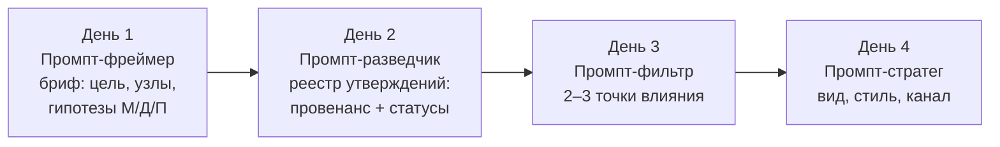

# День 2 курса «Репутационный инжиниринг»: обоснование, метод, тайминг и сквозные кейсы

**Документ 1 из 3.** Комплект Дня 2 (30 октября, 18:30–20:00, онлайн, 90 минут), тема «Мониторинг ресурсов, работа с данными». Остальные документы комплекта:

- [Документ 2: структура презентации и промпты для изображений](https://github.com/G-Ivan-A/hybrid-Intelligence-lab/blob/main/research/reputation-technologies/2026-10-30-day2-presentation.md);
- [Документ 3: сценарий лектора и «Промпт-разведчик»](https://github.com/G-Ivan-A/hybrid-Intelligence-lab/blob/main/research/reputation-technologies/2026-10-30-day2-lecturer-script.md).

Документ отвечает на четыре вопроса.

1. Что такое происхождение данных (провенанс) и зачем данным статусы `PARTIAL` и `CONFLICT`?
2. Как «Промпт-фреймер» Дня 1 превращается в «Промпт-разведчик» Дня 2?
3. Как статус данных меняет управленческое решение в каждом из трёх сквозных кейсов?
4. Почему ИИ на Дне 2 — инструмент первичной кластеризации и поиска галлюцинаций, а не источник истины?

Опоры комплекта:

- [SSOT Дня 1](https://github.com/G-Ivan-A/hybrid-Intelligence-lab/blob/main/research/reputation-technologies/2026-10-07-day1-rationale-and-method-653.md) — стиль, механики вовлечения, значки статуса;
- [исследовательская модель GRA](https://github.com/G-Ivan-A/hybrid-Intelligence-lab/blob/main/research/reputation-technologies/gra-research-program/00-introduction.md) — методологическое основание;
- [рамка решений](https://github.com/G-Ivan-A/hybrid-Intelligence-lab/blob/main/research/reputation-technologies/gra-research-program/30-decision-framework.md) — запрещённые формулировки F1–F10, процедура S1–S7, гейт ИИ G1–G6;
- [исследование #650](https://github.com/G-Ivan-A/hybrid-Intelligence-lab/blob/main/research/reputation-technologies/2026-09-30-course-sources-and-presentations-650.md) — источники Д1–Д13 и Н1–Н13, промпты D2-1…D2-3.

Три сквозных кейса и модульная цепочка промптов взяты из постановки issue [#659](https://github.com/G-Ivan-A/hybrid-Intelligence-lab/issues/659). Её PR [#661](https://github.com/G-Ivan-A/hybrid-Intelligence-lab/pull/661) влит 2026-10-11: полная разметка кейсов и Промпт-фреймер Дня 1 — в [40-practice-and-cases.md](https://github.com/G-Ivan-A/hybrid-Intelligence-lab/blob/main/research/reputation-technologies/gra-research-program/40-practice-and-cases.md). Здесь кейсы описаны в объёме, нужном Дню 2. Допущения перечислены в разделе [«Ограничения и допущения»](https://github.com/G-Ivan-A/hybrid-Intelligence-lab/blob/main/research/reputation-technologies/2026-10-30-day2-rationale-and-method.md#ограничения-и-допущения).

## Главная мысль дня

**Решение опирается не на объём упоминаний, а на происхождение каждого утверждения и на его статус.** Мониторинг отвечает, сколько о нас и о контрагенте говорят. День 2 добавляет к каждому утверждению ещё три вопроса:

- кто это утверждает и откуда он это знает;
- когда это было;
- хватает ли этих данных для **нашего** решения, или они противоречат друг другу.

К 20:00 слушатель должен прийти от «соберём побольше данных и посмотрим среднее» к «для каждого утверждения я знаю источник, дату и статус. `CONFLICT` — повод для разговора, а не для усреднения. `PARTIAL` блокирует публичное действие, но не проверку». Это второй шаг цепочки курса «Вижу → Собираю → Выбираю → Действую». День 2 — это «Собираю».

**Как произносить статус GRA на Дне 2.** День 2 не вводит новых положений GRA. Масса, Дистанция и Полярность остаются вопросами к карте Дня 1. Новое — у каждой стрелки карты появляется основание. Сама исследовательская модель GRA возникла исключительно как авторская гипотеза фаундера о возможности структурного описания социальных и информационных связей по аналогии с физическими закономерностями. Формула — рабочая гипотеза H1, одна из конкурирующих моделей ([20-taxonomy.md, §5](https://github.com/G-Ivan-A/hybrid-Intelligence-lab/blob/main/research/reputation-technologies/gra-research-program/20-taxonomy.md#5-конкурирующие-модели-связи-h0h6)). На Дне 2 формула на экране не появляется: оценки массы и дистанции здесь порядковые, а статусы данных показывают, на какие оценки вообще можно опираться.

## Почему Дню 2 нужны провенанс и статусы

Мониторинг даёт точку отсчёта, но не основание для решения. Ниже — пять разрывов между «нашли упоминание» и «можем решать». Для каждого указана опора в источниках.

**1. Объём повышает уверенность, но не точность.** Когда минимум информации для обоснованного суждения уже есть, дополнительная информация, как правило, не повышает точность оценки. Зато она повышает уверенность аналитика — вплоть до чрезмерной `[650:Д3]` (Heuer, с. 52). Двадцать перепостов одной новости выглядят как двадцать подтверждений, а по происхождению это один источник.

**2. Дашборд не объясняет «почему».** AMEC в Barcelona Principles 4.0 предупреждает: автоматические дашборды и отчёты на цифрах сами по себе не объясняют «почему» за метриками. Объём публикаций и тональность не равны воздействию на стейкхолдеров — это «ошибка подмены» `[650:Д7]` (с. 18, 24). Там же: методология должна различать уровни доверия к источникам, например бот-аккаунты и профессиональных журналистов `[650:Д7]` (с. 27).

**3. Среднее стирает противоречие.** Аналитические стандарты требуют двух вещей: признавать существенную подтверждающую и противоречащую информацию, а существенные расхождения доводить до заказчика, а не сглаживать `[650:Д2]`. Метрика «платёжная дисциплина 3,6 из 5» скрывает, что одни поставщики пишут в чате «платят день в день», а другие судятся.

**4. Отсутствие данных не равно нулю.** «Отмечайте не только наличие свидетельств, но и их отсутствие» `[650:Д3]` (с. 99). Пробелы в данных выпадают из рассуждения: что не на экране, того как будто нет `[650:Д3]` (с. 119). Это прямое продолжение правила Дня 1 «"?" — не 0».

**5. ИИ ускоряет сбор и ускоряет ошибку.** ИИ-поисковики ошиблись более чем в 60% запросов и почти никогда не сомневались вслух `[653:М3]`. Даже лучшие модели с цитированием примерно в половине случаев не дают полной опоры на источники `[650:Н4]`. NIST называет конфабуляции естественным следствием устройства генеративных моделей `[650:Н6]`. Значит, ИИ нужен на этапе сбора и черновой систематизации, но каждое его утверждение проходит провенанс.

## Провенанс: происхождение данных

### Определение для курса

**Провенанс (происхождение данных)** — это ответ на вопрос, кто, когда и каким действием создал утверждение и через какие руки оно до нас дошло. W3C определяет provenance как информацию о сущностях, действиях и людях, участвовавших в создании данных. Её можно использовать для оценки качества, надёжности и того, можно ли данным доверять `[650:Д1]`. В модели качества данных Wang и Strong это свойство называется прослеживаемостью: данные задокументированы, проверяемы и легко соотносятся с источником `[650:Д6]`. Российский ГОСТ Р 71484.2-2024 прямо пишет, что доверие к набору данных можно повысить, указав их происхождение `[650:Д12]`.

### Запись провенанса: одна строка на утверждение

Каждое утверждение на карте записывается одной строкой реестра:

| Поле | Что пишем | Пример (кейс 1) |
| --- | --- | --- |
| Утверждение | Одна проверяемая фраза, без оценок | «Сеть Х задерживает оплату поставщикам» |
| Источник | Кто утверждает; ссылка, которую человек открыл (G1) | Картотека арбитражных дел, https://kad.arbitr.ru/ |
| Первичный или пересказ | Первичный источник создан тем, у кого был непосредственный опыт, без ретроспективы `[650:Д1]` | Первичный: материалы дела |
| Дата | Дата события из источника, а не из ответа модели (G2) | Иски поданы в марте–октябре прошлого года |
| Надёжность источника | A–F: насколько мы знаем этот источник `[650:Д5]` | A: государственный реестр |
| Достоверность сведения | 1–6: подтверждено ли другими `[650:Д5]` | 2: вероятно, но предмет исков не прочитан |
| Тип утверждения | ● факт, ◐ интерпретация, ○ гипотеза (значки Дня 1) | ● факт подачи исков; ◐ «задерживает» — уже интерпретация |
| Статус данных | `VERIFIED`, `PARTIAL` или `CONFLICT` — для **этого** решения | `CONFLICT` (см. кейс 1) |
| Причина статуса | Для `PARTIAL` и `CONFLICT` — почему достоверность низкая: «слухи», «агрегированные данные», «отсутствие прямого первоисточника», «нет даты». Причина подсказывает, какой источник снимет статус | Слухи из чата против фактов исков; предмет и период исков не прочитаны |
| Что изменит статус | Какой факт или источник переведёт статус в другой | Текст решений суда; разговор с финдиректором сети и график оплаты в нашем договоре |

**Два принципа записи.**

1. **Надёжность источника и достоверность сведения оцениваются раздельно.** Надёжный источник может передать непроверенное сведение, а анонимный — точное. Так устроена матрица полевого устава FM 2-22.3: надёжность A–F × достоверность 1–6 `[650:Д5]`. Российские опоры: проверять отдельно источник и содержание `[650:Д10]`; знание источника и его мотивов — отдельный параметр достоверности `[650:Д11]`.
2. **Отделять сведение от суждения.** Аналитический продукт должен чётко отличать утверждения, передающие исходную информацию, от допущений и суждений `[650:Д2]`. Поэтому в реестре «иски поданы» (●) и «задерживает оплату» (◐) — разные строки.

### Цепочка происхождения: где теряется основание

Утверждение редко приходит из первоисточника. Обычно путь такой: событие → первичный документ → пересказ СМИ → пост → перепост → ответ ИИ. На каждом шаге теряется что-то из трёх: автор, дата, контекст. Провенанс — это восстановление цепочки назад, до звена, у которого есть автор и дата. Если восстановить её нельзя, утверждение получает `PARTIAL`, сколько бы раз его ни повторили. Это и значит «источник важнее объёма».

## Статусы данных: PARTIAL и CONFLICT вместо усреднённых метрик

### Определения

`PARTIAL` и `CONFLICT` — **рабочие метки курса, а не термины стандарта.** Готовой классификации с такими именами в литературе нет `[650]`. Метки опираются на четыре группы источников:

- модель происхождения W3C PROV `[650:Д1]`;
- требование аналитических стандартов выражать неопределённость явно и доводить расхождения до заказчика `[650:Д2]`;
- метод конкурирующих гипотез: искать то, что опровергает, а не только подтверждает `[650:Д3]`;
- фиксированный словарь оценок, потому что словесные оценки без шкалы читаются по-разному `[650:Д4]`.

| Статус | Определение | Ближайший аналог в источниках | Чем статус не является |
| --- | --- | --- | --- |
| `VERIFIED` | Происхождение восстановлено: есть первичный источник или два независимых, противоречий нет. Данных достаточно **для этого решения** | Достоверность «1»: сведение подтверждено внешними источниками `[650:Д5]` | Не «истина навсегда»: статус пересматривается при новом источнике |
| `PARTIAL` | Данных недостаточно для вывода: один источник, нет автора, нет даты, нет первичного документа, выборка мала | Оценки F и 6: «нет оснований для оценки» `[650:Д5]`; критические информационные пробелы `[650:Д2]` | Не «ложь» и не «0». F и 6 «не обязательно означают» недоверие, только отсутствие основания `[650:Д5]` |
| `CONFLICT` | Два или больше источника с восстановленным происхождением дают несовместимые утверждения об одном объекте за один период | Оценка 5: «противоречит другой информации по предмету» `[650:Д5]`; требование признавать противоречащую информацию `[650:Д2]` | Не «среднее» и не «у кого-то ошибка». Оценка 5 у FM 2-22.3 означает «маловероятно»; наш `CONFLICT` шире — обе стороны могут быть частично правы |

Три уточнения.

**Статус относителен решению.** Одни и те же данные могут быть `VERIFIED` для решения «написать первое письмо» и `PARTIAL` для решения «отгрузить партию на 50 млн с отсрочкой 60 дней». Достаточность определяется ценой ошибки, а не числом источников. Это наша интерпретация ◐. Она опирается на определение качества данных как пригодности для использования `[650:Д6]`.

**Статус данных и тип утверждения — разные оси.** Значки Дня 1 (● факт, ◐ интерпретация, ○ гипотеза) говорят, *что за утверждение* перед нами. `VERIFIED/PARTIAL/CONFLICT` говорит, *хватает ли под ним данных*. Гипотеза ○ «сеть платит вовремя» может иметь статус данных `CONFLICT`. Это нормальная и полезная запись, а не ошибка.

**Коммерческие условия из открытых источников — `PARTIAL` или `CONFLICT` с причиной.** Условия оплаты, отсрочки, маржу, скидки и внутренние договорённости компании обычно не публикуют. Коммерческая тайна — «режим конфиденциальности информации», который вводит сам обладатель сведений `[Д2-Р8]` (ст. 3). Поэтому прямых данных о платежах в открытом доступе почти нет, а в чатах, на форумах и агрегаторах — пересказы. Отсюда правила разметки:

- такие сведения собирают: любая разведка — результат, если она размечена;
- из чата, форума, агрегатора или косвенного упоминания они получают `PARTIAL`, а если им противоречит другой источник, — `CONFLICT`;
- рядом со статусом записывают причину низкой достоверности: «агрегированные данные», «отсутствие прямого первоисточника», «слухи». Причина подсказывает, какой источник снимет статус;
- `VERIFIED` возможен, только если условие прямо подтверждает первичный документ — решение суда, официальная публикация самой компании, наш договор или платёж, — и только для периода этого документа. Совпадение двух пересказов `VERIFIED` не даёт;
- управленческое решение — об оплате, отсрочке, объёме, цене — на `PARTIAL` и `CONFLICT` не принимают без прямого публичного подтверждения или проверки через первичный источник. Такие сведения задают только вид проверки: прямой разговор, запрос документа, обратимый пилот.

Приоритет при сборе — сведениям, которые в открытом доступе с высокой вероятностью достоверны: судебные дела, исполнительные производства, реестры юрлиц `[Д2-Р3]` `[Д2-Р4]` `[Д2-Р5]`, бухгалтерская отчётность, официальные публикации компаний, статьи с указанием оборотов и поставок. Приоритет не значит «только они».

### Почему не усреднять

Усреднение превращает два разных мира в один несуществующий. Если половина источников говорит «платит в срок», а половина — «судится с поставщиками», среднее «платит с небольшими задержками» не описывает ни одного реального поставщика. Решение на основе среднего будет неверным для обеих групп. `CONFLICT` сохраняет оба утверждения и их происхождение и задаёт вопрос, который нельзя задать среднему: **почему они расходятся?** Возможные ответы:

- разные периоды: Полярность(t) из Дня 1;
- разные сегменты: крупные поставщики против мелких;
- разные предметы спора: оплата или качество;
- один из источников ошибся.

Каждый ответ ведёт к своему решению.

### Метрики со статусами

В постановке issue иллюстрации запрошены к метрикам с оценочным прилагательным. В комплекте выражение заменено функциональным термином **«метрика со статусом»** (см. раздел [«Ограничения и допущения»](https://github.com/G-Ivan-A/hybrid-Intelligence-lab/blob/main/research/reputation-technologies/2026-10-30-day2-rationale-and-method.md#ограничения-и-допущения)). Метрика со статусом — любое число дашборда с тремя приписками:

1. происхождение: из каких источников и за какой период;
2. статус: `VERIFIED`, `PARTIAL` или `CONFLICT`;
3. что скрыто: какой разброс или противоречие стоит за числом.

Пример: «Тональность 72% позитива» превращается в «72% позитива — 140 упоминаний, из них 96 — перепосты одного пресс-релиза. По независимым источникам — 9 упоминаний. Статус `PARTIAL`».

## Как статусы меняют управленческое решение, а не только отчёт

Это центральный вопрос первого блока программы. Ответ короткий: статус задаёт **тип следующего действия**.

| Статус | Что можно делать | Что нельзя делать | Связь с Днём 3 |
| --- | --- | --- | --- |
| `VERIFIED` | Опираться в решении и в публичной коммуникации; ссылаться на источник | Считать статус вечным: при новом источнике он пересматривается | Точка входит в фильтр как «качество данных — высокое» |
| `PARTIAL` | Проверять: искать первоисточник, дату, второй независимый источник. Делать **обратимые** шаги: запрос, встреча, пилот малого объёма | Публичные заявления, необратимые обязательства, ссылки на сведение как на факт | «Точка с `PARTIAL` опасна для публичного действия без дополнительной проверки» (программа Дня 3) |
| `CONFLICT` | Выяснять причину расхождения. Самый короткий путь — прямой разговор с тем, кто знает обе стороны | Усреднять; выбирать удобную сторону; молчать о противоречии в отчёте | «Точка с `CONFLICT` может быть приоритетной: прямой разговор снимает противоречие» (программа Дня 3) |

**Правило программы «Страсть к данным».** Признание «здесь данных недостаточно» вместо ложной уверенности не должно блокировать действие. В таблице это видно: `PARTIAL` закрывает только публичные и необратимые шаги, а проверку и обратимые шаги открывает. Уверенность в выводе снижается явно, как требуют `[650:Д3]` (с. 120) и `[650:Д2]`. Решение при этом не откладывается до бесконечного сбора данных.

## Эволюция промпта: от «Промпта-фреймера» к «Промпту-разведчику»

Курс строит модульную цепочку промптов. Выход каждого дня — вход следующего, слушатель ведёт **один** кейс все четыре дня:

| Измерение | День 1: Промпт-фреймер | День 2: Промпт-разведчик | Почему меняется |
| --- | --- | --- | --- |
| Задача | Сформулировать концепт: цель, решение, узлы-кандидаты и гипотезы о Массе, Дистанции, Полярности | Найти данные под каждую гипотезу брифа, восстановить их происхождение, присвоить статусы | «Вижу» → «Собираю» |
| Вход | Описание ситуации своими словами | Бриф Дня 1 (или мини-бриф, если брифа нет) и источники, которые слушатель открыл сам | Работа идёт от гипотез, а не от поиска «всего подряд» |
| Выход | Бриф на полстраницы: гипотезы ○ | Реестр утверждений: утверждение → источник → дата → надёжность → статус → причина статуса для `PARTIAL` и `CONFLICT`. Плюс список `PARTIAL`/`CONFLICT` и план проверки | Реестр — вход Промпта-фильтра Дня 3 |
| Слой OSINT | Нет | Публичные профессиональные источники: реестры, суды, закупки, профильные СМИ, выступления. Только «белая» зона `[653:М8]` | Сбор — это и есть Day 2 |
| Отношение к пробелам | «?» — не 0 | `PARTIAL` с указанием, что изменит статус; запрет заполнять пробел догадкой | Правило программы «не доверять выводам там, где фактов нет» |
| Отношение к противоречиям | Не рассматривается | `CONFLICT` с обеими сторонами и их провенансом; запрет усреднять | «`PARTIAL` и `CONFLICT` вместо усреднённых метрик» |
| Коммерческие условия | Не рассматривается | Оплата, отсрочки, маржа, договорённости из чатов, форумов и агрегаторов — `PARTIAL` или `CONFLICT` с обязательной причиной; `VERIFIED` — только по первичному документу | Такие сведения обычно — коммерческая тайна `[Д2-Р8]`; в открытом доступе — пересказы |
| Проверки ИИ | Статус ●/◐/○ | Гейт G1–G6 целиком: открытая человеком ссылка, дата из источника, статус, опровержение, независимость, запрет личных выводов | Сбор — главная зона галлюцинаций |
| Качественные данные | Нет | Сначала темы и цитаты («почему»), потом счёт («сколько») | Блок 3 программы |

**Какой бриф Разведчик ждёт на входе.** Формат брифа задаёт [Промпт-фреймер Дня 1](https://github.com/G-Ivan-A/hybrid-Intelligence-lab/blob/main/research/reputation-technologies/gra-research-program/40-practice-and-cases.md#промпт-фреймер-дня-1): карточка из девяти полей, у каждого утверждения — статус ●, ◐ или ○, в поле 9 — «?» и ○, которые нужно проверить на Дне 2. Разведчик принимает карточку целиком и в первую очередь проверяет вопросы поля 9. Если карточки нет, промпт начинает с мини-брифа из пяти полей: цель, решение и его срок, кейс, 3–7 узлов-кандидатов с гипотезами М/Д/П, известные факты. Логика Разведчика не зависит от точной формы брифа.

Полный текст «Промпта-разведчика», готовый к копированию, — в [Приложении А документа 3](https://github.com/G-Ivan-A/hybrid-Intelligence-lab/blob/main/research/reputation-technologies/2026-10-30-day2-lecturer-script.md#приложение-а-промпт-разведчик-для-слушателей). Он объединяет три промпта #650:

- D2-1 «Оценка источника»;
- D2-2 «Реестр утверждений со статусами»;
- D2-3 «Отзывы: сначала "почему", потом "сколько"».

## ИИ на Дне 2: первичная кластеризация и охота на галлюцинации

**Роль.** ИИ — инструмент вероятностной систематизации и проверки гипотез. Его выводы не являются истиной и не являются эмпирическим подтверждением ([30-decision-framework.md, §5](https://github.com/G-Ivan-A/hybrid-Intelligence-lab/blob/main/research/reputation-technologies/gra-research-program/30-decision-framework.md#5-гейт-для-выводов-ии-агентов)). На Дне 2 ИИ делает три работы, и все три — черновые:

| Работа ИИ | Что получает слушатель | Что делает человек | Почему ИИ здесь полезен |
| --- | --- | --- | --- |
| Первичная кластеризация | Темы в 60 отзывах, жалобах, комментариях; 2 дословные цитаты на тему | Читает цитаты, проверяет, что темы не выдуманы; решает, что считать | Быстро даёт гипотезы «почему» — вход блока 3 |
| Черновой реестр утверждений | Утверждения из открытых человеком источников, разложенные по полям провенанса | Проверяет каждую ссылку (G1), дату (G2), статус (G3) | Снимает механическую работу; ошибки становятся видимыми |
| Поиск противоречий и пробелов | Список кандидатов в `CONFLICT` и `PARTIAL`; «какие два источника сильнее всего изменили бы статусы» | Решает, что проверять первым, и проверяет сам | ИИ хорошо сравнивает тексты, если не просить его угадывать |

**Тезис для эфира, в исправленной формулировке #650:** «Правильный запрос снижает частоту галлюцинаций и делает их видимыми и проверяемыми, но не отменяет их». Основания:

- документация Anthropic: разрешить модели ответ «я не знаю» и требовать цитаты — эти приёмы снижают галлюцинации, но не устраняют их полностью `[650:Н7]`;
- документация GigaChat: промпты «уменьшают вероятность» выдуманных данных `[650:Н9]`;
- обзор галлюцинаций Ji et al.: противоречие источнику и добавление непроверяемого — разные типы ошибок, и искать их нужно по-разному `[650:Н3]`;
- новичкам галлюцинацию распознать трудно, поэтому этап проверки обязателен `[650:Н12]`.

**Правило «не доверять выводам там, где фактов нет»** — это программное правило блока 2. В промпте оно реализовано тремя запретами:

1. не заполнять пустое поле догадкой — писать «в источниках нет»;
2. не повышать статус из-за числа повторов одного источника;
3. не делать выводов о личности, мотивах и «психотипе» (G6, r ≈ 0,29 `[653:М7]`).

**Охота на галлюцинации на Дне 2** — продолжение механики Дня 1. На Дне 1 искали ошибку в досье. На Дне 2 ищут **спрятанный `CONFLICT`**: модель усреднила противоречие или пометила `PARTIAL` как факт. Это метка `[САМОСТОЯТЕЛЬНАЯ РАБОТА: найди статус CONFLICT]` в сценарии. Набор строк и ключ — в [Приложении Б документа 3](https://github.com/G-Ivan-A/hybrid-Intelligence-lab/blob/main/research/reputation-technologies/2026-10-30-day2-lecturer-script.md#приложение-б-ии-реестр-для-охоты-на-спрятанный-conflict-слайд-19).

**ИИ-компонент: 27 минут из 90**, по коридору #650 для Дня 2. Из них:

- 4 мин — сигнал и шум;
- 8 мин — демонстрация Промпта-разведчика;
- 9 мин — охота на спрятанный `CONFLICT` с разбором;
- 6 мин — кейс 2 на выходе ИИ.

День 2 — самый «ИИ-ёмкий» день курса: здесь учат собирать.

## Качественные и количественные данные: что оцифровывать первым

Третий блок программы задаёт порядок работы с данными. Сначала понять «почему», потом считать «сколько».

| Шаг | Данные | Что даёт | Вопрос шага |
| --- | --- | --- | --- |
| 1. Качественные | Интервью, открытые комментарии, жалобы, переписка, выступления | Гипотезы о причинах | «Почему так происходит?» |
| 2. Гипотезы | Формулировки «если…, то…» с опровергающим условием (S2) | Что именно проверять | «Что опровергло бы это объяснение?» |
| 3. Количественные | Опросы, метрики, реестры, счёт по темам | Масштаб: насколько это распространено | «Сколько и у кого?» |

Это разведочный последовательный дизайн смешанных методов: сначала собирают и анализируют качественные данные, и их результаты определяют последующий количественный сбор `[650:Д8]`. Русскоязычный обзор смешанных стратегий — `[650:Д9]`.

**Ошибка преждевременной оцифровки** (наш термин) — считать то, чего ещё не поняли. Ближайшее в отраслевом стандарте — «ошибка подмены» AMEC: объём и тональность не равны воздействию `[650:Д7]`. Цифровые инструменты снабжают качественные данные числовыми индексами и тем размывают границу между качественным и количественным анализом `[650:Д13]`. Поэтому соблазн оцифровать рано — реальный, а не теоретический.

**Правило дня:** не понял причин — не делай выводов. Решение при этом не замораживается: из шага 1 следуют обратимые действия (разговор, пилот), а выводы о масштабе ждут шага 3.

## Три сквозных кейса через линзу Дня 2

Все три кейса — **синтетические типовые ситуации** из постановки фаундера (issue [#659](https://github.com/G-Ivan-A/hybrid-Intelligence-lab/issues/659)). Названия, цифры и даты условны и не описывают реальных компаний и людей. Ссылки на реестры — это адреса публичных сервисов, где такие данные ищут, а не ссылки на конкретные дела.

Каждый кейс разобран по одной схеме:

1. что дал бриф Дня 1;
2. что собирает Разведчик и из каких источников;
3. какое утверждение получает какой статус и почему;
4. какое решение было бы по старым лекалам;
5. какое решение даёт статус;
6. что изменит статус;
7. этическая и правовая граница.

Каждый кейс закреплён за одним блоком программы:

- кейс 1 — за блоком 1 («как статусы меняют решение»);
- кейс 2 — за блоком 2 («сигнал и шум, не доверять выводам там, где фактов нет»);
- кейс 3 — за блоком 3 («что оцифровывать первым»).

### Кейс 1. B2B-производство: `CONFLICT` по задержкам оплат меняет стратегию переговоров

**Ситуация.** Производитель консервов с небольшой розничной сетью продаёт крупному и мелкому опту, включая торговые сети. Цель, заданная фаундером, — сеть до 100 маржинальных партнёров по принципу Парето; правило «20% партнёров дают 80% маржи» — гипотеза ○ до ABC-анализа. Первый шаг, который разбирает курс, — ядро из ~20 маржинальных партнёров того же типа, что нынешнее «ядро 20%» (на первые 3 месяца — 5–8 новых в двух соседних регионах), без неплатежей и демпинга. Темп достижения цели курс не обещает (F7). Первичная выборка для разведки значительно шире ядра: фильтры GRA применяются к большому пулу кандидатов, чтобы на выходе осталось качественное ядро ([40-practice-and-cases.md, кейс 1](https://github.com/G-Ivan-A/hybrid-Intelligence-lab/blob/main/research/reputation-technologies/gra-research-program/40-practice-and-cases.md#кейс-1-b2b-производитель-консервов-надёжные-оптовые-партнёры)). Задача Дня 2 — составить профиль контрагента с основанием для переговоров. Пример — региональная сеть «Х» из 40 магазинов, кандидат в ядро.

**Что дал бриф Дня 1 (гипотезы ○).**

- Масса сети высокая: полки в регионе, закупщик категории решает ассортимент.
- Дистанция D2 велика (прямого канала нет), D3 — через знакомого дистрибьютора.
- Полярность «?».
- Гипотеза брифа: «сеть — надёжный плательщик, нужен выход на категорийного менеджера».

**Что собирает Разведчик.**

| № | Утверждение | Источник и провенанс | Надёжность × достоверность | Тип | Статус |
| --- | --- | --- | --- | --- | --- |
| 1 | «Сеть платит день в день» | Три сообщения в отраслевом чате поставщиков. Авторы — аккаунты без имени, даты 2–3 месяца назад; два сообщения — пересылка одного | F × 6 → после проверки авторов — C × 3 | ◐ | `PARTIAL` сам по себе; причина — слухи: прямого первоисточника нет, два сообщения — пересылка одного |
| 2 | «На сеть подано 4 иска от поставщиков о взыскании долга по договорам поставки за 18 месяцев, 2 закончились мировым соглашением» | Картотека арбитражных дел https://kad.arbitr.ru/. Первичный источник, даты подачи в карточках | A × 2 | ● (факт подачи) | `VERIFIED` для факта исков |
| 3 | «Сеть — надёжный партнёр для поставщиков» | Пресс-релиз сети на её сайте | B × 6: источник заинтересован | ◐ | `PARTIAL`; причина — самооценка заинтересованного источника, конкретных условий и фактов о расчётах нет |
| 4 | «Тональность упоминаний — 72% позитива» | Система мониторинга. 140 упоминаний, из них 96 — перепосты пресс-релиза из строки 3 | Метрика без провенанса | ◐ | `PARTIAL`; причина — агрегированные данные: 96 из 140 упоминаний — один источник |
| 5 | «Сеть платит в срок» против «сеть задерживает оплату» | Строки 1 и 2 вместе | — | ○ | **`CONFLICT`**; причина — слухи из чата против фактов исков; предмет и период исков не прочитаны; прямого первоисточника об условиях оплаты нет |

**Почему `CONFLICT`, а не среднее.** Отчёт по старым лекалам свёл бы строки 1–4 в одно число: «надёжность контрагента — 3,6 из 5, тональность позитивная». По такому числу сеть проходит в ядро со стандартной отсрочкой 45 дней. Статус `CONFLICT` фиксирует, что два источника с восстановленным происхождением говорят о платежах несовместимое. У противоречия есть проверяемые объяснения, и каждое ведёт к своему решению:

| Объяснение противоречия | Как проверить | Решение, если подтвердится |
| --- | --- | --- |
| Разные периоды: иски — до смены собственника, после — платят | Даты исков в https://kad.arbitr.ru/ против даты смены участников в ЕГРЮЛ (https://egrul.nalog.ru/); нет ли свежих исков и исполнительных производств | Пилотная партия; после нашего первого платежа в срок — стандартные условия со сроком пересмотра через квартал |
| Разные сегменты: крупным платят, мелким тянут | Кто истцы: размер компаний, предмет договоров | Условия зависят от того, в какой сегмент сеть нас отнесёт; переговоры о графике платежей |
| Разный предмет: спор не об оплате, а о качестве или возвратах | Текст решения или определения суда | Риск — не неплатёж, а претензии по качеству; переговоры о приёмке и возвратах |
| Систематическая задержка | Новые иски в последние 6 месяцев; исполнительные производства (https://fssp.gov.ru/iss/ip) | Предоплата или короткая отсрочка; сеть остаётся в пуле кандидатов, но не в ядре |

**Как меняется стратегия переговоров.** Без статуса переговоры шли бы про цену и объём, со стандартной отсрочкой. Со статусом `CONFLICT` они начинаются с другого:

1. **Предмет первой встречи — условия оплаты, а не цена.** На встречу выходят с вопросом: «мы видим разные сведения о сроках расчётов с поставщиками; как у вас устроен график платежей?». Это не обвинение. Это прямой разговор, который снимает противоречие. Ровно эту логику программа Дня 3 называет «точка с `CONFLICT` может быть приоритетной».
2. **Пилотная партия вместо полной отгрузки.** Объём — до первого подтверждённого платежа, отсрочка короче стандартной или частичная предоплата. Пилот — обратимый шаг, который сам по себе даёт первичный источник: наш собственный платёж.
3. **Канал выхода меняется.** Знакомый дистрибьютор из брифа (D3) теперь нужен не только как «вход к закупщику». Он поставщик сети с собственной историей расчётов. Первичный источник он только о своих расчётах с сетью, а не о чужих договорах. Разговор с ним о его собственной практике — первый шаг проверки.
4. **Защита от демпинга связана с тем же статусом.** Если иски — о возвратах и штрафах, сеть, вероятно, давит на поставщиков условиями. Это гипотеза о «ценовом охотнике», а не вывод. Её проверяют на встрече вопросом о промо-условиях и возвратах.

**Масштаб: широкая воронка ради узкого ядра.** Чтобы отобрать ~20 надёжных партнёров, разведка начинается с длинного списка — например, 300–400 кандидатов. Статусы — способ его сортировки:

- `VERIFIED` без рисков — стандартное предложение;
- `CONFLICT` — короткий список для прямого разговора;
- `PARTIAL` — проверка до того, как тратить время продавцов.

Это не замена финансового скоринга, а слой оснований под ним.

**Что изменит статус.**

- `CONFLICT` снимается: тексты решений показывают, что задержки относятся к периоду до смены собственника (дата — по ЕГРЮЛ), свежих исков и открытых исполнительных производств нет. Эти факты — `VERIFIED`. Слова дистрибьютора о его собственных расчётах — подкрепление, а не основание. «Платит в срок сейчас» остаётся `PARTIAL` (причина — отсутствие прямого первоисточника о текущих расчётах) до нашего собственного платежа по пилоту; после него — `VERIFIED` для нашего договора и его периода.
- `CONFLICT` → `VERIFIED` («задерживает»): есть свежие решения о взыскании долга и открытые исполнительные производства.

**Граница.** Белая зона:

- арбитражные дела, реестры, отчётность юрлица — публичные данные о компании;
- выступления и публикации категорийного менеджера как профессионала.

Серая зона — выводы о «характере» менеджера; только как раскрытая гипотеза (G6). Чёрная зона — частная жизнь и претекстинг: представиться не тем, кто ты есть, чтобы получить сведения `[653:М8]`.

### Кейс 2. Deep-tech на новых материалах: `PARTIAL` по видео блокирует преждевременное действие

**Ситуация.** Производство компонентов на основе новых материалов для продукции верхнего уровня. Цель — привлечь инвестиционный капитал. Задача Дня 2 — определить типы инвесторов и подобрать контакты для коммуникации, опираясь на данные с проверенным происхождением. Типы инвесторов:

- стратегический — корпорация или её венчурный фонд, которому нужны компоненты;
- финансовый — фонд, которому нужна доходность;
- государственный институт развития, например Фонд содействия инновациям (https://fasie.ru/).

Пути входа тоже разные: тёплый через отраслевого эксперта или холодный через заявку в фонд.

**Что дал бриф Дня 1 (гипотезы ○).**

- Масса стратегического инвестора выше: он даёт и деньги, и заказ.
- Дистанция D2 до него велика, D3 — через отраслевого эксперта, который знает технического директора холдинга.
- Полярность «?».
- Гипотеза брифа: «холдинг Y ищет поставщиков композитных компонентов и готов входить в капитал».

**Опорное событие — видео.** В отраслевом Telegram-канале ходит фрагмент видео на 40 секунд. Человек, подписанный как управляющий партнёр корпоративного фонда холдинга Y, говорит: «Мы ищем поставщиков композитных компонентов и готовы входить в капитал на ранней стадии». У фрагмента нет даты, названия мероприятия и полной записи. Его переслали шесть каналов, у поста 30 тысяч просмотров.

**Что собирает Разведчик.**

| № | Утверждение | Источник и провенанс | Надёжность × достоверность | Тип | Статус |
| --- | --- | --- | --- | --- | --- |
| 1 | «Фонд холдинга Y входит в капитал поставщиков композитов на ранней стадии» | Фрагмент видео. Первоисточник не найден, дата неизвестна, контекст вырезан; шесть пересылок — один источник | F × 6 | ○ | **`PARTIAL`** |
| 2 | «Управляющий партнёр фонда — названное лицо» | Страница фонда на сайте холдинга | B × 2 | ● | `VERIFIED` |
| 3 | «Фонд в отчётах указывает фокус на стадиях после выручки» | Годовой отчёт холдинга, раздел о венчурной деятельности | B × 2 | ● | `VERIFIED` для отчётного года |
| 4 | «Холдинг Y закупает композитные компоненты» | Закупки холдинга на https://zakupki.gov.ru/ (если холдинг закупает по 223-ФЗ) или его тендерная площадка | A × 2 | ● | `VERIFIED` для факта закупок |
| 5 | Строки 1 и 3 вместе: ранняя стадия против стадии после выручки | — | — | ○ | `CONFLICT` возможен; пока нет даты видео, это `PARTIAL` |

**Какие действия статус `PARTIAL` блокирует.**

1. **Холодное письмо с цитатой.** Письмо «Вы сказали, что входите в капитал на ранней стадии» опирается на сведение без провенанса. Если видео старое, вырезанное или не того человека, письмо показывает фонду, что команда не проверяет данные. Для deep-tech, где инвестор проверяет именно технологическую и управленческую добросовестность, это прямой вред репутации.
2. **Слайд в инвестиционной презентации.** Строка «интерес стратегического инвестора Y» — публичное утверждение. Финансовые инвесторы его проверят. Это ровно то, что программа Дня 3 называет опасностью `PARTIAL` для публичного действия.
3. **Перестройка раунда.** Отказаться от финансового трека ради «стратегического интереса» — необратимое по времени решение на непроверенном основании.

**Какие действия `PARTIAL` открывает** (правило программы «признание "здесь данных недостаточно" не должно блокировать действие»):

1. **Восстановить провенанс.** Найти полную запись на сайте мероприятия или в канале организатора, установить дату и контекст. Если видео трёхлетней давности, а отчёт (строка 3) свежий — `CONFLICT` разрешается в пользу отчёта: стратегия фонда изменилась (Полярность(t)).
2. **Тёплый вход через эксперта как вопрос, а не как цитата.** Отраслевому эксперту задают вопрос: «есть ли у фонда Y сейчас интерес к ранним стадиям в композитах?». Для эксперта это обычный профессиональный разговор. Для нас это второй, независимый источник (G5).
3. **Параллельный трек.** Финансовые фонды и институт развития идут своим ходом, их приоритет не меняется.
4. **Предложение пилотной поставки по закупке холдинга (строка 4).** Это шаг к стратегическому инвестору через его закупку, а не через капитал. Строка 4 имеет статус `VERIFIED`.

**Что изменит статус.**

- `PARTIAL` → `VERIFIED`: полная запись найдена, дата свежая, контекст совпадает, эксперт подтверждает.
- `PARTIAL` → `CONFLICT`: запись свежая, но в полной версии сказано «на ранней стадии — только через акселератор», что расходится с отчётом. Тогда вопрос эксперту становится точнее.
- Сведение снимается: видео — монтаж или не тот человек.

**Почему кейс про видео.** Видео выглядит как самый сильный тип свидетельства: «он сам сказал». Сокращённое видео без даты лишает утверждение автора контекста и времени — двух из трёх элементов провенанса. В цифровой среде нужно проверять и источник, и подлинность содержания, особенно в пользовательском контенте `[650:Д10]`. Тридцать тысяч просмотров повышают уверенность, но не точность `[650:Д3]`.

**Граница.** Белая зона — публичные выступления, отчёты, закупки, профессиональные профили. Серая — выводы о «стиле» партнёра фонда по его соцсетям: только как гипотеза низкой уверенности (G6). Чёрная — личные контакты партнёра, полученные в обход его согласия, и звонки «от имени» кого-либо.

### Кейс 3. Нишевый эксперт: что оцифровывать первым

**Ситуация.** Практикующий массажист с медицинским образованием и собственной методикой; «уникальные способности» — гипотеза ○, а не факт. Цель — закрытый пул из 10–20 постоянных обеспеченных клиентов за 6–9 месяцев только через рекомендации. **Этическая граница:** репутационный инжиниринг здесь — альтернатива прямой рекламе (реклама медицинских услуг строго ограничена), а не её обход. Цель — доверительное репутационное поле, в котором люди обращаются по рекомендациям сами; ни обещания излечения, ни гарантированного потока клиентов. Кейс — учебная абстракция: это снижает правовые риски и при этом точно показывает принцип ([40-practice-and-cases.md, кейс 3](https://github.com/G-Ivan-A/hybrid-Intelligence-lab/blob/main/research/reputation-technologies/gra-research-program/40-practice-and-cases.md#кейс-3-массажист-эксперт-закрытый-пул-клиентов-по-рекомендациям)). Допустимы закрытые каналы: клубы, сообщества, частные рекомендации. Задача Дня 2 — собрать данные, на которых на Дне 3 будут выбраны точки влияния.

**Что дал бриф Дня 1 (гипотезы ○).**

- Масса у владельца закрытого бизнес-клуба и у фитнес-тренеров премиальных студий.
- Дистанция D3 до клуба велика, до тренеров — короткая через двух нынешних клиентов.
- Полярность клуба «?».
- Гипотеза брифа: «клиенты приходят за статусной услугой, точка влияния — бизнес-клуб».

**Ловушка преждевременной оцифровки.** Самое доступное число: «за полгода 12 новых клиентов, из них 7 пришли из одного бизнес-клуба». По старым лекалам вывод готов: клуб — главная точка, нужно больше присутствия в клубе. Это и есть ошибка преждевременной оцифровки: посчитали, не поняв, **почему** эти семь пришли.

**Что собирает Разведчик: сначала «почему».**

| Шаг | Данные | Провенанс | Что выяснилось | Статус |
| --- | --- | --- | --- | --- |
| 1. Качественные | Короткий разговор с 7 клиентами из клуба: «что вас привело и кто рассказал?» С согласия клиентов, без записи сведений о здоровье | Первичный: сам массажист, даты разговоров | Пятерых направил не клуб, а один и тот же тренер по восстановлению после травм, который тоже состоит в клубе. Клуб — место встречи, а не источник рекомендации | ◐ интерпретация, `VERIFIED` для 7 из 12 |
| 2. Гипотеза | «Рекомендация идёт от специалистов, которые видят результат восстановления, а не от статуса клуба». Опровержение: следующие 5 новых клиентов приходят без участия специалистов по восстановлению | — | — | ○ |
| 3. Количественные | Сколько из 12 пришли через специалистов, сколько через знакомых; сколько вернулись повторно | Журнал записей массажиста | 9 из 12 — через двух специалистов; повторность у них выше | `PARTIAL`: 12 случаев — мало для вывода о масштабе |
| 4. Внешние данные о клубе | «В клубе любят такие услуги» (модератор чата) против правил клуба: коммерческие предложения участникам запрещены | Модератор — первичный, но заинтересован; правила клуба — документ клуба | — | `CONFLICT` |

**Как статусы меняют решение.**

- **По старым лекалам:** публикация в клубном чате или спонсорство клубного вечера. При `CONFLICT` по правилам клуба это прямой риск исключения из канала, который вообще не был источником рекомендаций.
- **С учётом статусов:**
  - (1) `CONFLICT` по клубу снимается прямым разговором с организатором клуба: что допустимо, а что нет. Публичного действия в клубе до этого нет.
  - (2) Специалисты по восстановлению после травм — кандидаты в точки влияния Дня 3. Их данные `VERIFIED` для качественного «почему», `PARTIAL` для масштаба.
  - (3) «Здесь данных недостаточно» не блокирует действие: разговор с двумя-тремя другими специалистами по восстановлению — обратимый шаг, который даст и рекомендации, и новые данные для шага 3.

**Что изменит статус.**

- `PARTIAL` по масштабу снимается, когда накопится 20–30 случаев, где известен путь клиента, а гипотеза шага 2 не опровергнута.
- `CONFLICT` по клубу снимается ответом организатора.

**Граница — строже, чем в кейсах 1 и 2.**

- Сведения о состоянии здоровья относятся к специальным категориям персональных данных. Их обработка допускается только в случаях, прямо названных в законе, в частности с письменного согласия (152-ФЗ, ст. 10, https://www.consultant.ru/document/cons_doc_LAW_61801/). Поэтому в реестр не пишутся диагнозы и жалобы клиентов. Пишется только путь клиента: «через специалиста по восстановлению», «через знакомого».
- Точки влияния — только публичная профессиональная активность специалистов и клубов (белая зона `[653:М8]`).
- Утверждения о медицинской эффективности методики в рекомендациях и в закрытых каналах — отдельный правовой риск: реклама медицинских услуг регулируется 38-ФЗ «О рекламе», ст. 24 (https://www.consultant.ru/document/cons_doc_LAW_58968/). Это граница для Дня 4, где выбирают содержание сообщения. На Дне 2 достаточно пометить её в реестре.

### Свой кейс

Слушатель может вести через все четыре дня свой кейс вместо одного из трёх. Условия те же, что в протоколе соисследователя Дня 1 ([40-practice-and-cases.md, «Протокол соисследователя»](https://github.com/G-Ivan-A/hybrid-Intelligence-lab/blob/main/research/reputation-technologies/gra-research-program/40-practice-and-cases.md#протокол-соисследователя)):

- одно решение с исходом в ближайший месяц;
- обезличивание по желанию;
- только белые источники.

Промпт-разведчик написан так, чтобы в блок «ВХОД» можно было вставить любой бриф.

### Что три кейса показывают вместе

| Кейс | Статус-развилка | Решение по старым лекалам | Решение со статусом | Блок программы |
| --- | --- | --- | --- | --- |
| 1. B2B | `CONFLICT` по оплатам | Средняя «надёжность 3,6/5» → стандартная отсрочка | Первая встреча — об условиях оплаты; пилотная партия; дистрибьютор — первичный источник о своих расчётах | 1. Как статусы меняют решение |
| 2. Deep-tech | `PARTIAL` по видео | Холодное письмо с цитатой; слайд «интерес стратега» | Восстановить провенанс; вопрос эксперту; параллельные треки; пилот по закупке | 2. Сигнал и шум; не доверять выводам там, где фактов нет |
| 3. Нишевый эксперт | Преждевременная оцифровка; `CONFLICT` по клубу | «7 из 12 из клуба» → пост в клубном чате | Сначала «почему»; точки — специалисты; клуб — через прямой разговор | 3. Что оцифровывать первым |

## Как меняется мышление слушателя за 90 минут

| Минута | Было у слушателя в голове | Что его сдвигает | Становится |
| --- | --- | --- | --- |
| 0–6 | «Карта Дня 1 готова, можно действовать» | Вопрос-мост: на чём держится каждая стрелка | «У стрелки должно быть основание» |
| 6–14 | «Мониторинг показывает репутацию» | Что дают и где теряют инструменты; 96 из 140 упоминаний — один пресс-релиз | «Мониторинг — точка отсчёта, а не основание» |
| 14–24 | «Чем больше данных, тем точнее» | Провенанс; объём повышает уверенность, но не точность | «Источник важнее объёма» |
| 24–33 | «Нужна одна итоговая метрика» | Средняя «3,6 из 5» против двух разных миров | «`PARTIAL` и `CONFLICT` вместо среднего» |
| 33–42 | «Статусы — это для отчёта» | Кейс 1: `CONFLICT` меняет предмет переговоров | «Статус задаёт тип следующего действия» |
| 42–63 | «ИИ соберёт и проверит за меня» | Демонстрация Разведчика и охота на спрятанный `CONFLICT` | «ИИ — черновик и кластеризация; проверяю я» |
| 63–69 | «Видео — самое сильное доказательство» | Кейс 2: видео без даты и автора | «`PARTIAL` блокирует публичное, но не проверку» |
| 69–84 | «Цифры объективнее разговоров» | Кейс 3: «7 из 12» и настоящая причина | «Сначала "почему", потом "сколько"» |
| 84–90 | «Данных всегда мало, решать нельзя» | Мост ко Дню 3: фильтр и 2–3 точки | «Из реестра со статусами можно выбирать» |

## Метод: 90 минут для пассивной вечерней аудитории

**Аудитория** та же, что на Дне 1:

- PR- и GR-службы промышленных корпораций;
- предприниматели МСП.

Формат — вечер, онлайн, камеры выключены. Часть слушателей пропустила День 1. Поэтому первые 6 минут возвращают карту Дня 1 одним слайдом, а Промпт-разведчик работает и без брифа Дня 1 — с мини-брифом.

Проектные решения Дня 1 сохраняются.

1. **Чат вместо голоса, выбор вместо открытого вопроса.** Закрытые вопросы «А или Б», «номер строки» — из-за спирали молчания `[650:П7][650:П8]` и по логике Peer Instruction «подумай — проголосуй — услышь объяснение» `[650:П1]`.
2. **Смена активности каждые 8–12 минут, по смыслу, а не по таймеру** `[650:П3]`. Каждый блок заканчивается действием слушателя.
3. **Три паттерна микро-вовлечения, без групп:**
   - **быстрый выбор в чате** — 7 раз за вечер;
   - **охота на галлюцинацию при сборе данных** — 1 раз, 4 минуты: ИИ-реестр с семью ошибками, главная — спрятанный `CONFLICT`;
   - **присвоение статуса** — 3 раза, по кейсу на блок: «`VERIFIED`, `PARTIAL` или `CONFLICT`?».

**Почему сквозные кейсы, а не микро-кейсы Дня 1.** На Дне 1 микро-кейсы показывали оптику. На Дне 2 нужна работа с данными, а она требует непрерывности: бриф → реестр → решение. Три кейса из постановки фаундера покрывают три разных типа решения: сделку, капитал и рекомендательную сеть. Каждый закреплён за своим блоком программы, поэтому ни один блок не остаётся без практического примера.

**Разрядка.** Юмор встроен в содержание, три точки:

- «у нас 140 упоминаний — 96 из них мы написали сами»;
- «видео — самое убедительное доказательство, особенно когда неизвестно, чего»;
- «7 из 12 клиентов пришли из клуба — но клуб об этом не знает».

## Поминутный тайминг

Значки акцентов: 🔥 боль · 🧭 линза статуса и провенанса · 😄 разрядка · 🤖 ИИ-микрововлечение · 🌉 мост ко Дню 3 · 🗳 чат.

| Время | Мин | Блок программы | Содержание | Акцент | Действие слушателя | Слайды (Док. 2) |
| --- | --- | --- | --- | --- | --- | --- |
| 18:30–18:36 | 0–6 | Вход | Карта Дня 1 и вопрос «на чём держится стрелка». Три кейса и «свой кейс» | 🔥 🗳 | Выбор А/Б: «78% позитива — (А) основание для решения, (Б) повод для вопроса» | 1–3 |
| 18:36–18:44 | 6–14 | 1. Принципы сбора | Инструменты мониторинга как точка отсчёта: что дают и где теряют | 🔥 😄 | — | 4–6 |
| 18:44–18:54 | 14–24 | 1. Принципы сбора | Провенанс: источник важнее объёма. Надёжность × достоверность | 🧭 🗳 | Выбор: «20 перепостов или одна выписка из суда» | 7–9 |
| 18:54–19:03 | 24–33 | 1. Принципы сбора | Статусы `PARTIAL` и `CONFLICT` вместо усреднённых метрик. Метрика со статусом. Причина статуса у коммерческих условий | 🧭 🗳 | Присвоение статуса: «3,6 из 5 — это средний контрагент или `CONFLICT`?» | 10–12 |
| 19:03–19:12 | 33–42 | 1. Принципы сбора | Как статусы меняют управленческое решение: кейс 1 | 🧭 🗳 | Выбор: «первая встреча — (А) о цене, (Б) об условиях оплаты» | 13–14 |
| 19:12–19:16 | 42–46 | 2. ИИ | Сигнал и шум. Правило «не доверять выводам там, где фактов нет» | 🤖 | — | 15–16 |
| 19:16–19:24 | 46–54 | 2. ИИ | От Фреймера к Разведчику. Демонстрация промпта на кейсе 2 | 🤖 | Смотрит; в чат — один вопрос к выходу ИИ | 17–18 |
| 19:24–19:33 | 54–63 | 2. ИИ | Охота на галлюцинацию: найди статус `CONFLICT` | 🤖 😄 | Самостоятельная работа 4 мин: номера строк — в чат | 19–20 |
| 19:33–19:39 | 63–69 | 2. ИИ | Кейс 2: `PARTIAL` по видео блокирует преждевременное действие | 🧭 🗳 | Выбор: «что делаем первым — (А) письмо фонду, (Б) ищем полную запись» | 21–22 |
| 19:39–19:46 | 69–76 | 3. Качественные и количественные | Правило «что оцифровывать первым». Ошибка преждевременной оцифровки | 🧭 😄 | — | 23–25 |
| 19:46–19:54 | 76–84 | 3. Качественные и количественные | Кейс 3: «не понял причин — не делай выводов»; «данных недостаточно» не блокирует действие | 🧭 🗳 | Присвоение статуса: «7 из 12 из клуба — какой статус у вывода "клуб — главная точка"?» | 26–27 |
| 19:54–19:58 | 84–88 | Итог и мост | Реестр со статусами как вход фильтра Дня 3. `CONFLICT` — кандидат в приоритет, `PARTIAL` — опасен для публичного | 🌉 | — | 28–29 |
| 19:58–20:00 | 88–90 | Выход | Задание: Промпт-разведчик на своём кейсе. Вопрос на выход | 🌉 🗳 | Одно слово в чат: «какой `CONFLICT` проверите первым» | 30 |

Резерв времени — 2 минуты внутри кейса 3: при отставании голосование на слайде 27 снимается, лектор называет ответ сам. Охоту на галлюцинации и демонстрацию промпта сокращать нельзя: это главный практический навык вечера.

**Сверка с программой.** Каждый пункт программы получает время и практику:

- блок 1 — 36 минут, кейс 1;
- блок 2 — 27 минут, демонстрация, охота и кейс 2;
- блок 3 — 15 минут, кейс 3.

Пропорция блоков 1 : 2 : 3 повторяет порядок программы и коридор ИИ-минут #650. Полная таблица соответствия слайдов программе — в конце [документа 2](https://github.com/G-Ivan-A/hybrid-Intelligence-lab/blob/main/research/reputation-technologies/2026-10-30-day2-presentation.md#проверка-на-соответствие-программе).

## Мост ко Дню 3

День 3 (2 ноября) называется «Внутренние и внешние факторы влияния на развитие компании». Его программа содержит пункт «Фильтр данных: доступность, значимость, качество, возможный вред». Выход Дня 2 — **реестр утверждений со статусами по одному кейсу** — это вход фильтра.

- Критерий «качество данных» фильтра берётся прямо из статусов Дня 2.
- «Точка с `CONFLICT` может быть приоритетной: прямой разговор снимает противоречие» — как дистрибьютор в кейсе 1 и организатор клуба в кейсе 3.
- «Точка с `PARTIAL` опасна для публичного действия без дополнительной проверки» — как фонд в кейсе 2.

Вопрос-мост в конце Дня 2: **«Если данные о двух узлах противоречат друг другу — с кем говорить первым?»** Домашнее задание — прогнать Промпт-разведчик на своём кейсе и принести на День 3 реестр, в котором есть хотя бы один `CONFLICT` и один `PARTIAL`, у каждого — причина статуса. Из него на Дне 3 выбираются 2–3 точки влияния.

| Что оставляет День 2 | Где подхватывается |
| --- | --- |
| Реестр утверждений со статусами по одному кейсу | День 3: фильтр данных, критерий «качество» |
| `CONFLICT` как повод для прямого разговора | День 3: приоритет точек с `CONFLICT` |
| `PARTIAL` как запрет на публичное действие | День 3: риск публичного действия; День 4: выбор канала |
| Различие «упоминание ≠ основание», «аудитория ≠ точка влияния» (кейс 3: клуб против специалистов) | День 3: различие точки влияния и аудитории |
| Причина статуса у `PARTIAL` и `CONFLICT`; разметка коммерческих условий | День 3: разметка достоверности в Промпте-фильтре |
| Промпт-разведчик | День 3: Промпт-фильтр получает реестр на вход |

## Ограничения и допущения

**Выявленные и исправленные расхождения с постановкой.**

1. **Оценочное название метрик → «метрики со статусами».** Issue просит иллюстрации к метрикам, названным оценочным прилагательным, и одновременно запрещает оценочные прилагательные. Выбран функциональный термин «метрика со статусом»: число + происхождение + статус + что скрыто. Смысл запроса сохранён, запрет соблюдён.
2. **Третий статус `VERIFIED`.** Программа называет только `PARTIAL` и `CONFLICT`. Без явного третьего значения слушатель не понимает, чем заканчивается проверка. `VERIFIED` введён как служебное значение «оснований достаточно для этого решения». Он не подаётся как третий «главный» статус дня. Это та же логика, что «подтверждено» в промпте D2-2 #650.
3. **Видео в кейсе 2 и оплаты в кейсе 1** заданы в постановке как примеры. Детали — фрагмент выступления без даты, арбитражные иски — выбраны так, чтобы статус давал развилку решений, а не только пометку в отчёте.

**Что уточнено в версии 0.2 по [комментарию владельца в PR #664](https://github.com/G-Ivan-A/hybrid-Intelligence-lab/pull/664#issuecomment-6111152651).** Разметка достоверности коммерческих данных. В версии 0.1 у «платят день в день» из чата не было причины статуса, а `CONFLICT` по оплатам снимался словами двух поставщиков. Условия оплаты обычно — коммерческая тайна `[Д2-Р8]`, в открытом доступе о них — пересказы. Теперь такие сведения собирают, но размечают `PARTIAL` или `CONFLICT` с обязательной причиной статуса. `VERIFIED` — только по первичному документу и только для его периода. Управленческое решение на них не принимают без прямого публичного подтверждения или проверки через первичный источник. Правило стоит в шаге 2 Промпта-разведчика (правила 9–12) и в Промпте-фильтре Дня 3.

**Допущения.**

1. **Текст программы Дня 2.** Файла `программа курса реп техно.txt` в репозитории нет. Заголовки и буллеты сверены с опубликованной программой курса на сайте Технограда: https://technograd.moscow/event_page_new?669#programm_event. Текст программы приведён в документе 2.
2. **Issue #659 влита после первой редакции комплекта.** Первая редакция писалась до слияния PR [#661](https://github.com/G-Ivan-A/hybrid-Intelligence-lab/pull/661) и опиралась на постановку #659: три сквозных кейса, опция «свой кейс», модульный «Промпт-фреймер» Дня 1. PR #661 влит 2026-10-11; кейсы 1 и 3 сверены с влитой версией при слиянии комплекта (PR [#662](https://github.com/G-Ivan-A/hybrid-Intelligence-lab/pull/662)). В версии 0.2 вход Разведчика сверен с карточкой Промпта-фреймера: блок «ВХОД» принимает её целиком и в первую очередь проверяет вопросы поля 9; мини-бриф остаётся для тех, у кого карточки нет.
3. **Модуль GRA переработан по #659.** В [40-practice-and-cases.md](https://github.com/G-Ivan-A/hybrid-Intelligence-lab/blob/main/research/reputation-technologies/gra-research-program/40-practice-and-cases.md) — сквозные кейсы, «свой кейс», Промпт-фреймер Дня 1 и протокол соисследователя; архивные кейсы А–Г помечены «не использовать». День 2 ссылается на него в кейсах 1 и 3 и в части протокола соисследователя.
4. **Правовые нормы** (152-ФЗ ст. 10, 38-ФЗ ст. 24, 98-ФЗ ст. 3) приведены как граница для лектора, а не как юридическая консультация. Перед эфиром их нужно сверить с текстом закона.

## Источники

Ссылки вида `[650:X]` ведут на проверенные записи [исследования #650](https://github.com/G-Ivan-A/hybrid-Intelligence-lab/blob/main/research/reputation-technologies/2026-09-30-course-sources-and-presentations-650.md). Там библиография, страницы, цитаты и статусы проверки. Ссылки `[653:X]` — на [источники Дня 1](https://github.com/G-Ivan-A/hybrid-Intelligence-lab/blob/main/research/reputation-technologies/2026-10-07-day1-rationale-and-method-653.md#источники). Ниже — сводка источников Дня 2 и новые записи комплекта. Переводы цитат наши.

| ID | Источник | Язык | Цитата или факт, на который опирается День 2 | Статус |
| --- | --- | --- | --- | --- |
| 650:Д1 | W3C. PROV-DM: The PROV Data Model. 2013. https://www.w3.org/TR/prov-dm/ | en | Provenance — информация о сущностях, действиях и людях, участвовавших в создании данных; используется для оценки качества, надёжности и доверия. Определение первичного источника | VERIFIED-FULLTEXT в #650 |
| 650:Д2 | ODNI. ICD 203 Analytic Standards. https://archive.dni.gov/files/documents/ICD/ICD-203.pdf | en | Выявлять критические информационные пробелы; отличать информацию от суждений; признавать противоречащую информацию; доводить существенные расхождения до заказчиков | VERIFIED-FULLTEXT в #650 |
| 650:Д3 | Heuer R. J. Psychology of Intelligence Analysis. 1999. https://www.cia.gov/resources/csi/static/Pyschology-of-Intelligence-Analysis.pdf | en | Объём повышает уверенность, но не точность (с. 52); ACH (с. 95); «отмечайте отсутствие свидетельств» (с. 99); диагностичность (с. 102); пробелы «с глаз долой» (с. 119); явно снижать уверенность при пробелах (с. 120) | VERIFIED-FULLTEXT в #650 |
| 650:Д4 | Kent S. Words of Estimative Probability. 1964. https://www.cia.gov/resources/csi/static/Words-of-Estimative-Probability.pdf | en | «Серьёзная возможность» понималась коллегами как 65:35 и как значительно меньшие шансы — аргумент за фиксированный словарь статусов | VERIFIED-FULLTEXT в #650 |
| 650:Д5 | US Army FM 2-22.3, Appendix B. 2006. https://irp.fas.org/doddir/army/fm2-22-3.pdf | en | Надёжность A–F × достоверность 1–6; F и 6 — «нет оснований для оценки»; 5 — «противоречит другой информации по предмету»; 1 — «подтверждено внешними источниками»; F и 6 «не обязательно» означают недоверие или ложь | VERIFIED-FULLTEXT в #650 |
| 650:Д6 | Wang R. Y., Strong D. M. Beyond Accuracy. 1996. https://courses.washington.edu/geog482/resource/14_Beyond_Accuracy.pdf | en | Качество данных — пригодность для использования; прослеживаемость | VERIFIED-FULLTEXT в #650 |
| 650:Д7 | AMEC. Barcelona Principles 4.0. 2025. https://amecorg.com/wp-content/uploads/2025/06/Barcelona-Principles-V4.0-eBook-Finalv-compressed.pdf | en | Цифры не объясняют «почему» (с. 17); дашборды не объясняют «почему» (с. 18); ошибка подмены (с. 24); уровни доверия к источникам (с. 27) | VERIFIED-FULLTEXT в #650 |
| 650:Д8 | Fetters M. D. et al. Achieving Integration in Mixed Methods Designs. 2013. https://pmc.ncbi.nlm.nih.gov/articles/PMC4097839/ | en | Разведочный последовательный дизайн: качественное определяет последующий количественный сбор | VERIFIED-FULLTEXT в #650 |
| 650:Д9 | Большаков Н. В. Сочетать, комбинировать, смешивать. 2017. https://monitoringjournal.ru/index.php/monitoring/article/download/324/312/340 | ru | Обзор стратегий смешивания методов | VERIFIED-FULLTEXT в #650 |
| 650:Д10 | Соколова Д. В. Фактчекинг и верификация информации в российских СМИ. 2018. https://cyberleninka.ru/article/n/faktcheking-i-verifikatsiya-informatsii-v-rossiyskih-smi-rezultaty-oprosa | ru | «Проверять как источник информации, так и сам контент»; поиск первоисточника; «подмена достоверности срочностью» | VERIFIED-FULLTEXT в #650 |
| 650:Д11 | Поздняков В. А. Свойства и методы обработки информации в конкурентной разведке. 2010. https://cyberleninka.ru/article/n/svoystva-i-metody-obrabotki-informatsii-v-konkurentnoy-razvedke | ru | Знание источника и его мотивов — параметр достоверности | VERIFIED-FULLTEXT в #650 |
| 650:Д12 | ГОСТ Р 71484.2-2024. https://meganorm.ru/mega_doc/norm_update_01032025/gost-r_gosudarstvennyj-standart/0/gost_r_71484_2-2024_iso_mek_5259-2_2024_natsionalnyy.html | ru | Доверие к набору данных повышается указанием происхождения данных | VERIFIED-FULLTEXT в #650 |
| 650:Д13 | Аргамакова А. А. Смешанная методология социальных наук. 2023. https://journal.iphras.ru/article/download/9892/5504/ | ru | Цифровые инструменты придают качественному анализу свойства количественного | VERIFIED-FULLTEXT в #650 |
| 650:Н3 | Ji Z. et al. Survey of Hallucination in Natural Language Generation. 2023. https://arxiv.org/pdf/2202.03629 | en | Типы галлюцинаций: противоречие источнику и непроверяемое добавление | VERIFIED-FULLTEXT в #650 |
| 650:Н4 | Gao T. et al. Enabling LLMs to Generate Text with Citations (ALCE). 2023. https://arxiv.org/pdf/2305.14627 | en | Лучшие модели примерно в половине случаев не дают полной опоры на цитаты | VERIFIED-FULLTEXT в #650 |
| 650:Н6 | NIST AI 600-1. 2024. https://nvlpubs.nist.gov/nistpubs/ai/NIST.AI.600-1.pdf | en | Конфабуляции — естественное следствие устройства генеративных моделей | VERIFIED-FULLTEXT в #650 |
| 650:Н7 | Anthropic. Reduce hallucinations. https://platform.claude.com/docs/en/test-and-evaluate/strengthen-guardrails/reduce-hallucinations | en | Разрешить «я не знаю», требовать цитаты; приёмы снижают, но не устраняют галлюцинации | VERIFIED-FULLTEXT в #650 |
| 650:Н9 | Сбер. GigaChat: промпт-инжиниринг. https://developers.sber.ru/docs/ru/gigachat/prompts-hub/prompt-engineering | ru | Промпты уменьшают вероятность выдуманных данных | VERIFIED-FULLTEXT в #650 |
| 650:Н12 | Давлатова, Сперанская. Промпт-инжиниринг как ключевая компетенция в образовании. 2026. https://cyberleninka.ru/article/n/prompt-inzhiniring-kak-klyuchevaya-kompetentsiya-v-obrazovanii-suschnost-osobennosti-i-podhody-k-otsenivaniyu | ru | Новичкам трудно распознать галлюцинацию; этап проверки обязателен | VERIFIED-FULLTEXT в #650 |
| 650:П1, П7, П8 | Crouch & Mazur 2001; Лукашевич 2013; Ван Цзэкай и др. 2025 — см. #650 | en/ru | Peer Instruction; спираль молчания как довод за анонимный выбор в чате | VERIFIED-FULLTEXT в #650 |
| 653:М3, М7, М8 | CJR Tow Center 2025; Peters & Matz 2024; 152-ФЗ ст. 10.1 и ГК ст. 152.2 — см. Источники Дня 1 | en/ru | Ошибки ИИ-поиска > 60%; r ≈ 0,29 для выводов о личности; правовая граница сбора | см. День 1 |
| Д2-Р1 | Федеральный закон № 152-ФЗ «О персональных данных», ст. 10 «Специальные категории персональных данных». https://www.consultant.ru/document/cons_doc_LAW_61801/ | ru | Сведения о состоянии здоровья — специальная категория; обработка — в случаях, названных в законе, в том числе с письменного согласия | Страница закона открыта (HTTP 200, 2026-10-10); текст статьи сверить юристу перед эфиром |
| Д2-Р2 | Федеральный закон № 38-ФЗ «О рекламе», ст. 24 «Реклама лекарственных средств, медицинских изделий и медицинских услуг». https://www.consultant.ru/document/cons_doc_LAW_58968/ | ru | Реклама медицинских услуг регулируется специальной статьёй — граница для кейса 3 | Страница закона открыта (HTTP 200, 2026-10-10); текст статьи сверить юристу перед эфиром |
| Д2-Р3 | Картотека арбитражных дел. https://kad.arbitr.ru/ | ru | Публичный первичный источник о судебных спорах юрлиц (кейс 1) | Сервис открыт (HTTP 200, 2026-10-10). Факт практики, не научный источник |
| Д2-Р4 | ФССП. Банк данных исполнительных производств. https://fssp.gov.ru/iss/ip | ru | Публичный источник об исполнительных производствах (кейс 1) | Сервис открыт (HTTP 200, 2026-10-10). Факт практики |
| Д2-Р5 | ФНС. Сведения из ЕГРЮЛ/ЕГРИП. https://egrul.nalog.ru/ | ru | Публичный источник о смене участников и руководителей юрлица (кейс 1) | Официальный сервис ФНС; из среды проверки 2026-10-10 не ответил — открыть вручную перед эфиром |
| Д2-Р6 | Единая информационная система в сфере закупок. https://zakupki.gov.ru/ | ru | Публичный источник о закупках по 44-ФЗ и 223-ФЗ (кейс 2) | Официальный сервис; из среды проверки 2026-10-10 не ответил — открыть вручную перед эфиром |
| Д2-Р7 | Фонд содействия инновациям. https://fasie.ru/ | ru | Государственный институт развития как тип инвестора (кейс 2) | Сайт ответил HTTP 403 автоматической проверке 2026-10-10; открыть вручную |
| Д2-Р8 | Федеральный закон № 98-ФЗ «О коммерческой тайне» (ред. от 08.08.2024), ст. 3 https://www.consultant.ru/document/cons_doc_LAW_48699/ea6f7bb32cdb797dc30aca18be2a215cd0211ad2/ | ru | Коммерческая тайна — «режим конфиденциальности информации», который вводит её обладатель: условия оплаты контрагентов в открытом доступе прямо почти не встречаются (кейс 1) | Страница ст. 3 открыта 2026-10-11, текст сверен; применение к кейсу сверить юристу перед эфиром |
