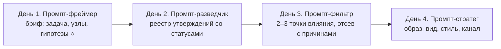

# День 3 курса «Репутационный инжиниринг»: обоснование, метод, фильтр данных и сквозные кейсы

**Документ 1 из 3.** Комплект Дня 3 (2 ноября, 18:30–20:00, онлайн, 90 минут), тема «Внутренние и внешние факторы влияния на развитие компании». Остальные документы комплекта:

- [Документ 2: Gamma-презентация на 33 слайда](https://github.com/G-Ivan-A/hybrid-Intelligence-lab/blob/main/research/reputation-technologies/2026-11-02-day3-presentation-gamma.md) (структура v0.2 с промптами для изображений — в [архивном документе 2](https://github.com/G-Ivan-A/hybrid-Intelligence-lab/blob/main/research/reputation-technologies/2026-11-02-day3-presentation.md));
- [Документ 3: сценарий лектора, Промпт-фильтр, реестр кейса 1, 20 визиток, выход ИИ с ошибками и ответы на частые вопросы](https://github.com/G-Ivan-A/hybrid-Intelligence-lab/blob/main/research/reputation-technologies/2026-11-02-day3-lecturer-script.md).

**Редакция issue [#683](https://github.com/G-Ivan-A/hybrid-Intelligence-lab/issues/683), версия 0.3.** Документ сверен с [RFC v0.3](https://github.com/G-Ivan-A/hybrid-Intelligence-lab/blob/main/research/reputation-technologies/2026-10-12-rfc-days-1-3-logic.md) и с принятыми в [PR #682](https://github.com/G-Ivan-A/hybrid-Intelligence-lab/pull/682) презентацией и сценарием. Что изменилось против версии 0.2:

- кейс 1 — только «Умные холодные продажи»: производитель консервов уже работает с сетями, у него более 100 оптовых покупателей, цель — 5–8 сетей-партнёров за 3 месяца; после выставки у него 20 визиток, и он сам выбирает по открытым данным 3–5 сетей и их ЛПР и пишет первым. Сеть «Х» — 25 магазинов; `CONFLICT` — открыта ли матрица (пресс-релиз против поста в чате), его снимают звонок дистрибьютору «Д» и вопрос в первом письме; `VERIFIED` — путь через сопоставщика «С»;
- GRA — только guardrails для ИИ: масса, дистанция и полярность — три вопроса к связи, а не баллы; силу связи не считаем;
- иски — только маркер активности: «компания действует, иски за годы работы есть»;
- четвёртый вопрос фильтра — «полезность для встречи»;
- этика сбора — «гибко и одновременно аккуратно», со списками «можно» и «нельзя»;
- Промпт-фильтр, тайминг и мост ко Дню 4 сверены со сценарием на 33 слайда.

Глубина обоснования, примеры и источники версии 0.2 сохранены; изменилась логика кейса 1 и четвёртого критерия. Полный список правок — в разделе [«Ограничения и допущения»](https://github.com/G-Ivan-A/hybrid-Intelligence-lab/blob/main/research/reputation-technologies/2026-11-02-day3-rationale-and-method.md#ограничения-и-допущения).

Документ отвечает на пять вопросов.

1. Как теория заинтересованных сторон превращается в карту узлов на языке GRA: масса, дистанция, полярность?
2. Как фильтр данных из четырёх критериев — доступность, значимость, качество, полезность для встречи — сокращает около 10 узлов до 2–3 точек влияния?
3. Почему точка со статусом `CONFLICT` может стать приоритетом для прямого разговора, а точка со статусом `PARTIAL` опасна для публичного действия?
4. Чем точка влияния отличается от аудитории?
5. Что изменит выбор: какие новые данные и какая смена полярности заставят пересобрать список?

Опоры комплекта:

- [SSOT Дня 1](https://github.com/G-Ivan-A/hybrid-Intelligence-lab/blob/main/research/reputation-technologies/2026-10-07-day1-rationale-and-method-653.md) — стиль, механики вовлечения, значки статуса ●/◐/○;
- [обоснование Дня 2](https://github.com/G-Ivan-A/hybrid-Intelligence-lab/blob/main/research/reputation-technologies/2026-10-30-day2-rationale-and-method.md) — провенанс, статусы `VERIFIED` / `PARTIAL` / `CONFLICT`, Промпт-разведчик, реестр по трём кейсам. Комплект Дня 2 влит в `main` через [PR #662](https://github.com/G-Ivan-A/hybrid-Intelligence-lab/pull/662) 2026-10-11; выдержки из реестра Дня 2, нужные Дню 3, пересказаны в разборе кейсов ниже;
- [RFC v0.3 «Логический каркас Дней 1–4»](https://github.com/G-Ivan-A/hybrid-Intelligence-lab/blob/main/research/reputation-technologies/2026-10-12-rfc-days-1-3-logic.md) — принципы фаундера, [GRA как guardrails](https://github.com/G-Ivan-A/hybrid-Intelligence-lab/blob/main/research/reputation-technologies/2026-10-12-rfc-days-1-3-logic.md#gra-как-guardrails-модель-для-промптов), раскладка Дня 3 и решения по кейсу 1, искам и этике сбора;
- [исследовательская модель GRA](https://github.com/G-Ivan-A/hybrid-Intelligence-lab/blob/main/research/reputation-technologies/gra-research-program/00-introduction.md) и [таксономия](https://github.com/G-Ivan-A/hybrid-Intelligence-lab/blob/main/research/reputation-technologies/gra-research-program/20-taxonomy.md) — оси дистанции D1–D5, компоненты массы M1–M4, полярность и направление потока;
- [рамка решений](https://github.com/G-Ivan-A/hybrid-Intelligence-lab/blob/main/research/reputation-technologies/gra-research-program/30-decision-framework.md) — запрещённые формулировки F1–F10, критерии K1–K7 (K7 «этика и право» — порог), гейт ИИ G1–G6;
- [файл практики](https://github.com/G-Ivan-A/hybrid-Intelligence-lab/blob/main/research/reputation-technologies/gra-research-program/40-practice-and-cases.md) — три сквозных кейса, «Свой кейс», этические и правовые границы каждого кейса;
- [исследование #650](https://github.com/G-Ivan-A/hybrid-Intelligence-lab/blob/main/research/reputation-technologies/2026-09-30-course-sources-and-presentations-650.md) — источники по данным, ИИ и вовлечению.

Комплекты Дня 1 версии 0.3 ([PR #661](https://github.com/G-Ivan-A/hybrid-Intelligence-lab/pull/661)) и Дня 2 ([PR #662](https://github.com/G-Ivan-A/hybrid-Intelligence-lab/pull/662)) влиты в `main` 2026-10-11; Gamma-комплекты Дней 1–3 — позже, последним [PR #682](https://github.com/G-Ivan-A/hybrid-Intelligence-lab/pull/682). Версия 0.3 сверена с ними. Данные Дня 2, нужные Дню 3, пересказаны здесь, чтобы документ читался без перехода. Подробности — в разделе [«Ограничения и допущения»](https://github.com/G-Ivan-A/hybrid-Intelligence-lab/blob/main/research/reputation-technologies/2026-11-02-day3-rationale-and-method.md#ограничения-и-допущения).

## Главная мысль дня

**Влияние — не свойство узла, а свойство связи узла с конкретной задачей. Из десяти заметных узлов действовать стоит через два-три, и выбор каждого записан с основанием и с причиной отсева остальных.** День 2 дал реестр утверждений со статусами. День 3 задаёт к каждому узлу реестра четыре вопроса фильтра:

- можно ли дойти до узла белым каналом за срок задачи (доступность);
- изменит ли действие узла результат именно этой задачи (значимость);
- какой статус у данных, на которых держится выбор (качество);
- что из собранного пригодится на встрече: факт для первой фразы, общая тема, общий знакомый или вопрос (полезность для встречи).

К 20:00 слушатель должен прийти от «работаем со всеми, кто громко говорит о нас или о рынке» к «у меня 2–3 точки влияния. Для каждой записаны статус данных, полезное для встречи, вид, стиль и канал первого шага. Отдельно записано, кого я откладываю со словами «не сейчас», почему и что вернёт узел в работу». Это третий шаг цепочки курса «Вижу → Собираю → Выбираю → Действую». День 3 — это «Выбираю».

**Как произносить статус GRA на Дне 3.** День 3 не вводит новых положений GRA. По вердикту RFC v0.3 GRA работает только как guardrails — ограничители для работы с ИИ: масса, дистанция и полярность — три вопроса к связи узла с задачей, а не баллы ([RFC, «GRA как guardrails»](https://github.com/G-Ivan-A/hybrid-Intelligence-lab/blob/main/research/reputation-technologies/2026-10-12-rfc-days-1-3-logic.md#gra-как-guardrails-модель-для-промптов)). Масса — что узел может сделать с нашей задачей; дистанция — сколько шагов и какой канал до него; полярность — с каким знаком он примет наш сигнал, и «?», пока знака нет. Силу связи курс не вычисляет, весов не назначает, числа на экране нет. Сама исследовательская модель GRA возникла как авторская гипотеза фаундера о структурном описании социальных и информационных связей по аналогии с физическими закономерностями; на курсе от неё остаются вопросы и ограничители. Фильтр задаёт вопросы по очереди и записывает, на каком узел остановился. Это следует правилу таксономии — не сворачивать дистанцию в одно число ([20-taxonomy.md, §2](https://github.com/G-Ivan-A/hybrid-Intelligence-lab/blob/main/research/reputation-technologies/gra-research-program/20-taxonomy.md#2-дистанция)).

## Почему Дню 3 нужен фильтр

После Дня 2 у слушателя есть реестр на 10–15 узлов по одному кейсу. Ресурс на действие ограничен: время собственника, переговорщика, специалиста. Ниже — четыре разрыва между «знаю узлы» и «знаю, с кем действовать». Для каждого указана опора в источниках.

**1. Список заинтересованных сторон не говорит, с кем действовать.** Классическое определение стейкхолдера — любая группа или индивид, который может влиять на достижение целей организации или испытывает влияние от него `[Д3-Т1]`. Определение широкое намеренно: оно помогает никого не забыть. Но под него попадают и регулятор, и случайный комментатор. Чтобы выбрать, нужен второй шаг. Mitchell, Agle и Wood предлагают отбирать по трём атрибутам: власть, легитимность, срочность `[Д3-Т2]`. Программа Дня 3 задаёт свои три измерения: влияние на бизнес-процессы, репутацию, финансы; степень вовлечённости в дела компании; активность в коммуникации. Ниже они переведены на язык GRA.

**2. Активность в коммуникации не равна влиянию.** В сетевом анализе давно различают два вида центральности. Узел с большим числом связей (степень) отражает видимость и потенциал активности в коммуникации `[Д3-Т3]` (с. 219). Узел, который стоит на путях между другими (посредничество), имеет потенциал контроля над их коммуникацией `[Д3-Т3]` (с. 221). Эмпирически: пользователи с большим числом подписчиков не обязательно влиятельны, если считать влиянием ретвиты и упоминания `[Д3-Т5]`. Это и есть различие точки влияния и аудитории из программы.

**3. Посредник ценнее «громкого» узла.** Посредничество через структурные дыры — источник добавленной ценности, а замкнутость сети нужна, чтобы эту ценность реализовать `[Д3-Т4]`. На языке GRA это направление потока: сигнал, который приходит через доверенного посредника, идёт по потоку, а холодный контакт — против ([20-taxonomy.md, §4](https://github.com/G-Ivan-A/hybrid-Intelligence-lab/blob/main/research/reputation-technologies/gra-research-program/20-taxonomy.md#4-полярность)). В кейсе 1 это сопоставщик, в кейсе 2 — отраслевой эксперт, в кейсе 3 — специалист по восстановлению.

**4. Выбор на данных с неясным статусом повторяет ошибку Дня 2 в другой форме.** Если в реестре стоит `CONFLICT`, выбор узла «по среднему» стирает противоречие. Аналитические стандарты требуют доводить существенные расхождения до заказчика, а не сглаживать `[650:Д2]`. Если стоит `PARTIAL`, публичное действие опирается на сведение без основания. Объём таких сведений повышает уверенность, но не точность `[650:Д3]` (с. 52). Поэтому критерий «качество» берётся прямо из статусов Дня 2 и определяет **тип** первого шага: разговор, обратимая проверка, действие или отказ.

## Теория заинтересованных сторон на языке GRA

### Три измерения программы как вопросы GRA

Программа называет три измерения стейкхолдера. Каждое переводится в наблюдаемые признаки GRA. Ни одно не сворачивается в балл.

| Измерение программы | Вопрос к узлу | Что наблюдаемо на языке GRA | Типичная ошибка |
| --- | --- | --- | --- |
| Влияние на бизнес-процессы, репутацию, финансы | Что узел может сделать с нашим процессом, репутацией или деньгами за срок задачи? | Масса M1 (ресурс), M2 (позиция, полномочия), M3 (сеть), M4 (репутационный капитал). Влияние на решение M5 — отдельно от массы | Принять высокую массу за влияние на **нашу** задачу. Федеральная сеть огромна, но в 3-месячной задаче кейса 1 недоступна |
| Степень вовлечённости в дела компании | Насколько узел уже связан с нами или с задачей? | Дистанция: D3 (доверие, история взаимодействия), D5 (институциональная близость: договор, регламент, членство), D1 (время). Знак полярности и его основание | Считать вовлечённым того, кто много о нас пишет. Вовлечённость — это связь с делом, а не с темой |
| Активность в коммуникации | Как узел передаёт сигналы и кому? | D2 (канал), направление потока (кто кому передаёт), позиция посредника. Степень против посредничества `[Д3-Т3]` | Принять охват за влияние `[Д3-Т5]`. Активный узел может быть только ретранслятором |

**Внутренние и внешние факторы.** Контуры Дня 1 сохраняются: внутренний контур — сотрудники, руководство, акционеры; внешний — клиенты, партнёры, регуляторы, конкуренты, фонды развития, инфлюенсеры, СМИ. День 3 добавляет к ним одно наблюдение. **Внутренний узел часто задаёт пороги фильтра, а не становится точкой внешнего действия.** Финансовый директор в кейсе 1 задаёт объём пробной партии и сроки, которые компания вправе предложить сети. Технический директор стартапа в кейсе 2 решает, какие данные можно раскрыть до соглашения о конфиденциальности. Сам специалист в кейсе 3 задаёт границы метода и список противопоказаний. Без согласования с внутренним узлом внешний выбор не состоится.

**Регулятор и среда — рамка, а не точка.** Закон о торговле (381-ФЗ, ст. 9 — договор поставки с сетью) в кейсе 1, закон о рекламе (38-ФЗ `[653:М10]`) в кейсе 3, 259-ФЗ `[653:М12]` в кейсе 2 — это ось D5 и граница допустимого. На них не воздействуют в рамках задачи. Их учитывают при выборе вида и канала.

### Точка влияния и аудитория

| | Точка влияния | Аудитория |
| --- | --- | --- |
| Определение для курса | Узел, который сам совершает действие, меняющее результат нашей задачи, или передаёт сигнал по доверенному каналу к такому узлу | Узлы, которые потребляют контент. Их реакция агрегирована: просмотры, лайки, тональность |
| Режим | Активное воздействие: решение, рекомендация, допуск в канал, подпись | Пассивное потребление: прочитал, посмотрел, переслал |
| Что измеряем | Действие и его основание: было ли, кто совершил, со статусом | Охват и тональность — метрики со статусами Дня 2 |
| Как выглядит в карте | Короткий путь по потоку к решению; посредник между нами и решением | Много связей «от нас» и мало «к решению» |
| Пример | Специалист по восстановлению, который направил 5 клиентов (кейс 3) | Блогер с 200 тыс. подписчиков (кейс 3); 30 тыс. просмотров видео (кейс 2) |

**Тест одной фразой.** «Что конкретно этот узел может сделать для нашей задачи за её срок, и как мы узнаем, что он это сделал?» Если ответ — «прочитает» или «посмотрит», это аудитория. Если ответ — «примет решение», «порекомендует», «допустит в канал», это кандидат в точку влияния.

**Роль зависит от задачи.** Один и тот же узел может быть точкой влияния для одной задачи и аудиторией для другой. Участники бизнес-клуба в кейсе 3 — аудитория для задачи «10–20 клиентов по рекомендациям». Организатор того же клуба — точка влияния: он решает, что допустимо в канале. Поэтому роль записывается для задачи, а не для узла навсегда.

## Фильтр данных: четыре критерия

### Определения для курса

Четыре критерия названы в программе. Ниже — рабочие определения курса. Это не стандарт, а учебная операционализация: она связывает критерии с осями GRA и статусами Дня 2.

| Критерий программы | Вопрос | Опора в GRA и Дне 2 | Значения | Что отсеивает |
| --- | --- | --- | --- | --- |
| **Доступность** | Можно ли дойти до узла белым каналом за срок задачи? | Дистанция D1 (время), D2 (канал, число посредников), D3 (есть ли общий доверенный узел), D5 (регламент, тендер, членство) | открыт / через посредника (кто) / закрыт за срок задачи | Узлы, до которых можно дойти только серым путём или не за срок задачи |
| **Значимость** | Изменит ли действие узла результат **этой** задачи? | Масса M1–M4 и отдельно влияние на решение M5; роль: точка влияния или аудитория | высокая / средняя / низкая / «?» с основанием | Аудиторию и узлы, чьё действие не меняет результат задачи |
| **Качество** | Какой статус у ключевого утверждения, на котором держится выбор, и откуда оно? | Статусы Дня 2: `VERIFIED` / `PARTIAL` / `CONFLICT` / нет данных; тип ●/◐/○; надёжность × достоверность; источник и причина статуса | статус + тип; для `PARTIAL` и `CONFLICT` — причина статуса | Ничего не отсеивает само по себе. Определяет **вид первого шага**. Сведения `PARTIAL` и `CONFLICT` не служат основанием выбора точки |
| **Полезность для встречи** | Что из собранного мы возьмём в разговор с узлом? | Решение фаундера в RFC v0.3 ([«Фильтр Дня 3: полезное для встречи»](https://github.com/G-Ivan-A/hybrid-Intelligence-lab/blob/main/research/reputation-technologies/2026-10-12-rfc-days-1-3-logic.md#3-фильтр-дня-3-полезное-для-встречи)); строка реестра Дня 2 со статусом; мост ко Дню 4 | факт для первой фразы / общая тема / общий знакомый / вопрос — со строкой реестра; «взять нечего» | Узлы, о которых для разговора нечего сказать: скорее всего, они попали в список по громкости |

**Почему «полезность для встречи».** В программе Технограда четвёртый критерий назван словом «вред» — от неудачного контакта. Программу сайта изменить нельзя, поэтому лектор один раз называет её формулировку и сразу переводит её в полезность для встречи: из собранного выделяем то, что пригодится для подготовки встречи на Дне 4, а не ищем, чем контакт опасен. Так решил фаундер курса: «В эфире лектор использует термин "полезность для встречи"», а слово программы внутренней логикой фильтра не становится ([RFC, принцип 3](https://github.com/G-Ivan-A/hybrid-Intelligence-lab/blob/main/research/reputation-technologies/2026-10-12-rfc-days-1-3-logic.md#3-фильтр-дня-3-полезное-для-встречи)). Дальше в документе это слово не используется.

**Что даёт полезность для встречи.** У каждой выбранной точки есть хотя бы одна строка реестра, с которой можно начать разговор:

1. **Факт для первой фразы.** Страница «Поставщикам» на сайте сети «Х» обновлена — дата видна по снимку веб-архива (кейс 1).
2. **Общая тема.** Что сеть ценит в поставщиках соседней категории — тема для разговора с сопоставщиком «С» (кейс 1); протоколы испытаний — для технического директора холдинга (кейс 2).
3. **Общий знакомый.** Наш оптовик, которому поставляет «С» (кейс 1); эксперт К. (кейс 2); специалисты по восстановлению А и Б (кейс 3).
4. **Вопрос.** «Как сеть сейчас принимает новых поставщиков?» — вопрос к «Д» о его собственном входе (кейс 1); «что в клубе допустимо для участника, который оказывает услуги?» — к организатору клуба (кейс 3).

**Граница при этом не исчезает.** Полезным для встречи может быть только то, о чём на встрече можно сказать вслух, откуда мы это знаем. Сведения, которые не проходят эту проверку, в реестр не попадают вовсе — правила в разделе [«Этика сбора: гибко и одновременно аккуратно»](https://github.com/G-Ivan-A/hybrid-Intelligence-lab/blob/main/research/reputation-technologies/2026-11-02-day3-rationale-and-method.md#этика-сбора-гибко-и-одновременно-аккуратно). Правовые рамки кейсов (реклама, персональные данные, медицинская деятельность, инвестиционные платформы) остаются ограничениями из входа и проверяются уже на доступности: канал, который их нарушает, не считается каналом. Порог K7 «этика и право» ([30-decision-framework.md, §4](https://github.com/G-Ivan-A/hybrid-Intelligence-lab/blob/main/research/reputation-technologies/gra-research-program/30-decision-framework.md#4-выбор-между-операционализациями)) работает так же — как порог, а не как слагаемое.

### Порядок применения: отсев, а не сумма баллов

Фильтр применяется в порядке программы. Каждый выбывший узел получает причину одной строкой. Критерии не складываются в один балл.

1. **Роль.** До фильтра — тест одной фразой: точка влияния или аудитория. Аудитория выходит из воронки точек, но остаётся в карте: на Дне 4 она нужна для выбора канала.
2. **Доступность.** Узлы, закрытые за срок задачи белым каналом, переходят в резерв следующего цикла.
3. **Значимость.** Узлы, чьё действие не меняет результат задачи, выбывают. Значимость «?» без способа проверить — тоже.
4. **Качество.** Статус не отсеивает, а задаёт вид первого шага (таблица ниже). `CONFLICT` проходит, если сам узел может снять расхождение: тогда это «точка для разговора». `PARTIAL` проходит только для обратимого шага. Узел без данных возвращается в сбор Дня 2. Сведения из чатов, форумов и агрегаторов получают `PARTIAL` или `CONFLICT` с причиной статуса (раздел «Разметка достоверности» ниже).
5. **Полезность для встречи.** Узел проходит, если для разговора с ним есть строка реестра: факт, общая тема, общий знакомый или вопрос. Если взять нечего, узел откладывается: скорее всего, он попал в список по громкости.

Каждый узел, который не прошёл, записывается не как «нет», а как **«не сейчас»**: на каком вопросе остановился, почему и что вернёт его в работу — новый белый канал, смена статуса, смена роли, сдвиг внутреннего порога. «Отказ» пишется только тогда, когда любой шаг к узлу выходит за этику сбора или ограничения кейса.

Белая граница встроена уже в критерий доступности. Канал, который требует разговора под чужим видом, сведений о частной жизни или контактов из скрытых баз, не считается каналом. Узел, до которого можно дойти только так, недоступен.

**Почему не сумма баллов.** Сумма позволяет громкости купить проход и скрыть `CONFLICT` за средним: чат поставщиков наберёт баллы за активность и обгонит дистрибьютора «Д», хотя в задаче ничего не решает. Кроме того, она смешивает порядковые оценки разной природы: «далеко по D3» и «PARTIAL» нельзя сложить, не потеряв смысл. Отсев с причиной оставляет след: через месяц видно, почему узел не выбрали, и что должно измениться, чтобы выбрали.

### Таблица статусов: тип сведения и статус данных

Две оси Дней 1–2 сохраняются и в фильтре. Тип сведения — что это за утверждение. Статус — хватает ли основания для **этого** решения.

| Значок | Тип сведения | Пример в фильтре |
| --- | --- | --- |
| ● | Факт: зафиксировано источником с провенансом | «Холдинг закупает композитные компоненты» — закупочная документация |
| ◐ | Интерпретация: вывод из фактов | «Сопоставщик знает закупщика сети» — со слов сопоставщика |
| ○ | Гипотеза: проверяется | «Специалисты по восстановлению приведут следующих клиентов» |

`VERIFIED`, `PARTIAL`, `CONFLICT` — рабочие статусы курса, а не стандарт. `VERIFIED` — служебная пометка «для этого решения достаточно», а не оценка истинности.

### Статус → действие или отказ

Программа задаёт две развилки: точка с `CONFLICT` может быть приоритетной, точка с `PARTIAL` опасна для публичного действия без проверки. Таблица ниже доводит их до конкретного шага.

| Статус ключевого утверждения | Если узел доступен и для встречи есть что взять | Если узел недоступен или любой шаг выходит за этику сбора |
| --- | --- | --- |
| `CONFLICT` | **Приоритет для прямого разговора.** Первый шаг — вопрос о причине противоречия, а не позиция. Разговор с узлом, который сам является первичным источником, снимает противоречие быстрее, чем ещё десять вторичных источников | «Не сейчас» для действия через этот узел. Ищем другой первичный источник или задаём вопрос в первом письме; противоречие остаётся в реестре со статусом `CONFLICT` |
| `PARTIAL` | **Только обратимый шаг:** вопрос, встреча, пилот, запрос документа. Никаких публичных ссылок на неподтверждённое: письма с цитатой, слайда инвестору, поста | «Не сейчас» до проверки. Записываем, какой источник снимет `PARTIAL` |
| `VERIFIED` | Действие по задаче: вид, стиль, канал первого шага; образ и сообщение — День 4 | «Не сейчас» с условием возврата или выход через посредника (доступность); **отказ** — только при выходе за этику |
| Нет данных | Узел возвращается в сбор: Промпт-разведчик Дня 2 | Узел исключается из этого цикла; пометка «?» сохраняется. «?» — не 0 |

**Почему `CONFLICT` может стать приоритетом.** Программа говорит: «Точка с CONFLICT может быть приоритетной: прямой разговор снимает противоречие». Противоречие — это узел, в котором есть информация. Если разговор с одним человеком снимает противоречие, он стоит дешевле, чем проверка десятка вторичных источников. Кроме того, вопрос о причине противоречия — профессиональный повод для первого контакта: «мы видим разные сведения, помогите понять». Он не требует ни скидки, ни обещания.

**Почему `PARTIAL` опасна для публичного действия.** Публичное действие необратимо: письмо, слайд, пост видят люди, которые проверят основание. Если основание не подтвердится, расплачиваются уже не данные, а репутация автора действия. Поэтому `PARTIAL` закрывает публичное и открывает обратимое.

### Разметка достоверности: собирать всё, решать по проверяемому

Разведка Дня 2 приносит разное: страницы компаний и их снимки в веб-архиве, пресс-релизы, вакансии, открытые профили, сообщения в чатах, отзывы на агрегаторах. Фильтр ничего не выбрасывает: любая разведка — результат, если она размечена. Сбор ограничивают условия задачи и этика сбора (раздел ниже). У каждого сведения, на котором держится выбор, записаны источник (кто автор, первичный это источник или пересказ, есть ли дата) и статус. У `PARTIAL` и `CONFLICT` записана ещё и причина статуса.

| Правило | Что делает фильтр | Почему |
| --- | --- | --- |
| Приоритет тому, что опубликовал сам узел, но не только ему | Сначала опирается на сведения, которые организация или человек опубликовали сами: страница «Поставщикам» и её снимки в веб-архиве с датой, пресс-релизы, вакансии, раздел «Клиенты» или «Где купить» на сайте поставщика, выступления, открытые профессиональные профили, фото полок в открытом доступе. Остальные сведения тоже размечает | Первичная запись с датой — самое короткое основание статуса ([40-practice-and-cases.md, §1.6](https://github.com/G-Ivan-A/hybrid-Intelligence-lab/blob/main/research/reputation-technologies/gra-research-program/40-practice-and-cases.md#16-белые-источники-для-дня-2)). Снимок веб-архива показывает, когда страница изменилась; дата снимка — не дата живой страницы |
| Обязательный поиск — открытый веб и веб-архив; реестры — по желанию | Для каждого «?» и каждого `CONFLICT` — поиск по ключевым словам в открытом вебе и снимки ключевых страниц на https://web.archive.org/ с датами первого и последнего снимка. Пустой архив записывается как «снимков нет», а не как вывод. ЕГРЮЛ и картотека дел — по желанию, не обязательная и не приоритетная цель | Решение RFC v0.3 ([принцип 4](https://github.com/G-Ivan-A/hybrid-Intelligence-lab/blob/main/research/reputation-technologies/2026-10-12-rfc-days-1-3-logic.md#4-цифры-кейса-1-признак-того-что-компания-работает)): цифры кейса 1 — признак того, что компания работает и открыта к поставщикам, а не материал для анализа её дел |
| Иски — только маркер активности | Если иски или записи реестров попались, они записываются одной строкой: «компания действует, иски за годы работы есть». На отсев не влияют | Споры у действующих компаний бывают. Курс не учит форензик-анализу: число исков, суммы, предметы, стороны и выводы о финансах организации или её людях — вне рамок курса ([RFC, «Что этот RFC не делает»](https://github.com/G-Ivan-A/hybrid-Intelligence-lab/blob/main/research/reputation-technologies/2026-10-12-rfc-days-1-3-logic.md#что-этот-rfc-не-делает)) |
| Пересказы из чатов, форумов и агрегаторов — `PARTIAL` или `CONFLICT` | Сведения без автора, без даты или из перепостов одного источника получают `PARTIAL`, а если им противоречит первичный источник с датой — `CONFLICT`. Это касается и слов о том, открыта ли матрица сети, и коммерческих условий | Объём пересказов повышает уверенность, но не точность `[650:Д3]` (с. 52) |
| Причина статуса обязательна | У `PARTIAL` и `CONFLICT` явно указана причина: «слухи», «нет даты», «агрегированные данные», «перепосты одного источника», «отсутствие прямого первоисточника» | Причина отличает «нет оснований для оценки» от «противоречит другой информации»: это разные значения шкалы достоверности `[650:Д5]`. Кроме того, она подсказывает, какой источник снимет статус |
| Чужие коммерческие условия не выясняем | Человека можно спросить о его собственной практике — как он сам входил в матрицу сети, — но не об условиях чужих договоров. Свои условия мы узнаём в разговоре с самой сетью, а их рамку заранее задаёт финансовый директор | Коммерческая тайна — режим конфиденциальности, который вводит сам обладатель информации `[Д3-Р2]` (ст. 3) |
| Ограничение действия | Сведения `PARTIAL` и `CONFLICT` можно использовать как основание выбора точки — со статусом и причиной рядом. Нельзя подавать их как подтверждённые в письме, на слайде или в посте. Решение на таком основании записано как «решение на гипотезе» и задаёт проверку: вопрос первичному источнику, вопрос в первом письме, обратимый пилот | Публичная ссылка на пересказ переносит ошибку источника в репутацию того, кто написал |

**Как это сочетается с приоритетом `CONFLICT`.** Точку выбирают по `VERIFIED`-сведениям о её роли для задачи: дистрибьютор «Д» поставляет сети «Х» другую категорию, и это видно на его сайте и на фото полок в открытом доступе. Расхождение «пресс-релиз сети "Ищем местных производителей" против поста в чате "Матрица закрыта до весны"» — законный повод сделать «Д» приоритетом для разговора, а не подтверждённый факт об открытости матрицы. Поэтому `CONFLICT` выводит точку в приоритет, а в первом письме сети пост из чата не цитируется: вместо него — вопрос о сроках входа в матрицу.

### Этика сбора: гибко и одновременно аккуратно

Принцип RFC v0.3 для сбора данных — **«гибко и одновременно аккуратно»** ([RFC, «Решения по кейсу 1, источникам, этике и структуре кейсов»](https://github.com/G-Ivan-A/hybrid-Intelligence-lab/blob/main/research/reputation-technologies/2026-10-12-rfc-days-1-3-logic.md#решения-по-кейсу-1-источникам-этике-и-структуре-кейсов-issue-671-пункты-1316)). Это мирный сбор данных для партнёрства: мы готовимся к встрече, а не изучаем человека. Рабочее определение курса ◐, не юридическая консультация: открыто то, что человек или его компания сами опубликовали для публики или делового контакта и что доступно без обхода входа, платного доступа и без обмана. Условие сбора совпадает с [условием Дня 2](https://github.com/G-Ivan-A/hybrid-Intelligence-lab/blob/main/research/reputation-technologies/2026-10-30-day2-rationale-and-method.md#условие-сбора-только-открытые-источники).

| Можно | Нельзя |
| --- | --- |
| Открытые аккаунты и профили в соцсетях лиц, принимающих решения, — как профессионалов | Скрытые базы и агрегаторы персональных данных |
| Фото в открытом доступе: стенд на выставке, полки магазина, выступление | «Слитые» выгрузки |
| Телефоны из открытых источников, опубликованные для делового контакта, — в личную записную книжку для одного звонка, без базы | Парсинг вопреки правилам площадки |
| Сайты, страницы «Поставщикам», пресс-релизы, вакансии, снимки веб-архива | Закрытые данные и закрытые профили |
| Реестры и картотеки — по желанию, одной строкой | Подставные аккаунты и разговоры под чужим видом |
| Слова человека о его собственной практике — в разговоре с ним | Сведения о частной жизни: семья, здоровье, перемещения — даже если они попались |

**Проверочный вопрос.** Для каждого сведения: можно ли сказать на встрече вслух, откуда мы это знаем? «Видел вашу вакансию категорийного менеджера» — можно. «Знаем из чата, что матрица закрыта» — нельзя: это выдаёт чужое обсуждение и опирается на `PARTIAL`. Если сказать нельзя, сведения нет в реестре.

**Профессиональная роль открыта, частная жизнь — нет.** Вывод о человеке по фото или по стилю постов — гипотеза низкой уверенности (guardrail 6, G6): r ≈ 0,29 для выводов о личности по цифровым следам `[653:М7]`. Такой вывод не становится основанием выбора.

**Правовая опора.** Изображение гражданина охраняется ст. 152.2 ГК РФ; распространение персональных данных, разрешённых субъектом, — ст. 10.1 152-ФЗ `[653:М8]`; сведения о здоровье — специальная категория, ст. 10 152-ФЗ `[Д3-Р1]`. Сложные случаи — вопрос к юристу компании, а не к ИИ.

### Вид, стиль, канал: черновик для Дня 4

Задача требует, чтобы у каждой выбранной точки было записано, **как** начинать: вид, стиль и канал коммуникации. На Дне 3 это черновик первого шага, а не стратегия образа. Образ, слово и факты как одно сообщение — тема Дня 4. Рабочие определения:

| Элемент | Что записываем | Варианты | От чего зависит |
| --- | --- | --- | --- |
| **Вид** | Форма первого шага | Личная встреча; звонок по рекомендации; письмо; профессиональное событие (выставка, круглый стол); пилот или образец; закрытая трансляция; совместный документ (протокол, описание метода) | От статуса: `CONFLICT` → разговор; `PARTIAL` → обратимый шаг; `VERIFIED` → предложение |
| **Стиль** | Позиция и регистр | «Вопрос, а не предложение»; деловой партнёрский; экспертный доказательный (данные, протоколы, противопоказания); коллегиальный | От полярности и дистанции D4: при «?» или −1 — вопрос и данные, а не заявление |
| **Канал** | Путь сигнала | Прямой (официальный контакт); через посредника (кто именно, по потоку доверия); институциональный (закупка, конкурс, акселератор); событие | От дистанции D2, D3, D5 и направления потока: канал по потоку предпочтительнее канала против потока |

## Промпт-фильтр

### Эволюция промпта: от Фреймера к Фильтру

Цепочка промптов курса принимает на вход одну и ту же карточку кейса и добавляет к ней один шаг в день ([40-practice-and-cases.md, «Промпт-фреймер Дня 1»](https://github.com/G-Ivan-A/hybrid-Intelligence-lab/blob/main/research/reputation-technologies/gra-research-program/40-practice-and-cases.md#промпт-фреймер-дня-1)).



| Измерение | День 2: Разведчик | День 3: Фильтр | Почему меняется |
| --- | --- | --- | --- |
| Вход | Бриф Дня 1: карточка Промпта-фреймера, поля 1–9 | Реестр Дня 2 + бриф Дня 1 | Выбор опирается на утверждения со статусами, а не на гипотезы |
| Единица работы | Утверждение | Узел | День 3 выбирает, через кого действовать |
| Главный запрет | Не делать выводов о репутации и не выбирать точки влияния | Не складывать четыре вопроса в балл, не превращать «?» в 0, не сглаживать `CONFLICT`, не выбирать больше трёх точек, не выносить `PARTIAL` в публичное действие, ничего не вычислять по GRA | Выбор — ответственность человека; ИИ раскладывает основания |
| Выход | Таблица: узел, ключевое утверждение, источник, статус, причина статуса для `PARTIAL` и `CONFLICT`, можно ли публичное действие | Найденное в поиске по вебу и веб-архиву с пометками [AI-n]; 2–3 точки с основанием выбора, полезным для встречи, видом, стилем, каналом; список «не сейчас» с вопросом и условием возврата; триггеры пересмотра; контрпроверка; гейт | Выход Дня 3 — вход Промпта-стратега Дня 4 |

### Как пользоваться

Инструкция совпадает с [разделом А.1 документа 3](https://github.com/G-Ivan-A/hybrid-Intelligence-lab/blob/main/research/reputation-technologies/2026-11-02-day3-lecturer-script.md#а1-как-пользоваться); здесь — она же с пояснением, зачем каждый пункт.

1. Скопируйте весь промпт в ИИ-ассистент, который умеет работать с длинным текстом. Подойдёт любой, в том числе GigaChat или YandexGPT: промпт не зависит от модели. Если ассистент умеет искать в интернете, он выполнит шаг «ПОИСК» сам; если нет — проверьте пробелы реестра вручную по открытому вебу и веб-архиву и допишите найденное в реестр с источником и датой. *Зачем:* «?» в реестре — повод для короткого поиска, а не для догадки модели.
2. Заполните блок «ВХОД»: задача из карточки Промпта-фреймера Дня 1 или мини-бриф в пять строк; реестр Дня 2 таблицей — у каждой строки источник, у `PARTIAL` и `CONFLICT` причина статуса. Сведения из чатов, форумов и агрегаторов не выбрасывайте: любая разведка — результат, если она размечена. Для пробы — бриф из раздела А.3 и реестр десяти узлов из раздела Б.1 документа 3.
3. Впишите внутренние пороги: что компания вправе предложить партнёру и кто внутри задаёт эту рамку. Если порога ещё нет, сначала поговорите с тем, кто его задаёт, — в кейсе 1 это финансовый директор, — и только потом запускайте промпт. *Зачем:* без порога первое письмо обещает то, что компания не подтвердит.
4. Прочитайте выход как черновик. ИИ — инструмент вероятностной систематизации, а не источник истины. Проверьте три места: задал ли он четыре вопроса по очереди или выдал рейтинг; у каждого «не сейчас» названы вопрос, на котором узел остановился, и условие возврата; `CONFLICT` записан как повод для разговора, а не сглажен до «скорее да».
5. Откройте сами каждую ссылку с пометкой [AI-…] (G1). У снимков веб-архива сверьте дату снимка. Строки, которые не удалось проверить, переведите в `PARTIAL` и запишите причину; строки без источника удалите. Правила — в разделе [«Разметка достоверности»](#разметка-достоверности-собирать-всё-решать-по-проверяемому), образец типичных ошибок — в [разделе Б.3 документа 3](https://github.com/G-Ivan-A/hybrid-Intelligence-lab/blob/main/research/reputation-technologies/2026-11-02-day3-lecturer-script.md#б3-выход-ии-с-ошибками-образец-для-слайда-24).
6. Если ИИ нарушил ограничитель, правьте промпт, а не ответ, и запишите нарушение одной строкой: какой guardrail, на каком узле, что исправили. *Зачем:* исправленный промпт не повторит ошибку на следующем кейсе.
7. Решение о 2–3 точках принимаете вы. Запишите его вместе со списком «не сейчас» и условиями пересмотра. Вид, стиль и канал первого шага из выхода — черновик: принесите его на День 4.

### Текст промпта

```text
РОЛЬ
Ты — ассистент аналитика связей. Ты работаешь в исследовательской модели GRA:
масса, дистанция и полярность здесь — вопросы к связи узла с задачей, а не
баллы. Твоя задача — помочь человеку отобрать из реестра узлов 2–3 точки
влияния для ОДНОЙ задачи и записать, кого и почему откладываем.
Ты не источник истины и не выбираешь сам. Ты раскладываешь то, что есть во
входе, и показываешь, где данных не хватает. Решение принимает человек.

ВХОД
1. Задача: что должно измениться, за какой срок, кто решает.
   Вариант 1 — карточка Дня 1 (Промпт-фреймер) целиком.
   Вариант 2 — мини-бриф: цель; ближайший шаг и срок; кейс; узлы-кандидаты;
   что уже известно.
   [вставьте]
2. Реестр Дня 2 (выход Промпта-разведчика) — таблица:
   | № | Узел | Ключевое утверждение | Источник: автор, первичный или
   пересказ, дата | Статус: VERIFIED / PARTIAL / CONFLICT / ? | Причина
   статуса, если не VERIFIED | Можно ли публичный шаг: да / нет / после
   проверки |
   [вставьте]
3. Карта Дня 1 по узлам, если есть: масса (M1 ресурс, M2 позиция, M3 сеть,
   M4 репутационный капитал; влияние на решение M5 — отдельно), дистанция по
   осям (D1 время, D2 канал, D3 доверие, D4 ценности, D5 институты),
   полярность (+1 / 0 / −1 / ?) и направление потока.
   [вставьте или напишите «нет»]
4. Внутренние пороги: что компания вправе предложить партнёру (объём пробной
   партии, сроки, образцы) и кто внутри компании задаёт эту рамку.
   [вставьте или напишите «нет»]
5. Ограничения: этика и право кейса, срок, каналы, которые мы не используем.
   [вставьте]

ШАГ 0. ПОИСК (обязательный, только по пробелам реестра)
1. Для каждого узла со статусом «?» и для каждого CONFLICT сделай поиск по
   ключевым словам в открытом вебе: сайт организации, пресс-релизы, страница
   для поставщиков или партнёров, вакансии, отраслевые СМИ, открытые аккаунты
   и профили людей как профессионалов.
2. Для ключевых страниц (сайт, страница для поставщиков, пресс-релизы) найди
   снимки веб-архива: https://web.archive.org/ . Запиши дату первого и
   последнего снимка и что изменилось. Если снимков нет, так и напиши:
   «снимков нет». Пустой архив — не вывод об организации.
3. Дату снимка не выдавай за дату текущей страницы: у снимка — дата снимка,
   у живой страницы — дата, когда человек её откроет.
4. ЕГРЮЛ и картотека дел — по желанию, не обязательная и не приоритетная цель.
5. Всё, что ты нашёл сам, помечай [AI-1], [AI-2]… и ставь статус не выше
   PARTIAL с пометкой «человек не открывал». Найденное не меняет статус строки
   реестра, пока человек не открыл ссылку.
6. Разложи найденное: дата, статус, к какому узлу относится и на какой из
   четырёх вопросов фильтра отвечает.

ПРАВИЛА
- Опирайся только на вход и на найденное в шаге 0. Если данных нет — пиши «?».
  «?» — не 0 и не «нейтрально». Не заполняй пробел догадкой.
- Не ставь баллов, не складывай критерии и не усредняй статусы. CONFLICT
  остаётся CONFLICT, пока его не снял первичный источник.
- Охват, подписчики, просмотры, число упоминаний — не значимость.
- Только белые каналы: публичная профессиональная активность, официальные
  контакты организаций, представление общим знакомым с их согласия. Если до
  узла можно дойти только иначе, узел недоступен.
- Не делай выводов о личности, характере, мотивах людей. Если такой вывод
  напрашивается, пометь его «гипотеза низкой уверенности» и не используй как
  основание выбора.
- Не обещай результатов: сделки, выручки, рекомендации, инвестиций.
- Не выбирай больше трёх точек.

РАЗМЕТКА ДОСТОВЕРНОСТИ
- Во входе могут быть любые сведения из открытых источников: реестры,
  публикации, форумы, чаты, агрегаторы, пересказы. Не отбрасывай их: любая
  разведка — результат, если она размечена. Для каждого сведения, на котором
  держится выбор, укажи: кто автор, первичный это источник или пересказ, есть
  ли дата. Если источник не указан — статус PARTIAL, причина «источник не
  указан».
- Приоритет — сведениям, которые организация или человек опубликовали сами:
  официальные публикации, страница для поставщиков и её снимки в архиве,
  вакансии, выступления, открытые профессиональные профили. Приоритет не
  значит «только они»: остальные сведения тоже размечай.
- Коммерческие условия (цены, отсрочки, сроки расчётов, скидки, маржа,
  внутренние договорённости) компании защищают режимом коммерческой тайны.
  Если такие сведения взяты из чатов, форумов или агрегаторов, присвой им
  статус PARTIAL, а если им противоречит другой источник, — CONFLICT. Даже
  если во входе стоит VERIFIED.
- Для каждого PARTIAL и CONFLICT явно назови причину низкой достоверности:
  «слухи», «агрегированные данные», «нет даты», «перепосты одного
  источника», «отсутствие прямого первоисточника».
- Сведения PARTIAL и CONFLICT можно использовать как основание для выбора
  точки, но рядом всегда стоят статус и причина. Решение на таком основании
  помечай «решение на гипотезе» и назови проверку: вопрос первичному
  источнику о его собственной практике, запрос документа, обратимый пилот.
- Не предлагай выяснять коммерческие условия у третьих лиц: человека можно
  спросить о его собственной практике, но не об условиях чужих договоров.

ШАГ 1. ЗАДАЧА
Перескажи задачу одной фразой: действие какого узла изменит результат и к
какому сроку. Если задача не задана или их несколько — остановись и попроси
человека выбрать одну.

ШАГ 2. РОЛЬ УЗЛА
Для каждого узла ответь: «Если узел согласится с нами, что сдвинется в задаче
за её срок, и как мы узнаем, что он это сделал?»
- Точка влияния: сам совершает действие, меняющее результат (решение,
  рекомендация, знакомство, допуск в канал), или передаёт сигнал по
  доверенному каналу к такому узлу. Назови действие.
- Аудитория: потребляет контент (прочитает, посмотрит, перешлёт). Ничего в
  задаче не сдвигает.
- Рамка: регулятор или среда, задаёт границы, но не действует в задаче.
- Внутренний порог: узел внутри нашей компании, который задаёт условия для
  первого шага. Его не фильтруй: перенеси его условия в шаги 5 и 6.

ШАГ 3. ФИЛЬТР: ЧЕТЫРЕ ВОПРОСА ПО ПОРЯДКУ
Задавай вопросы каждому узлу строго по порядку. Если узел не прошёл вопрос,
дальше его не проверяй: запиши, на каком вопросе он остановился. Ответы не
складывай: это отсев, а не сумма. В каждой ячейке — основание: номер строки
реестра, [AI-…] или «?».
В1. ДОСТУПНОСТЬ. Дойдём ли до узла белым каналом за срок задачи?
    открыт / через посредника (кто) / не за срок задачи.
В2. ЗНАЧИМОСТЬ. Может ли узел сам сдвинуть задачу (шаг 2)? Аудитория и
    рамка здесь останавливаются. высокая / средняя / низкая / ? и на чём
    основана.
В3. КАЧЕСТВО. На чём держится ключевое утверждение об узле: тип
    (● ФАКТ / ◐ ИНТЕРПРЕТАЦИЯ / ○ ГИПОТЕЗА), статус, источник, дата; для
    PARTIAL и CONFLICT — причина.
    - CONFLICT не останавливает узел, если сам узел может снять расхождение:
      тогда он проходит как «точка для разговора».
    - PARTIAL проходит только для обратимого шага.
    - «?» без способа проверить не проходит: узел возвращается в сбор.
В4. ПОЛЕЗНОСТЬ ДЛЯ ВСТРЕЧИ. Что из собранного мы возьмём в разговор:
    факт для первой фразы / общая тема / общий знакомый / вопрос? Нужна
    строка реестра. Если взять нечего — узел не проходит: скорее всего, он
    попал в список по громкости.
Таблица:
| № | Узел | Роль | В1 | В2 | В3 | В4 | Прошёл / остановился на (В1–В4) |

ШАГ 4. «НЕ СЕЙЧАС» ВМЕСТО «НЕТ»
Для каждого узла, который не прошёл фильтр, запиши одну строку:
| № | Узел | Остановился на | Причина | Что вернёт его в работу |
«Что вернёт» — конкретное событие: новый белый канал, смена статуса строки
реестра, смена роли узла, сдвиг внутреннего порога.
Не пиши «отказ», если узел недоступен или о нём мало данных: это «не сейчас».
«Отказ» — только если любой шаг к узлу нарушает ограничения из входа или
этику; тогда назови ограничение.

ШАГ 5. СТАТУС → ВИД ПЕРВОГО ШАГА
Для прошедших узлов:
- CONFLICT → прямой разговор о причине расхождения с тем, кто сам является
  первичным источником. Сформулируй один вопрос, а не позицию. Назови
  документ или источник, который снимет CONFLICT, если разговора не будет.
- PARTIAL → только обратимый шаг (вопрос, встреча, пилот, запрос документа),
  без публичных ссылок на неподтверждённое. Назови источник, который снимет
  PARTIAL.
- VERIFIED → можно планировать действие по задаче.
- нет данных → вернуть узел в сбор (Промпт-разведчик Дня 2).
Условия первого шага (объём пробной партии, сроки) не выходят за внутренние
пороги из входа. Коммерческие сведения PARTIAL и CONFLICT в условия первого
шага не входят.

ШАГ 6. КОРОТКИЙ СПИСОК: 2–3 ТОЧКИ
Порядок приоритета:
1) узел, разговор с которым снимает CONFLICT, мешающий решению;
2) узел по потоку доверия (посредник, которому доверяет узел решения);
3) значимость для задачи.
Для каждой точки запиши:
- основание выбора: строка реестра со статусом; если основание — только
  PARTIAL или CONFLICT, напиши «точка для проверки»;
- вид первого шага (разговор / просьба о знакомстве / письмо / пилот);
- полезное для встречи: факт, общая тема, общий знакомый или вопрос — со
  строкой реестра;
- полярность сейчас (+1 / 0 / −1 / ?) и релевантный сигнал: повод из задачи
  самого узла, который может сменить «?» на +1. Повтор писем и холодный прайс
  сигналом не считаются;
- черновик для Дня 4:
  ВИД: встреча / звонок по рекомендации / письмо / профессиональное
  событие / пилот или образец / совместный документ;
  СТИЛЬ: вопрос, а не предложение / деловой партнёрский / экспертный
  доказательный / коллегиальный — и почему (полярность, дистанция D4);
  КАНАЛ: прямой / через посредника (кто) / институциональный (какой) /
  событие — и почему (дистанция D2, D3, D5, направление потока).
Образ и текст сообщения не пиши: это задача Дня 4.

ШАГ 7. СОЗНАТЕЛЬНО НЕ ТРОГАЕМ
Перечисли узлы, которые выглядят громко (охват, упоминания, крупный
логотип), но не прошли фильтр. Для каждого — одна строка: почему не сейчас.

ШАГ 8. ЧТО ИЗМЕНИТ ВЫБОР
Для каждой выбранной точки назови:
- какая смена статуса уберёт её из списка;
- какая смена полярности уберёт её из списка (знак или направление потока);
- какая смена роли узла или сдвиг внутреннего порога изменит выбор;
- какой узел из списка «не сейчас» войдёт на её место и при каком новом
  белом канале;
- когда возвращаемся к списку: по событию или раз в две недели.
Если пришла новость о точке, сначала назови 2 возможные причины и того, кто
может их различить. Не меняй выбор по одному заголовку.

ШАГ 9. КОНТРПРОВЕРКА
Выступи критиком своего выхода: найди 3 самых слабых основания и один узел
из «не сейчас», который фильтр мог недооценить. Не переделывай выбор
целиком: для каждого пункта назови, что проверить человеку.

GUARDRAILS (ограничители GRA; ничего не вычисляй)
- guardrail 4: нет вывода без открытой ссылки и даты. Факт есть только по
  ссылке, которую человек открыл; дата — из источника или снимка архива.
- guardrail 5: у каждой гипотезы — тип (●, ◐, ○), условие, при котором она
  неверна, и другое объяснение.
- guardrail 7: только открытые источники (см. ЭТИКА И ГРАНИЦЫ).
Напоминания с Дня 1: «?» не равно 0 (guardrail 2); размер узла не равен его
массе (guardrail 3); личные качества — гипотеза низкой уверенности
(guardrail 6). Силу связи не считай.

ШАГ 10. САМОПРОВЕРКА ПО ГЕЙТУ
Перед выходом проверь и отметь да / нет:
G1 Источник — у каждого основания есть номер строки реестра, [AI-…] или «?».
G2 Дата — даты взяты из реестра, источника или снимка, а не из твоих знаний.
G3 Статус — тип сведения, статус и источник указаны для каждого основания
   выбора; у PARTIAL и CONFLICT названа причина; ни выбор точки, ни условия
   первого шага не держатся только на PARTIAL или CONFLICT.
G4 Опровержение — для каждой точки назван факт, который опроверг бы выбор,
   и альтернативная точка.
G5 Независимость — ключевое основание не держится на одном источнике,
   повторённом много раз, на тебе самом или на повторном запросе к модели.
G6 Личные выводы — в основании выбора нет выводов о личности, характере,
   здоровье или частной жизни людей.
Для каждого «нет» — одна строка: какой пункт, на каком узле, что поправить.

ЭТИКА И ГРАНИЦЫ (условие сбора)
- Только открытые источники: то, что человек или организация сами
  опубликовали для публики или делового контакта и что доступно без обхода
  входа, платного доступа и без обмана.
- Можно: реестры, сайты, публикации, снимки веб-архива, вакансии, открытые
  аккаунты и профили лиц, принимающих решения, как профессионалов, фото в
  открытом доступе.
- Нельзя: закрытые профили, скрытые базы, «слитые» выгрузки и агрегаторы
  персональных данных, парсинг вопреки правилам площадки, подставные
  аккаунты и разговоры под чужим видом.
- Профессиональная роль открыта для изучения, частная жизнь — нет. Сведения
  о семье, здоровье и перемещениях людей не включай, даже если они попались.
- Проверка для каждого сведения: можно ли на встрече сказать вслух, откуда
  мы это знаем? Если нельзя — сведения нет в выходе.
- Иски и записи реестров, если попались, — одна строка «организация
  действует; иски за годы работы есть». Иски — только маркер активности:
  не выписывай их число, суммы, предметы споров и стороны и не делай по ним
  выводов о финансах, дисциплине расчётов или людях организации.
- Если в кейсе есть клиенты или пациенты: никаких диагнозов и сведений о
  здоровье, только обезличенный путь клиента («через специалиста»).

ВЫХОД
1. Задача одной фразой (шаг 1).
2. Найденное в шаге 0: страницы и снимки архива с датами или «снимков нет».
3. Таблица ролей и фильтра (шаги 2 и 3).
4. 2–3 точки: основание выбора, статус, вид первого шага, полезное для
   встречи, полярность и сигнал, черновик ВИД / СТИЛЬ / КАНАЛ.
5. Список «не сейчас»: вопрос, на котором узел остановился, причина и что
   вернёт его в работу (шаг 4).
6. «Сознательно не трогаем» (шаг 7).
7. «Что изменит выбор» (шаг 8).
8. Контрпроверка: 3 слабых основания и 1 недооценённый узел (шаг 9).
9. Самопроверка G1–G6 (шаг 10).
10. Список «?» для человека: что проверить до первого шага.
Не пиши итоговых суждений о том, «какая у кого репутация».
```

### Что делает каждый блок промпта

| Блок | Что делает | Опора |
| --- | --- | --- |
| РОЛЬ | Задаёт ИИ позицию систематизатора, а не эксперта, который выносит вердикт | `[650:Н7]`: разрешить «я не знаю» снижает галлюцинации, но не устраняет их |
| ВХОД | Задача, реестр Дня 2 со статусами и причинами, внутренние пороги | Цепочка промптов курса; RFC v0.3 |
| ШАГ 0. ПОИСК | Обязательный поиск только по пробелам реестра: открытый веб и снимки веб-архива с датами; ЕГРЮЛ — по желанию. Найденное помечается [AI-n] и не выше `PARTIAL`, пока человек не открыл ссылку | [RFC v0.3, принцип 4](https://github.com/G-Ivan-A/hybrid-Intelligence-lab/blob/main/research/reputation-technologies/2026-10-12-rfc-days-1-3-logic.md#4-цифры-кейса-1-признак-того-что-компания-работает); guardrail 4; G1, G2 |
| ПРАВИЛА | Переносит запреты Дней 1–2 в выбор: «?» не 0, не усреднять статусы, охват не значимость, без выводов о личности, без обещаний; иски — одной строкой как маркер активности | F7, F9, G6 ([30-decision-framework.md](https://github.com/G-Ivan-A/hybrid-Intelligence-lab/blob/main/research/reputation-technologies/gra-research-program/30-decision-framework.md#2-формулировки-запрещённые-и-допустимые)); `[Д3-Т5]`; `[650:Д5]` |
| ШАГИ 1–2 | Задача одной строкой и роль узла: точка влияния, аудитория, рамка, внутренний порог | `[Д3-Т3]`, `[Д3-Т5]` |
| ШАГ 3 | Четыре вопроса по порядку: В1 доступность, В2 значимость, В3 качество, В4 полезность для встречи. Узел идёт к следующему вопросу, только если прошёл предыдущий | Программа Дня 3; K7 — порог |
| ШАГ 4 | «Не сейчас» вместо «нет»: вопрос, на котором узел остановился, причина и условие возврата | Программа Дня 3: «Что изменит выбор» |
| ШАГ 5 | Статус → вид первого шага: `VERIFIED` — предложение, `PARTIAL` — обратимый шаг, `CONFLICT` — разговор. `PARTIAL` не выносится в письмо, пост или слайд | Статусы Дня 2; G3 |
| ШАГ 6 | 2–3 точки с основанием из `VERIFIED`-строк, полезным для встречи, черновиком вида, стиля и канала — вход Дня 4 | Программа Дня 4: выбор стратегии зависит от полярности, дистанции и массы |
| ШАГИ 7–8 | Кого сознательно не трогаем и что изменит выбор: новые данные и смена полярности | Программа Дня 3; Полярность(t) |
| ШАГ 9. КОНТРПРОВЕРКА | Альтернативное объяснение для каждой точки: что, если основание выбора неверно | Guardrail 5 |
| GUARDRAILS | Три вопроса к связи и guardrails 4, 5, 7 как ограничители: ничего не вычислять, не взвешивать, не сводить в показатель | [RFC v0.3](https://github.com/G-Ivan-A/hybrid-Intelligence-lab/blob/main/research/reputation-technologies/2026-10-12-rfc-days-1-3-logic.md); [30-decision-framework.md](https://github.com/G-Ivan-A/hybrid-Intelligence-lab/blob/main/research/reputation-technologies/gra-research-program/30-decision-framework.md) |
| ШАГ 10. САМОПРОВЕРКА | Гейт G1–G6; в G3 — источник, причина статуса и запрет публичных действий на `PARTIAL` и `CONFLICT` | [30-decision-framework.md, §5](https://github.com/G-Ivan-A/hybrid-Intelligence-lab/blob/main/research/reputation-technologies/gra-research-program/30-decision-framework.md#5-гейт-для-выводов-ии-агентов) |
| ЭТИКА И ГРАНИЦЫ | Условие сбора «гибко и одновременно аккуратно»: что можно, что нельзя, проверка «можно ли сказать вслух, откуда знаем» | [Этика сбора](#этика-сбора-гибко-и-одновременно-аккуратно); 152-ФЗ `[Д3-Р1]`; 98-ФЗ `[Д3-Р2]` |

## ИИ на Дне 3: ранжирование как черновик, а не как вердикт

ИИ на Дне 3 делает то, в чём он полезен: раскладывает 10–15 узлов по четырём вопросам, ищет по пробелам реестра в открытом вебе и веб-архиве, напоминает о пропущенных клетках, предлагает формулировки вопросов. Чего он не делает: не знает, доступен ли узел на самом деле, не видит, кто кому доверяет, и не отвечает за то, как пройдёт встреча. На выходе — вероятностная систематизация входа, а не знание о мире. Если ИИ пишет «дистрибьютор "Д" — лучшая точка входа», это значит: «во входе есть основания, совместимые с этим выбором». Решение и проверку делает человек (F9).

Шесть типовых ошибок ИИ-фильтра — по образцу [раздела Б.3 документа 3](https://github.com/G-Ivan-A/hybrid-Intelligence-lab/blob/main/research/reputation-technologies/2026-11-02-day3-lecturer-script.md#б3-выход-ии-с-ошибками-образец-для-слайда-24), который разбирают на слайде 24:

1. **Выбор по охвату.** Модель ставит чат поставщиков первой точкой за число участников и упоминаний, потому что эти числа есть во входе и выглядят как мера. Чат — аудитория: он останавливается на В2. Противоядие — правило «охват — не значимость» и `[Д3-Т5]`.
2. **`CONFLICT` сглажен.** «Матрица скорее открыта: пресс-релиз весомее». Строка остаётся `CONFLICT`, а точкой становится тот, кто снимает расхождение, — «Д». Противоядие — правило «не усредняй статусы» и G3.
3. **Публичное действие на `PARTIAL`.** Ссылка в письме на пост из чата. Пост — слухи без даты, и слова «знаем, что матрица закрыта» выдают чужое обсуждение. Противоядие — шаг 5 и проверка «можно ли сказать вслух, откуда знаем».
4. **Снимок без даты.** «Страница обновлена недавно» без даты снимка веб-архива. Найденное ИИ — не выше `PARTIAL`, пока человек не открыл ссылку. Противоядие — guardrail 4, G1, G2.
5. **Точка без полезного для встречи.** Ассоциация с прочерком в графе «полезное для встречи». Такой узел не проходит В4. Противоядие — шаг 3.
6. **Нет записи «не сейчас».** «Остальные узлы менее значимы». Без вопроса и условия возврата громкий узел вернётся в план при первом нажиме. Противоядие — шаг 4.

Время ИИ на эфире — 14 минут из 90: проба Промпта-фильтра на реестре кейса 1 и разбор его ошибок (19:16–19:30, слайды 23–24). Это в коридоре ИИ-минут исследования #650 и меньше, чем на Дне 2: центр Дня 3 — выбор человека.

## Три сквозных кейса через фильтр Дня 3

Кейсы взяты из [файла практики](https://github.com/G-Ivan-A/hybrid-Intelligence-lab/blob/main/research/reputation-technologies/gra-research-program/40-practice-and-cases.md#как-устроены-сквозные-кейсы) и продолжают реестры Дня 2. В каждом кейсе:

1. задача и вход из Дня 2;
2. карта: около 10 узлов, внутренний и внешний контур;
3. фильтр: таблица по четырём критериям;
4. 2–3 точки влияния с видом, стилем и каналом;
5. кого сознательно не трогаем, несмотря на «шум»;
6. как `CONFLICT` или `PARTIAL` ведёт к действию или к отказу;
7. что изменит выбор;
8. граница: белая зона и что исключено.

Все имена и названия условные.

Обозначения в таблицах фильтра: «Дост.» — доступность; «Знач.» — значимость; «Кач.» — качество (статус ключевого утверждения); «Полезн.» — полезность для встречи: что есть сказать или спросить на первой встрече.

### Кейс 1. B2B-производитель консервов: вход через тех, кто уже поставляет кандидату

**Задача и вход.** Кейс 1 — «Умные холодные продажи» ([RFC v0.3, кейс 1](https://github.com/G-Ivan-A/hybrid-Intelligence-lab/blob/main/research/reputation-technologies/2026-10-12-rfc-days-1-3-logic.md)). Производитель консервов уже работает с сетями, у него более 100 оптовых покупателей, и не только сети. Цель — расширить пул партнёров: 5–8 торговых сетей за 3 месяца. Инициатор контакта — мы: сети нам не писали, и исходной точкой не служат ни входящее обращение сети, ни слова «сеть сама нас ищет». После отраслевой выставки у собственника 20 визиток представителей сетей. По открытым данным он выбирает 3–5 сетей и их лиц, принимающих решения, и пишет первым. У собственника и менеджера по продажам — два-три разговора в неделю, поэтому фильтр отвечает на вопрос «кому первые письма и через кого».

Мини-бриф — тот же, что в [разделе А.3 документа 3](https://github.com/G-Ivan-A/hybrid-Intelligence-lab/blob/main/research/reputation-technologies/2026-11-02-day3-lecturer-script.md#а3-бриф-кейса-1-сеть-х):

- Сеть «Х» — 25 магазинов, попала в пул по маркерам открытости: страница «Поставщикам» на её сайте обновлена, у снимков веб-архива есть даты; сеть ищет трёх категорийных менеджеров.
- Дистрибьютор «Д» поставляет в «Х» другую категорию — это видно на его сайте и на фото полок в открытом доступе (`VERIFIED`).
- Сопоставщик «С» поставляет в «Х» и нашему оптовику — раздел «Где купить» на сайте «С» и слова оптовика, два независимых источника (`VERIFIED`).
- Главный «?» — `CONFLICT`: открыта ли сейчас матрица «Х» для новых поставщиков консервов. Пресс-релиз сети в марте: «Ищем местных производителей» (первичный, с датой). Пост в отраслевом чате: «Матрица закрыта до весны, можно не писать» (автор без имени, даты нет).
- Внутренний порог: финансовый директор задаёт объём пробной партии и сроки, которые компания вправе предложить сети. Порог согласован до первого письма.

**Цифры кейса — признак того, что компания работает.** Надёжный фильтр — маркеры, которые проверяются без чьих-то слов. Они показывают, что сеть действует и открыта к поставщикам, а не описывают её дела. Обязательный поиск — открытый веб и веб-архив; ЕГРЮЛ — по желанию.

| Маркер | Где проверить | Что показывает | В кейсе 1 |
| --- | --- | --- | --- |
| Страница «Поставщикам» и её снимки | Сайт сети; веб-архив https://web.archive.org/ | Есть ли процедура для новых поставщиков и когда её обновляли | Анкета обновлена; снимки: первый два года назад, последний полгода назад — `VERIFIED` ● |
| Пресс-релизы и новости сети | Сайт сети, отраслевые СМИ | Заявленные намерения с датой | Март: «Ищем местных производителей» — первичный, с датой; против поста в чате — `CONFLICT` |
| Вакансии | Сайты вакансий | Кто в сети решает о матрице и растёт ли закупочная команда | Три вакансии категорийных менеджеров за последние три недели — `VERIFIED` ● |
| Кто уже поставляет | Сайты поставщиков: «Клиенты», «Где купить»; фото полок в открытом доступе | Белый путь к сети через тех, кто уже в ней | «Д» и «С» — `VERIFIED` ● |
| Публичная активность | Выставки, выступления закупщиков | Где с решающим можно встретиться | Стенд сети на отраслевой выставке, визитка представителя |
| Реестры (по желанию) | ЕГРЮЛ https://egrul.nalog.ru/ `[Д2-Р5]` | Что компания действует | Одной строкой: «компания действует, иски за годы работы есть» — маркер активности, на отсев не влияет |

**Карта: 10 узлов и строка К.** Реестр Дня 2 — [раздел Б.1 документа 3](https://github.com/G-Ivan-A/hybrid-Intelligence-lab/blob/main/research/reputation-technologies/2026-11-02-day3-lecturer-script.md#б1-десять-узлов-вокруг-сети-х). Финансовый директор нашей компании в десять узлов не входит: его не фильтруют, он задаёт рамку первого письма.

| № | Узел | Ключевое утверждение и источник | Статус и причина | Роль для задачи (тест одной фразой) |
| --- | --- | --- | --- | --- |
| 1 | Коммерческий директор сети «Х» | Подписывает решения о новых поставщиках; сайт сети, раздел «Руководство» | `VERIFIED` для роли; полярность «?» — нас не знает | Точка влияния: подписывает |
| 2 | Категорийный менеджер «Х» (консервы) | Решает о вводе позиций в матрицу; сеть ищет трёх категорийных менеджеров | `VERIFIED` для роли и вакансий; человек — «?», имя не найдено | Точка влияния, но человек неизвестен |
| 3 | Служба закупок «Х» | Принимает анкеты поставщиков на общий адрес; страница «Поставщикам» и снимки веб-архива | `VERIFIED` для канала; кто решает — «?» | Процесс, а не решение |
| 4 | Представитель «Х» с выставки | Говорил с собственником на стенде; на визитке — «менеджер по развитию» | `PARTIAL`: на сайте сети не найден, один источник | Вход, роль неясна |
| 5 | Дистрибьютор «Д» | Поставляет в «Х» другую категорию; сайт «Д» и фото полок | `VERIFIED` | Точка влияния: знает, как сеть берёт поставщиков, может снять `CONFLICT` |
| 6 | Сопоставщик «С» | Производитель соседней категории; поставляет в «Х» и нашему оптовику | `VERIFIED`: сайт «С» и слова оптовика | Точка влияния: может рекомендовать нас категорийному менеджеру |
| 7 | Другие поставщики «Х» | Бренды на полках «Х»; фото покупателей в открытых отзывах | `PARTIAL`: фото без дат, список неполный | Возможный посредник |
| 8 | Отраслевая ассоциация | «Х» — член ассоциации; сайт ассоциации | `VERIFIED` для членства; о матрице не решает ◐ | Рамка: среда, а не решение |
| 9 | Чат поставщиков | Самый частый источник упоминаний «Х»; пост «Матрица закрыта до весны» | `PARTIAL`: слухи, нет даты, один автор | Аудитория |
| 10 | Федеральная сеть (визитка из пула) | Новые поставщики — через ассортиментный комитет и тендер; путь дольше трёх месяцев ◐ | `VERIFIED` для процедуры; `PARTIAL` для срока | Точка влияния по массе |
| К | Открыта ли матрица «Х» для новых поставщиков консервов | Пресс-релиз «Х», март, против поста в чате (строка 9) | `CONFLICT`: официальное намерение с датой против слов практика без даты | Повод для разговора, а не вывод |

Закон о торговле (381-ФЗ, ст. 9) задаёт рамку договора поставки с сетью. Это рамка D5 для разговора об условиях пробной партии, а не узел. Конкретные нормы сверяются с актуальной редакцией до встречи ([40-practice-and-cases.md, §1.7](https://github.com/G-Ivan-A/hybrid-Intelligence-lab/blob/main/research/reputation-technologies/gra-research-program/40-practice-and-cases.md#17-этика-и-право)).

**Фильтр.** Вопросы идут по порядку; узел, остановившийся на вопросе, получает «не сейчас» с условием возврата.

| № | Узел | Дост. | Знач. | Кач. | Полезн. | Итог |
| --- | --- | --- | --- | --- | --- | --- |
| 5 | Дистрибьютор «Д» | через общего знакомого (D3) | высокая: знает, как сеть сейчас берёт поставщиков | `VERIFIED` ● для поставок; по строке К — `CONFLICT` → вид шага: разговор | вопрос о его собственном входе: как сеть сейчас принимает новых поставщиков. Чужие условия не спрашиваем | **Точка 1** |
| 6 | Сопоставщик «С» | через нашего оптовика — общий знакомый | высокая: путь по потоку доверия к категорийному менеджеру | `VERIFIED` ●: два независимых источника | тема — что сеть ценит в поставщиках; просьба о знакомстве | **Точка 2** |
| 1 | Коммерческий директор «Х» | письмо после разговоров с «Д» и «С» | высокая: подписывает | `VERIFIED` ● для роли; полярность «?» | два факта с датами: страница «Поставщикам» обновлена, сеть ищет трёх категорийных менеджеров; вопрос о сроках входа в матрицу | **Точка 3** |
| 2 | Категорийный менеджер «Х» | прямого белого канала нет, человек неизвестен | — | — | — | Не сейчас (В1): вернётся через знакомство от «С» |
| 10 | Федеральная сеть | путь дольше срока задачи | — | — | — | Резерв следующего цикла (В1): вернётся с белым каналом в ассортиментный комитет |
| 3 | Служба закупок «Х» | открыт | о матрице не решает | — | — | Не сейчас (В2): вернётся после решения о пилоте — анкета и документы |
| 8 | Отраслевая ассоциация | открыт | о матрице не решает, до решения три шага | — | — | Не сейчас (В2): вернётся, если соберёт встречу поставщиков с закупщиками «Х» |
| 9 | Чат поставщиков | открыт | аудитория, а не точка | — | — | Не сейчас (В2): вернётся, если в чате появится сотрудник сети, отвечающий за матрицу |
| 4 | Представитель «Х» с выставки | визитка | «?» | `PARTIAL`: роль не подтверждена | — | Не сейчас (В3): вернётся, когда роль подтвердит сайт сети или «Д»; контакт тёплый — сохранить |
| 7 | Другие поставщики «Х» | «?» | возможный посредник | `PARTIAL` | для разговора с «Х» о них нечего сказать | Не сейчас (В4): вернутся, если кто-то окажется общим знакомым |

**Выбор: 3 точки влияния.**

| Точка | Статус → тип шага | Вид | Стиль | Канал |
| --- | --- | --- | --- | --- |
| 1. Дистрибьютор «Д» | `CONFLICT` по строке К → разговор с тем, кто знает практику сети из первых рук | Звонок по рекомендации | «Вопрос, а не предложение»: «Как сеть сейчас принимает новых поставщиков? Как входили вы сами?» | Через общего знакомого — по потоку доверия |
| 2. Сопоставщик «С» | `VERIFIED` → действие: просьба о знакомстве | Встреча или звонок | Деловой партнёрский: что сеть ценит в поставщиках, без вопросов о чужих договорах | Через нашего оптовика, затем — знакомство с категорийным менеджером «Х» |
| 3. Коммерческий директор «Х» | `VERIFIED` для роли, полярность «?» → первое письмо как сигнал, а не серия писем | Письмо | Деловой: два факта с датами, пробная партия в пределах порога финансового директора, вопрос о сроках входа в матрицу | Прямой официальный контакт после разговоров с «Д» и «С» |

**20 визиток → 5 писем.** Тот же фильтр на первом уровне — [раздел Б.2 документа 3](https://github.com/G-Ivan-A/hybrid-Intelligence-lab/blob/main/research/reputation-technologies/2026-11-02-day3-lecturer-script.md#б2-20-визиток-с-выставки), слайд 25:

- **Три письма на этой неделе:** «Х» и «Т1» — через знакомство от «С»; «О1» — по её собственной странице для поставщиков с анкетой и датой обновления.
- **Два письма после звонка «Д»:** «М1» и «М2» — у обеих `CONFLICT` по открытости категории, и «Д» поставляет в обе.
- **3 — в резерве:** федеральные сети «Ф1»–«Ф3», путь дольше срока задачи (В1).
- **6 — «не сейчас»:** региональные сети «Р1»–«Р6», только пересказы или один источник (В3); у каждой записано, какая публикация вернёт её в работу.
- **6 — назад к сбору:** сети «Л1»–«Л6», в открытом вебе по закупкам — «?».

Числа условные, ход рассуждения реальный: пять писем укладываются в два-три разговора в неделю.

**Кого сознательно не трогаем, несмотря на шум.**

- **Чат поставщиков** громче всех говорит о сети «Х». Это аудитория, и его пост — `PARTIAL` (слухи, нет даты). Ни ответа в чате, ни цитаты в письме: слова «знаем, что матрица закрыта» к тому же выдают чужое обсуждение.
- **Федеральная сеть** — самая большая масса на карте. В 3-месячной задаче недоступна белым каналом. Резерв следующего цикла, а не корзина: появится знакомый в комитете — вернёмся к ней первой.
- **Отраслевая ассоциация** — авторитетная среда, но о матрице не решает. Её время — профессиональное событие на Дне 4.

**Как `CONFLICT` ведёт к действию.** `CONFLICT` по строке К не исключает сеть «Х», а задаёт первый разговор. Звонок «Д» — вопрос о его собственном входе: как сеть сейчас принимает новых поставщиков. Если «Д» вошёл в матрицу этой весной — пресс-релиз весомее; если слышал, что приём закрыт, — письмо сдвигается. Вторая проверка встроена в первое письмо коммерческому директору: вопрос о сроках входа в матрицу вместо ссылки на чат. `VERIFIED`-основание пути — «С»: он поставляет в «Х», и знакомство от него ведёт к категорийному менеджеру. Если «Д» не готов говорить, это «не сейчас» для пути через «Д», а не повод расспрашивать других поставщиков о чужих договорах: `CONFLICT` тогда снимает вопрос в первом письме.

**Что изменит выбор.**

- **Новые данные:** «Д» подтверждает, что вошёл в матрицу этой весной → строка К становится `VERIFIED` «открыта», письма «М1» и «М2» уходят сразу. Наоборот: приём закрыт до весны → письмо «Х» сдвигается, вопрос о сроках остаётся, на его место встаёт сеть из списка «не сейчас», чьё условие возврата выполнилось.
- **«С» перестал поставлять в «Х»** (слайд 27): сначала — почему. Сменилась ли категория, ушёл ли менеджер, закончился ли сезон. Ответ даёт сам «С»; пока причины нет, точка 2 — `PARTIAL`, а знакомство откладывается, а не заменяется слухом.
- **Смена полярности:** коммерческий директор не ответил на первое письмо → полярность «?» не стала −1: это сигнал, а не спам — второе письмо идёт только с новым поводом (знакомство от «С» или ответ на вопрос о сроках).
- **Внутренний триггер:** финансовый директор меняет порог — объём пробной партии или сроки → условия первого письма для всех пяти сетей пересматриваются до отправки.

**Граница.** Белая зона — по разделу [«Этика сбора»](#этика-сбора-гибко-и-одновременно-аккуратно): сайты и страницы «Поставщикам», снимки веб-архива, пресс-релизы, вакансии, открытые профессиональные профили лиц, принимающих решения, фото полок в открытом доступе, телефоны из открытых источников в личной записной книжке, разговор с поставщиком о **его собственной** практике. Иски, если попались, — одной строкой как маркер активности. Исключено: скрытые базы и «слитые» выгрузки, парсинг вопреки правилам площадки, подставные аккаунты и звонки под чужим видом, просьба к «С» или «Д» раскрыть условия чужих договоров, сведения о частной жизни лиц, принимающих решения.

### Кейс 2. Deep-tech стартап: к стратегу — через заказчика и эксперта, а не через видео

**Задача и вход.** За 6 месяцев выйти на 2–3 разговора уровня инвестиционного комитета (due diligence или term sheet). Решение о том, с кем начинать, принимает основатель в течение месяца. Из реестра Дня 2:

- корпоративный фонд «ТП Венчурс» холдинга «Теплоприбор Групп»: видео «готовы входить на ранней стадии» — `PARTIAL` (F × 6, без даты, 30 тыс. просмотров);
- годовой отчёт: фокус на стадиях после выручки, ранние стадии — только через корпоративный акселератор — `VERIFIED` для отчётного года;
- холдинг закупает композитные компоненты — `VERIFIED` для факта закупок;
- отраслевой эксперт К. знает технического директора холдинга, полярность +1.

**Карта: 10 узлов.**

| № | Узел | Контур | Роль для задачи |
| --- | --- | --- | --- |
| 1 | Технический директор стартапа | Внутренний | Внутренний порог: что можно раскрыть до соглашения о конфиденциальности |
| 2 | Отраслевой эксперт К. | Внешний: посредник | Точка: второй независимый источник по видео и мост к техническому директору холдинга |
| 3 | Технический директор холдинга | Внешний: якорный заказчик | Точка: решает о пилоте; пилот — путь к корпоративному фонду по потоку |
| 4 | Корпоративный акселератор холдинга | Внешний: институт | Точка: официальный вход к фонду для ранних стадий |
| 5 | Управляющий партнёр «ТП Венчурс» | Внешний: инвестор | Точка по массе; прямой вход сейчас опирается на `PARTIAL` |
| 6 | Telegram-каналы, переславшие видео | Внешний | Аудитория |
| 7 | Венчурный фонд «Н» | Внешний: инвестор | Точка по типу; полярность «?», дистанция далеко |
| 8 | Фонд содействия инновациям | Внешний: институт развития | Точка: грант по конкурсу; полярность 0 |
| 9 | Инвестиционная платформа | Внешний | Аудитория: охват не равен массе точки влияния |
| 10 | Отраслевое издание о композитах | Внешний | Аудитория |

**Фильтр.**

| № | Узел | Дост. | Знач. | Кач. | Полезн. | Итог |
| --- | --- | --- | --- | --- | --- | --- |
| 1 | Технический директор стартапа | открыт | высокая: без него нет данных для пилота | ● | что можно показать до NDA и что после | Внутренний порог: перечень данных до и после NDA |
| 2 | Эксперт К. | открыт, близко (D3) | высокая: посредник по потоку, независимый источник (G5) | ◐ знакомство — со слов К. | вопрос об интересе фонда к ранним стадиям и о том, кто в холдинге отвечает за пилоты | **Точка 1** |
| 3 | Технический директор холдинга | через К. | высокая: пилот → фонд по потоку | `VERIFIED` для закупок ● | протоколы испытаний под его закупки; технические данные — после NDA | **Точка 2** |
| 4 | Акселератор холдинга | открыт: публичный набор | высокая: официальный вход фонда к ранним стадиям | `VERIFIED` (годовой отчёт) | правила набора и данные испытаний для заявки | **Точка 3** |
| 5 | Управляющий партнёр фонда | закрыт для прямого входа: ранние стадии — через акселератор | высокая по массе | `PARTIAL` (видео) против `VERIFIED` (отчёт) | пока только цитата из видео без даты — в письмо она не идёт | Не сейчас (В1): вход — через точки 3 и 2 |
| 6 | Каналы с видео | открыт | низкая: аудитория | `PARTIAL` | — | Не сейчас (В2): аудитория |
| 7 | Фонд «Н» | далеко, тёплого входа нет | «?» | нет данных | — | Вернуть в сбор: мандат, портфель |
| 8 | ФСИ | открыт: конкурс | средняя: не разговор инвесткомитета, а параллельный трек | `VERIFIED` правила программы на дату | заявка по правилам конкурса | Параллельный трек, не точка этого цикла |
| 9 | Инвестиционная платформа | открыт | низкая: охват | — | — | Не сейчас (В2): аудитория; публичное предложение долей — правовой «?» по 259-ФЗ, вопрос юристу |
| 10 | Отраслевое издание | открыт | низкая: аудитория | — | до пилота сказать нечего | Не сейчас (В2): вернуться после пилота (День 4) |

**Выбор: 3 точки влияния.**

| Точка | Статус → тип шага | Вид | Стиль | Канал |
| --- | --- | --- | --- | --- |
| 1. Эксперт К. | `PARTIAL` по видео → вопрос, а не цитата | Личная встреча или звонок | «Вопрос, а не предложение»: «Есть ли у фонда холдинга сейчас интерес к ранним стадиям в композитах? Кто в холдинге отвечает за пилоты новых материалов?» | Прямой: К. близко, полярность +1 |
| 2. Технический директор холдинга | `VERIFIED` по закупкам → предложение пилотной поставки | Техническая встреча, затем пилотная поставка | Экспертный доказательный: протоколы испытаний, условия NDA; никаких заявлений об интересе фонда | Через К. (по потоку доверия), параллельно — участие в закупке холдинга |
| 3. Акселератор холдинга | `VERIFIED` по отчёту → заявка по правилам | Заявка в набор, затем интервью | Экспертный доказательный: технология, данные испытаний, без обещаний доходности (F7) | Институциональный: публичная процедура акселератора |

**Кого сознательно не трогаем, несмотря на шум.**

- **Видео на 30 тыс. просмотров** — самый громкий сигнал кейса. Каналы, которые его переслали, — аудитория. Само видео — `PARTIAL`, и пока у него нет даты, оно не основание ни для письма, ни для слайда.
- **Управляющий партнёр фонда** — самая большая масса на карте. Прямое письмо сейчас опирается на `PARTIAL` и противоречит `VERIFIED` отчёту: для ранних стадий фонд работает через акселератор. Не «никогда», а «через точки 2 и 3».
- **Инвестиционная платформа** обещает охват. Охват не равен массе точки влияния, а публичное предложение долей — правовой «?» (259-ФЗ `[653:М12]`).
- **Фонд «Н»** — «?», а не 0: вернуть в сбор и проверить мандат.

**Как статус ведёт к действию или к отказу.** `PARTIAL` по видео блокирует публичное действие — письмо с цитатой и слайд «интерес стратегического инвестора». Тот же `PARTIAL` открывает обратимый шаг: вопрос эксперту К. Это прямо следует из программы: точка с `PARTIAL` не годится для публичного действия без дополнительной проверки. Отказ записан явно: прямой контакт с управляющим партнёром в этом цикле — нет.

**Что изменит выбор.**

- **Новые данные:** найдена полная запись видео, дата свежая, в полной версии — «ранние стадии через акселератор» → `PARTIAL` снимается, `CONFLICT` с отчётом исчезает, точка 3 подтверждена. Если запись старая, а отчёт свежий — стратегия фонда сменилась (Полярность(t)), видео выходит из реестра.
- **Смена полярности:** технический директор холдинга после первой встречи видит в стартапе будущего конкурента внутреннему производству → знак −1. Точка 2 выходит, вместе с ней ослабевает путь к фонду. На её место — другой якорный заказчик из закупок отрасли, и снова через эксперта.
- **Смена направления потока:** пилот прошёл, холдинг сам передаёт сведения о результате своему фонду → управляющий партнёр становится точкой следующего цикла по потоку, а не против.

**Граница.** Белая зона: публичные выступления, отчёты, закупки, профессиональные профили, разговор с экспертом о его профессиональном знании. Исключено: личные контакты партнёров фонда без их согласия, выводы о «психотипе» по соцсетям как основание выбора (G6, r ≈ 0,29 `[653:М7]`), технические данные до NDA, обещания доходности (F7). Экспортный контроль и технологии двойного назначения — «?» к юристу до раскрытия данных ([40-practice-and-cases.md, §2.7](https://github.com/G-Ivan-A/hybrid-Intelligence-lab/blob/main/research/reputation-technologies/gra-research-program/40-practice-and-cases.md#27-этика-и-право)).

### Кейс 3. Массажист-эксперт: специалисты, которые видят результат, а не клуб и не блогер

**Задача и вход.** Закрытый пул из 10–20 постоянных клиентов за 6–9 месяцев только через рекомендации. Реклама и публичный блог исключены; закрытые эфиры и закрытые каналы допустимы. Ни обещаний излечения, ни гарантированного потока клиентов. Из реестра Дня 2:

- 12 новых клиентов за полгода, 9 из них — через двух специалистов по восстановлению после травм (`VERIFIED` для «почему», `PARTIAL` для масштаба);
- 7 из 12 — участники бизнес-клуба, но пятерых из них направил один из этих специалистов; он тоже состоит в клубе;
- клуб: модератор чата «у нас такое любят» против правил клуба, которые запрещают коммерческие предложения участникам, — `CONFLICT`.

**Карта: 10 узлов.**

| № | Узел | Контур | Роль для задачи |
| --- | --- | --- | --- |
| 1 | Сам специалист: метод, границы, противопоказания | Внутренний | Внутренний порог: «что делаю и чего не делаю» — основа любого сообщения |
| 2 | Специалисты по восстановлению А и Б (направили 9 из 12) | Внешний | Точка: рекомендуют, видят результат |
| 3 | Врачи их круга: ортопед, невролог | Внешний | Точка: рекомендация от авторитета в здоровье; знак зависит от сигнала |
| 4 | Организатор бизнес-клуба | Внешний | Точка: решает, что допустимо в канале |
| 5 | Модератор клубного чата | Внешний | Источник `CONFLICT`, но не решает правила |
| 6 | Участники клуба | Внешний | Аудитория |
| 7 | Нынешние 5 постоянных клиентов и их круг | Внешний | Точка: рекомендации по инициативе клиента |
| 8 | Блогер о здоровом образе жизни, 200 тыс. подписчиков | Внешний | Аудитория; к тому же — публичная реклама, исключённая задачей |
| 9 | Партнёрская клиника | Внешний | Точка по массе; правовой «?» |
| 10 | Агрегатор отзывов об услугах | Внешний | Аудитория |

**Фильтр.**

| № | Узел | Дост. | Знач. | Кач. | Полезн. | Итог |
| --- | --- | --- | --- | --- | --- | --- |
| 1 | Сам специалист | открыт | высокая | ● дипломы и сертификаты | описание метода и противопоказаний | Внутренний порог: описание метода и противопоказаний до любых встреч |
| 2 | Специалисты А и Б | открыт, близко | высокая: 9 из 12 | `VERIFIED` для «почему», `PARTIAL` для масштаба | разбор метода и обратная связь о пациенте с его согласия; без вознаграждения за направление | **Точка 1** |
| 3 | Ортопед и невролог из круга А и Б | через А и Б | высокая, ○ гипотеза | `PARTIAL`: данных о них нет, есть только связь | общие знакомые А и Б; письменные противопоказания — то, что врачу важно увидеть | **Точка 2** |
| 4 | Организатор клуба | через специалиста А — члена клуба | средняя: канал, а не источник рекомендаций | `CONFLICT` по правилам канала | вопрос о правилах клуба и о закрытом формате по приглашению | **Точка 3** — только прямой разговор; публичных шагов в клубе до него нет |
| 5 | Модератор чата | открыт | низкая: не решает правила | заинтересованный источник | — | Не сейчас (В2): не решает правила |
| 6 | Участники клуба | открыт | низкая: аудитория | — | — | Не сейчас (В2): аудитория; пост нарушит правила клуба |
| 7 | Нынешние клиенты | открыт | средняя: 3 из 12 через знакомых | `VERIFIED` для пути прихода | только канал прихода, никаких сведений о здоровье | Не точка этого цикла: не выключаем, но не тратим ресурс |
| 8 | Блогер | открыт за деньги | низкая: аудитория | — | — | Отказ: публичная реклама исключена задачей; 38-ФЗ ст. 24 |
| 9 | Партнёрская клиника | через договор | высокая по массе | нет данных | «?» до ответа юриста о лицензировании медицинской деятельности | Не сейчас (В3): резерв до консультации юриста |
| 10 | Агрегатор отзывов | открыт | низкая: аудитория | — | — | Не сейчас (В2): аудитория; отзывы о здоровье — 152-ФЗ ст. 10 |

**Выбор: 3 точки влияния.**

| Точка | Статус → тип шага | Вид | Стиль | Канал |
| --- | --- | --- | --- | --- |
| 1. Специалисты А и Б | `VERIFIED` («почему») → профессиональная встреча; `PARTIAL` (масштаб) → без обещаний объёма | Встреча-разбор: как устроен метод, какие противопоказания проверяются, как давать обратную связь о пациенте с его согласия | Коллегиальный: медицинский язык, границы метода, без «уникальных способностей» | Прямой: связь уже есть |
| 2. Ортопед и невролог | `PARTIAL` → обратимый шаг: знакомство без просьбы о направлении | Короткая профессиональная встреча + письменное описание метода и противопоказаний | Экспертный доказательный: «медицинский массаж от специалиста с медицинским образованием, противопоказания проверяю». Этот сигнал +1 для врача, а «народный метод» — −1 | Через специалистов А и Б: представление по потоку доверия сверху вниз — от авторитета в здоровье |
| 3. Организатор клуба | `CONFLICT` → прямой разговор о правилах | Личный разговор | «Вопрос, а не предложение»: «Что в клубе допустимо для участника, который оказывает услуги? Есть ли закрытый формат по приглашению, который правила разрешают?» | Через специалиста А — члена клуба, с его согласия |

**Кого сознательно не трогаем, несмотря на шум.**

- **Блогер с 200 тыс. подписчиков.** Самый громкий узел карты. Аудитория, а не точка влияния. Публичная реклама исключена задачей, а реклама медицинских услуг ограничена законом (38-ФЗ, ст. 24 `[653:М10]`). Самый влиятельный «маркетолог» массажиста — его ортопед, а не блогер.
- **Клубный чат и модератор.** «У нас такое любят» — заинтересованный источник против документа клуба. Пост в чате при `CONFLICT` по правилам может закрыть канал, который вообще не был источником рекомендаций.
- **Агрегатор отзывов.** Публичный канал с отзывами о здоровье упирается в правовую и этическую границу (152-ФЗ, ст. 10).
- **Партнёрская клиника** — значимость высокая, но доступность «?» до консультации юриста: лицензирование медицинской деятельности.

**Как статус ведёт к действию или к отказу.** `CONFLICT` по клубу делает организатора приоритетом **для разговора** и одновременно запрещает любое публичное действие в клубе до разговора. Если организатор скажет, что любые предложения участникам запрещены, — это **отказ** от клуба как канала, и он записан как результат, а не как неудача. `PARTIAL` по масштабу не блокирует встречу с А и Б, но блокирует обещания объёма: «приведу вам поток клиентов» или «направьте мне десять пациентов».

**Что изменит выбор.**

- **Новые данные:** следующие 5 новых клиентов приходят без участия специалистов → гипотеза «рекомендация идёт от тех, кто видит результат» опровергнута, точки 1 и 2 пересматриваются. Обратный случай: 20–30 случаев с известным путём клиента подтверждают её → `PARTIAL` по масштабу снимается.
- **Смена полярности:** клиент, направленный ортопедом, сообщает ему о плохом самочувствии после сеанса → знак врача становится −1. Действие — разбор случая с врачом и пересмотр противопоказаний, а не поиск нового врача.
- **Новый канал:** организатор разрешает закрытую лекцию по приглашению → клуб становится каналом (D2) для Дня 4, но точкой влияния остаётся организатор.

**Граница — самая строгая из трёх.** Белая зона: публичная профессиональная активность врачей и специалистов, правила клуба как документ, путь прихода клиента с его согласия. Исключено:

- сведения о здоровье клиентов в реестре и в разговорах с рекомендателями (152-ФЗ, ст. 10 `[Д3-Р1]`);
- медицинский массаж и договор с клиникой без проверки лицензионных требований — «?» к юристу (323-ФЗ `[653:М11]`);
- вознаграждение врачу за направление пациентов — «?» к юристу, по умолчанию не используется ([40-practice-and-cases.md, §3.7](https://github.com/G-Ivan-A/hybrid-Intelligence-lab/blob/main/research/reputation-technologies/gra-research-program/40-practice-and-cases.md#37-этика-и-право));
- обещания излечения и «уникальные способности» как факт (38-ФЗ, ст. 5 `[653:М10]`).

### Свой кейс

Слушатель может вести свой кейс вместо одного из трёх. Условия те же, что в [протоколе соисследователя](https://github.com/G-Ivan-A/hybrid-Intelligence-lab/blob/main/research/reputation-technologies/gra-research-program/40-practice-and-cases.md#свой-кейс):

- одна задача на 1–3 месяца;
- обезличивание по желанию;
- только белые источники;
- статусы, «?», опровергающее условие и H0 не убираются.

Вход Промпта-фильтра — реестр Дня 2 по своему кейсу. Если реестра нет, сначала — Промпт-разведчик. Ближайший образец: B2B-продажи → кейс 1, инвесторы и длинный цикл сделки → кейс 2, личная услуга и рекомендации → кейс 3.

### Что три кейса показывают вместе

| Кейс | Громкий узел, который не прошёл фильтр | `CONFLICT` → разговор | `PARTIAL` → что заблокировано | Внутренний порог | Выбранные точки |
| --- | --- | --- | --- | --- | --- |
| 1. Консервы | Чат поставщиков, федеральная сеть, отраслевая ассоциация | Открыта ли матрица «Х»: звонок «Д» о его собственном входе и вопрос о сроках в первом письме | Пост из чата «матрица закрыта» в письме сети | Финансовый директор: объём пробной партии и сроки | «Д», «С», коммерческий директор «Х» |
| 2. Deep-tech | Видео на 30 тыс. просмотров, платформа, управляющий партнёр фонда напрямую | Видео против отчёта: снимается через К. и полную запись | Письмо с цитатой, слайд для инвесторов | Технический директор: данные до и после NDA | Эксперт К., технический директор холдинга, акселератор |
| 3. Массажист | Блогер 200 тыс., клубный чат | Организатор клуба по правилам канала | Обещание объёма специалистам | Сам специалист: метод и противопоказания | Специалисты А и Б, ортопед и невролог, организатор клуба |

Общее правило трёх кейсов: **самый громкий узел почти никогда не точка влияния, а самый ценный узел почти всегда посредник по потоку доверия.** Это наблюдение по трём учебным кейсам, а не закономерность: гипотеза ○, которую слушатели проверяют на своих данных.

## Что изменит выбор: новые данные и смена полярности

Выбор Дня 3 — не решение навсегда. Программа ставит вопрос «Что изменит выбор: появление новых данных и смена полярности связей?». Ответ курса — список триггеров, записанный **до** первого шага.

| Триггер | Что меняется в фильтре | Пример |
| --- | --- | --- |
| Смена статуса: `PARTIAL` → `VERIFIED` или `CONFLICT` | Качество → вид первого шага | Полная запись видео найдена (кейс 2) |
| `CONFLICT` снят первичным источником | Узел становится точкой действия или выбывает | Звонок «Д»: как сеть сейчас принимает новых поставщиков — строка К становится `VERIFIED` (кейс 1) |
| Смена знака полярности | Значимость для стратегии; узел может выбыть | Ортопед сменил знак на −1 (кейс 3); молчание коммерческого директора — ещё не −1, а «?» (кейс 1) |
| Смена направления потока | Канал: прямой вход становится входом по потоку | Пилот прошёл, холдинг сам передаёт сигнал фонду (кейс 2) |
| Смена массы или роли | Значимость; ЛПР ушёл — точка исчезает | «С» перестал поставлять в «Х» — сначала почему; новый категорийный менеджер сети; новый организатор клуба |
| Внутренний порог изменился | Условия первого шага для всех кандидатов | Финансовый директор изменил объём пробной партии или сроки (кейс 1) |
| Новый белый канал | Доступность | Выставка, закрытый формат клуба (кейс 3) |

**Правило пересмотра.** Фильтр перезапускается по триггеру и на контрольной точке задачи (например, раз в две недели). Для каждой точки заранее записан узел из резерва, который войдёт при её выбытии. Полярность — функция времени: знак, записанный в октябре, — гипотеза о ноябре ([20-taxonomy.md, §4](https://github.com/G-Ivan-A/hybrid-Intelligence-lab/blob/main/research/reputation-technologies/gra-research-program/20-taxonomy.md#4-полярность)).

## Как меняется мышление слушателя за 90 минут

| Время | Было | Что сдвигает | Становится |
| --- | --- | --- | --- |
| 18:30–18:52 | «У меня реестр и 20 визиток. Теперь пишу всем» | 20 визиток и десять узлов вокруг «Х»; голосование «Кому звоним первым?» | «Нужен способ выбирать» |
| 18:52–19:02 | «Стейкхолдеры — это список: клиенты, партнёры, регуляторы» | Freeman и три измерения программы; посредник против громкого узла; финансовый директор как внутренний порог | «Стейкхолдер — связь с задачей. Громкий ≠ влиятельный» |
| 19:02–19:16 | «Выбираю самых крупных и самых активных» | Четыре вопроса по порядку; голосование о федеральной сети; `CONFLICT` по матрице — повод поговорить; точка влияния против аудитории | «Выбираю тех, через кого можно действовать белым каналом и с чем прийти на встречу» |
| 19:16–19:30 | «ИИ подскажет, с кем работать» | Проба Промпта-фильтра на реестре кейса 1 и шесть ошибок ИИ | «ИИ раскладывает основания, выбор и проверка — мои» |
| 19:30–19:39 | «Кого не выбрал — тех вычеркнул» | 20 визиток после фильтра; «не сейчас» с условием возврата; «С» перестал поставлять | «Выбор — с триггерами пересмотра и резервом» |
| 19:39–19:50 | «Что делать с точками?» | Три точки кейса 1; подготовка к встрече, а не слежка; мост ко Дню 4 | «На Дне 4 строю образ под 2–3 точки, а не под всех» |

## Метод: 90 минут для пассивной вечерней аудитории

Аудитория та же, что на Днях 1–2: PR- и GR-службы промышленных корпораций и предприниматели МСП, вечер после рабочего дня, камеры выключены. Метод Дней 1–2 сохраняется: смена активности каждые 8–12 минут `[650:П3]`, закрытые вопросы в чате с вариантами А/Б/В вместо открытых `[650:П1]`, анонимный выбор против спирали молчания `[650:П7][650:П8]`.

Три паттерна микрововлечения Дня 3:

1. **Выбор узла.** Голосование на слайде 9 «Кому звоним первым?» — закрытый выбор из узлов сети «Х». Главный жест дня: слушатель выбирает и называет основание.
2. **Проверка гипотезы.** Слайд 18 «Федеральная сеть проходит фильтр?»: самая большая масса против срока задачи. Ответ разбирается по четырём вопросам.
3. **Охота на ошибку ИИ.** Слайды 23–24: проба Промпта-фильтра на реестре кейса 1 и выход ИИ с шестью ошибками ([раздел Б.3 документа 3](https://github.com/G-Ivan-A/hybrid-Intelligence-lab/blob/main/research/reputation-technologies/2026-11-02-day3-lecturer-script.md#б3-выход-ии-с-ошибками-образец-для-слайда-24)). Номера узлов — в чат.

Точки юмора — `[ЮМОР/РАЗРЯДКА]`, по сценарию:

- «у кого больше всех подписчиков, тот и главный» — на слайде 14;
- финансовый директор как «самый влиятельный человек, которого нет в стопке визиток» — на слайде 16;
- ИИ, который «уверенно выбрал чат поставщиков» — на слайде 24;
- «мы готовимся к встрече, а не к допросу» — на слайде 30.

## Поминутный тайминг

Тайминг совпадает с [разделом «Тайминг и План Б» документа 3](https://github.com/G-Ivan-A/hybrid-Intelligence-lab/blob/main/research/reputation-technologies/2026-11-02-day3-lecturer-script.md#тайминг-и-план-б) и с 33 слайдами [презентации для Gamma](https://github.com/G-Ivan-A/hybrid-Intelligence-lab/blob/main/research/reputation-technologies/2026-11-02-day3-presentation-gamma.md).

Значки акцентов: 🔥 боль · 🧭 линза фильтра и GRA · 😄 разрядка · 🤖 ИИ-микрововлечение · 🌉 мост ко Дню 4 · 🗳 чат.

| Время | Мин | Блок | Содержание | Акцент | Действие слушателя | Слайды |
| --- | --- | --- | --- | --- | --- | --- |
| 18:30–18:37 | 7 | Вводный блок | Обложка «Выбираю: фильтруем узлы для действия»; лектор и четыре вопроса фильтра; четыре дня курса; маршрут вечера | 🧭 | — | 1–4 |
| 18:37–18:52 | 15 | Вход | Внутренние и внешние факторы влияния; статусы Дня 2 становятся критериями; «20 визиток: кому первые письма?»; «Сеть «Х»: десять узлов, два-три разговора»; вопрос вечера; маршрут | 🔥 🗳 | Голосование «Кому звоним первым?» | 5–11 |
| 18:52–19:02 | 10 | 1. Теория заинтересованных сторон | Freeman; три измерения программы; «Больше подписчиков — не больше влияния»; посредник ценнее громкого узла; финансовый директор как внутренний узел | 🧭 😄 | — | 12–16 |
| 19:02–19:16 | 14 | 2. Фильтр данных | Четыре вопроса фильтра; «CONFLICT по матрице — повод поговорить»; кейс 2: видео без даты; точка влияния — не аудитория; «Смена полярности: сигнал, а не спам» | 🧭 🗳 | Голосование «Федеральная сеть проходит фильтр?» | 17–22 |
| 19:16–19:30 | 14 | 2. Фильтр данных + ИИ | Проба Промпта-фильтра на реестре кейса 1; «Где ИИ-фильтр ошибся» | 🤖 😄 | Номер узла, который ИИ выбрал по охвату, — в чат | 23–24 |
| 19:30–19:39 | 9 | 2. Итог фильтра | «20 визиток после фильтра»; «Кого пока не трогаем и почему»; «"С" перестал поставлять: сначала почему»; что изменит выбор | 🧭 | — | 25–28 |
| 19:39–19:50 | 11 | Финал и мост | «Кейс 1 после фильтра: три точки»; «Подготовка к встрече, а не слежка»; одна карта за три вечера; «Полярность −1 или «?»: гармония или эклектика?»; что изучить после эфира | 🌉 🗳 | Вопрос-мост в чат | 29–33 |
| 19:50–20:00 | 10 | Резерв | Вопросы из чата и выход | — | Вопросы | — |

Резерв — 10 минут в конце эфира. Голосования, пробу промпта и разбор на слайде 24 не сокращают: это главный практический навык вечера.

**Сверка с программой.** Каждый пункт программы получает время и практику:

- блок 1 «Теория заинтересованных сторон» — 10 минут (слайды 12–16) на кейсе 1, плюс вход на тех же узлах (слайды 5–11);
- блок 2 «Фильтр данных» — 37 минут (слайды 17–28): четыре вопроса, `CONFLICT` и `PARTIAL`, точка влияния и аудитория, проба промпта, итог фильтра, «Что изменит выбор».

Второй блок длиннее, потому что в нём пять из шести формулировок программы и вся практика. Покрытие программы по слайдам — в [логике Дня 3 в RFC v0.3](https://github.com/G-Ivan-A/hybrid-Intelligence-lab/blob/main/research/reputation-technologies/2026-10-12-rfc-days-1-3-logic.md#день-3-выбираю-фильтруем-узлы-для-действия); прежняя таблица соответствия архивной презентации — в [документе 2 предыдущей версии](https://github.com/G-Ivan-A/hybrid-Intelligence-lab/blob/main/research/reputation-technologies/2026-11-02-day3-presentation.md#проверка-на-соответствие-программе).

## Мост ко Дню 4

День 4 (3 ноября, 18:30–20:00, по расписанию на [странице курса](https://technograd.moscow/event_page_new?669#programm_event)) называется «Имиджевые стратегии для действия». Его программа говорит: «Выбор стратегии зависит от полярности связи, дистанции и массы в коммуникации». Выход Дня 3 — **2–3 точки влияния, у каждой записаны масса, дистанция, полярность и черновик вида, стиля и канала** — это вход Промпта-стратега Дня 4.

| Что оставляет День 3 | Где подхватывается |
| --- | --- |
| 2–3 точки влияния с основанием и статусом | День 4: стратегия встречи для каждой точки |
| Черновик вида, стиля и канала | День 4: «образ, слово и факты — одно сообщение»; согласованность образа с каналом |
| Полярность каждой точки к нашему сигналу | День 4: «гармония или эклектика?» — при полярности −1 или «?» резкий контраст образа разрушает доверие |
| Сигналы со знаком +1 и −1 у одной и той же точки (врач в кейсе 3) | День 4: образ «свой, но заметный» |
| Внутренние пороги (финансовый директор: объём пробной партии и сроки; технический директор; сам специалист) | День 4: что образ может обещать и чего не может |
| Игнор-лист и аудитория | День 4: канал для аудитории — отдельно от стратегии для точек |

Вопрос-мост в конце Дня 3: **«Полярность −1 или «?»: гармония или эклектика?»** (слайд 32) Домашнее задание — прогнать Промпт-фильтр на своём кейсе и принести на День 4 две-три точки с видом, стилем и каналом.

## Ограничения и допущения

**Что изменено по issue #683 (версия 0.3).** Документ сверен с [RFC v0.3](https://github.com/G-Ivan-A/hybrid-Intelligence-lab/blob/main/research/reputation-technologies/2026-10-12-rfc-days-1-3-logic.md) и с файлами Дня 3, одобренными в PR #682: [презентацией для Gamma](https://github.com/G-Ivan-A/hybrid-Intelligence-lab/blob/main/research/reputation-technologies/2026-11-02-day3-presentation-gamma.md) и [сценарием лектора](https://github.com/G-Ivan-A/hybrid-Intelligence-lab/blob/main/research/reputation-technologies/2026-11-02-day3-lecturer-script.md). Сами эти файлы не менялись.

1. Кейс 1 — только «Умные холодные продажи»: производитель консервов уже работает с сетями, у него более 100 оптовых покупателей; цель — 5–8 сетей за 3 месяца; после выставки — 20 визиток, по открытым данным выбраны 3–5 сетей и их лица, принимающие решения; пишем первыми. Сеть «Х» — 25 магазинов. `CONFLICT` — открыта ли матрица (пресс-релиз против поста в чате); снимается звонком «Д» и вопросом в первом письме. `VERIFIED`-путь — через сопоставщика «С». Прежняя версия кейса о расчётах сети с поставщиками убрана целиком.
2. GRA — только guardrails: три вопроса к связи и guardrails 4, 5, 7 в промпте. Никаких вычислений, весов и сводных показателей.
3. Иски — только маркер активности: «компания действует, иски за годы работы есть». Без чисел, сумм, предметов, сторон и выводов о финансах сети. Обязательный поиск — открытый веб и веб-архив; ЕГРЮЛ — по желанию.
4. Четвёртый критерий — «полезность для встречи». Слово программы упомянуто один раз и сразу переведено (раздел [«Определения для курса»](#определения-для-курса)).
5. Узел, не прошедший вопрос, — «не сейчас» с вопросом, причиной и условием возврата; отказ — только при нарушении этики или ограничений кейса.
6. Добавлен раздел [«Этика сбора: гибко и одновременно аккуратно»](#этика-сбора-гибко-и-одновременно-аккуратно): что можно и что нельзя, проверка «можно ли сказать вслух, откуда знаем».
7. Текст промпта, инструкция «Как пользоваться», шесть ошибок ИИ, тайминг 33 слайдов и мост ко Дню 4 синхронизированы со сценарием лектора.

**История версий 0.1–0.2 (заменена версией 0.3).** Ниже — что исправлялось раньше. Пункты о кейсе 1 описывают прежнюю постановку и сохранены для истории решений; действующая постановка — в пунктах выше.

1. Вид, стиль и канал коммуникации требует постановка задачи, но не программа Дня 3 — в ней этих слов нет, а образ и стратегия встречи — тема Дня 4. Поэтому на Дне 3 они записаны как **черновик первого шага**, а не как стратегия образа. Решение действует и в версии 0.3.
2. Четыре вопроса фильтра не складываются в балл. Иначе нарушались бы правило таксономии «не сворачивать дистанцию в одно число» и порог K7: значимость не должна покупать проход через этическую границу. Решение действует.
3. В версии 0.1 Дня 2 дистрибьютор в кейсе 1 был назван первичным источником о чужих коммерческих условиях. Первичен он только для своей практики, а файл практики запрещает просить сопоставщиков о чужих условиях. Правило «спрашиваем только о собственной практике» действует и в версии 0.3: звонок «Д» — о его собственном входе в матрицу.
4. Когда писалась первая версия Дня 3, комплект Дня 2 ещё не был влит в `main`, поэтому нужные данные Дня 2 пересказаны в разделе кейсов. [PR #662](https://github.com/G-Ivan-A/hybrid-Intelligence-lab/pull/662) влит 2026-10-11, ссылки на День 2 открываются.
5. В версии 0.2 отсев федеральной сети опирался на коммерческое условие без источника; барьер переписан как тендер и ассортиментный комитет по разделу для поставщиков на сайте сети. В версии 0.3 так же: путь дольше срока задачи, резерв следующего цикла.
6. Строка «Выход» в таблице эволюции промпта разваливалась на лишние колонки: вертикальная черта внутри кода делит ячейку таблицы. Колонки реестра перечислены словами.
7. Пункт 5 раздела «Перед эфиром» в прежнем сценарии — сверка с юристом — назван со всеми шестью нормами из допущений ниже.

**Что уточнялось по комментариям владельца в PR #664 ([первый](https://github.com/G-Ivan-A/hybrid-Intelligence-lab/pull/664#issuecomment-6111152651), [второй](https://github.com/G-Ivan-A/hybrid-Intelligence-lab/pull/664#issuecomment-6120826499)).** Разметка достоверности коммерческих данных: такие сведения не запрещено собирать, они размечаются `PARTIAL` или `CONFLICT` с явной причиной; их можно использовать как основание выбора точки, но нельзя подавать как подтверждённые. Сбор не ограничен типом сведений — только условиями задачи и этикой. Эти правила сохранены в разделе [«Разметка достоверности»](#разметка-достоверности-собирать-всё-решать-по-проверяемому); пример кейса 1 в версии 0.3 — строка К об открытости матрицы. Те же правила есть в Промпте-разведчике Дня 2 (версия 0.2, правила 9–12).

**Допущения.**

- Дни 1 и 2 сверены с версиями в `main` на 2026-10-11, после слияния PR #661 и #662. Если они изменятся до эфира, пересказ данных Дня 2 в разделе кейсов нужно сверить заново.
- Даты Дней 1–4 (29 и 30 октября, 2 и 3 ноября) взяты со [страницы курса](https://technograd.moscow/event_page_new?669#programm_event) на 2026-10-11 и повторно сверены по данным события https://technograd.moscow/api/events/669/ в тот же день: программа Дня 3 не изменилась. При переносе верна дата сайта.
- Определения фильтра, точки влияния, вида, стиля и канала — рабочие определения курса, а не стандарт.
- Сети «Х», «Т1», «О1», «М1», «М2», «Ф1»–«Ф3», «Р1»–«Р6», «Л1»–«Л6», дистрибьютор «Д», сопоставщик «С», холдинг «Теплоприбор Групп», фонд «ТП Венчурс», эксперт К., фонд «Н», специалисты А и Б — условные.
- Правовые нормы (381-ФЗ, 38-ФЗ, 98-ФЗ, 152-ФЗ, 259-ФЗ, 323-ФЗ; ст. 152.2 ГК РФ) помечены как граница для сверки с юристом, а не как правовая консультация.
- Общее правило трёх кейсов («громкий узел почти никогда не точка влияния») — гипотеза ○ на учебных данных.

## Источники

Ссылки вида `[650:X]` ведут на проверенные записи [исследования #650](https://github.com/G-Ivan-A/hybrid-Intelligence-lab/blob/main/research/reputation-technologies/2026-09-30-course-sources-and-presentations-650.md). Ссылки `[653:X]` — на [источники Дня 1](https://github.com/G-Ivan-A/hybrid-Intelligence-lab/blob/main/research/reputation-technologies/2026-10-07-day1-rationale-and-method-653.md#источники). Ссылки `[Д2-X]` — на [источники Дня 2](https://github.com/G-Ivan-A/hybrid-Intelligence-lab/blob/main/research/reputation-technologies/2026-10-30-day2-rationale-and-method.md#источники). Ниже — сводка источников Дня 3 и новые записи комплекта. Переводы цитат наши. Новые ключевые источники (Д3-Т1, Д3-Т4, Д3-Т5, Д3-Р2) внесены в [реестр внешних источников](https://github.com/G-Ivan-A/hybrid-Intelligence-lab/blob/main/research/external-knowledge/external-sources-registry.md) как `ext-372` … `ext-375`. Д3-Т2, Д3-Т3 и Д3-Р1 уже были в реестре как `ext-350`, `ext-043` и `ext-363`.

| ID | Источник | Язык | Цитата или факт, на который опирается День 3 | Статус |
| --- | --- | --- | --- | --- |
| Д3-Т1 | Freeman R. E. Strategic Management: A Stakeholder Approach. 1984; переиздание Cambridge University Press, 2010. https://doi.org/10.1017/CBO9781139192675 | en | Стейкхолдер — любая группа или индивид, который может влиять на достижение целей организации или испытывает влияние от него | Страница издательства открыта (HTTP 200, 2026-10-11). Определение — по общепринятому изложению; страницу цитаты сверить по изданию перед эфиром |
| Д3-Т2 | Mitchell R. K., Agle B. R., Wood D. J. Toward a Theory of Stakeholder Identification and Salience. Academy of Management Review, 1997, 22(4). https://doi.org/10.5465/amr.1997.9711022105 | en | Значимость стейкхолдера — через три атрибута: власть, легитимность, срочность | DOI разрешается; полный текст из среды проверки 2026-10-11 закрыт проверкой браузера. Тезис — по общепринятому изложению, сверить перед эфиром |
| Д3-Т3 | Freeman L. C. Centrality in Social Networks: Conceptual Clarification. Social Networks, 1978/79, 1: 215–239. https://www.bebr.ufl.edu/sites/default/files/Centrality%20in%20Social%20Networks.pdf | en | Степень отражает «видимость или потенциал активности в коммуникации» (с. 219); узел на путях между другими имеет «потенциал контроля над их коммуникацией» (с. 221) | VERIFIED-FULLTEXT 2026-10-11: PDF открыт, цитаты сверены |
| Д3-Т4 | Burt R. S. Structural Holes versus Network Closure as Social Capital. 2000 (препринт главы в Social Capital: Theory and Research, 2001). https://snap.stanford.edu/class/cs224w-readings/burt00capital.pdf | en | «Посредничество через структурные дыры — источник добавленной ценности, но замкнутость может быть критична для реализации этой ценности» (с. 1) | VERIFIED-FULLTEXT 2026-10-11: PDF открыт, цитата сверена |
| Д3-Т5 | Cha M., Haddadi H., Benevenuto F., Gummadi K. P. Measuring User Influence in Twitter: The Million Follower Fallacy. ICWSM 2010. https://snap.stanford.edu/class/cs224w-readings/cha10influence.pdf | en | «Популярные пользователи с большим числом подписчиков не обязательно влиятельны с точки зрения ретвитов и упоминаний»; «самые связанные пользователи не обязательно самые влиятельные» | VERIFIED-FULLTEXT 2026-10-11: PDF открыт, цитаты сверены |
| 650:Д2 | ODNI. ICD 203 Analytic Standards. https://archive.dni.gov/files/documents/ICD/ICD-203.pdf | en | Признавать противоречащую информацию; доводить существенные расхождения до заказчиков | VERIFIED-FULLTEXT в #650 |
| 650:Д3 | Heuer R. J. Psychology of Intelligence Analysis. 1999. https://www.cia.gov/resources/csi/static/Pyschology-of-Intelligence-Analysis.pdf | en | Объём повышает уверенность, но не точность (с. 52) | VERIFIED-FULLTEXT в #650 |
| 650:Д5 | US Army FM 2-22.3, Appendix B. 2006. https://irp.fas.org/doddir/army/fm2-22-3.pdf | en | Надёжность A–F × достоверность 1–6 — основание статусов Дня 2, которые становятся критерием «качество» | VERIFIED-FULLTEXT в #650 |
| 650:Н7 | Anthropic. Reduce hallucinations. https://platform.claude.com/docs/en/test-and-evaluate/strengthen-guardrails/reduce-hallucinations | en | Разрешить «я не знаю», требовать опоры на источники; приёмы снижают, но не устраняют галлюцинации | VERIFIED-FULLTEXT в #650 |
| 650:Н9 | Сбер. GigaChat: промпт-инжиниринг. https://developers.sber.ru/docs/ru/gigachat/prompts-hub/prompt-engineering | ru | Промпты уменьшают вероятность выдуманных данных | VERIFIED-FULLTEXT в #650 |
| 650:П1, П3, П7, П8 | Crouch & Mazur 2001; ритм смены активности; Лукашевич 2013; Ван Цзэкай и др. 2025 — см. #650 | en/ru | Peer Instruction; смена активности каждые 8–12 минут; спираль молчания как довод за анонимный выбор в чате | VERIFIED-FULLTEXT в #650 |
| 653:М7, М8, М10, М11, М12 | Peters & Matz 2024; 152-ФЗ ст. 10.1 и ГК ст. 152.2; 38-ФЗ (https://www.consultant.ru/document/cons_doc_LAW_58968/); 323-ФЗ (https://www.consultant.ru/document/cons_doc_LAW_121895/); 259-ФЗ — см. Источники Дня 1 | en/ru | r ≈ 0,29 для выводов о личности; правовая граница сбора; реклама (ст. 5, ст. 24); граница медицинской деятельности (ст. 50); инвестиционные платформы | Страницы 38-ФЗ и 323-ФЗ повторно открыты 2026-10-11 (HTTP 200); остальное — см. День 1 |
| Д3-Р1 | Федеральный закон № 152-ФЗ «О персональных данных», ст. 10. https://www.consultant.ru/document/cons_doc_LAW_61801/ | ru | Сведения о состоянии здоровья — специальная категория персональных данных (кейс 3). Ст. 10.1 и ГК ст. 152.2 — в `[653:М8]` | Страница закона открыта (HTTP 200, 2026-10-11); текст статьи сверить юристу перед эфиром |
| Д3-Р2 | Федеральный закон № 98-ФЗ «О коммерческой тайне» (ред. от 08.08.2024), ст. 3 https://www.consultant.ru/document/cons_doc_LAW_48699/ea6f7bb32cdb797dc30aca18be2a215cd0211ad2/ и ст. 5 https://www.consultant.ru/document/cons_doc_LAW_48699/1baefc3a58183ff7712fb7baf06689440ed24c98/ | ru | Коммерческая тайна — «режим конфиденциальности информации», который вводит её обладатель (ст. 3); режим нельзя установить для сведений учредительных документов и документов о внесении записей в госреестры (ст. 5, п. 1) и для сведений «о нарушениях законодательства Российской Федерации и фактах привлечения к ответственности» (ст. 5, п. 7) | Страницы ст. 3 и ст. 5 открыты 2026-10-11, текст сверен; применение к кейсу сверить юристу перед эфиром |
| Д2-Р5 | ЕГРЮЛ https://egrul.nalog.ru/ — см. Источники Дня 2; веб-архив https://web.archive.org/ | ru/en | Реестр — по желанию: одной строкой, что компания действует (маркер активности, кейс 1). Веб-архив — обязательный поиск: даты снимков страницы «Поставщикам» | ЕГРЮЛ из среды проверки не ответил — открыть вручную перед эфиром |
