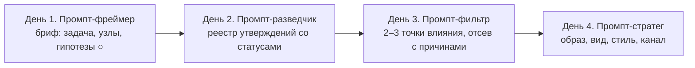

# День 3 курса «Репутационный инжиниринг»: обоснование, метод, фильтр данных и сквозные кейсы

**Документ 1 из 3.** Комплект Дня 3 (2 ноября, 18:30–20:00, онлайн, 90 минут), тема «Внутренние и внешние факторы влияния на развитие компании». Остальные документы комплекта:

- [Документ 2: структура презентации и промпты для изображений](https://github.com/G-Ivan-A/hybrid-Intelligence-lab/blob/main/research/reputation-technologies/2026-11-02-day3-presentation.md);
- [Документ 3: сценарий лектора, выход ИИ для самостоятельной работы и ответы на частые вопросы](https://github.com/G-Ivan-A/hybrid-Intelligence-lab/blob/main/research/reputation-technologies/2026-11-02-day3-lecturer-script.md).

Документ отвечает на пять вопросов.

1. Как теория заинтересованных сторон превращается в карту узлов на языке GRA: масса, дистанция, полярность?
2. Как фильтр данных из четырёх критериев — доступность, значимость, качество, возможный вред — сокращает около 10 узлов до 2–3 точек влияния?
3. Почему точка со статусом `CONFLICT` может стать приоритетом для прямого разговора, а точка со статусом `PARTIAL` опасна для публичного действия?
4. Чем точка влияния отличается от аудитории?
5. Что изменит выбор: какие новые данные и какая смена полярности заставят пересобрать список?

Опоры комплекта:

- [SSOT Дня 1](https://github.com/G-Ivan-A/hybrid-Intelligence-lab/blob/main/research/reputation-technologies/2026-10-07-day1-rationale-and-method-653.md) — стиль, механики вовлечения, значки статуса ●/◐/○;
- [обоснование Дня 2](https://github.com/G-Ivan-A/hybrid-Intelligence-lab/blob/main/research/reputation-technologies/2026-10-30-day2-rationale-and-method.md) — провенанс, статусы `VERIFIED` / `PARTIAL` / `CONFLICT`, Промпт-разведчик, реестр по трём кейсам;
- [исследовательская модель GRA](https://github.com/G-Ivan-A/hybrid-Intelligence-lab/blob/main/research/reputation-technologies/gra-research-program/00-introduction.md) и [таксономия](https://github.com/G-Ivan-A/hybrid-Intelligence-lab/blob/main/research/reputation-technologies/gra-research-program/20-taxonomy.md) — оси дистанции D1–D5, компоненты массы M1–M4, полярность и направление потока;
- [рамка решений](https://github.com/G-Ivan-A/hybrid-Intelligence-lab/blob/main/research/reputation-technologies/gra-research-program/30-decision-framework.md) — запрещённые формулировки F1–F10, критерии K1–K7 (K7 «этика и право» — порог), гейт ИИ G1–G6;
- [файл практики](https://github.com/G-Ivan-A/hybrid-Intelligence-lab/blob/main/research/reputation-technologies/gra-research-program/40-practice-and-cases.md) — три сквозных кейса, «Свой кейс», этические и правовые границы каждого кейса;
- [исследование #650](https://github.com/G-Ivan-A/hybrid-Intelligence-lab/blob/main/research/reputation-technologies/2026-09-30-course-sources-and-presentations-650.md) — источники по данным, ИИ и вовлечению.

Комплект Дня 2 на 2026-10-11 находится в открытом PR [#662](https://github.com/G-Ivan-A/hybrid-Intelligence-lab/pull/662). Ссылки на него ведут на пути в `main`, а данные Дня 2, нужные Дню 3, пересказаны здесь. Подробности — в разделе [«Ограничения и допущения»](https://github.com/G-Ivan-A/hybrid-Intelligence-lab/blob/main/research/reputation-technologies/2026-11-02-day3-rationale-and-method.md#ограничения-и-допущения).

## Главная мысль дня

**Влияние — не свойство узла, а свойство связи узла с конкретной задачей. Из десяти заметных узлов действовать стоит через два-три, и выбор каждого записан с основанием и с причиной отсева остальных.** День 2 дал реестр утверждений со статусами. День 3 задаёт к каждому узлу реестра четыре вопроса фильтра:

- можно ли дойти до узла белым каналом за срок задачи (доступность);
- изменит ли действие узла результат именно этой задачи (значимость);
- какой статус у данных, на которых держится выбор (качество);
- кому и чем может навредить контакт (возможный вред).

К 20:00 слушатель должен прийти от «работаем со всеми, кто громко говорит о нас или о рынке» к «у меня 2–3 точки влияния. Для каждой записаны статус данных, вид, стиль и канал первого шага. Отдельно записано, кого я сознательно не трогаю и что заставит пересобрать список». Это третий шаг цепочки курса «Вижу → Собираю → Выбираю → Действую». День 3 — это «Выбираю».

**Как произносить статус GRA на Дне 3.** День 3 не вводит новых положений GRA. Масса, Дистанция и Полярность работают как вопросы к узлам, а не как баллы. Сама исследовательская модель GRA возникла исключительно как авторская гипотеза фаундера о возможности структурного описания социальных и информационных связей по аналогии с физическими закономерностями. Формула — рабочая гипотеза H1, одна из конкурирующих моделей ([20-taxonomy.md, §5](https://github.com/G-Ivan-A/hybrid-Intelligence-lab/blob/main/research/reputation-technologies/gra-research-program/20-taxonomy.md#5-конкурирующие-модели-связи-h0h6)). На Дне 3 формула на экране не появляется. Фильтр не перемножает массу на дистанцию: он отсеивает узлы по очереди и записывает причину отсева. Это следует правилу таксономии — не сворачивать дистанцию в одно число ([20-taxonomy.md, §2](https://github.com/G-Ivan-A/hybrid-Intelligence-lab/blob/main/research/reputation-technologies/gra-research-program/20-taxonomy.md#2-дистанция)).

## Почему Дню 3 нужен фильтр

После Дня 2 у слушателя есть реестр на 10–15 узлов по одному кейсу. Ресурс на действие ограничен: время собственника, переговорщика, специалиста. Ниже — четыре разрыва между «знаю узлы» и «знаю, с кем действовать». Для каждого указана опора в источниках.

**1. Список заинтересованных сторон не говорит, с кем действовать.** Классическое определение стейкхолдера — любая группа или индивид, который может влиять на достижение целей организации или испытывает влияние от него `[Д3-Т1]`. Определение широкое намеренно: оно помогает никого не забыть. Но под него попадают и регулятор, и случайный комментатор. Чтобы выбрать, нужен второй шаг. Mitchell, Agle и Wood предлагают отбирать по трём атрибутам: власть, легитимность, срочность `[Д3-Т2]`. Программа Дня 3 задаёт свои три измерения: влияние на бизнес-процессы, репутацию, финансы; степень вовлечённости в дела компании; активность в коммуникации. Ниже они переведены на язык GRA.

**2. Активность в коммуникации не равна влиянию.** В сетевом анализе давно различают два вида центральности. Узел с большим числом связей (степень) отражает видимость и потенциал активности в коммуникации `[Д3-Т3]` (с. 219). Узел, который стоит на путях между другими (посредничество), имеет потенциал контроля над их коммуникацией `[Д3-Т3]` (с. 221). Эмпирически: пользователи с большим числом подписчиков не обязательно влиятельны, если считать влиянием ретвиты и упоминания `[Д3-Т5]`. Это и есть различие точки влияния и аудитории из программы.

**3. Посредник ценнее «громкого» узла.** Посредничество через структурные дыры — источник добавленной ценности, а замкнутость сети нужна, чтобы эту ценность реализовать `[Д3-Т4]`. На языке GRA это направление потока: сигнал, который приходит через доверенного посредника, идёт по потоку, а холодный контакт — против ([20-taxonomy.md, §4](https://github.com/G-Ivan-A/hybrid-Intelligence-lab/blob/main/research/reputation-technologies/gra-research-program/20-taxonomy.md#4-полярность)). В кейсе 1 это сопоставщик, в кейсе 2 — отраслевой эксперт, в кейсе 3 — специалист по восстановлению.

**4. Выбор на данных с неясным статусом повторяет ошибку Дня 2 в другой форме.** Если в реестре стоит `CONFLICT`, выбор узла «по среднему» стирает противоречие. Аналитические стандарты требуют доводить существенные расхождения до заказчика, а не сглаживать `[650:Д2]`. Если стоит `PARTIAL`, публичное действие опирается на сведение без основания. Объём таких сведений повышает уверенность, но не точность `[650:Д3]` (с. 52). Поэтому критерий «качество» берётся прямо из статусов Дня 2 и определяет **тип** первого шага: разговор, обратимая проверка, действие или отказ.

## Теория заинтересованных сторон на языке GRA

### Три измерения программы как вопросы GRA

Программа называет три измерения стейкхолдера. Каждое переводится в наблюдаемые признаки GRA. Ни одно не сворачивается в балл.

| Измерение программы | Вопрос к узлу | Что наблюдаемо на языке GRA | Типичная ошибка |
| --- | --- | --- | --- |
| Влияние на бизнес-процессы, репутацию, финансы | Что узел может сделать с нашим процессом, репутацией или деньгами за срок задачи? | Масса M1 (ресурс), M2 (позиция, полномочия), M3 (сеть), M4 (репутационный капитал). Влияние на решение M5 — отдельно от массы | Принять высокую массу за влияние на **нашу** задачу. Федеральная сеть огромна, но в 3-месячной задаче кейса 1 недоступна |
| Степень вовлечённости в дела компании | Насколько узел уже связан с нами или с задачей? | Дистанция: D3 (доверие, история взаимодействия), D5 (институциональная близость: договор, регламент, членство), D1 (время). Знак полярности и его основание | Считать вовлечённым того, кто много о нас пишет. Вовлечённость — это связь с делом, а не с темой |
| Активность в коммуникации | Как узел передаёт сигналы и кому? | D2 (канал), направление потока (кто кому передаёт), позиция посредника. Степень против посредничества `[Д3-Т3]` | Принять охват за влияние `[Д3-Т5]`. Активный узел может быть только ретранслятором |

**Внутренние и внешние факторы.** Контуры Дня 1 сохраняются: внутренний контур — сотрудники, руководство, акционеры; внешний — клиенты, партнёры, регуляторы, конкуренты, фонды развития, инфлюенсеры, СМИ. День 3 добавляет к ним одно наблюдение. **Внутренний узел часто задаёт пороги фильтра, а не становится точкой внешнего действия.** Финансовый директор в кейсе 1 задаёт порог просроченной дебиторки. Технический директор стартапа в кейсе 2 решает, какие данные можно раскрыть до соглашения о конфиденциальности. Сам специалист в кейсе 3 задаёт границы метода и список противопоказаний. Без согласования с внутренним узлом внешний выбор не состоится.

**Регулятор и среда — рамка, а не точка.** Закон о торговле (381-ФЗ, ст. 9) в кейсе 1, закон о рекламе (38-ФЗ `[653:М10]`) в кейсе 3, 259-ФЗ `[653:М12]` в кейсе 2 — это ось D5 и граница допустимого. На них не воздействуют в рамках задачи. Их учитывают при выборе вида и канала.

### Точка влияния и аудитория

| | Точка влияния | Аудитория |
| --- | --- | --- |
| Определение для курса | Узел, который сам совершает действие, меняющее результат нашей задачи, или передаёт сигнал по доверенному каналу к такому узлу | Узлы, которые потребляют контент. Их реакция агрегирована: просмотры, лайки, тональность |
| Режим | Активное воздействие: решение, рекомендация, допуск в канал, подпись | Пассивное потребление: прочитал, посмотрел, переслал |
| Что измеряем | Действие и его основание: было ли, кто совершил, со статусом | Охват и тональность — метрики со статусами Дня 2 |
| Как выглядит в карте | Короткий путь по потоку к решению; посредник между нами и решением | Много связей «от нас» и мало «к решению» |
| Пример | Специалист по восстановлению, который направил 5 клиентов (кейс 3) | Блогер с 200 тыс. подписчиков (кейс 3); 30 тыс. просмотров видео (кейс 2) |

**Тест одной фразой.** «Что конкретно этот узел может сделать для нашей задачи за её срок, и как мы узнаем, что он это сделал?» Если ответ — «прочитает» или «посмотрит», это аудитория. Если ответ — «примет решение», «порекомендует», «допустит в канал», это кандидат в точку влияния.

**Роль зависит от задачи.** Один и тот же узел может быть точкой влияния для одной задачи и аудиторией для другой. Участники бизнес-клуба в кейсе 3 — аудитория для задачи «10–20 клиентов по рекомендациям». Организатор того же клуба — точка влияния: он решает, что допустимо в канале. Поэтому роль записывается для задачи, а не для узла навсегда.

## Фильтр данных: четыре критерия

### Определения для курса

Четыре критерия названы в программе. Ниже — рабочие определения курса. Это не стандарт, а учебная операционализация: она связывает критерии с осями GRA и статусами Дня 2.

| Критерий программы | Вопрос | Опора в GRA и Дне 2 | Значения | Что отсеивает |
| --- | --- | --- | --- | --- |
| **Доступность** | Можно ли дойти до узла белым каналом за срок задачи? | Дистанция D1 (время), D2 (канал, число посредников), D3 (есть ли общий доверенный узел), D5 (регламент, тендер, членство) | открыт / через посредника (кто) / закрыт за срок задачи | Узлы, до которых можно дойти только серым путём или не за срок задачи |
| **Значимость** | Изменит ли действие узла результат **этой** задачи? | Масса M1–M4 и отдельно влияние на решение M5; роль: точка влияния или аудитория | высокая / средняя / низкая / «?» с основанием | Аудиторию и узлы, чьё действие не меняет результат задачи |
| **Качество** | Какой статус у ключевого утверждения, на котором держится выбор? | Статусы Дня 2: `VERIFIED` / `PARTIAL` / `CONFLICT` / нет данных; тип ●/◐/○; надёжность × достоверность | статус + тип | Ничего не отсеивает само по себе. Определяет **вид первого шага** |
| **Возможный вред** | Кому и чем может навредить контакт или действие? | Порог K7 «этика и право» ([30-decision-framework.md, §4](https://github.com/G-Ivan-A/hybrid-Intelligence-lab/blob/main/research/reputation-technologies/gra-research-program/30-decision-framework.md#4-выбор-между-операционализациями)); правовые границы кейсов | низкий / управляемый при условии (каком) / недопустимый | Узлы, где вред недопустим, независимо от значимости |

**Вред считается для четырёх адресатов.**

1. **Узел:** персональные данные сверх профессиональной роли, давление, конфликт интересов, риск для его профессиональной репутации. Врач, который рекомендует немедицинского специалиста, рискует своей репутацией (кейс 3).
2. **Третьи лица:** клиенты, чьи сведения могут быть раскрыты (152-ФЗ, ст. 10 `[Д3-Р1]` — сведения о здоровье).
3. **Мы:** правовой риск (реклама, персональные данные, инвестиционное законодательство), репутационный риск от публичной ошибки.
4. **Задача:** сжечь канал. Пост в клубном чате при запрете коммерческих предложений закрывает канал, который ещё не проверен (кейс 3).

### Порядок применения: отсев, а не сумма баллов

Фильтр применяется в порядке программы. Каждый выбывший узел получает причину одной строкой. Критерии не складываются в один балл.

1. **Роль.** До фильтра — тест одной фразой: точка влияния или аудитория. Аудитория выходит из воронки точек, но остаётся в карте: на Дне 4 она нужна для выбора канала.
2. **Доступность.** Узлы, закрытые за срок задачи белым каналом, переходят в резерв следующего цикла.
3. **Значимость.** Узлы, чьё действие не меняет результат задачи, выбывают. Значимость «?» без способа проверить — тоже.
4. **Качество.** Статус не отсеивает, а задаёт вид первого шага (таблица ниже). Узел без данных возвращается в сбор Дня 2.
5. **Возможный вред.** Проверяется последним, но имеет право вето: высокая значимость его не компенсирует. Это прямое следствие того, что K7 — порог, а не слагаемое.

Белая граница встроена уже в критерий доступности. Канал, который требует претекстинга, сведений о частной жизни или контактов, полученных без согласия, не считается каналом. Узел, до которого можно дойти только так, недоступен.

**Почему не сумма баллов.** Сумма позволяет купить вред значимостью и скрыть `CONFLICT` за средним. Кроме того, она смешивает порядковые оценки разной природы: «далеко по D3» и «PARTIAL» нельзя сложить, не потеряв смысл. Отсев с причиной оставляет след: через месяц видно, почему узел не выбрали, и что должно измениться, чтобы выбрали.

### Таблица статусов: тип сведения и статус данных

Две оси Дней 1–2 сохраняются и в фильтре. Тип сведения — что это за утверждение. Статус — хватает ли основания для **этого** решения.

| Значок | Тип сведения | Пример в фильтре |
| --- | --- | --- |
| ● | Факт: зафиксировано источником с провенансом | «Холдинг закупает композитные компоненты» — закупочная документация |
| ◐ | Интерпретация: вывод из фактов | «Сопоставщик знает закупщика сети» — со слов сопоставщика |
| ○ | Гипотеза: проверяется | «Специалисты по восстановлению приведут следующих клиентов» |

`VERIFIED`, `PARTIAL`, `CONFLICT` — рабочие статусы курса, а не стандарт. `VERIFIED` — служебная пометка «для этого решения достаточно», а не оценка истинности.

### Статус → действие или отказ

Программа задаёт две развилки: точка с `CONFLICT` может быть приоритетной, точка с `PARTIAL` опасна для публичного действия без проверки. Таблица ниже доводит их до конкретного шага.

| Статус ключевого утверждения | Если узел доступен и вред низкий | Если узел недоступен или вред недопустим |
| --- | --- | --- |
| `CONFLICT` | **Приоритет для прямого разговора.** Первый шаг — вопрос о причине противоречия, а не позиция. Разговор с узлом, который сам является первичным источником, снимает противоречие быстрее, чем ещё десять вторичных источников | **Отказ** от действия через этот узел. Ищем другой первичный источник; противоречие остаётся в реестре со статусом `CONFLICT` |
| `PARTIAL` | **Только обратимый шаг:** вопрос, встреча, пилот, запрос документа. Никаких публичных ссылок на неподтверждённое: письма с цитатой, слайда инвестору, поста | **Отказ** до проверки. Записываем, какой источник снимет `PARTIAL` |
| `VERIFIED` | Действие по задаче: вид, стиль, канал первого шага; образ и сообщение — День 4 | **Отказ** (вред) или выход через посредника (доступность) |
| Нет данных | Узел возвращается в сбор: Промпт-разведчик Дня 2 | Узел исключается из этого цикла; пометка «?» сохраняется. «?» — не 0 |

**Почему `CONFLICT` может стать приоритетом.** Противоречие — это узел, в котором есть информация. Если разговор с одним человеком снимает противоречие, он стоит дешевле, чем проверка десятка вторичных источников. Кроме того, вопрос о причине противоречия — профессиональный повод для первого контакта: «мы видим разные сведения, помогите понять». Он не требует ни скидки, ни обещания.

**Почему `PARTIAL` опасна для публичного действия.** Публичное действие необратимо: письмо, слайд, пост видят люди, которые проверят основание. Если основание не подтвердится, вред несёт уже не данные, а репутация автора действия. Поэтому `PARTIAL` закрывает публичное и открывает обратимое.

### Вид, стиль, канал: черновик для Дня 4

Задача требует, чтобы у каждой выбранной точки было записано, **как** начинать: вид, стиль и канал коммуникации. На Дне 3 это черновик первого шага, а не стратегия образа. Образ, слово и факты как одно сообщение — тема Дня 4. Рабочие определения:

| Элемент | Что записываем | Варианты | От чего зависит |
| --- | --- | --- | --- |
| **Вид** | Форма первого шага | Личная встреча; звонок по рекомендации; письмо; профессиональное событие (выставка, круглый стол); пилот или образец; закрытая трансляция; совместный документ (протокол, описание метода) | От статуса: `CONFLICT` → разговор; `PARTIAL` → обратимый шаг; `VERIFIED` → предложение |
| **Стиль** | Позиция и регистр | «Вопрос, а не предложение»; деловой партнёрский; экспертный доказательный (данные, протоколы, противопоказания); коллегиальный | От полярности и дистанции D4: при «?» или −1 — вопрос и данные, а не заявление |
| **Канал** | Путь сигнала | Прямой (официальный контакт); через посредника (кто именно, по потоку доверия); институциональный (закупка, конкурс, акселератор); событие | От дистанции D2, D3, D5 и направления потока: канал по потоку предпочтительнее канала против потока |

## Промпт-фильтр

### Эволюция промпта: от Фреймера к Фильтру

Цепочка промптов курса принимает на вход одну и ту же карточку кейса и добавляет к ней один шаг в день ([40-practice-and-cases.md, «Промпт-фреймер Дня 1»](https://github.com/G-Ivan-A/hybrid-Intelligence-lab/blob/main/research/reputation-technologies/gra-research-program/40-practice-and-cases.md#промпт-фреймер-дня-1)).



| Измерение | День 2: Разведчик | День 3: Фильтр | Почему меняется |
| --- | --- | --- | --- |
| Вход | Бриф Дня 1 | Реестр Дня 2 + бриф Дня 1 | Выбор опирается на утверждения со статусами, а не на гипотезы |
| Единица работы | Утверждение | Узел | День 3 выбирает, через кого действовать |
| Главный запрет | Не делать выводов о репутации и не выбирать точки влияния | Не складывать критерии в балл, не превращать «?» в 0, не выбирать больше трёх точек | Выбор — ответственность человека; ИИ раскладывает основания |
| Выход | Таблица `Узел | Ключевое утверждение | Статус | Можно ли публичное действие` | 2–3 точки с видом, стилем, каналом; отсев с причинами; игнор-лист; триггеры пересмотра | Выход Дня 3 — вход Промпта-стратега Дня 4 |

### Как пользоваться

1. Заполните блок «ВХОД»: задача из брифа Дня 1, реестр Дня 2 таблицей, карта узлов, если есть, и ограничения.
2. Вставьте промпт целиком в чат-ассистент. Подойдёт любой, в том числе GigaChat или YandexGPT; промпт не зависит от модели.
3. Прочитайте выход как черновик. ИИ — инструмент вероятностной систематизации, а не источник истины. Каждую строку таблицы сверьте со строкой реестра: G1 — ссылку открыл человек.
4. Проверьте три места, где ИИ ошибается чаще всего: охват подан как значимость; `PARTIAL` использован для публичного действия; «?» превращён в 0 или в «нейтрально». Образец таких ошибок — в [Приложении Б документа 3](https://github.com/G-Ivan-A/hybrid-Intelligence-lab/blob/main/research/reputation-technologies/2026-11-02-day3-lecturer-script.md#приложение-б-выход-ии-для-самостоятельной-работы-кейс-2).
5. Решение о 2–3 точках принимаете вы. Запишите его вместе с причинами отсева.

### Текст промпта

```text
РОЛЬ
Ты — ассистент аналитика связей. Ты работаешь в исследовательской модели GRA:
масса, дистанция и полярность здесь — вопросы к узлам, а не баллы. Твоя задача —
помочь человеку отобрать из реестра узлов 2–3 точки влияния для ОДНОЙ задачи.
Ты не источник истины. Ты раскладываешь то, что есть во входе, и показываешь,
где данных не хватает. Решение принимает человек.

ВХОД
1. Задача (из брифа Дня 1): что должно измениться, за какой срок, кто решает.
   [вставьте]
2. Реестр Дня 2 — таблица:
   | Узел | Ключевое утверждение | Статус: VERIFIED / PARTIAL / CONFLICT |
   | Можно ли публичное действие: да / нет / после проверки |
   [вставьте]
3. Карта Дня 1 по узлам, если есть: масса (M1 ресурс, M2 позиция, M3 сеть,
   M4 репутационный капитал; влияние на решение M5 — отдельно), дистанция по
   осям (D1 время, D2 канал, D3 доверие, D4 ценности, D5 институты),
   полярность (+1 / 0 / −1 / ?) и направление потока.
   [вставьте или напишите «нет»]
4. Ограничения: этика и право кейса, срок, каналы, которые мы не используем.
   [вставьте]

ПРАВИЛА
- Опирайся только на вход. Если данных нет — пиши «?». «?» — не 0 и не
  «нейтрально». Не заполняй пробел догадкой.
- Не складывай критерии в один балл и не усредняй статусы. CONFLICT остаётся
  CONFLICT, пока его не снял первичный источник.
- Охват, подписчики, просмотры, число упоминаний — не значимость.
- Только белые каналы: публичная профессиональная активность, официальные
  контакты организаций, представление общим знакомым с их согласия. Если до
  узла можно дойти только иначе, узел недоступен.
- Не делай выводов о личности, характере, мотивах людей. Если такой вывод
  напрашивается, пометь его «гипотеза низкой уверенности» и не используй как
  основание выбора.
- Не обещай результатов: сделки, выручки, рекомендации, инвестиций.
- Не выбирай больше трёх точек.

ШАГ 1. ЗАДАЧА
Перескажи задачу одной фразой: действие какого узла изменит результат и к
какому сроку. Если задача не задана или их несколько — остановись и попроси
человека выбрать одну.

ШАГ 2. РОЛЬ УЗЛА
Для каждого узла ответь: «Что конкретно этот узел может сделать для задачи за
её срок, и как мы узнаем, что он это сделал?»
- Точка влияния: сам совершает действие, меняющее результат (решение,
  рекомендация, допуск в канал), или передаёт сигнал по доверенному каналу к
  такому узлу. Назови действие.
- Аудитория: потребляет контент (прочитает, посмотрит, перешлёт).
- Рамка: регулятор или среда, задаёт границы, но не действует в задаче.
- Внутренний порог: внутренний узел, который задаёт условие для выбора
  (например, порог дебиторки).

ШАГ 3. ФИЛЬТР
Для каждой точки влияния заполни таблицу. В каждой ячейке — основание:
номер строки реестра или «?».
| Узел | Доступность: открыт / через посредника (кто) / закрыт за срок |
| Значимость для задачи: высокая / средняя / низкая / ? и на чём основана |
| Качество: статус ключевого утверждения и тип (факт / интерпретация / гипотеза) |
| Возможный вред: кому (узлу, третьим лицам, нам, задаче) и чем;
  низкий / управляемый при условии (каком) / недопустимый |

ШАГ 4. ОТСЕВ
Отсей узлы по порядку. Для каждого выбывшего — причина одной строкой:
а) аудитория или рамка, а не точка влияния;
б) недоступен белым каналом за срок задачи → резерв следующего цикла;
в) значимость для задачи низкая или «?» без способа проверить;
г) возможный вред недопустим → вето, значимость не компенсирует.

ШАГ 5. СТАТУС → ВИД ПЕРВОГО ШАГА
Для оставшихся узлов:
- CONFLICT → прямой разговор о причине противоречия. Сформулируй один вопрос,
  а не позицию.
- PARTIAL → только обратимый шаг (вопрос, встреча, пилот, запрос документа),
  без публичных ссылок на неподтверждённое. Назови источник, который снимет
  PARTIAL.
- VERIFIED → можно планировать действие по задаче.
- нет данных → вернуть узел в сбор (Промпт-разведчик).
Если узел недоступен или вред недопустим — напиши «отказ» и причину.

ШАГ 6. КОРОТКИЙ СПИСОК: 2–3 ТОЧКИ
Порядок приоритета:
1) узел, разговор с которым снимает CONFLICT, мешающий решению;
2) узел по потоку доверия (посредник, которому доверяет узел решения);
3) значимость для задачи.
Для каждой точки запиши черновик первого шага:
- ВИД: встреча / звонок по рекомендации / письмо / профессиональное событие /
  пилот или образец / закрытая трансляция / совместный документ;
- СТИЛЬ: вопрос, а не предложение / деловой партнёрский / экспертный
  доказательный / коллегиальный — и почему (полярность, дистанция D4);
- КАНАЛ: прямой / через посредника (кто) / институциональный (какой) /
  событие — и почему (дистанция D2, D3, D5, направление потока).
Образ и текст сообщения не пиши: это задача следующего шага.

ШАГ 7. СОЗНАТЕЛЬНО НЕ ТРОГАЕМ
Перечисли узлы, которые выглядят громко (охват, упоминания, большая масса),
но не прошли фильтр. Для каждого — одна строка: почему не сейчас.

ШАГ 8. ЧТО ИЗМЕНИТ ВЫБОР
Для каждой выбранной точки назови:
- какие новые данные уберут её из списка (смена статуса);
- какая смена полярности уберёт её из списка (знак или направление потока);
- какой узел из резерва войдёт на её место.

ШАГ 9. САМОПРОВЕРКА
Перед выходом проверь и отметь да / нет:
G1 — у каждой строки есть номер строки реестра или «?»;
G2 — даты взяты из реестра, а не придуманы;
G3 — тип сведения и статус указаны для каждого основания выбора;
G4 — для каждой выбранной точки назван факт, который опроверг бы выбор, и
     альтернативная точка;
G5 — ключевое основание не держится на одном источнике, повторённом много раз;
G6 — в основании выбора нет выводов о личности.

ВЫХОД
1. Задача одной фразой.
2. Таблица ролей и фильтра.
3. Список отсева с причинами.
4. 2–3 точки: статус, вид, стиль, канал, вопрос первого шага.
5. «Сознательно не трогаем».
6. «Что изменит выбор».
7. Список «?» для человека: что проверить до первого шага.
Не пиши итоговых суждений о том, «какая у кого репутация».
```

### Что делает каждый блок промпта

| Блок | Что делает | Опора |
| --- | --- | --- |
| РОЛЬ | Задаёт ИИ позицию систематизатора, а не эксперта, который выносит вердикт | `[650:Н7]`: разрешить «я не знаю» снижает галлюцинации, но не устраняет их |
| ПРАВИЛА | Переносит запреты Дней 1–2 в выбор: «?» не 0, не усреднять, охват не значимость, белые каналы, без выводов о личности, без обещаний | F7, F9, G6 ([30-decision-framework.md](https://github.com/G-Ivan-A/hybrid-Intelligence-lab/blob/main/research/reputation-technologies/gra-research-program/30-decision-framework.md#2-формулировки-запрещённые-и-допустимые)); `[Д3-Т5]` |
| ШАГ 2 | Тест одной фразой: точка влияния, аудитория, рамка, внутренний порог | `[Д3-Т3]`, `[Д3-Т5]` |
| ШАГИ 3–4 | Фильтр по программе и отсев с причиной вместо балла | Программа Дня 3; K7 — порог |
| ШАГ 5 | Статус → вид первого шага или отказ | Программа Дня 3; статусы Дня 2 |
| ШАГ 6 | Черновик вида, стиля и канала — вход Дня 4 | Программа Дня 4: выбор стратегии зависит от полярности, дистанции и массы |
| ШАГ 8 | Триггеры пересмотра: новые данные и смена полярности | Программа Дня 3: «Что изменит выбор»; Полярность(t) |
| ШАГ 9 | Самопроверка по гейту G1–G6 | [30-decision-framework.md, §5](https://github.com/G-Ivan-A/hybrid-Intelligence-lab/blob/main/research/reputation-technologies/gra-research-program/30-decision-framework.md#5-гейт-для-выводов-ии-агентов) |

## ИИ на Дне 3: ранжирование как черновик, а не как вердикт

ИИ на Дне 3 делает то, в чём он полезен: раскладывает 10–15 узлов по четырём критериям, напоминает о пропущенных клетках, предлагает формулировки вопросов. Чего он не делает: не знает, доступен ли узел на самом деле, не видит, кто кому доверяет, и не отвечает за вред. На выходе — вероятностная систематизация входа, а не знание о мире. Если ИИ пишет «эксперт К. — лучшая точка входа», это значит: «во входе есть основания, совместимые с этим выбором». Решение и проверку делает человек (F9).

Три типовые ошибки ИИ-фильтра, которые слушатели ищут в самостоятельной работе:

1. **Охват как значимость.** Модель ранжирует узлы по числу упоминаний или подписчиков, потому что эти числа есть во входе и выглядят как мера. Противоядие — шаг 2 промпта и `[Д3-Т5]`.
2. **`PARTIAL` как основание публичного действия.** Модель предлагает письмо с цитатой из непроверенного источника, потому что цитата «сильная». Противоядие — шаг 5.
3. **«?» как ноль или «нейтрально».** Модель заполняет пробел самым безопасным значением. Противоядие — правило «"?" — не 0» и шаг 9.

Время ИИ на эфире — 17 минут из 90: демонстрация Промпта-фильтра на кейсе 1 (8 минут) и самостоятельная работа с выходом ИИ по кейсу 2 (9 минут). Это в коридоре ИИ-минут исследования #650 и чуть меньше, чем на Дне 2: центр Дня 3 — выбор человека.

## Три сквозных кейса через фильтр Дня 3

Кейсы взяты из [файла практики](https://github.com/G-Ivan-A/hybrid-Intelligence-lab/blob/main/research/reputation-technologies/gra-research-program/40-practice-and-cases.md#как-устроены-сквозные-кейсы) и продолжают реестры Дня 2. В каждом кейсе:

1. задача и вход из Дня 2;
2. карта: около 10 узлов, внутренний и внешний контур;
3. фильтр: таблица по четырём критериям;
4. 2–3 точки влияния с видом, стилем и каналом;
5. кого сознательно не трогаем, несмотря на «шум»;
6. как `CONFLICT` или `PARTIAL` ведёт к действию или к отказу;
7. что изменит выбор;
8. граница: белая зона и что исключено.

Все имена и названия условные.

Обозначения в таблицах фильтра: «Дост.» — доступность; «Знач.» — значимость; «Кач.» — качество (статус ключевого утверждения); «Вред» — возможный вред.

### Кейс 1. B2B-производитель консервов: вход через тех, кто уже поставляет кандидату

**Задача и вход.** Найти 5–8 новых партнёров того же типа, что «ядро 20%», в двух соседних регионах за 3 месяца. Условия: без демпинга, просроченная дебиторка не выше порога финансового директора. Цель фаундера — сеть до 100 маржинальных партнёров — горизонт за пределами курса; темп её достижения курс не обещает (F7). Из реестра Дня 2 по региональной сети «Х» (40 магазинов):

- 4 иска поставщиков о взыскании долга за 18 месяцев, 2 — мировым соглашением (`VERIFIED` для факта исков);
- «платит день в день» из отраслевого чата (`PARTIAL`);
- «72% позитива» — 140 упоминаний, из них 96 перепостов пресс-релиза (`PARTIAL`);
- платёжная дисциплина в целом — `CONFLICT`.

Дистрибьютор, который уже поставляет сети, назван на Дне 2 первичным источником по спорному утверждению.

**Карта: 10 узлов.**

| № | Узел | Контур | Роль для задачи (тест одной фразой) |
| --- | --- | --- | --- |
| 1 | Финансовый директор | Внутренний | Внутренний порог: задаёт порог дебиторки и условия пилота |
| 2 | Дистрибьютор «Д» — поставщик сети «Х» другой категории | Внешний: посредник | Точка: снимает `CONFLICT` из первых рук и может представить нас закупщику |
| 3 | Сеть «Х»: коммерческий директор и категорийный менеджер | Внешний: кандидат | Точка: решает о вводе в матрицу и об условиях оплаты |
| 4 | Сопоставщик «С» — производитель другой категории, поставляет 6 региональным оптовикам | Внешний: посредник | Точка: рекомендует нас оптовикам, у которых он уже поставщик |
| 5 | Отраслевой чат поставщиков | Внешний | Аудитория: сообщения без авторов, источник `PARTIAL` |
| 6 | Региональные СМИ, перепечатавшие пресс-релиз сети | Внешний | Аудитория |
| 7 | Федеральная сеть | Внешний: кандидат | Точка по массе, но вход — через тендер и ассортиментный комитет |
| 8 | Мелкооптовая база «Ц», выбирает поставщика по минимальной цене | Внешний: кандидат | Точка, полярность −1 к стратегии «без демпинга» |
| 9 | Отраслевой союз | Внешний: посредник | Точка с длинным циклом |
| 10 | Логистический оператор, возит в оба региона | Внешний: посредник | Возможный посредник; данных о его связях нет |

Закон о торговле (381-ФЗ, ст. 9) ограничивает сроки оплаты продовольственных товаров торговыми сетями. Это рамка D5 для разговора об условиях оплаты, а не узел. Конкретные сроки сверяются с актуальной редакцией до встречи ([40-practice-and-cases.md, §1.7](https://github.com/G-Ivan-A/hybrid-Intelligence-lab/blob/main/research/reputation-technologies/gra-research-program/40-practice-and-cases.md#17-этика-и-право)).

**Фильтр.**

| № | Узел | Дост. | Знач. | Кач. | Вред | Итог |
| --- | --- | --- | --- | --- | --- | --- |
| 1 | Финансовый директор | открыт | высокая: его порог — условие выбора | `VERIFIED` ● (регламент) | низкий | Внутренний порог: согласовать **до** внешних шагов |
| 2 | Дистрибьютор «Д» | через знакомого (D3) | высокая: первичный источник по `CONFLICT` и мост к сети | `CONFLICT` по сети «Х» ◐ | управляемый: не просить чужих коммерческих условий | **Точка 1** |
| 3 | Сеть «Х» | через «Д» или выставку | высокая: 40 магазинов, решение о матрице | `CONFLICT` по оплатам | управляемый: пилотная партия, короткая отсрочка | **Точка 2** (после точки 1) |
| 4 | Сопоставщик «С» | через выставку, D3 средняя | высокая: путь по потоку к нескольким оптовикам сразу | `VERIFIED` ● для факта поставок (сайт «С», отгрузочные документы, которые он сам показывает) | низкий: рекомендует, а не раскрывает условия | **Точка 3** |
| 5 | Отраслевой чат | открыт | низкая: аудитория | `PARTIAL` | управляемый | Отсев (а): аудитория |
| 6 | Региональные СМИ | открыт | низкая: аудитория | `PARTIAL` (перепосты одного источника) | низкий | Отсев (а): аудитория |
| 7 | Федеральная сеть | закрыт за 3 месяца: тендер, плата за вход | высокая по массе, «?» по задаче | нет данных об условиях | управляемый | Отсев (б): резерв на горизонт цели |
| 8 | База «Ц» | открыт | низкая: полярность −1 к «без демпинга» | `VERIFIED` для практики тендеров «по цене» | управляемый: втягивает в ценовую войну | Отсев (в): готов купить, но против стратегии |
| 9 | Отраслевой союз | открыт | средняя: длинный цикл | ◐ | низкий | Отсев (в) на 3 месяца, резерв |
| 10 | Логистический оператор | открыт | «?» | нет данных | низкий | Вернуть в сбор (День 2) |

**Выбор: 3 точки влияния.**

| Точка | Статус → тип шага | Вид | Стиль | Канал |
| --- | --- | --- | --- | --- |
| 1. Дистрибьютор «Д» | `CONFLICT` → прямой разговор, снимающий противоречие | Встреча или звонок по рекомендации | «Вопрос, а не предложение»: «Как в регионе устроены расчёты сетей с поставщиками? С какими условиями вы сами работаете спокойно?» | Через знакомого, который нас связывает (D3) — по потоку доверия |
| 2. Сеть «Х» | `CONFLICT` → первая встреча об условиях оплаты; пилот — обратимый шаг | Деловая встреча + пилотная партия до первого подтверждённого платежа | Деловой партнёрский: условия на столе, без скидки как аргумента | Представление от «Д», если разговор с ним не изменил выбор; иначе — стенд сети на отраслевой выставке |
| 3. Сопоставщик «С» | `VERIFIED` → действие: просьба о рекомендации | Встреча на отраслевой выставке | Деловой партнёрский: общая логика «стабильность поставок важнее скидки», без запроса чужих условий | Событие (выставка), затем — личное представление оптовикам от «С» |

**Кого сознательно не трогаем, несмотря на шум.**

- **Отраслевой чат** громко говорит о сети «Х». Это аудитория, и именно его сообщения дали `PARTIAL`. Ни ответа в чате, ни цитаты из него.
- **«72% позитива»** — 96 перепостов одного пресс-релиза. Региональные СМИ — аудитория, не точка.
- **Федеральная сеть** — самая большая масса на карте. В 3-месячной задаче недоступна белым каналом без тендера и платы за вход. Резерв на горизонт цели «до 100 партнёров».
- **База «Ц»** готова купить сегодня. Её полярность −1 к стратегии «без демпинга»: сделка с ней — шаг против задачи.

**Как статус ведёт к действию или к отказу.** `CONFLICT` по сети «Х» не исключает сеть, а меняет порядок: сначала разговор с первичным источником (точка 1), потом встреча с сетью об условиях оплаты (точка 2). Если «Д» откажется говорить о своей практике — это **отказ** от пути через «Д», а не повод спрашивать других поставщиков о чужих договорах. Тогда `CONFLICT` снимается через документы: тексты решений по искам и свежие исполнительные производства.

**Что изменит выбор.**

- **Новые данные:** «Д» рассказывает, что задержки были до смены собственника сети, а свежих исков нет → `CONFLICT` снимается, сеть «Х» идёт со стандартным предложением и сроком пересмотра через квартал. Наоборот: свежие иски и исполнительные производства → сеть «Х» выходит из точек, на её место — оптовик из списка рекомендаций «С».
- **Смена полярности:** на встрече выясняется, что сеть давит на поставщиков промо-условиями и возвратами → знак сети к стратегии «без демпинга» становится −1, точка 2 заменяется оптовиком из резерва.
- **Внутренний триггер:** финансовый директор снижает порог дебиторки → пилоты только на предоплате; критерий «вред» для всех кандидатов пересчитывается.

**Граница.** Белая зона: публичная профессиональная активность закупщиков, реестры юрлиц, арбитражные дела, разговор с поставщиком о **его собственной** практике. Исключено: претекстинг («звонок под видом покупателя»), просьба к сопоставщику или дистрибьютору раскрыть условия чужих договоров, сведения о частной жизни ЛПР.

### Кейс 2. Deep-tech стартап: к стратегу — через заказчика и эксперта, а не через видео

**Задача и вход.** За 6 месяцев выйти на 2–3 разговора уровня инвестиционного комитета (due diligence или term sheet). Решение о том, с кем начинать, принимает основатель в течение месяца. Из реестра Дня 2:

- корпоративный фонд «ТП Венчурс» холдинга «Теплоприбор Групп»: видео «готовы входить на ранней стадии» — `PARTIAL` (F × 6, без даты, 30 тыс. просмотров);
- годовой отчёт: фокус на стадиях после выручки, ранние стадии — только через корпоративный акселератор — `VERIFIED` для отчётного года;
- холдинг закупает композитные компоненты — `VERIFIED` для факта закупок;
- отраслевой эксперт К. знает технического директора холдинга, полярность +1.

**Карта: 10 узлов.**

| № | Узел | Контур | Роль для задачи |
| --- | --- | --- | --- |
| 1 | Технический директор стартапа | Внутренний | Внутренний порог: что можно раскрыть до соглашения о конфиденциальности |
| 2 | Отраслевой эксперт К. | Внешний: посредник | Точка: второй независимый источник по видео и мост к техническому директору холдинга |
| 3 | Технический директор холдинга | Внешний: якорный заказчик | Точка: решает о пилоте; пилот — путь к корпоративному фонду по потоку |
| 4 | Корпоративный акселератор холдинга | Внешний: институт | Точка: официальный вход к фонду для ранних стадий |
| 5 | Управляющий партнёр «ТП Венчурс» | Внешний: инвестор | Точка по массе; прямой вход сейчас опирается на `PARTIAL` |
| 6 | Telegram-каналы, переславшие видео | Внешний | Аудитория |
| 7 | Венчурный фонд «Н» | Внешний: инвестор | Точка по типу; полярность «?», дистанция далеко |
| 8 | Фонд содействия инновациям | Внешний: институт развития | Точка: грант по конкурсу; полярность 0 |
| 9 | Инвестиционная платформа | Внешний | Аудитория: охват не равен массе точки влияния |
| 10 | Отраслевое издание о композитах | Внешний | Аудитория |

**Фильтр.**

| № | Узел | Дост. | Знач. | Кач. | Вред | Итог |
| --- | --- | --- | --- | --- | --- | --- |
| 1 | Технический директор стартапа | открыт | высокая: без него нет данных для пилота | ● | низкий | Внутренний порог: перечень данных до и после NDA |
| 2 | Эксперт К. | открыт, близко (D3) | высокая: посредник по потоку, независимый источник (G5) | ◐ знакомство — со слов К. | низкий | **Точка 1** |
| 3 | Технический директор холдинга | через К. | высокая: пилот → фонд по потоку | `VERIFIED` для закупок ● | управляемый: технические данные — только после NDA | **Точка 2** |
| 4 | Акселератор холдинга | открыт: публичный набор | высокая: официальный вход фонда к ранним стадиям | `VERIFIED` (годовой отчёт) | низкий | **Точка 3** |
| 5 | Управляющий партнёр фонда | закрыт для прямого входа: ранние стадии — через акселератор | высокая по массе | `PARTIAL` (видео) против `VERIFIED` (отчёт) | **недопустимый** при письме с цитатой из видео | Отсев (б, г): не сейчас; вход — через точки 3 и 2 |
| 6 | Каналы с видео | открыт | низкая: аудитория | `PARTIAL` | — | Отсев (а) |
| 7 | Фонд «Н» | далеко, тёплого входа нет | «?» | нет данных | низкий | Вернуть в сбор: мандат, портфель |
| 8 | ФСИ | открыт: конкурс | средняя: не разговор инвесткомитета, а параллельный трек | `VERIFIED` правила программы на дату | низкий | Параллельный трек, не точка этого цикла |
| 9 | Инвестиционная платформа | открыт | низкая: охват | — | управляемый: правовой «?» по 259-ФЗ | Отсев (а), «?» юристу |
| 10 | Отраслевое издание | открыт | низкая: аудитория | — | управляемый: публикация до пилота | Отсев (а); вернуться после пилота (День 4) |

**Выбор: 3 точки влияния.**

| Точка | Статус → тип шага | Вид | Стиль | Канал |
| --- | --- | --- | --- | --- |
| 1. Эксперт К. | `PARTIAL` по видео → вопрос, а не цитата | Личная встреча или звонок | «Вопрос, а не предложение»: «Есть ли у фонда холдинга сейчас интерес к ранним стадиям в композитах? Кто в холдинге отвечает за пилоты новых материалов?» | Прямой: К. близко, полярность +1 |
| 2. Технический директор холдинга | `VERIFIED` по закупкам → предложение пилотной поставки | Техническая встреча, затем пилотная поставка | Экспертный доказательный: протоколы испытаний, условия NDA; никаких заявлений об интересе фонда | Через К. (по потоку доверия), параллельно — участие в закупке холдинга |
| 3. Акселератор холдинга | `VERIFIED` по отчёту → заявка по правилам | Заявка в набор, затем интервью | Экспертный доказательный: технология, данные испытаний, без обещаний доходности (F7) | Институциональный: публичная процедура акселератора |

**Кого сознательно не трогаем, несмотря на шум.**

- **Видео на 30 тыс. просмотров** — самый громкий сигнал кейса. Каналы, которые его переслали, — аудитория. Само видео — `PARTIAL`, и пока у него нет даты, оно не основание ни для письма, ни для слайда.
- **Управляющий партнёр фонда** — самая большая масса на карте. Прямое письмо сейчас опирается на `PARTIAL` и противоречит `VERIFIED` отчёту: для ранних стадий фонд работает через акселератор. Не «никогда», а «через точки 2 и 3».
- **Инвестиционная платформа** обещает охват. Охват не равен массе точки влияния, а публичное предложение долей — правовой «?» (259-ФЗ `[653:М12]`).
- **Фонд «Н»** — «?», а не 0: вернуть в сбор и проверить мандат.

**Как статус ведёт к действию или к отказу.** `PARTIAL` по видео блокирует публичное действие — письмо с цитатой и слайд «интерес стратегического инвестора». Тот же `PARTIAL` открывает обратимый шаг: вопрос эксперту К. Это прямо следует из программы: точка с `PARTIAL` опасна для публичного действия без дополнительной проверки. Отказ записан явно: прямой контакт с управляющим партнёром в этом цикле — нет.

**Что изменит выбор.**

- **Новые данные:** найдена полная запись видео, дата свежая, в полной версии — «ранние стадии через акселератор» → `PARTIAL` снимается, `CONFLICT` с отчётом исчезает, точка 3 подтверждена. Если запись старая, а отчёт свежий — стратегия фонда сменилась (Полярность(t)), видео выходит из реестра.
- **Смена полярности:** технический директор холдинга после первой встречи видит в стартапе будущего конкурента внутреннему производству → знак −1. Точка 2 выходит, вместе с ней ослабевает путь к фонду. На её место — другой якорный заказчик из закупок отрасли, и снова через эксперта.
- **Смена направления потока:** пилот прошёл, холдинг сам передаёт сведения о результате своему фонду → управляющий партнёр становится точкой следующего цикла по потоку, а не против.

**Граница.** Белая зона: публичные выступления, отчёты, закупки, профессиональные профили, разговор с экспертом о его профессиональном знании. Исключено: личные контакты партнёров фонда без их согласия, выводы о «психотипе» по соцсетям как основание выбора (G6, r ≈ 0,29 `[653:М7]`), технические данные до NDA, обещания доходности (F7). Экспортный контроль и технологии двойного назначения — «?» к юристу до раскрытия данных ([40-practice-and-cases.md, §2.7](https://github.com/G-Ivan-A/hybrid-Intelligence-lab/blob/main/research/reputation-technologies/gra-research-program/40-practice-and-cases.md#27-этика-и-право)).

### Кейс 3. Массажист-эксперт: специалисты, которые видят результат, а не клуб и не блогер

**Задача и вход.** Закрытый пул из 10–20 постоянных клиентов за 6–9 месяцев только через рекомендации. Реклама и публичный блог исключены; закрытые эфиры и закрытые каналы допустимы. Ни обещаний излечения, ни гарантированного потока клиентов. Из реестра Дня 2:

- 12 новых клиентов за полгода, 9 из них — через двух специалистов по восстановлению после травм (`VERIFIED` для «почему», `PARTIAL` для масштаба);
- 7 из 12 — участники бизнес-клуба, но пятерых из них направил один из этих специалистов; он тоже состоит в клубе;
- клуб: модератор чата «у нас такое любят» против правил клуба, которые запрещают коммерческие предложения участникам, — `CONFLICT`.

**Карта: 10 узлов.**

| № | Узел | Контур | Роль для задачи |
| --- | --- | --- | --- |
| 1 | Сам специалист: метод, границы, противопоказания | Внутренний | Внутренний порог: «что делаю и чего не делаю» — основа любого сообщения |
| 2 | Специалисты по восстановлению А и Б (направили 9 из 12) | Внешний | Точка: рекомендуют, видят результат |
| 3 | Врачи их круга: ортопед, невролог | Внешний | Точка: рекомендация от авторитета в здоровье; знак зависит от сигнала |
| 4 | Организатор бизнес-клуба | Внешний | Точка: решает, что допустимо в канале |
| 5 | Модератор клубного чата | Внешний | Источник `CONFLICT`, но не решает правила |
| 6 | Участники клуба | Внешний | Аудитория |
| 7 | Нынешние 5 постоянных клиентов и их круг | Внешний | Точка: рекомендации по инициативе клиента |
| 8 | Блогер о здоровом образе жизни, 200 тыс. подписчиков | Внешний | Аудитория; к тому же — публичная реклама, исключённая задачей |
| 9 | Партнёрская клиника | Внешний | Точка по массе; правовой «?» |
| 10 | Агрегатор отзывов об услугах | Внешний | Аудитория |

**Фильтр.**

| № | Узел | Дост. | Знач. | Кач. | Вред | Итог |
| --- | --- | --- | --- | --- | --- | --- |
| 1 | Сам специалист | открыт | высокая | ● дипломы и сертификаты | — | Внутренний порог: описание метода и противопоказаний до любых встреч |
| 2 | Специалисты А и Б | открыт, близко | высокая: 9 из 12 | `VERIFIED` для «почему», `PARTIAL` для масштаба | управляемый: без вознаграждения за направление | **Точка 1** |
| 3 | Ортопед и невролог из круга А и Б | через А и Б | высокая, ○ гипотеза | `PARTIAL`: данных о них нет, есть только связь | управляемый: риск для репутации врача снимается прозрачными противопоказаниями | **Точка 2** |
| 4 | Организатор клуба | через специалиста А — члена клуба | средняя: канал, а не источник рекомендаций | `CONFLICT` по правилам канала | **недопустимый** при публичном шаге до разговора; низкий при разговоре | **Точка 3** — только прямой разговор |
| 5 | Модератор чата | открыт | низкая: не решает правила | заинтересованный источник | — | Отсев (в) |
| 6 | Участники клуба | открыт | низкая: аудитория | — | **недопустимый**: пост нарушит правила | Отсев (а, г) |
| 7 | Нынешние клиенты | открыт | средняя: 3 из 12 через знакомых | `VERIFIED` для пути прихода | управляемый: никаких сведений о здоровье, только канал прихода | Не точка этого цикла: не выключаем, но не тратим ресурс |
| 8 | Блогер | открыт за деньги | низкая: аудитория | — | **недопустимый**: публичная реклама исключена задачей; 38-ФЗ ст. 24 | Отсев (а, г) |
| 9 | Партнёрская клиника | через договор | высокая по массе | нет данных | «?»: лицензирование медицинской деятельности | Отсев (г) до консультации юриста, резерв |
| 10 | Агрегатор отзывов | открыт | низкая: аудитория | — | управляемый: отзывы о здоровье — 152-ФЗ ст. 10 | Отсев (а) |

**Выбор: 3 точки влияния.**

| Точка | Статус → тип шага | Вид | Стиль | Канал |
| --- | --- | --- | --- | --- |
| 1. Специалисты А и Б | `VERIFIED` («почему») → профессиональная встреча; `PARTIAL` (масштаб) → без обещаний объёма | Встреча-разбор: как устроен метод, какие противопоказания проверяются, как давать обратную связь о пациенте с его согласия | Коллегиальный: медицинский язык, границы метода, без «уникальных способностей» | Прямой: связь уже есть |
| 2. Ортопед и невролог | `PARTIAL` → обратимый шаг: знакомство без просьбы о направлении | Короткая профессиональная встреча + письменное описание метода и противопоказаний | Экспертный доказательный: «медицинский массаж от специалиста с медицинским образованием, противопоказания проверяю». Этот сигнал +1 для врача, а «народный метод» — −1 | Через специалистов А и Б: представление по потоку доверия сверху вниз — от авторитета в здоровье |
| 3. Организатор клуба | `CONFLICT` → прямой разговор о правилах | Личный разговор | «Вопрос, а не предложение»: «Что в клубе допустимо для участника, который оказывает услуги? Есть ли закрытый формат по приглашению, который правила разрешают?» | Через специалиста А — члена клуба, с его согласия |

**Кого сознательно не трогаем, несмотря на шум.**

- **Блогер с 200 тыс. подписчиков.** Самый громкий узел карты. Аудитория, а не точка влияния. Публичная реклама исключена задачей, а реклама медицинских услуг ограничена законом (38-ФЗ, ст. 24 `[653:М10]`). Самый влиятельный «маркетолог» массажиста — его ортопед, а не блогер.
- **Клубный чат и модератор.** «У нас такое любят» — заинтересованный источник против документа клуба. Пост в чате при `CONFLICT` по правилам рискует каналом, который вообще не был источником рекомендаций.
- **Агрегатор отзывов.** Публичный канал с отзывами о здоровье — правовой и этический риск (152-ФЗ, ст. 10).
- **Партнёрская клиника** — значимость высокая, но вред «?» до консультации юриста: лицензирование медицинской деятельности.

**Как статус ведёт к действию или к отказу.** `CONFLICT` по клубу делает организатора приоритетом **для разговора** и одновременно запрещает любое публичное действие в клубе до разговора. Если организатор скажет, что любые предложения участникам запрещены, — это **отказ** от клуба как канала, и он записан как результат, а не как неудача. `PARTIAL` по масштабу не блокирует встречу с А и Б, но блокирует обещания объёма: «приведу вам поток клиентов» или «направьте мне десять пациентов».

**Что изменит выбор.**

- **Новые данные:** следующие 5 новых клиентов приходят без участия специалистов → гипотеза «рекомендация идёт от тех, кто видит результат» опровергнута, точки 1 и 2 пересматриваются. Обратный случай: 20–30 случаев с известным путём клиента подтверждают её → `PARTIAL` по масштабу снимается.
- **Смена полярности:** клиент, направленный ортопедом, сообщает ему о плохом самочувствии после сеанса → знак врача становится −1. Действие — разбор случая с врачом и пересмотр противопоказаний, а не поиск нового врача.
- **Новый канал:** организатор разрешает закрытую лекцию по приглашению → клуб становится каналом (D2) для Дня 4, но точкой влияния остаётся организатор.

**Граница — самая строгая из трёх.** Белая зона: публичная профессиональная активность врачей и специалистов, правила клуба как документ, путь прихода клиента с его согласия. Исключено:

- сведения о здоровье клиентов в реестре и в разговорах с рекомендателями (152-ФЗ, ст. 10 `[Д3-Р1]`);
- медицинский массаж и договор с клиникой без проверки лицензионных требований — «?» к юристу (323-ФЗ `[653:М11]`);
- вознаграждение врачу за направление пациентов — «?» к юристу, по умолчанию не используется ([40-practice-and-cases.md, §3.7](https://github.com/G-Ivan-A/hybrid-Intelligence-lab/blob/main/research/reputation-technologies/gra-research-program/40-practice-and-cases.md#37-этика-и-право));
- обещания излечения и «уникальные способности» как факт (38-ФЗ, ст. 5 `[653:М10]`).

### Свой кейс

Слушатель может вести свой кейс вместо одного из трёх. Условия те же, что в [протоколе соисследователя](https://github.com/G-Ivan-A/hybrid-Intelligence-lab/blob/main/research/reputation-technologies/gra-research-program/40-practice-and-cases.md#свой-кейс):

- одна задача на 1–3 месяца;
- обезличивание по желанию;
- только белые источники;
- статусы, «?», опровергающее условие и H0 не убираются.

Вход Промпта-фильтра — реестр Дня 2 по своему кейсу. Если реестра нет, сначала — Промпт-разведчик. Ближайший образец: B2B-продажи → кейс 1, инвесторы и длинный цикл сделки → кейс 2, личная услуга и рекомендации → кейс 3.

### Что три кейса показывают вместе

| Кейс | Громкий узел, который не прошёл фильтр | `CONFLICT` → разговор | `PARTIAL` → что заблокировано | Внутренний порог | Выбранные точки |
| --- | --- | --- | --- | --- | --- |
| 1. Консервы | Отраслевой чат, «72% позитива», федеральная сеть | Дистрибьютор «Д» по оплатам сети «Х» | Цитата «платит день в день» как основание отсрочки | Финансовый директор: порог дебиторки | «Д», сеть «Х», сопоставщик «С» |
| 2. Deep-tech | Видео на 30 тыс. просмотров, платформа, управляющий партнёр фонда напрямую | Видео против отчёта: снимается через К. и полную запись | Письмо с цитатой, слайд для инвесторов | Технический директор: данные до и после NDA | Эксперт К., технический директор холдинга, акселератор |
| 3. Массажист | Блогер 200 тыс., клубный чат | Организатор клуба по правилам канала | Обещание объёма специалистам | Сам специалист: метод и противопоказания | Специалисты А и Б, ортопед и невролог, организатор клуба |

Общее правило трёх кейсов: **самый громкий узел почти никогда не точка влияния, а самый ценный узел почти всегда посредник по потоку доверия.** Это наблюдение по трём учебным кейсам, а не закономерность: гипотеза ○, которую слушатели проверяют на своих данных.

## Что изменит выбор: новые данные и смена полярности

Выбор Дня 3 — не решение навсегда. Программа ставит вопрос «Что изменит выбор: появление новых данных и смена полярности связей?». Ответ курса — список триггеров, записанный **до** первого шага.

| Триггер | Что меняется в фильтре | Пример |
| --- | --- | --- |
| Смена статуса: `PARTIAL` → `VERIFIED` или `CONFLICT` | Качество → вид первого шага | Полная запись видео найдена (кейс 2) |
| `CONFLICT` снят первичным источником | Узел становится точкой действия или выбывает | Разговор с «Д» (кейс 1) |
| Смена знака полярности | Значимость для стратегии; узел может выбыть | Сеть давит промо-условиями → −1 к «без демпинга» (кейс 1) |
| Смена направления потока | Канал: прямой вход становится входом по потоку | Пилот прошёл, холдинг сам передаёт сигнал фонду (кейс 2) |
| Смена массы или роли | Значимость; ЛПР ушёл — точка исчезает | Новый закупщик сети, новый организатор клуба |
| Внутренний порог изменился | Возможный вред для всех кандидатов | Финансовый директор снизил порог дебиторки (кейс 1) |
| Новый белый канал | Доступность | Выставка, закрытый формат клуба (кейс 3) |

**Правило пересмотра.** Фильтр перезапускается по триггеру и на контрольной точке задачи (например, раз в две недели). Для каждой точки заранее записан узел из резерва, который войдёт при её выбытии. Полярность — функция времени: знак, записанный в октябре, — гипотеза о ноябре ([20-taxonomy.md, §4](https://github.com/G-Ivan-A/hybrid-Intelligence-lab/blob/main/research/reputation-technologies/gra-research-program/20-taxonomy.md#4-полярность)).

## Как меняется мышление слушателя за 90 минут

| Минута | Было | Что сдвигает | Становится |
| --- | --- | --- | --- |
| 0–6 | «У меня реестр со статусами. Теперь работаем со всеми» | Вопрос «10 узлов, ресурс на 2–3: кому звоним первым?» | «Нужен способ выбирать» |
| 6–30 | «Стейкхолдеры — это список: клиенты, партнёры, регуляторы» | Три измерения программы на языке GRA; степень против посредничества; внутренний порог | «Стейкхолдер — связь с задачей. Громкий ≠ влиятельный» |
| 30–51 | «Выбираю самых крупных и самых активных» | Четыре критерия фильтра; отсев с причиной; `CONFLICT` → разговор, `PARTIAL` → не публично; точка влияния против аудитории | «Выбираю тех, через кого можно действовать белым каналом с основанием» |
| 51–68 | «ИИ подскажет, с кем работать» | Демонстрация Промпта-фильтра и поиск ошибок ИИ-фильтра | «ИИ раскладывает основания, выбор и проверка — мои» |
| 68–85 | «Выбрал — значит, решено» | Кейсы 2 и 3; кого не трогаем; «Что изменит выбор» | «Выбор — с триггерами пересмотра и резервом» |
| 85–90 | «Что делать с точками?» | Мост ко Дню 4: вид, стиль, канал → образ | «На Дне 4 строю образ под 2–3 точки, а не под всех» |

## Метод: 90 минут для пассивной вечерней аудитории

Аудитория та же, что на Днях 1–2: PR- и GR-службы промышленных корпораций и предприниматели МСП, вечер после рабочего дня, камеры выключены. Метод Дней 1–2 сохраняется: смена активности каждые 8–12 минут `[650:П3]`, закрытые вопросы в чате с вариантами А/Б/В вместо открытых `[650:П1]`, анонимный выбор против спирали молчания `[650:П7][650:П8]`.

Три паттерна микрововлечения Дня 3:

1. **Выбор узла.** `[ВОПРОС В ЧАТ: выберите узел для действия]` — закрытый выбор из двух-трёх узлов кейса. Повторяется три раза: на кейсе 2 в блоке 1, на кейсе 3 и в финале на своём кейсе. Это главный жест дня: слушатель каждый раз выбирает и называет основание.
2. **Проверка гипотезы.** Лектор называет гипотезу («федеральная сеть — главная точка, у неё самая большая масса»), слушатели голосуют, проходит ли она фильтр. Ответ разбирается по критериям.
3. **Охота на ошибку ИИ.** `[САМОСТОЯТЕЛЬНАЯ РАБОТА: примените фильтр к кейсу]` — выход ИИ-фильтра по кейсу 2 с пятью спрятанными ошибками. Номера строк — в чат.

Точки юмора — `[ЮМОР/РАЗРЯДКА]`, четыре за вечер:

- «у кого больше всех подписчиков, тот и главный» — на слайде 8;
- финансовый директор как «самый влиятельный человек, которого нет на карте стейкхолдеров» — на слайде 12;
- ортопед, а не блогер — на слайде 19;
- ИИ, который «уверенно выбрал телеграм-канал» — на самостоятельной работе.

## Поминутный тайминг

Значки акцентов: 🔥 боль · 🧭 линза фильтра и GRA · 😄 разрядка · 🤖 ИИ-микрововлечение · 🌉 мост ко Дню 4 · 🗳 чат.

| Время | Мин | Блок программы | Содержание | Акцент | Действие слушателя | Слайды (Док. 2) |
| --- | --- | --- | --- | --- | --- | --- |
| 18:30–18:36 | 0–6 | Вход | Реестр Дня 2 и вопрос-мост «с кем говорить первым». 10 узлов на кейс, ресурс на 2–3 | 🔥 🗳 | Выбор А/Б: «кому звоним первым: (А) самому крупному, (Б) тому, о ком данные противоречат» | 1–3 |
| 18:36–18:44 | 6–14 | 1. Теория заинтересованных сторон | Кто влияет на цели и на кого влияют они. Три измерения программы: влияние на процессы, репутацию, финансы; вовлечённость; активность в коммуникации | 🧭 | — | 4–6 |
| 18:44–18:52 | 14–22 | 1. Теория заинтересованных сторон | Три измерения на языке GRA. Степень против посредничества: активность ≠ влияние | 🧭 😄 🗳 | `[ВОПРОС В ЧАТ: выберите узел для действия]` по кейсу 2: (А) канал с видео, (Б) эксперт К. | 7–9 |
| 18:52–19:00 | 22–30 | 1. Теория заинтересованных сторон | Внутренние и внешние факторы: 10 узлов в каждом кейсе. Внутренний узел задаёт пороги фильтра; регулятор — рамка | 🧭 😄 | — | 10–12 |
| 19:00–19:08 | 30–38 | 2. Фильтр данных | Четыре критерия: доступность, значимость, качество, возможный вред. Воронка 10 → 2–3. Отсев с причиной, вред — вето | 🧭 🗳 | Проверка гипотезы: «федеральная сеть — главная точка кейса 1: проходит фильтр?» | 13–15 |
| 19:08–19:15 | 38–45 | 2. Фильтр данных | `CONFLICT` — приоритет для прямого разговора. `PARTIAL` — опасна для публичного действия. Действие или отказ | 🧭 🗳 | Выбор: «`CONFLICT` по клубу — (А) пост в чате, (Б) разговор с организатором, (В) отказ от клуба» | 16–17 |
| 19:15–19:21 | 45–51 | 2. Фильтр данных | Точка влияния против аудитории: активное воздействие против пассивного потребления. Тест одной фразой | 🧭 😄 | — | 18–19 |
| 19:21–19:29 | 51–59 | 2. Фильтр данных + ИИ | `[ДЕМОНСТРАЦИЯ ЭКРАНА: промпт-фильтр]` на кейсе 1: 10 → 3 точки с видом, стилем, каналом; кого не трогаем | 🤖 | В чат — одна строка выхода ИИ, которую стоит перепроверить | 20–21 |
| 19:29–19:38 | 59–68 | 2. Фильтр данных + ИИ | `[САМОСТОЯТЕЛЬНАЯ РАБОТА: примените фильтр к кейсу]` — выход ИИ по кейсу 2 с ошибками, 5 минут; разбор | 🤖 😄 | Номера строк с ошибками + 2–3 точки в чат | 22–23 |
| 19:38–19:44 | 68–74 | 2. Фильтр данных | Кейс 2: три точки с видом, стилем, каналом; кого не трогаем; `PARTIAL` → отказ от прямого письма | 🧭 | — | 24–25 |
| 19:44–19:50 | 74–80 | 2. Фильтр данных | Кейс 3: три точки; блогер и клубный чат вне фильтра; `CONFLICT` → разговор или отказ | 🧭 🗳 | `[ВОПРОС В ЧАТ: выберите узел для действия]`: (А) блогер, (Б) организатор клуба, (В) ортопед через специалистов | 26–27 |
| 19:50–19:55 | 80–85 | 2. Фильтр данных | Что изменит выбор: новые данные и смена полярности. Триггеры и резерв | 🧭 🗳 | Выбор: «ортопед сменил знак на −1 — (А) ищем другого врача, (Б) разбираем случай с ним» | 28 |
| 19:55–19:58 | 85–88 | Итог и мост | 2–3 точки с видом, стилем, каналом — вход Дня 4: образ, слово и факты как одно сообщение | 🌉 | — | 29 |
| 19:58–20:00 | 88–90 | Выход | Задание: Промпт-фильтр на своём кейсе. Вопрос на выход | 🌉 🗳 | `[ВОПРОС В ЧАТ: выберите узел для действия]` на своём кейсе: одно слово — тип узла | 30 |

Резерв времени — 2 минуты внутри кейса 3: при отставании голосование на слайде 27 снимается, лектор называет ответ сам. Демонстрацию Промпта-фильтра и самостоятельную работу сокращать нельзя: это главный практический навык вечера.

**Сверка с программой.** Каждый пункт программы получает время и практику:

- блок 1 «Теория заинтересованных сторон» — 24 минуты (6–30), кейсы 1–3 на карте узлов, вопрос в чат по кейсу 2;
- блок 2 «Фильтр данных» — 55 минут (30–85): четыре критерия, `CONFLICT` и `PARTIAL`, точка влияния и аудитория, демонстрация, самостоятельная работа, кейсы 2 и 3, «Что изменит выбор».

Второй блок длиннее, потому что в нём пять из шести формулировок программы и вся практика. Полная таблица соответствия слайдов программе — в конце [документа 2](https://github.com/G-Ivan-A/hybrid-Intelligence-lab/blob/main/research/reputation-technologies/2026-11-02-day3-presentation.md#проверка-на-соответствие-программе).

## Мост ко Дню 4

День 4 (3 ноября, 18:30–20:00, по расписанию на [странице курса](https://technograd.moscow/event_page_new?669#programm_event)) называется «Имиджевые стратегии для действия». Его программа говорит: «Выбор стратегии зависит от полярности связи, дистанции и массы в коммуникации». Выход Дня 3 — **2–3 точки влияния, у каждой записаны масса, дистанция, полярность и черновик вида, стиля и канала** — это вход Промпта-стратега Дня 4.

| Что оставляет День 3 | Где подхватывается |
| --- | --- |
| 2–3 точки влияния с основанием и статусом | День 4: стратегия встречи для каждой точки |
| Черновик вида, стиля и канала | День 4: «образ, слово и факты — одно сообщение»; согласованность образа с каналом |
| Полярность каждой точки к нашему сигналу | День 4: «подстройка или провокация?» — при отрицательной полярности провокация разрушает доверие |
| Сигналы со знаком +1 и −1 у одной и той же точки (врач в кейсе 3) | День 4: образ «свой, но заметный» |
| Внутренние пороги (финансовый директор, технический директор, сам специалист) | День 4: что образ может обещать и чего не может |
| Игнор-лист и аудитория | День 4: канал для аудитории — отдельно от стратегии для точек |

Вопрос-мост в конце Дня 3: **«Если у точки полярность −1 к нашему нынешнему образу — подстраиваемся или провоцируем?»** Домашнее задание — прогнать Промпт-фильтр на своём кейсе и принести на День 4 две-три точки с видом, стилем и каналом.

## Ограничения и допущения

**Что исправлено при самопроверке комплекта.**

1. Вид, стиль и канал коммуникации требует постановка задачи, но не программа Дня 3 — в ней этих слов нет, а образ и стратегия встречи — тема Дня 4. Поэтому на Дне 3 они записаны как **черновик первого шага**, а не как стратегия образа, и в презентации стоят в блоке «точка влияния» и в мосте ко Дню 4.
2. Четыре критерия фильтра не складываются в балл. Иначе нарушались бы правило таксономии «не сворачивать дистанцию в одно число» и порог K7: значимость не должна покупать вред.
3. В кейсе 1 дистрибьютор назван на Дне 2 первичным источником по платежам сети. Файл практики запрещает просить сопоставщиков о чужих коммерческих условиях. Поэтому вопрос к дистрибьютору ограничен его **собственной** практикой и практикой региона.
4. Комплект Дня 2 ещё не влит в `main`. Чтобы День 3 работал без него, нужные данные Дня 2 пересказаны в разделе кейсов.

**Допущения.**

- Ссылки на комплект Дня 2 ведут на пути `main` из PR [#662](https://github.com/G-Ivan-A/hybrid-Intelligence-lab/pull/662). До его слияния они не открываются.
- Даты Дней 1–4 (29 и 30 октября, 2 и 3 ноября) взяты со [страницы курса](https://technograd.moscow/event_page_new?669#programm_event) на 2026-10-11; при переносе верна дата сайта.
- Определения фильтра, точки влияния, вида, стиля и канала — рабочие определения курса, а не стандарт.
- Сети «Х», дистрибьютор «Д», сопоставщик «С», база «Ц», холдинг «Теплоприбор Групп», фонд «ТП Венчурс», эксперт К., фонд «Н», специалисты А и Б — условные.
- Правовые нормы (381-ФЗ, 38-ФЗ, 152-ФЗ, 259-ФЗ, 323-ФЗ) помечены как граница для сверки с юристом, а не как правовая консультация.
- Общее правило трёх кейсов («громкий узел почти никогда не точка влияния») — гипотеза ○ на учебных данных.

## Источники

Ссылки вида `[650:X]` ведут на проверенные записи [исследования #650](https://github.com/G-Ivan-A/hybrid-Intelligence-lab/blob/main/research/reputation-technologies/2026-09-30-course-sources-and-presentations-650.md). Ссылки `[653:X]` — на [источники Дня 1](https://github.com/G-Ivan-A/hybrid-Intelligence-lab/blob/main/research/reputation-technologies/2026-10-07-day1-rationale-and-method-653.md#источники). Ниже — сводка источников Дня 3 и новые записи комплекта. Переводы цитат наши.

| ID | Источник | Язык | Цитата или факт, на который опирается День 3 | Статус |
| --- | --- | --- | --- | --- |
| Д3-Т1 | Freeman R. E. Strategic Management: A Stakeholder Approach. 1984; переиздание Cambridge University Press, 2010. https://doi.org/10.1017/CBO9781139192675 | en | Стейкхолдер — любая группа или индивид, который может влиять на достижение целей организации или испытывает влияние от него | Страница издательства открыта (HTTP 200, 2026-10-11). Определение — по общепринятому изложению; страницу цитаты сверить по изданию перед эфиром |
| Д3-Т2 | Mitchell R. K., Agle B. R., Wood D. J. Toward a Theory of Stakeholder Identification and Salience. Academy of Management Review, 1997, 22(4). https://doi.org/10.5465/amr.1997.9711022105 | en | Значимость стейкхолдера — через три атрибута: власть, легитимность, срочность | DOI разрешается; полный текст из среды проверки 2026-10-11 закрыт проверкой браузера. Тезис — по общепринятому изложению, сверить перед эфиром |
| Д3-Т3 | Freeman L. C. Centrality in Social Networks: Conceptual Clarification. Social Networks, 1978/79, 1: 215–239. https://www.bebr.ufl.edu/sites/default/files/Centrality%20in%20Social%20Networks.pdf | en | Степень отражает «видимость или потенциал активности в коммуникации» (с. 219); узел на путях между другими имеет «потенциал контроля над их коммуникацией» (с. 221) | VERIFIED-FULLTEXT 2026-10-11: PDF открыт, цитаты сверены |
| Д3-Т4 | Burt R. S. Structural Holes versus Network Closure as Social Capital. 2000 (препринт главы в Social Capital: Theory and Research, 2001). https://snap.stanford.edu/class/cs224w-readings/burt00capital.pdf | en | «Посредничество через структурные дыры — источник добавленной ценности, но замкнутость может быть критична для реализации этой ценности» (с. 1) | VERIFIED-FULLTEXT 2026-10-11: PDF открыт, цитата сверена |
| Д3-Т5 | Cha M., Haddadi H., Benevenuto F., Gummadi K. P. Measuring User Influence in Twitter: The Million Follower Fallacy. ICWSM 2010. https://snap.stanford.edu/class/cs224w-readings/cha10influence.pdf | en | «Популярные пользователи с большим числом подписчиков не обязательно влиятельны с точки зрения ретвитов и упоминаний»; «самые связанные пользователи не обязательно самые влиятельные» | VERIFIED-FULLTEXT 2026-10-11: PDF открыт, цитаты сверены |
| 650:Д2 | ODNI. ICD 203 Analytic Standards. https://archive.dni.gov/files/documents/ICD/ICD-203.pdf | en | Признавать противоречащую информацию; доводить существенные расхождения до заказчиков | VERIFIED-FULLTEXT в #650 |
| 650:Д3 | Heuer R. J. Psychology of Intelligence Analysis. 1999. https://www.cia.gov/resources/csi/static/Pyschology-of-Intelligence-Analysis.pdf | en | Объём повышает уверенность, но не точность (с. 52) | VERIFIED-FULLTEXT в #650 |
| 650:Д5 | US Army FM 2-22.3, Appendix B. 2006. https://irp.fas.org/doddir/army/fm2-22-3.pdf | en | Надёжность A–F × достоверность 1–6 — основание статусов Дня 2, которые становятся критерием «качество» | VERIFIED-FULLTEXT в #650 |
| 650:Н7 | Anthropic. Reduce hallucinations. https://platform.claude.com/docs/en/test-and-evaluate/strengthen-guardrails/reduce-hallucinations | en | Разрешить «я не знаю», требовать опоры на источники; приёмы снижают, но не устраняют галлюцинации | VERIFIED-FULLTEXT в #650 |
| 650:Н9 | Сбер. GigaChat: промпт-инжиниринг. https://developers.sber.ru/docs/ru/gigachat/prompts-hub/prompt-engineering | ru | Промпты уменьшают вероятность выдуманных данных | VERIFIED-FULLTEXT в #650 |
| 650:П1, П3, П7, П8 | Crouch & Mazur 2001; ритм смены активности; Лукашевич 2013; Ван Цзэкай и др. 2025 — см. #650 | en/ru | Peer Instruction; смена активности каждые 8–12 минут; спираль молчания как довод за анонимный выбор в чате | VERIFIED-FULLTEXT в #650 |
| 653:М7, М8, М10, М11, М12 | Peters & Matz 2024; 152-ФЗ ст. 10.1 и ГК ст. 152.2; 38-ФЗ (https://www.consultant.ru/document/cons_doc_LAW_58968/); 323-ФЗ (https://www.consultant.ru/document/cons_doc_LAW_121895/); 259-ФЗ — см. Источники Дня 1 | en/ru | r ≈ 0,29 для выводов о личности; правовая граница сбора; реклама (ст. 5, ст. 24); граница медицинской деятельности (ст. 50); инвестиционные платформы | Страницы 38-ФЗ и 323-ФЗ повторно открыты 2026-10-11 (HTTP 200); остальное — см. День 1 |
| Д3-Р1 | Федеральный закон № 152-ФЗ «О персональных данных», ст. 10. https://www.consultant.ru/document/cons_doc_LAW_61801/ | ru | Сведения о состоянии здоровья — специальная категория персональных данных (кейс 3). Ст. 10.1 и ГК ст. 152.2 — в `[653:М8]` | Страница закона открыта (HTTP 200, 2026-10-11); текст статьи сверить юристу перед эфиром |
